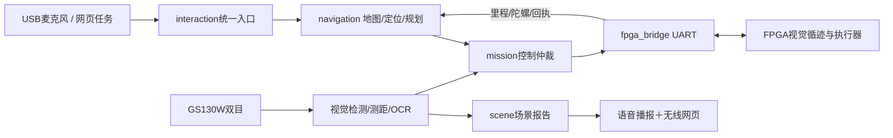

# RDK X5 消防小车：主工作区与当前入口

**2026-10-11 当前入口是 [四种任务运行节点：从启动到语音控制](docs/四种任务运行节点_从启动到语音控制.md)。** 已接入真实 GS130W 和 BPU 三类识别，新增道路斑马线观察、任务切换、显式火焰选择、短喷请求及基于实时检测的场景问答。工作目录 `/root/rescue/ros2_ws`，`task_modes.launch.py` 复用正在运行的官方 MIPI 相机和高速 YOLO。PWM、MOS、UART 执行仍默认关闭/演练，待实测标定。现已加入官方 Qwen2.5-0.5B-Instruct Q4_K_M 的 CPU 本地问答接入，权重已校验上板，运行器已在 X5 原生编译并启动；实际部署与验收进度见 [本地边缘 AI 部署与使用](docs/本地边缘AI部署与使用.md)。

先读新任务教程中的流程图与命令，再参考 [ROS 2 从零运行](../docs/02_ROS2从零运行.md) 和 [VS Code 与板端开发](docs/VSCode与板端开发_一步一步.md)。本页以下保留早期十节点通用栈的接口与部署背景；其中 `rescue.launch.py`、SBS/USB 摄像头示例不用于当前双 MIPI 运行栈，也不能和新任务栈同时启动。新功能的测试和运行记录在 `logs/task_modes_20261011/`。

地图、定位和规划在 **RDK X5**；前置单目的实时循迹、路口执行、编码器/陀螺仪/测距采样、电机和舵机在 **FPGA**。X5规划下一条道路，FPGA依靠视觉边线走在道路里。陀螺仪只提供转动信息，不能独自解决位置。

## 1. 早期通用栈功能与接口参考

| 功能 | 程序实现 | 实物阶段需要补齐 |
|---|---|---|
| 道路导航 | 实际v6地图49节点、55边、13楼；路线规划、封边重规划、编码器与陀螺定位接口、路段回执检查 | 地图配准、固定起点、传感器标定、FPGA循迹/转弯固件与阿克曼轨迹验证 |
| 双目感知 | 左右整流、SGBM、有效深度检查，三类YOLO检测接口 | GS130W内外参、同步核验、X5 BPU精度和速度验证 |
| 红绿灯 | FPGA斑马线事件→停车→云台扫描→稳定绿灯放行；红灯撤销许可 | LED灯板、曝光、云台安装/限位/运动时间 |
| 场景理解 | 轻量OCR楼号楼名＋同帧火焰/人物/消防员，单楼面关联与证据到期 | 单楼面ROI、观察姿态、实拍验证 |
| 火焰瞄准 | 图像跟踪、稳定锁定、云台修正建议与可选落点补偿 | 相机/喷嘴外参、舵机误差、实际落点标定；尚无水泵执行 |
| 语音交互 | Vosk离线中文识别、明确任务解析、eSpeak NG中文播报；USB音频接口 | 选择USB设备，测真人语音、环境噪声和回声 |
| 无线上位机 | 浏览器中文控制台、场景/状态/低频图像、任务按钮和请求反馈 | 与X5同Wi-Fi/热点，配置地址与令牌，实测网络 |

默认是**无硬件输入、UART演练、导航预览**。功能已实现不代表硬件已联调。YOLO `.bin`仍是量化精度门槛未全部通过的候选模型；桌面FP32演示不代表该BIN的实际效果。

## 2. 十个节点和常用话题

| 可执行入口 | 职责 | 主要输出 |
|---|---|---|
| stereo_camera | 从指定SBS双目取图 | /stereo/pair |
| perception | 检测与有效双目距离 | /perception/detections、/vision/frame |
| scene | OCR、楼栋关联和当前场景 | /scene/report、/scene/ocr |
| fire_aim | 火焰锁定和云台修正建议 | /fire/proposal |
| mission | 运动、红绿灯和云台唯一仲裁 | /control/motion_permission、/control/maneuver、/control/gimbal |
| fpga_bridge | CRC串口、ACK、遥测与回执翻译 | /fpga/events、/fpga/telemetry、/fpga/link |
| navigation | 道路路线、位置更新、执行门槛 | /navigation/state、/navigation/proposal |
| interaction | 语音/网页统一命令验证和任务路由 | /interaction/result、/navigation/request、/mission/request |
| voice | 离线识别和本地播报 | /interaction/command、/voice/status |
| telemetry | HTTP网页与ROS数据桥 | /interaction/command |

节点源文件在 `src/rescue_vision/rescue_vision/`，强类型消息在 `src/rescue_interfaces/msg/`。JSON话题的具体字段见各模块文档。



## 3. 文件分类

- `src/`：程序和消息，改这里再编译。
- `config/`：道路图、楼栋表、相机/云台/观察区、语音/网络参数。
- `models/yolo/`、`models/ocr/`、`models/voice/`：三类检测候选权重、轻量OCR、离线ASR。
- `web/`：网页上位机；编译时安装到ROS包的share目录。
- `tools/`：检查/安装、标定、演示、测试、打包；`tests/`和`reports/`：测试及证据。
- `docs/`：功能教程；`vendor/`：来源/许可证。

`.bin`是模型，`.blend`是设计场景，`navigation_map.json`是道路图，它们都不能替代控制程序。整车程序由launch启动。

## 4. 历史十节点通用栈的安装示例

以下是**X5 Linux终端**命令。把整个ros2_ws复制到 `~/rescue/ros2_ws`，保留config、models和web。

```bash
cd ~/rescue/ros2_ws
bash tools/check_board.sh
# 确认已有兼容的ROS 2 Humble后：
bash tools/setup_board.sh
source /opt/ros/humble/setup.bash
source .venv/bin/activate
source install/setup.bash
ros2 launch rescue_vision rescue.launch.py workspace_dir:="$PWD"
```

本项目在Ubuntu22.04 / ROS 2 Humble的隔离Linux环境验证。“RDK OS 3.5”不能代替检查实际Ubuntu/Python/ROS/BPU版本。脚本不会重刷系统；缺少ROS时先按实际板卡系统安装兼容环境。

每个新终端先执行以上三个source。保持launch运行，第二终端运行 `ros2 topic echo /interaction/result`，第三个已加载环境的终端发命令，避免错过单次结果：

```bash
ros2 topic pub --once /voice/text std_msgs/msg/String "{data: '小车去三号楼观察'}"
ros2 topic pub --once /voice/text std_msgs/msg/String "{data: '报告当前场景'}"
ros2 topic pub --once /voice/text std_msgs/msg/String "{data: '停车'}"
```

持续查看 `/navigation/state` 可见预览路线；默认不会驱动车。`/voice/text`验证的是ASR之后的逻辑，不代表麦克风识别成功。真实USB按住说话、音箱与Wi-Fi配置见功能文档。

旧 `/semantic/request` → `/navigation/semantic_goal` 仍是符号解析兼容接口。**新自动任务入口是 `/voice/text`、网页或 `/interaction/command`**，它们进入新导航链。

## 5. 历史 SBS 摄像头接口示例

按 [逐步教程](../docs/02_ROS2从零运行.md) 完成实测配置，再启用对应设备。以下设备名/分辨率仅为格式示例，SBS总宽1280对应每眼640，标定必须一致：

```bash
ros2 launch rescue_vision rescue.launch.py \
  workspace_dir:="$PWD" \
  camera_enabled:=true camera_device:=/dev/video0 \
  capture_width:=1280 capture_height:=480 \
  synchronization_verified:=true \
  detector_enabled:=true ocr_enabled:=true \
  uart_dry_run:=false uart_port:=/dev/ttyUSB0 \
  stereo_calibration:="$PWD/config/stereo.measured.json" \
  mount_config:="$PWD/config/mount.measured.json" \
  servo_config:="$PWD/config/servo.measured.json" \
  facade_config:="$PWD/config/facade.measured.json" \
  voice_config:="$PWD/config/voice.measured.json" \
  telemetry_config:="$PWD/config/telemetry.lan.json"
```

导航执行还需 `navigation_execute_enabled:=true` 和 `navigation_config:=.../navigation.measured.json`，并且地图配准、执行适配、初始定位已真实验证，请求当时有新鲜有效里程/陀螺数据。不得直接用示例起点开实车。FPGA还要实现循迹、路口转向、路段完成和断线停车。

`synchronization_verified`记录已核实的同步模式，不会让不同步摄像头自动同步。无云台角度回读时，ACK只证明收到，靠实测运动/稳定时间估算就绪，实际角度仍未知。

到计划观察点后先停车核对楼牌，再根据实测观察姿态/楼面ROI建立归属。看到楼号不等于恢复车辆位姿。底层火焰瞄准可请求 `/mission/request` 为 `{"mode":"fire"}`；这是跟踪/瞄准，不喷水。

双目输出左相机光学坐标：X右、Y下、Z前，单位米，不是喷嘴/地图坐标。壁纸测到墙面距离；命中还需外参与落点标定。人物检测不直接证明受困/伤亡，相关字段保持未知。

## 6. 学习与验证索引

- [地图定位与导航](docs/地图定位与导航.md)、[交互路线预览](reports/navigation_preview.html)
- [语音输入与播报](docs/语音输入与播报.md)、[无线网页上位机](docs/无线网页上位机.md)
- [双目标定](docs/双目标定.md)、[红绿灯联调](docs/红绿灯联调.md)
- [楼牌与场景](docs/ROS2节点与场景报告.md)、[基础UART协议](docs/UART协议与红绿灯流程.md)
- [新增FPGA遥测与路段指令](../docs/03_FPGA与X5数据清单.md)

最终汇总是 `deployment_status.json`。当前算法回归是 `reports/system_core_tests.log`；既有六节点红绿灯/UART回归是 `ros_integration.json`；十节点启动是 `launch_smoke.json`；新导航执行链是 `system_ros_integration.json`。语音/HTTP另有独立报告。桌面集成使用模拟输入与虚拟串口，不包含X5 BPU、实拍或真实行驶性能。
