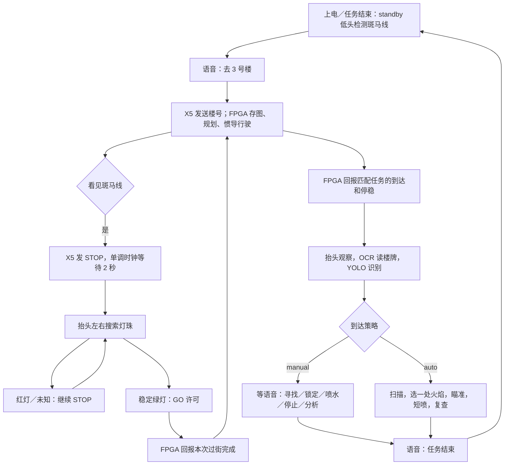

# FPGA 惯导导航版：当前分工与完整任务流程

2026-10-11 按最新要求修改。本文替代此前“X5 规划道路、FPGA 视觉循迹”的板端分工。电脑 C++ 仿真保留原算法用于比较，没有把它冒充成新 FPGA 固件。

## 1. 两块板分别做什么

| FPGA | RDK X5 |
|---|---|
| 存完整地图，计算路径，惯导定位，控制速度和转向，处理底盘障碍 | 保存楼栋编号/名字词典，理解目的地，把楼号发给 FPGA |
| 接收目标楼栋，报告接受、导航中、暂停、到达、失败 | 检测斑马线，发停车指令，等待 2 秒后抬头找红绿灯 |
| 收到 STOP 保持停车；收到有效 GO 许可按原导航任务继续 | OCR 读楼牌、YOLO 检测火焰/消防员/居民、云台瞄准、水泵 MOS |
| 报告实际停稳、急停、过街完成 | 语音任务、Qwen 场景分析、文字/网页输出 |

新任务栈启动 `fpga_navigation`，它只发送语义目标，不加载 `navigation_map.json`、不计算 Dijkstra、不下发路段转向；旧 `navigation` 节点不启动，旧 MANEUVER UART 输出也禁用。楼栋目录 A..M 对应 01..13，UART 使用数值楼号。

**不再要求视觉循迹。** FPGA 的惯导建议结合轮编码器与 IMU：只有陀螺仪无法测量平移，纯加速度二次积分也会漂移。固定起点、航向与地图尺度仍需实测。这里实现了 X5 协议和任务端，没有生成/烧录 FPGA 的导航固件。

## 2. 状态流程



`standby` 意思是开启低头斑马线观察，不会自己产生一个目的地或让车任意走。`idle` 则是明确停车保持、禁止云台继续任务；“紧急停车”进入该状态。没有标定低头角度和接通云台时，程序会报告姿态未就绪，不伪造云台动作。

## 3. 斑马线：不用等 FPGA 回传停车信息

确认斑马线后立即发布 STOP，从该时刻等待完整 2 秒。2 秒内不会抬头扫描，即使 FPGA 提前报告停稳也不提前。计时结束后可以抬头，不要求本次停车 ACK 或 STATUS。

这是**时间等待策略**，状态标注 `elapsed_time_only`。它不会把 `vehicle_stopped` 自动改成 true，因而不影响喷水所需的真实停稳检查。绿灯许可撤销后再次搜索，也会重新请求停车并等待。云台到位仍使用自身的指令执行与稳定时间；灯色多帧确认仍然有效。

串口底盘在线心跳、急停、到达和过街完成仍需要回传。它们的用途与“停车后是否等反馈才抬头”不同。GO 为有期限许可，FPGA 不应把收到目标或收到 ACK 当成通行授权。具体见 [FPGA 导航协议](FPGA导航协议_v2.md)。

## 4. 两种火场模式

默认 `manual`：到达并停稳后观察、识别、等指令。自动检测不会自行启动水泵。

`auto`：一次明确授权执行一轮，左右扫描，优先选一处最大的稳定火焰，等待标定有效的锁定，执行一次短喷，复查报告，然后待机。本轮最多处理一个目标，不因壁纸火焰始终存在而反复重新启动水泵；后续目标可再次启动一轮或用手动选择。无目标、失锁、超时、硬件未就绪会结束或阻止喷射，并报告原因。

自动/手动都沿用距离、落点补偿、真实停稳、目标身份、数据时效与泵限时控制。自动不会跳过未完成的标定；“停止喷水”“任务结束”会撤销自动授权，延迟到达的旧自动喷水请求也不能重新开泵。Qwen 输出不能直接变成控制命令。

## 5. 语音与文字指令

所有指令经过同一个解析器。当前 USB 麦克风和音箱尚未连接验证，可以先在 SSH 终端发同样的中文文字。

| 说法 | 含义 |
|---|---|
| 去三号楼观察／去春晖楼 | 向 FPGA 提交楼栋目标，沿用当前到达策略 |
| 去三号楼自动灭火 | 导航任务附带 auto 策略 |
| 去三号楼等待语音指令 | 导航任务附带 manual 策略 |
| 到达后自动找火灭火 | 设置后续目标的自动策略，不立即喷射 |
| 到达后等待语音指令 | 设置后续目标的手动策略 |
| 寻找火焰／开启识别 | 请求停车观察，开启三类 YOLO 和楼牌 OCR |
| 开始自动找火灭火 | 在当前位置启动一轮自动任务 |
| 瞄准第二个火焰 | 按当前画面可选择火焰从左到右排序，选第 2 个 |
| 瞄准二号火焰 | 按稳定跟踪 ID 选 2 号，与“第二个”不同 |
| 瞄准最左边的火焰 | 明确选择左侧目标，只瞄准 |
| 开启喷水／停止喷水 | 分别请求限时喷射／立即撤销喷射授权 |
| 对当前火场进行分析 | 读取事实并调用本地 Qwen，分析期间原控制流程不被问句打断 |
| 现在有几个人／有没有消防员／现在是几号楼 | 直接读取近期有效证据回答 |
| 任务结束 | 取消导航和自动任务、关泵、回到低头斑马线待机 |
| 紧急停车 | 停车、关泵、退出活动任务，进入 idle |

只有明确命令进入执行分支；否定、假设、多个不明确目标不会直接驱动。连续收音可配置，动作指令使用“小车”或“消防小车”前缀；明确的“停止喷水”等停止指令无需前缀。Vosk 小中文模型仍需真实语音准确率验证，播报时暂停收音以防回声触发。

```bash
cd /root/rescue/ros2_ws
export ROS_DOMAIN_ID=0 ROS_LOCALHOST_ONLY=0
source env.sh
python tools/task_command.py "去三号楼等待语音指令"
python tools/task_command.py "寻找火焰"
python tools/task_command.py --targets
python tools/task_command.py "现在是几号楼" --wait-answer
python tools/task_command.py "对当前火场进行分析" --wait-answer
python tools/task_command.py "任务结束"
```

这些命令逐条选择使用，不应把整段当作自动依次执行的任务。`accepted` 只表示任务解析接收，不意味着底盘已到达、舵机已对准或已经出水。

## 6. 楼牌识别和 Qwen 怎么结合

OCR 以单线程低频运行，复用物理左眼当前图像，并与同次采集的 YOLO 元数据关联。文字区域检测使用最大边 512 的分析图，最多处理 6 个有效文字区域；文字识别裁剪仍取原始清晰像素，坐标映射回原图，不改 YOLO 或预览画质。读取楼号/楼名后匹配目录，多帧确认。最近楼牌独立保存原采集时间，最多保留 3 秒；最新人物和火焰数量仍取最新 YOLO。

看见某块楼牌，不证明画面中所有人和火焰都属于那栋楼。报告会区分“近期读到 3 号楼牌”和“当前画面看到几个目标”。不能把 FPGA 目的地直接说成已经视觉确认的当前位置。

Qwen 收到这些文字事实生成受限观察建议；准确数量来自程序，普通事实查询不等大模型。当前 0.5B CPU 模型较慢；先前问答耗时约 27～31 秒，部署这一版后的额外 OCR 开销还需观察。没有把它称为直接看图的多模态模型。

## 7. 启动与状态查看

当前任务服务复用已运行相机和 YOLO，不再启动第二份驱动。手动重启时使用同一个服务，避免同时开两个任务管理节点。编译必须先 `source env.sh`，再用 `python -m colcon build --packages-select rescue_vision --symlink-install`；这样 ROS 程序使用已经装有 OCR、语音依赖的项目 Python 环境。

```bash
systemctl status rescue-task-modes --no-pager
journalctl -u rescue-task-modes -n 60 --no-pager
```

未使用服务时，完整参数入口是：

```bash
bash tools/run_task_modes.sh ocr_fixed_camera_preview:=true
```

`ocr_fixed_camera_preview:=true` 只用于尚未安装云台的固定相机联调，会明确标记姿态未验证。实车标定完成后改为 false。当前 UART、PWM、MOS 和 USB 音频仍按实际配置关闭；启动软件不会自动绕过它们。

观察话题：`/mission/state`、`/navigation/state`、`/fpga/tx`、`/traffic/state`、`/fire/auto/state`、`/fire/targets`、`/scene/ocr`、`/scene/report`、`/diagnostics/building_ocr`、`/voice/status`。

语音配置见 `config/voice.continuous.template.json`，接好 USB 设备后填写实际输入/输出设备并启用。节点主要位于 `src/rescue_vision/rescue_vision/`：`mission_node.py`、`fpga_navigation_node.py`、`task_interaction.py`、`voice_node.py`、`mipi_building_ocr_node.py`、`auto_fire_node.py`、`task_scene_node.py`。

板端：`/root/rescue/ros2_ws`。电脑：`D:\工程仿真\FPGA赛道_小车仿真\RDKX5_消防小车系统\ros2_ws`。

## 8. 本次部署验收

- 板端编译与最终 227 项自动测试通过，包括隔离 ROS 域中的 2 秒等待、自动/手动到达切换、过期和错目标拒绝、单次短喷、停止后不重新开泵。
- 当前相机、YOLO、预览、任务栈和 Qwen 五个服务运行正常，最后留在 `standby`，运动许可关闭、泵关闭，执行器没有真实硬件输出。
- 真实相机联调确认：楼号目标转换为 UART 模拟报文；到达策略可切换；楼牌节点与实时 YOLO 共运行，样本处理约 1.54 秒，2 个完成样本均未过期。当前画面没有可确认楼牌，因此正确回答楼号未知。
- 本地 Qwen 的本轮火场分析返回 `edge_llm_generate`，单次耗时约 13.7 秒；这是一次测量，不是每次响应时限。
- 独立离线检查中，已有地图渲染图的 `01安居楼`、`03春晖楼` 读出正确。这不是打印实拍正确率验证。
- 没有 USB 麦克风/音箱，未进行真实录音/播报；FPGA UART、云台、MOS、双目距离和水流落点仍需实物对接/标定。尚未确认低头角度时，道路观察会报告未就绪。

证据：`logs/fpga_tasks_20261011/tests_final.log`、`live_acceptance.json`、`manifest.json`；OCR 离线数据在 `reports/ocr_workload_20261011/results.json`。板端更新前备份为 `logs/fpga_tasks_20261011/before_update.tar.gz`。自动测试不替代上述实物验收。
