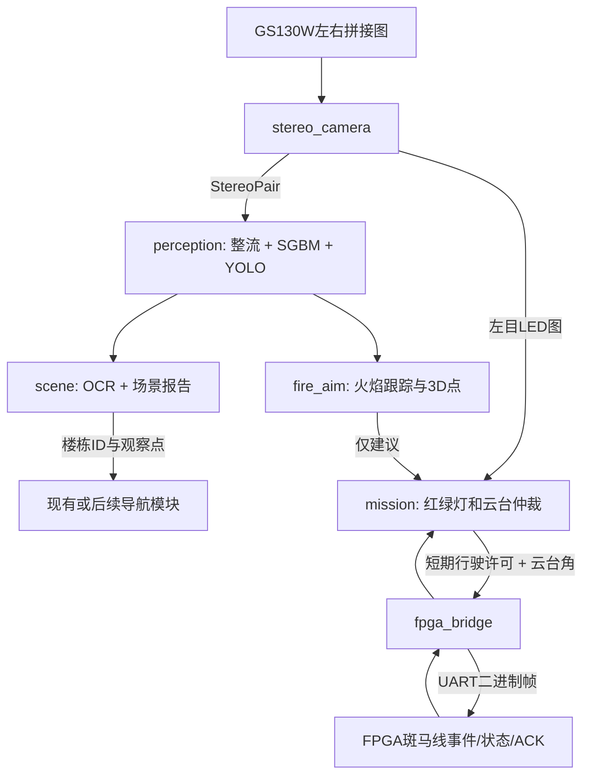

# ROS 2 实现结构与学习路线

> 更新说明：本页讲解视觉/场景及旧 `/semantic/request` 符号解析接口。新语音/网页自动任务入口为 `/interaction/command`；实际道路规划、定位接口与执行门槛见[地图定位与导航](地图定位与导航.md)和[当前主README](../README_开始使用.md)。

这份工作区包含真正的ROS 2消息包、Python节点、launch启动文件和UART收发代码。硬件独立算法与ROS适配层分开，先在电脑进行可重复验证，再填写GS130W和云台实测参数接入X5。

## 节点与话题

| 节点 | 订阅 | 发布 | 主要计算位置 |
|---|---|---|---|
| stereo_camera | 摄像头SBS设备 | `/stereo/pair` | CPU采集；左右合在一条消息中 |
| perception | `/stereo/pair` | `/vision/frame`、`/perception/detections` | CPU双目整流/SGBM，BPU YOLO |
| fire_aim | 检测结果、`/mission/state` | `/fire/proposal` | CPU跟踪/坐标变换/角度建议 |
| scene | 同sequence的整流图与检测、任务状态、`/semantic/request` | `/scene/ocr`、`/scene/report`、`/navigation/semantic_goal` | CPU PP-OCRv4和规则语义 |
| mission | FPGA事件、原始左目、火焰建议、模式请求、串口状态 | `/traffic/state`、`/mission/state`、`/control/gimbal`、`/control/motion_permission` | CPU红绿灯与任务状态机 |
| fpga_bridge | 云台指令、行驶许可、UART | `/fpga/events`、`/fpga/link`、`/fpga/tx`、UART | CPU协议；FPGA执行 |

相机、检测、FPGA事件、控制命令使用`rescue_interfaces`自定义强类型消息；语义报告和模式请求用`std_msgs/String`承载UTF-8 JSON。高流量图像采用best-effort、keep-last=1；控制消息为可靠队列。图像和识别结果以sequence与采集时间关联，不把不同画面拼成一个场景。

只有mission可以发布真正交给通信层的云台目标。fire_aim发的是建议；斑马线事件会抢占灭火瞄准，任务结束后重新建立瞄准状态。OCR节点不自行转云台。当前不含水泵执行。

## 双目坐标是什么意思

在真实标定完成并确认同步后，输出`rectified_left_optical`坐标：X向右、Y向下、Z向前，单位米。`Detection.depth_m`是Z轴深度，XYZ欧氏长度才是从左相机到采样点的斜距。它不是地图坐标，也不是喷嘴坐标。`depth_valid=false`时其数值字段不得用于运动控制。

YOLO在整流左目上检测，深度在同一张图的框内稳健采样。左右一致性、纹理、有效像素比例不过关就拒绝深度；发光灯珠和纯色墙尤其可能没有可靠视差。火焰是壁纸图案时，估计的是印刷墙面的距离，不能把图案火苗当成立体燃烧结构。

角度修正把整流视线通过R1转回物理左相机坐标；喷水落点表使用原始左目像素时也会同步变换到整流图。启用动态距离补偿需在落点JSON中明确`distance_reference: "left_camera_euclidean_m"`；必须从左相机参考原点测斜距，不能混用喷嘴距离或墙面轴向距离。当前表依然只在实测俯仰角、水压范围内有效。

## 场景理解的具体内容

报告示例含义：“读到08幸福楼的楼牌；经同帧单楼面关联，当前视野内发现火焰、2名普通人物、1名消防员；建议停车进一步观察。”

`visible_person_count`和`visible_firefighter_count`是分开的类别数量，不跨帧相加；`casualty_count`保持null，因为person类别不能判断是否受困。`fire_status`取`observed`、`not_observed`或`unknown`；没看到火焰不等于整栋楼没有火灾。

楼面关联默认关闭。要把“画面看到火焰”归属到某栋楼，必须在已验证观察点填写`facade.template.json`里的楼面ROI、图像坐标系、云台角和`observation_pose_id`，并在停车状态下请求inspect模式带同一ID。云台/底盘改变姿态会撤销该关联，不能一张矩形长期通用。没有关联证据时仍可输出`unassigned_current_view`全画面计数，但不会声称某栋楼起火。

ROS中的OCR工作线程独立于消息回调，避免OCR计算期间阻塞任务状态更新。超过有效期的楼栋/火焰证据会变为unknown。完整解释与真实样例见`reports/scene_demo.html`和`docs/楼牌与语义导航.md`。

## 语义导航的实际边界

`/semantic/request`接收例如`{"text":"去3号楼观察"}`，解析为C春晖楼和地图中的observe_C观察点；结果明确为`symbolic_goal_only`、`can_execute=false`。当前观察点来自虚拟地图的相机位置，不能直接作为实车底盘坐标。

下一层导航需要完成地图与实物配准、定位、路线规划、避障以及阿克曼行驶控制。现有包没有伪造这些硬件状态，也没有把“绿灯允许恢复FPGA循迹”当作完整自主导航。ROS负责组织通信，模型和控制算法各自承担具体任务。

## 联调所需配置

请复制template为自己的实测JSON，保留原模板用于对照：

- stereo：左右内参、畸变、R/T、米制单位、分辨率和标定质量。
- mount：机械限位、指令方向、初始角、实测速度与等待时间；勾选verified表示已完成测量。
- servo：与mount一致的方向、角度范围和home；启用后才计算云台角度建议。
- landing：喷水落点、距离定义和有效工况；不提供时只能图像锁定。
- facade：特定观察点的单楼面范围，必须随观察姿态重新确认。

`IMAGE_LOCKED`只表示图像对准。角度指令仍是命令角，不是实测角；没有反馈就输出未知。FPGA报告中`measured_angles_valid`只能在硬件确有测量时置1。
