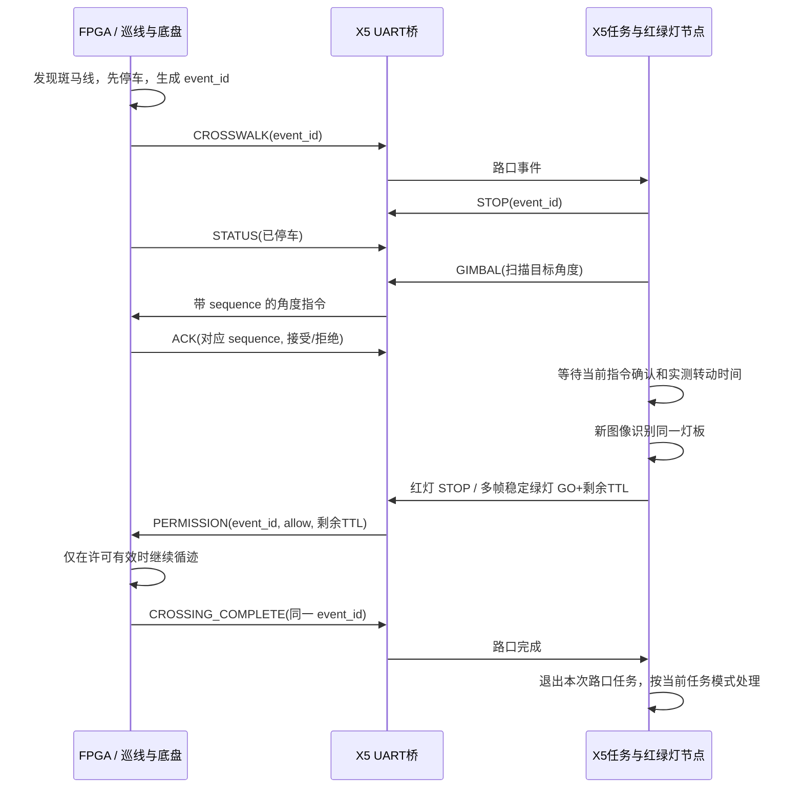

# UART 协议与红绿灯流程

本文对应 `src/rescue_vision/rescue_vision/protocol.py` 的 v1 二进制协议，给 FPGA 端编程和联调使用。它是本项目新定义的协议，**尚未烧入你的 FPGA，也没有完成真实串口、云台和车轮联调**。下面给出协议和伪代码，不提供未经实机验证的 HDL。

## 1. 整车职责

FPGA 的前置单目算法发现斑马线后，先在本地停车，并向 RDK X5 发送一次路口事件。X5 的任务节点取得云台控制权，左右扫描，确认灯板和灯珠颜色。红灯、未看清、过曝、图像过期、通信中断都不授予通行许可。稳定绿灯才发送短期许可，由 FPGA 继续执行原有视觉循迹。

**GO 的意思是“本次路口允许恢复既有循迹控制”，不是速度、导航路径或转向角指令。** FPGA 仍负责路面中线、转向、电机速度、障碍物约束和急停。收到 GO 也不能覆盖本地障碍停车条件。



## 2. 串口参数与全帧结构

默认波特率 `115200`，8 数据位、无校验、1 停止位，无硬件流控；端口与波特率可配置。必须明确填写真实串口设备，不自动猜测连接哪块板。`dry_run=true` 时仅输出发送记录，不打开串口、不执行真实硬件控制。串口电平和接线应按两块板的实际接口确认。

所有多字节整数采用**小端序**。一帧共 `10 + payload_length` 字节：

| 字节偏移 | 长度 | 字段 | 含义 |
|---|---:|---|---|
| 0 | 2 | sync | 固定 `A5 5A` |
| 2 | 1 | version | 固定 `01` |
| 3 | 1 | type | 消息类型，见下表 |
| 4 | 2 | sequence | 当前发送端的 uint16 帧序号，回绕后继续；不是路口 ID |
| 6 | 2 | payload_length | uint16，当前接收器上限 64，并校验每种类型的固定长度 |
| 8 | N | payload | 消息载荷 |
| 8+N | 2 | crc16 | CRC16，低字节先传 |

CRC 使用 **CRC-16/CCITT-FALSE**：多项式 `0x1021`、初值 `0xFFFF`、输入不反射、输出不反射、结果不异或。计算范围为 `version` 到 `payload` 末尾，即 `frame[2:8+N]`；不包含同步头和 CRC 本身。标准检查串 ASCII `123456789` 应得到 `0x29B1`。

解析器应支持一帧分多次到达、一次到达多帧、错误字节后重新寻找同步头。类型、长度、版本或 CRC 错误一律丢弃，不改变有效控制状态，不续期 GO。收到完整错误帧也不能因此暂停本地超时检查。

## 3. 消息类型和载荷

下表中的偏移从 payload 的第 0 字节开始。`i16` 表示有符号 16 位整数，`u16/u32` 表示无符号整数。

| type | 方向 | 名称 | 长度 | payload 顺序 |
|---|---|---|---:|---|
| `0x10` | FPGA → X5 | CROSSWALK | 4 | `event_id:u32` |
| `0x11` | FPGA → X5 | CROSSING_COMPLETE | 4 | `event_id:u32` |
| `0x12` | FPGA → X5 | STATUS | 8 | `flags:u16, pan_centideg:i16, tilt_centideg:i16, reserved:u16` |
| `0x13` | FPGA → X5 | ACK | 3 | `acknowledged_sequence:u16, result:u8` |
| `0x80` | X5 → FPGA | PERMISSION | 7 | `event_id:u32, allow:u8, lease_ms:u16` |
| `0x81` | X5 → FPGA | GIMBAL | 8 | `pan_centideg:i16, tilt_centideg:i16, speed_centideg_s:u16, lease_ms:u16` |
| `0x83` | 预留 | HEARTBEAT | 4 | 协议模块预留类型；当前流程不发送、不依赖，载荷语义未启用 |

### CROSSWALK 与 CROSSING_COMPLETE

`event_id` 是一次路口任务的 uint32 标识。建议从 1 开始递增，0 留给无活动路口的普通任务。持续多帧检测到同一个斑马线，只能重发**同一个** `event_id`，不能每一帧都生成新任务。帧 `sequence` 可以递增，因为它只是通信帧号。

当前 X5 会去重近期 256 个路口事件 ID；活动期间其他路口 ID 不会抢占当前任务。应通过真实“驶出本斑马线区域”的条件判断完成，例如下游位置条件与斑马线消失的组合，而不是刚收到 GO 就立刻发完成。

完成消息必须带原来的 `event_id`。当前 X5 只在该路口已处于 `RELEASED` 时接受完成事件。若已经失去许可停住，应先恢复受控通行或人工处理，不能依靠伪造完成事件跳过红灯任务。

FPGA 与 X5 复位后，应明确清理任务会话。不要在一次未完成路口中偷偷把事件计数清零，并期望另一端正确解释所有旧帧；本 v1 帧没有启动会话 UUID。

### STATUS：实际状态不能用目标值冒充

建议 FPGA 定期发送 STATUS，例如 10～20 Hz；X5 当前以约 0.5 秒作为状态新鲜性上限。

| flags 位 | 含义 |
|---|---|
| bit 0 / `0x0001` | 底盘已经停止。应根据车轮速度/执行器状态判定；刚收到 STOP 不等于机械运动已经停止 |
| bit 1 / `0x0002` | FPGA 报告云台已经稳定。只有有依据时设置，不能发完目标角就立即设置 |
| bit 2 / `0x0004` | 后续 pan、tilt 是有效的**实际角度反馈** |
| bit 3～15 | 保留，必须为 0 |

`reserved` 必须为 0。角度单位均为 0.01°，例如 `9000` 表示 90°。如果普通 PWM 舵机没有角度回读，`measured_angles_valid` 位必须是 0；此时角度字段可填 0 占位，接收端不得把它解释成测得的 0°。**不能把“命令转到90°”再作为“实际已经90°”回报。**

当前云台就绪可以采用“当前命令 ACK + 实测转动时间 + 稳定等待”的估算策略，不需要假装读到了真实角度；它与 bit 2 的实际测量是两回事。

### ACK：确认接受，不等于已经转到

ACK 的 `acknowledged_sequence` 必须是被确认的 X5 GIMBAL 帧序号，ACK 自己的帧头 sequence 仍属于 FPGA 发送序列。

- `result=0`：命令已接受。
- `result!=0`：拒绝或执行错误；当前未细分错误码，可先统一使用 1。

只有协议合法、机械限位合法、执行器可接收时才能返回成功。X5 根据命令代次和目标匹配 ACK，避免旧角度指令的迟到确认使新动作提前就绪；当前目标的拒绝 ACK 会撤销旧确认。ACK 只证明命令接受，云台仍需等待转动。

### PERMISSION：短期通行许可

`allow` 只接受 0 或 1。`lease_ms` 必须为 1～1000 毫秒；FPGA 可设置更小的本地最大值，不能接受无限期限。

- `allow=0`：立即撤销通行权限并减速停车；STOP 不能被旧的缓存 GO 覆盖。
- `allow=1`：在匹配当前路口 ID 且本地无其他停车条件时，允许继续原巡迹算法，最多持续 `lease_ms`。
- 租期到期、串口断开、CRC 错误、X5程序停止，都不能使上一次 GO 永久保留；没有更新的有效许可就停车。

X5 内部视觉许可、ROS 消息、UART 桥逐层扣除已经消耗的时间，发送的是**剩余** TTL。FPGA 的单调计时器在接收完整有效帧时建立本地到期时刻；继续考虑实际线路传输和执行延迟，不要声称通信没有任何延迟。

一次新的斑马线事件生成后，应立即废除普通巡逻许可。路口活动期间只接受本 `event_id` 的 GO；无活动路口时普通巡逻使用 `event_id=0`，旧路口 GO 不能复活已完成任务。路口完成后由 X5 的任务模式决定恢复巡逻还是继续停止，FPGA 不应自己无限直走。

### GIMBAL：目标角度和有期限的控制权

例：`pan=9000`、`tilt=9500`、`speed=3000` 分别表示目标水平 90°、目标俯仰 95°、指令速度 30°/秒。当前协议允许角度 0～180°、速度大于0且不超过180°/秒；真实机械限位通常更窄，必须额外检查。

`lease_ms` 同样为 1～1000 毫秒。任务活跃期间 X5 续发当前保持目标，即使车辆已在绿灯下行驶，也要维持相机观察姿态。租约过期应终止旧控制权、撤销就绪状态，按执行器约定保持当前姿态或停止新动作；不要擅自执行新扫描。是否保持舵机供电及力矩取决于具体硬件，应在驱动层明确，不把协议超时直接解释成突然断电。

## 4. FPGA 端参考伪代码

以下是控制逻辑示意，不是可烧录 HDL。周期性速度控制、UART 接收和 watchdog 必须独立运行；等待一帧串口期间不能停止计时。

```text
初始化:
    motion_allowed = false
    permission_deadline = 0
    active_crosswalk = NONE
    completed_event = NONE

每个控制周期:
    if local_monotonic_ms >= permission_deadline:
        motion_allowed = false
    if local_emergency OR obstacle_requires_stop:
        motion_allowed = false
    if motion_allowed:
        执行现有视觉巡迹的速度和转向控制
    else:
        执行停车控制
    周期发送 STATUS（真实停车标志、可用的实际角度信息）

斑马线可靠检测的上升沿:
    if active_crosswalk is NONE:
        active_crosswalk = 生成新的非零 event_id
        motion_allowed = false
        permission_deadline = 0
    发送 CROSSWALK(active_crosswalk)
    若需要重发，仍使用同一 event_id

收到完整UART帧:
    检查同步头、版本、已知类型、固定长度、CRC
    若不合法: 丢弃；不刷新任何许可到期时间
    若 PERMISSION:
        检查 allow 是 0 或 1，lease_ms 在 1..1000
        检查帧序列，丢弃旧的重放 GO（正确处理 uint16 回绕）
        if allow == 0:
            motion_allowed = false
            permission_deadline = 0
        else if event_id 与当前活动任务匹配:
            permission_deadline = 本地当前毫秒 + lease_ms
            motion_allowed = 没有本地障碍/急停条件
        else:
            拒绝GO；不改变旧许可到期时间
    若 GIMBAL:
        检查机械限位、速度、租期、驱动健康状态
        不合法则 ACK(当前帧sequence, 非零)
        合法则接受目标，更新云台租约，ACK(当前帧sequence, 0)
        真实反馈可用时才发送 measured_angles_valid=1

确认车身已完成通过斑马线:
    completed_event = active_crosswalk
    发送 CROSSING_COMPLETE(completed_event)
    记录该事件已经完成，拒绝之后旧事件的GO
    按需重发完成消息直到X5转入无活动路口状态
    清理活动路口任务；等待后续新的有效任务许可
```

当前 wire ACK 专用于 X5 云台指令确认，X5 没有向 FPGA 的 CROSSWALK/CROSSING_COMPLETE 自动发送对称事件 ACK；FPGA 可以通过后续 PERMISSION 的 event_id 和任务阶段判断是否进入下一阶段。完成事件重发应保持 ID 不变，具体重发次数与会话复位流程需在 FPGA 固件中明确。

## 5. 可逐字节核对的测试向量

下列完整帧由当前 `protocol.encode` 生成；末尾两个字节均为小端 CRC。它们只用于软件解析器验算，不应在未完成限位和接线确认时直接向实物发送。

| 含义 | 完整十六进制帧 |
|---|---|
| FPGA序号1：发现路口 event_id=42 | `a5 5a 01 10 01 00 04 00 2a 00 00 00 15 c3` |
| FPGA序号2：已停车，无实际角度反馈 | `a5 5a 01 12 02 00 08 00 01 00 00 00 00 00 00 00 0b 45` |
| X5序号16：云台90°/95°，30°/秒，租约300ms | `a5 5a 01 81 10 00 08 00 28 23 1c 25 b8 0b 2c 01 d8 61` |
| FPGA序号3：接受X5序号16 | `a5 5a 01 13 03 00 03 00 10 00 00 a3 73` |
| X5序号17：event42允许通行200ms | `a5 5a 01 80 11 00 07 00 2a 00 00 00 01 c8 00 64 ce` |
| X5序号18：event42立即停止 | `a5 5a 01 80 12 00 07 00 2a 00 00 00 00 c8 00 ae 81` |
| FPGA序号4：完成event42 | `a5 5a 01 11 04 00 04 00 2a 00 00 00 88 60` |

例：GIMBAL 中 `28 23` 解码为 `0x2328=9000`，即90°；`2c 01` 解码为300毫秒。GO 中 `c8 00` 为200毫秒。可以逐字节喂给 FPGA 软件仿真解析器，再故意改一位验证 CRC 拒绝，同时验证本地 watchdog 不被错误帧续期。

## 6. 灯板、安装和参数设置

默认识别布局为**竖直哑光黑色长方形背板，上红下绿**。红灯位于板宽50%、板高27%，绿灯位于板宽50%、板高73%；默认板宽/高比允许0.28～0.85。裸灯珠、绿色衣物、墙面绿色图案都不能仅凭颜色直接放行。检测同时要求暗板矩形、暗色比例、亮度、饱和度、紧凑灯珠形状、灯珠相对位置和相机ROI约束。

需要用真实 LED、GS130W、0.4～1.0 米距离与斜视角调整 `config/traffic.json`，检查灯珠过曝、暗光、反射和 PWM 闪烁。只有灯珠中央白色过曝而颜色环仍可辨时也需实测确认；当前规则对大范围板面泛白保持停车。多帧稳定绿灯和同一灯板空间关联可以减少偶然误判，但不能代替真实样本验证。

`config/mount.template.json` 初始 `mounting_verified=false`，表示还未测量，不允许直接启用扫描。请测量并设置：

- `pan_home_deg/tilt_home_deg`：实际安装的中位目标命令。
- `pan_limits_deg/tilt_limits_deg`：避开机械顶死、喷嘴和线材拉扯的有效范围。
- `pan_sign/tilt_sign`：图像/扫描方向与舵机角度正方向的关系。
- `speed_deg_s`：经实测用于等待估算的转动速度，不能仅抄空载标称速度。
- `extra_settle_s`：负载下到位后的额外稳定时间。

确认后再把 `mounting_verified` 改为 true。当前估算等待约为“目标角变化量 ÷ 配置速度 + 额外稳定时间”，第一次未知姿态使用整个限位范围估算；交通识别还会再等待稳定时间。该策略仍不能发现舵机被卡住，只有角度反馈或画面反馈能提供进一步证据。

界面显示的“目标90°”与“实际反馈90°”必须分开。实际角度不可用时显示未知，不填假值。实际联调建议先架空车轮、保持水泵断开，只观察串口记录、停车标志、云台方向与红绿灯状态，再进行低速地面穿越。
