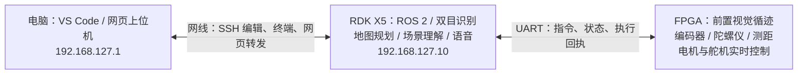

# VS Code 与 RDK X5 开发：从连接到运行

你现在可以直接在电脑上编辑 X5 内的程序。VS Code 是操作窗口；终端里启动的 Python、ROS 2 和模型推理，实际由 X5 执行。

**目前软件预览已经在 X5 后台运行，服务名为 `rescue-preview.service`，没有设置开机自启。** 想直接看上位机，可双击本目录的 `打开上位机软件预览.cmd`；想改程序，可双击 `打开VSCode远程工程.cmd`。要运行前台预览或 VS Code 启动任务，必须先在板端停止后台实例：

```bash
cd /root/rescue/ros2_ws
bash tools/preview_service.sh stop
```

## 1. 先看懂连接关系



| 项目 | 当前约定 |
|---|---|
| 电脑直连网口 | `192.168.127.1/24` |
| X5 网口 eth0 | `192.168.127.10/24` |
| SSH 名称与用户 | `rdkx5`，用户 `root`，电脑密钥登录 |
| VS Code 远程工作目录 | `/root/rescue/ros2_ws` |
| 工作目录实际位置 | `/root/rescue/system_20261010/ros2_ws`，上面的路径是指向它的快捷链接 |
| ROS 环境 | ROS 2 Humble：`/opt/ros/humble`；工程 `.venv` 复用系统 Python 包 |

MobaXterm 串口窗口用于查看启动信息、登录和网络排障；日常编辑与运行可在 VS Code 完成。网线断开会中断 SSH，串口仍可用于检查板子。

## 2. 下次怎样打开工程

1. X5 通电，保持电脑与板卡之间的网线连接。
2. 在 VS Code 按 **Ctrl+Shift+P**，输入 `Remote-SSH: Connect to Host...`，选择 **rdkx5**。
3. 在远程窗口选择“文件 → 打开文件夹”，输入 `/root/rescue/ros2_ws` 并打开。
4. 确认窗口显示 **SSH: rdkx5**。左侧文件树现在属于 X5。
5. 选择“终端 → 新建终端”。出现 `root@ubuntu:...#`，说明当前命令在板上执行。

电脑 PowerShell 中也可输入 `ssh rdkx5` 登录。它进入终端，不会自动打开 VS Code 文件树。

`Acquiring CodeLLDB platform package` 表示 C/C++ 调试扩展下载其调试组件。它与 SSH 登录是否成功是两件事；本项目的 Python ROS 2 开发先用终端和任务即可。

## 3. 第一次运行：按这个顺序

下面命令都在 **VS Code 的 X5 远程终端**执行。

**第一步：进入目录并加载环境。** 每次新建终端都做一次：

```bash
cd /root/rescue/ros2_ws
source ./env.sh
```

`source` 的意思是“让当前终端加载这组环境”。`env.sh` 负责加载 ROS、工程虚拟环境，以及已有的编译产物；关闭终端后，新终端仍需再加载。

**第二步：编译工程。** 首次使用、修改程序后都运行：

```bash
bash tools/build_board.sh
source ./env.sh
```

编译把 `src` 中的程序和消息接口安装到 `install`，供 ROS 找到。当前使用普通安装方式；修改源代码后，应重新编译，停止旧进程再启动，才能确保运行新版本。

**第三步：启动前台软件演练。** 若后台仍在运行，先停止它：

```bash
bash tools/preview_service.sh stop
bash tools/run_board_preview.sh
```

这个终端会持续显示日志，属于正常运行。保持它打开；按 **Ctrl+C** 停止本次启动。默认使用 UART `dry-run`、导航预览，并关闭真实硬件输入，不会向实际底盘下发运动指令。

希望关闭终端后继续演练，可先用 Ctrl+C 停止前台，再使用后台管理命令：

```bash
bash tools/preview_service.sh start   # 临时后台启动，不设置开机自启
bash tools/preview_service.sh status  # 查看状态
bash tools/preview_service.sh logs    # 查看日志
bash tools/preview_service.sh stop    # 停止后台预览
```

**第四步：新开第二个远程终端，观察节点和话题。**

```bash
cd /root/rescue/ros2_ws
source ./env.sh
ros2 node list
ros2 topic list
ros2 topic echo /interaction/result
```

“节点”是分工运行的程序；“话题”是程序间发送数据的通道。最后一行持续显示任务接收结果；按 Ctrl+C 只停止当前观察命令。

**第五步：再开一个已加载环境的终端，发送文字任务。**

```bash
ros2 topic pub --once /voice/text std_msgs/msg/String "{data: '小车去三号楼观察'}"
```

在第二个终端看接受或拒绝原因，也可查看 `/navigation/state`。文字输入用于先验证“识别后的句子 → 任务 → 路线”这条链路，不代表 USB 麦克风已启用。默认路线属于软件预览，车辆不会自行出发。

## 4. 也可以点击 VS Code 任务

按 **Ctrl+Shift+P → Tasks: Run Task**，选择：

| 任务名称 | 用途 |
|---|---|
| `Rescue: build on X5` | 在板上编译当前工程 |
| `Rescue: unit tests` | 执行单元测试，检查核心逻辑 |
| `Rescue: launch software preview` | 前台启动软件演练；在任务终端 Ctrl+C 停止 |

避免同时启动两套整车程序。运行启动任务前，先执行 `bash tools/preview_service.sh stop`；若另有前台预览，先 Ctrl+C 停止它。修改代码后先重新编译，再重新启动预览。

## 5. 打开电脑上的网页上位机

最方便的方式是双击电脑本目录的 **`打开上位机软件预览.cmd`**。它通过 `open_dashboard.ps1` 启动板端后台预览和 SSH 隧道，供浏览器访问。

当前板端预览使用 **`127.0.0.1:18088`**，SSH 转发也是“电脑 **18088** → X5 **18088**”。浏览器打开：

**http://127.0.0.1:18088/**

这里的 `127.0.0.1` 指浏览器所在的电脑。数据通过现有 SSH 网线连接到 X5；无需把板端网页直接开放给整个校园网络。

若页面打不开：先执行 `bash tools/preview_service.sh status` 看后台状态，或确认前台预览仍在运行。自动脚本已建立隧道时，不必在 VS Code 重复转发。手动使用“端口 / Ports”时，远程与本地都设 **18088**；HTTP 的 Host 校验要求两边保持同端口。

若网页提示输入访问令牌，在 X5 终端执行下面命令，把输出复制进页面。教程不记录实际令牌，也不要把令牌放到代码仓库或公共群：

```bash
cat ~/.local/state/rescue_robot/dashboard.token
```

原始 `config/telemetry.json` 仍保留 **8088**，供原 launch 和测试使用。日常请用上述板端预览脚本或快捷入口，避免混用两套端口配置。

## 6. 文件应该看哪里

以下路径均相对于 `/root/rescue/ros2_ws`：

| 文件或目录 | 你可以做什么 |
|---|---|
| `src/rescue_vision/rescue_vision/` | 学习和修改导航、视觉、语音、任务管理、串口等节点 |
| `src/rescue_interfaces/msg/` | 查看各节点之间传递的数据结构；修改后必须重新编译 |
| `config/` | 查看地图、楼栋、相机、语音、网络等参数；运行后改配置通常需要重启对应程序 |
| `models/yolo/` | 火焰、人物、消防员检测模型 |
| `models/ocr/` | 楼牌文字识别模型 |
| `models/voice/` | 离线中文语音识别模型 |
| `web/` | 网页上位机；修改后重新编译并刷新页面 |
| `tests/`、`reports/` | 核心测试与验证报告 |
| `docs/` | 各功能学习文档 |

**Windows 上的副本与 X5 工程不会自动同步。** 远程窗口 Ctrl+S 保存到 X5；本地窗口 Ctrl+S 保存到电脑 D 盘。确认左下角连接标识，避免改错版本。后续可用 Git 管理两边的修改，或明确地上传/下载文件；不要以为两边目录同名就会同步。

## 7. 开发时怎样判断问题

| 现象 | 先检查 |
|---|---|
| SSH 超时 | X5 电源、网线、电脑网口地址；串口执行 `ip -br -4 addr` 看 eth0 是否仍为 `192.168.127.10/24` |
| `ros2: command not found` | 是否进入 X5 终端，并在工程目录执行了 `source ./env.sh` |
| 提示找不到工程包 | 是否编译完成，再次加载 `env.sh`；不要把电脑 PowerShell 当成板端终端 |
| 修改后效果没变 | 是否重新编译并停止、重启旧程序 |
| 没有相机图像或语音 | 默认演练未启用这些硬件；应逐项配置设备后测试 |
| 板上下载依赖跳到登录页 | 校园网络认证问题。本次依赖经电脑离线准备安装；无需关闭 TLS 校验 |

## 8. 目前在这台 X5 验证到了哪里

板端已经通过：**2 个包编译、85 项单元测试、10 节点启动、17 项 ROS/伪串口检查、28 项导航/伪串口检查和 16 项 HTTP 检查**。伪串口使用软件模拟输入输出，尚未连接真实 FPGA 验证协议。

真实 BPU 已完成 3 次合成图样例推理，forward 约 **28 ms**；这是模型单次前向计算时间，不能当成整车端到端帧率或实拍精度。OCR 样例读到“08 幸福楼”和“消防救援”；Vosk 的 6 条合成录音通过语义测试。

**实摄画面、USB 麦克风/音箱、真实 FPGA 和底盘仍待联调。** 初学时按“软件预览 → 相机画面 → 模型结果 → USB 语音 → UART 遥测 → 底盘执行”的顺序学习。
