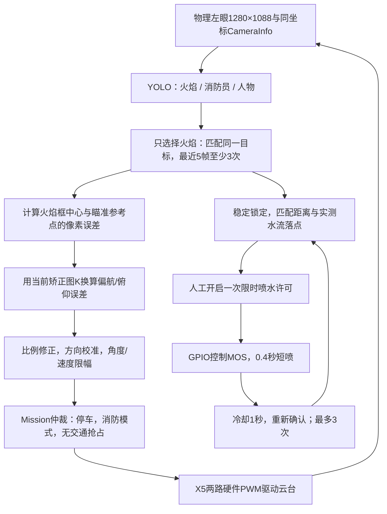

# X5 本地云台与水泵：接线依据及联调边界

本页记录 2026-10-11 的 X5 本地执行器实现与联调方法。三类视觉识别已经开启，二维云台硬件PWM、GPIO水泵驱动、任务仲裁和限时喷水代码已经加入工程。当前配置为干跑；没有使能 PWM、请求 GPIO 或启动水泵。舵机型号、工作电压、脉宽范围和水泵/MOS 模块仍需按实物确认。

电脑代码在 `D:\工程仿真\FPGA赛道_小车仿真\RDKX5_消防小车系统\ros2_ws`；板端代码在 `/root/rescue/ros2_ws`。VS Code 通过 SSH 打开后者即可开发。

已在X5完成44项测试（底层I/O用模拟对象、隔离ROS域83做节点联调），并在正式ROS域0启动默认干跑检查了消息连接、正确CameraInfo、泵关闭和PWM未导出。验证后已停止干跑控制服务，避免在硬件未接好时占用视觉算力；相机、三类YOLO和8086网页继续运行。测试记录在 `logs/local_fire_control_20261010/`，目录保留跨日开始时的日期。

## 先理解它怎样瞄准

新增双目测距与喷嘴几何补偿见 [双目测距与喷嘴角度补偿](双目测距与喷嘴角度补偿_使用说明.md)。本地消防启动器现在包含独立 `stereo_depth` 节点；标定有效时，`fire_aim` 从 `/perception/depth_detections` 取得同帧距离。实测落点优先，喷嘴几何补偿次之，二者不叠加。



默认瞄准目标是YOLO火焰框中心的平滑位置，不是火焰根部的精确分割。检测消防员和人物不会使云台瞄向他们。没有落点标定但已完成喷嘴几何标定时，使用距离相关的喷嘴射线参考点；两种标定均缺失时使用画面中心。仅几何补偿仍不能授权喷水。

像素坐标 `(u,v)` 通过当前镜头参数换成视线：`x=(u-cx)/fx`、`y=(v-cy)/fy`，偏航约为 `atan(x)`、俯仰为 `atan2(-y,sqrt(1+x²))`。目标与参考点两条视线的角差，经比例系数和速度限制转换为下一次目标角；再拍照、再修正，形成闭环。普通舵机并不返回真实角度，所以这个闭环靠后续图像判断纠偏效果。

同一云台上的摄像头与喷嘴仍有位置差，水流还受距离、压力和重力影响。应在至少两个实测距离记录“水流实际打在图像哪个像素”，瞄准时把火焰移到该落点，而不是一律移到画面中心。当前采用距离内插表，超出已测距离拒绝喷水；不是全姿态弹道模型。更换喷嘴安装、泵电压、压力或明显改变俯仰工作范围后需要重新标定。

## 两路硬件 PWM 已经具备

当前方案直接用 X5 的两路硬件 PWM 驱动云台信号，不需要额外 PWM 扩展板。舵机电源仍需独立供电，不能把“直接接 X5 信号”理解为用 GPIO 或板载电源带动舵机。

| 用途 | X5 的物理针脚（BOARD 编号） | 官方功能 | 本机控制器及通道 |
|---|---:|---|---|
| 云台水平舵机信号 | 32 | PWM6 / LSIO_PWM_OUT6 | `34170000.pwm`，通道 0 |
| 云台俯仰舵机信号 | 33 | PWM7 / LSIO_PWM_OUT7 | `34170000.pwm`，通道 1 |
| 公共参考地 | 官方针脚图中标明的 GND | GND | X5、舵机电源及信号接收端共地 |
| 舵机正电源 | 独立稳压供电 | 按舵机额定电压 | 电流能力按两只舵机堵转/峰值电流核算 |
| 水泵控制 | 待选定 MOS 模块后指定空闲 GPIO | 仅提供控制信号 | 不得接 PWM32/33，也不得连接泵功率端 |

“物理 32/33”不是 Linux GPIO 编号，也不是 `pwmchip32/33`。本机安装的 `Hobot.GPIO 0.0.2` 的 `RDK_X5_PIN` 表、官方 PWM3 说明、当前内核 pinmux 三者一致。

本次检查读到：

```text
/sys/class/pwm/pwmchip0/device/uevent
  DRIVER=drobot-pwm
  OF_FULLNAME=/soc/a55_apb0/pwm@34170000
  OF_ALIAS_0=pwm3
  npwm=2

pin 41 (lsio_i2c1_scl): 34170000.pwm ... group pinctrl_pwm3_0
pin 42 (lsio_i2c1_sda): 34170000.pwm ... group pinctrl_pwm3_1
```

两路目前没有导出的 `pwm0/pwm1`，debug PWM 状态没有 request、周期/占空比均为零。这里 pin41/pin42 是内核 pinctrl 编号，**不是接线用的物理针脚**。

控制器枚举号会变化，程序应按 `device/uevent` 中的 `34170000` 地址确认控制器，不应永久写死 `pwmchip0`。另一个 `pwmchip2` 指向 `34110000.lpwm`；这是 LPWM 控制器，不能当作此处云台的 PWM3，当前相机使用 LPWM 同步触发。

## 电平及供电

官方说明：40PIN GPIO 为 **3.3 V 逻辑，最大耐压 3.46 V**。舵机信号输入是否接受 3.3 V，必须查所买舵机的资料；不接受则加正确的电平转换。不得向 X5 GPIO 回灌 5 V。

PWM 频率和高电平脉宽以舵机型号为准；常见 50 Hz / 1–2 ms 只能作为示例，不能据此把未知舵机直接扫到极限。先拆下负载或舵盘，在中位附近小幅调节，确认正负方向和机械限位。

水泵接独立的合适电源及 MOS 驱动功率端；X5 GPIO 只控制 MOS 模块输入。驱动模块应明确支持 3.3 V 高电平，并具备适合电感负载的续流保护。外部硬件应保证上电/重启/高阻时默认关闭，例如与模块极性匹配的下拉或上拉；低电平有效模块不能套用高电平有效接法。

**硬件 PWM 和 GPIO 可能在进程停止后继续保持输出。** `finally`、ROS shutdown、systemd 重启均不能保证在 `SIGKILL`、内核故障或程序卡死时及时断泵。可靠方案需独立的限时断电/单稳态或硬件看门狗：软件发出许可仍须在硬件最大时间内断开。硬件看门狗不能由一条脱离程序持续振荡的 PWM 冒充“软件还活着”。未落实独立截止前，仅使用 LED/示波器做自动喷水逻辑联调。

## 软件只保留一个实际执行者

已实现的命令关系：

```text
fire_aim（产生瞄准建议） ──→ mission（消防/红绿灯/人工停止仲裁）
                                         │
                                  /control/gimbal
                                         │
                         X5 本地 actuator（唯一 PWM/GPIO 写入者）
                                         │
                                  /actuators/state

fpga_bridge：底盘 UART、停车状态、导航与急停信息
```

`local_fire_control.launch.py` 已设置 `gimbal_transport=x5`、`fpga_bridge.gimbal_enabled=false`，禁止同一命令再由FPGA执行。Mission读取 `/actuators/state`，包括命令是否接受、目标角度、预计稳定状态；不会伪造 `/fpga/link` ACK。FPGA仍提供底盘停车状态及交通事件，X5直接产生舵机PWM和水泵GPIO。

普通舵机只有控制输入，没有角度回读。成功写入 PWM 代表指令已输出，不代表实际角度到位；经过实测运动时间等待后只能标作“预计稳定”。

## 图像坐标必须使用同一套几何

当前高清检测的 `frame_id` 为 `undistorted_left_optical`。它做了单目去畸变，`rectified=false` 表示尚未验证双目校正，不能因此套用原始畸变图的 K/D。

此次已修正 `fire_aim_node.py` 的选择逻辑。高清视觉发布可靠、保留最新值的 `/vision/camera_info`，传递有效K、D=0、尺寸和frame_id；火焰节点严格检查它们。当前矫正图缺少匹配CameraInfo时，停止产生有效瞄准建议，不退回原始图K/D。旧raw和经过验证的双目rectified路径仍有独立处理。

水流落点也必须处于同一图像坐标空间。旧表若记录原始图像像素，需按当前去畸变映射转换，不能直接作为高清预览的瞄准点。喷嘴与相机同云台不等于光轴重合；没有实际落点标定时只能说“火焰图像锁定”，不能宣称准确命中。

云台进入预计稳定状态后，用于锁定的图像还应采集于稳定时间之后，不能拿运动过程中的旧图做喷水依据。

## 最小联调顺序

1. 用离线/仿真输出跑通命令仲裁与状态显示，确认云台实际执行者只有一个。
2. 舵机及水泵断开，示波器/逻辑分析仪检查物理 32/33 的周期、脉宽和默认状态。
3. 独立供电连接一只空载舵机，从实测中位附近小幅运动；记录方向、限位、速度和稳定时间，再接第二只。
4. 在屏幕显示火焰框、目标点、有效坐标空间与角度误差。只跟踪云台，不接泵，确认目标在画面四个方向时移动方向正确。
5. 以 LED 替代 MOS 泵使能，验证人工 arm、稳定锁定、脉冲、冷却、次数耗尽、掉帧、暂停、交通抢占、急停及进程异常。
6. 外部硬件截止验收后，才在固定安全容器中做短脉冲水流落点标定，先手动短喷，再允许经过门限的自动短喷。

当前纯软件 `PumpGuard` 仅产生开关建议：默认人工许可最长 30 秒、连续稳定门限 0.35 秒、每次脉冲 0.4 秒、冷却至少 1 秒、单次许可最多 3 次。所有门限需要持续新鲜的数据；丢失任何条件即取消许可，图像恢复不会自行恢复喷水。壁纸火焰不会被水“扑灭”，所以单次人工许可必须有次数上限。

## 程序如何启动和查看

相机、视觉、网页入口沿用已有程序。当前网页是三类输出，颜色为火焰橙色、消防员绿色、人物蓝色；开关仍然仅控制图像传输。

以下在X5的SSH终端执行。先查看是否已经在运行，不能同时启动两套Mission或本地执行器：

```bash
systemctl status rescue-mipi-camera rescue-mipi-vision rescue-yolo-preview rescue-local-fire-control --no-pager
cd /root/rescue/ros2_ws
export ROS_DOMAIN_ID=0 ROS_LOCALHOST_ONLY=0
source env.sh
```

干跑前台入口（如果临时服务已运行，先 `systemctl stop rescue-local-fire-control`）：

```bash
bash tools/run_local_fire_control.sh
```

另开一个已source环境的终端查看：

```bash
ros2 topic echo /actuators/state
ros2 topic echo /fire/proposal
```

一个终端执行一条echo即可。`dry_run:true` 表示只计算/记录，`actual_angles_deg:null` 表示没有舵机角度回读。`enabled:false`、`pump_enabled:false` 是未填写硬件参数时的正常模板状态，不是故障。默认还没有实际FPGA停车报文，Mission不会通过停车条件。

在参数和硬件都验证后，任务命令为：

```bash
# 进入消防模式；必须有来自FPGA的新鲜停车状态
ros2 topic pub --once /mission/request std_msgs/msg/String "{data: '{\"mode\":\"fire\"}'}"

# 校准完成并已稳定锁定后，允许一轮最多15秒的喷水任务
ros2 topic pub --once /actuators/request std_msgs/msg/String "{data: '{\"action\":\"arm_pump\",\"lease_s\":15}'}"

# 立即撤销喷水许可
ros2 topic pub --once /actuators/request std_msgs/msg/String "{data: '{\"action\":\"disarm\"}'}"

# 停止任务
ros2 topic pub --once /mission/request std_msgs/msg/String "{data: '{\"mode\":\"idle\"}'}"

# 软件急停；不能替代物理断电按钮
ros2 topic pub --once /control/emergency_stop std_msgs/msg/Bool '{data: true}'
```

任务条件不满足时arm请求会被拒绝，并在 `/actuators/state.last_request` 说明原因。重复arm不会延长许可或重置喷水次数；一轮耗尽后要先disarm再明确arm。暂停任务、交通抢占、丢图、失锁、丢停车状态或命令过期，均会停泵并取消本轮许可。

软件急停锁存后，先进入idle，再发送 `{"action":"reset_estop"}` 到 `/actuators/request`。I/O故障需要检查接线和日志后重启节点，不能靠重发arm消除。

## 实物接好后填写哪些文件

先复制模板为自己的配置，不要把例子当作实测值：

| 配置 | 应填写的内容 |
|---|---|
| `config/actuator_io.template.json` | 两路PWM控制器/通道、实测角度和脉宽、反向映射；泵GPIO chip/line与有效极性。泵未接时保持 `pump.enabled=false`，可单独调云台 |
| `config/local_fire_control.template.json` | 云台 `enabled`、泵 `pump_enabled`、速度/稳定时间、独立硬件截止确认。两者分开启用 |
| `config/mount.template.json` | Mission的机械限位、home、移动速度和额外稳定时间；实测后 `mounting_verified=true` |
| `config/servo.template.json` | 视觉纠偏方向、比例系数、步长/速度限幅；实测后 `enabled=true`、`mounting_verified=true` |
| `config/landing.corrected.template.json` | 实测水流落点表、真实距离、泵工况ID、相机喷嘴安装ID、当前K；实测后 `landing_calibrated=true` |

PWM命令角范围必须覆盖Mission和视觉规划器的限位，并使用同一角度定义。`invert`表示角度到脉宽的映射反向，`pan_sign_for_right / tilt_sign_for_up`表示画面误差应让命令角增大还是减小，二者不要重复猜测反向。

例如复制成 `actuator_io.local.json`、`local_fire_control.local.json`、`mount.local.json`、`servo.local.json`、`landing.local.json`。首先只开云台，两个配置中的泵开关都保持false。真实模式需要I/O配置 `dry_run=false`、实测 `calibration_confirmed=true`，并在启动时明确 `actuator_dry_run:=false`；任何一个仍是干跑就不会真实输出。

```bash
# 这是填写并验证实测参数后的启动格式；不是当前即可执行喷水的默认命令
bash tools/run_local_fire_control.sh \
  actuator_dry_run:=false \
  io_config:=/root/rescue/ros2_ws/config/actuator_io.local.json \
  control_config:=/root/rescue/ros2_ws/config/local_fire_control.local.json \
  mount_config:=/root/rescue/ros2_ws/config/mount.local.json \
  servo_config:=/root/rescue/ros2_ws/config/servo.local.json \
  landing_calibration:=/root/rescue/ros2_ws/config/landing.local.json \
  uart_dry_run:=false uart_port:=你的实际UART设备
```

当前MIPI快速链路仍无经过验证的双目测距。没有距离时可以自动转动云台对准火焰，但不会通过喷水条件。固定观察位演示可在实际测量并保持小车、目标站位后加 `fixed_observation_range_m:=实测米数 fixed_observation_verified:=true`。这是固定站位假设，不是双目测距；换站位不能继续复用。将来使用经验证且与当前火焰框对应的 `depth_valid` 和三维坐标时，程序会优先计算左相机到目标的欧氏距离。

## 按这个顺序学习代码

1. `src/rescue_vision/launch/local_fire_control.launch.py`：四个节点怎么组合，为什么不再开一套摄像头和YOLO。
2. `fire_aim_geometry.py`、`fire_aim_node.py`：矫正图坐标、目标关联、锁定、落点标定与瞄准建议。
3. `legacy_aiming.py`、`legacy_visual_servo.py`：最近5帧3次确认、平滑、稳定时长、比例控制和角度限幅。
4. `mission_node.py`：停车/红绿灯/消防/人工停止的统一仲裁。
5. `local_actuator_node.py`：命令租约、限速、估计稳定、人工许可和状态反馈。
6. `local_actuator_guard.py`：喷水时长、冷却、次数和失效撤销。
7. `local_actuator_io.py`：最终如何写硬件PWM和GPIO；干跑在这里截断所有物理动作。

上述Python模块均位于 `src/rescue_vision/rescue_vision/`。改完节点代码后执行 `bash tools/build_board.sh`，再重启对应节点；板端安装目录是构建副本，直接修改源码不会自动改变已经运行的进程。

## 官方资料

- [40PIN 针脚定义与电平](https://developer.d-robotics.cc/rdk_x_doc/Basic_Application/01_40pin_user_sample/40pin_define)
- [X5 PWM 应用与 Python 示例](https://developer.d-robotics.cc/rdk_x_doc/Basic_Application/01_40pin_user_sample/pwm)
- [Hobot.GPIO Python 应用](https://developer.d-robotics.cc/rdk_x_doc/Basic_Application/01_40pin_user_sample/gpio)
- [X5 PWM 驱动、复用与 pwmchip 查找](https://developer.d-robotics.cc/rdk_x_doc/Advanced_development/linux_development/driver_development_x5/driver_pwm)
- 板上官方示例：`/app/40pin_samples/simple_pwm.py`（阅读示例即可，不要在舵机连线未核实前执行）。

当前板上已有 `Hobot.GPIO 0.0.2`，系统 `libgpiod2/libgpiod-dev 1.6.3`；本次已从官方Ubuntu软件包安装 `python3-libgpiod 1.6.3-1build1` 并核对SHA256及虚拟环境导入。程序使用硬件PWM sysfs和libgpiod，未使用Python sleep翻转GPIO生成舵机PWM。
