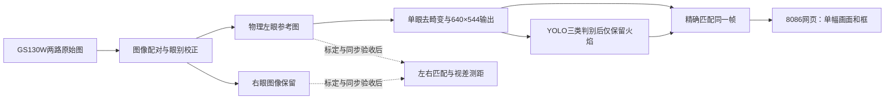

# 单画面YOLO预览：看画面、看框、验证模型

> **历史记录，请先阅读[当前高清预览与传图开关说明](高清火焰预览与传图开关_使用说明.md)。**
> 截至2026-10-10本轮优化：默认1280×1088去畸变画面、JPEG质量90；采用“图像准备→YOLO→JPEG”独立流水线，原生BPU后端复用同一BIN，当前默认仅输出火焰。
> 下文的640×544、10fps上限、双临时服务和旧帧率均是早期配置记录，不能用于描述当前运行状态。当前相机和8086网页是手动进程，算法由未设置开机自启的`rescue-mipi-vision`临时服务运行；8000官方预览未运行。
> 最新参数、管理命令和整机实测以新说明及`logs/vision_pipeline_20261010/`为准。左右眼映射、标定边界和历史排障内容仍可参考。

## 以下为历史版本记录

更新：2026-10-10。本说明对应已接入X5的GS130W。模型文件仍是地图壁纸三分类BIN，当前默认只输出火焰，并对参考左眼做候选参数去畸变。

## 现在直接打开哪里

现在已经运行，**不需要再启动一遍**：

- [单画面YOLO识别网页](http://192.168.127.10:8086/)：去畸变后的物理左眼参考画面、火焰框、置信度、本帧数量和处理耗时。
- [官方双目原图网页](http://192.168.127.10:8000/TogetheROS/)：保留上下两幅原图，适合检查两只镜头是否正常。

当前默认输出640×544去畸变画面，框和像素坐标与这张矫正后的图一致。之前三类原图模式下的帧率、960×816网页JPEG与1280×1088框坐标属于旧配置，不应用来描述当前模式。新配置性能仍在测量，以页面实时统计及本轮`logs/fire_lens_20261010/summary.json`最终记录为依据；未完成记录前不声称固定帧率。

详见[火焰模式与去畸变使用说明](火焰模式与去畸变_使用说明.md)。画面与框出现只验证显示链路工作，不等于实拍准确率已验收。

## 为什么双目可以显示成一个画面

两只镜头从稍有不同的位置看同一场景。两幅图直接透明叠加容易出现重影，把它们上下拼接又仍是两幅画面。机器人通常选一眼作为参考：在它上面识别目标，再利用另一眼的对应点计算视差和距离。

当前8086网页显示**算法使用的物理左眼经单眼去畸变后的640×544图像**；右眼仍保留在图像链路内。当前`/vision/frame`左图是640×544 BGR，右图仍是1280×1088原始NV12，不能把它们当作可直接计算视差的同尺寸整流图对。真实米制测距仍须核验眼别、曝光同步、双目标定和整流；当前`depth_valid=false`不能被当作真实零距离。



同帧匹配使用序号、时间戳、坐标系名称和尺寸；不会把旧检测框套到新图上。本页面只读，不给底盘、云台或水泵发送命令。

## 怎样知道YOLO检测到了

先看顶部，再看右侧“本帧检测”和画面：

| 页面显示 | 解释 |
|---|---|
| 正在识别；模型已加载 | 正在收到新图与对应检测结果，模型已启用 |
| 彩色火焰框＋百分数 | 模型认为当前帧该区域是火焰候选目标；当前只输出火焰 |
| 消防员或人物栏显示未启用 | 当前模式关闭了这两类结果；不是模型文件丢失 |
| 本帧未检出目标 | 该帧没有达到模型检测阈值的目标；链路仍可以正常运行 |
| 等待图像与结果 | 尚未收到一对匹配图像和检测消息；检查相机与识别是否均运行 |
| 识别画面停更或连接中断 | 留在页面上的是上次画面，不应据此判断现在的场景 |

“显示检测框”复选框只控制画框，不关闭识别。右侧数量是**当前这一帧的候选框数量**，不是跨帧去重后的人数，也不是已经确认的受困人数。

置信度例如“火焰85%”是模型对此候选框的评分，**不等于真实准确率85%**。对准普通房间出现一个火焰框可能是误检，要拿已知图案核对。没有实拍标注集，不能据此声称模型已可靠。恢复三类输出的方法见火焰模式说明。

页面“单次BPU推理ms”只是模型计算耗时；“完整算法处理率”还受解码、去畸变、预处理、后处理和发布等环节影响；顶部“识别画面更新率”是网页后端收到匹配图像与结果的速率，还可能受消息或网页传输限制。`process_fps=10.0`是当前入口的输入频率上限，不是实测10帧/秒的承诺，也不能把`1000/BPU毫秒`当作整套系统帧率。

状态在更新超过3秒、采集时间超过3秒或采集时间在未来时变为停更。系统时间错误也可能造成无新帧或停更，因此启动前先校时。

## 现在由什么程序在运行

| 程序 | 当前运行方式 | 停止的影响 |
|---|---|---|
| 相机采集 | 用户X5远程终端前台 | 下游没有新图 |
| 8000官方原图预览 | 用户X5远程终端前台 | 只停止官方原图显示 |
| YOLO识别 | 临时服务`rescue-mipi-vision` | 没有新检测帧，8086随后提示停更 |
| 8086新检测网页 | 临时服务`rescue-detection-preview` | 只停止新网页，不停止相机或YOLO |

在X5远程终端查看算法与新网页服务：

```bash
systemctl status rescue-mipi-vision rescue-detection-preview --no-pager
journalctl -u rescue-mipi-vision -u rescue-detection-preview -n 60 --no-pager
```

只有想关闭新网页时才执行：

```bash
systemctl stop rescue-detection-preview
```

这两个服务均未配置开机自启。普通用户在`systemctl`前加`sudo`。仅希望停止算法时执行`systemctl stop rescue-mipi-vision`，底层相机仍运行。改用算法手动入口前须先停止算法服务；启动脚本带`flock`锁，重复运行会提示已有程序，不应绕过锁。

## 重启X5以后怎样重新运行

1. 先在**Windows电脑的PowerShell**运行已有脚本校准X5时间：

   ```powershell
   & 'D:\工程仿真\FPGA赛道_小车仿真\RDKX5_消防小车系统\board_setup\sync_rdkx5_time.ps1'
   ```

2. 在**第一个X5远程终端**启动相机。如果已经运行就跳过：

   ```bash
   cd /root/rescue/ros2_ws
   bash tools/run_mipi_camera.sh
   ```

3. 在**第二个X5远程终端**启动YOLO：

   ```bash
   cd /root/rescue/ros2_ws
   bash tools/run_mipi_vision.sh
   ```

4. 在**第三个X5远程终端**启动新检测网页：

   ```bash
   cd /root/rescue/ros2_ws
   bash tools/run_detection_preview.sh --bind 192.168.127.10
   ```

5. 电脑浏览器打开`http://192.168.127.10:8086/`。这些前台终端要保持运行；Ctrl+C停止对应程序。若板子的IP变了，网页地址和`--bind`都改成新的板端网口地址。

三个项目入口统一使用ROS域0。网页手动入口默认监听127.0.0.1，只能板端访问；上述`--bind`让电脑通过网线访问。不需要8000原图页时无需启动它；若想同时看两眼，再另开X5远程终端：

```bash
cd /root/rescue/ros2_ws
bash tools/run_mipi_preview.sh
```

不要在已采集的情况下再启动官方`mipi_cam_dual_channel_websocket.launch.py`，它包含另一个相机驱动。

## 用你的壁纸做第一轮实拍验证

当前BIN面向地图里的**卡通火焰、消防员、人物图案**，本轮只启用火焰输出。优先用实际打印火焰壁纸，而不是拿真人或普通房间判断模型是否训练成功；需要测试另外两类时先按说明恢复三类模式。

1. 把火焰壁纸放到镜头前约0.4米、0.7米、1.0米，先保证图案清楚、不反光；距离用尺测，当前深度值尚不可用。
2. 每个距离分别拍正面和左右斜角，移动图案确认框跟随；保留约10秒视频或若干连续截图，记录真实类别和框是否正确。
3. 改成稍暗光、局部阴影和部分遮挡，分别记录漏检、误分类；再拿无火焰/人物的楼面作为负样本，检查误检。
4. 同一场景把图案移走，页面应在新帧到达后清空旧框；若状态停更，应先排查运行链路，不把保留的旧框当作持续识别。
5. 将实拍图片按独立场景划分训练与验证集；先标注并统计各类别漏检/误检，再决定是否补训、改阈值。近距离可靠性优先，远处暂时识别不到不等于整套方案不可用。

验证结束后再接入连续多帧确认、楼栋关联和双目测距。像素框中心还不是云台喷嘴的可直接执行坐标。

## 代码从哪里读

X5项目目录为`/root/rescue/ros2_ws`，电脑镜像目录为`D:\工程仿真\FPGA赛道_小车仿真\RDKX5_消防小车系统\ros2_ws`。

| 文件 | 学习重点 |
|---|---|
| `tools/run_detection_preview.sh` | 运行环境、通信域和避免重复启动 |
| `tools/detection_preview.py` | 订阅两种消息、同帧匹配、JPEG和只读HTTP接口 |
| `web/detection-preview.html` | 单画面、框、类别、数量和停更提示 |
| `src/rescue_vision/rescue_vision/perception_node.py` | 图像进入YOLO并发布检测结果 |
| `tests/test_detection_preview.py` | 错帧拒绝、尺寸检查、空结果清框、时间过期等5项测试 |

ROS数据流是`/vision/frame`与`/perception/detections`进入预览程序，再由浏览器读取`/api/state`。网页只负责展示，不会重新运行一套YOLO。
