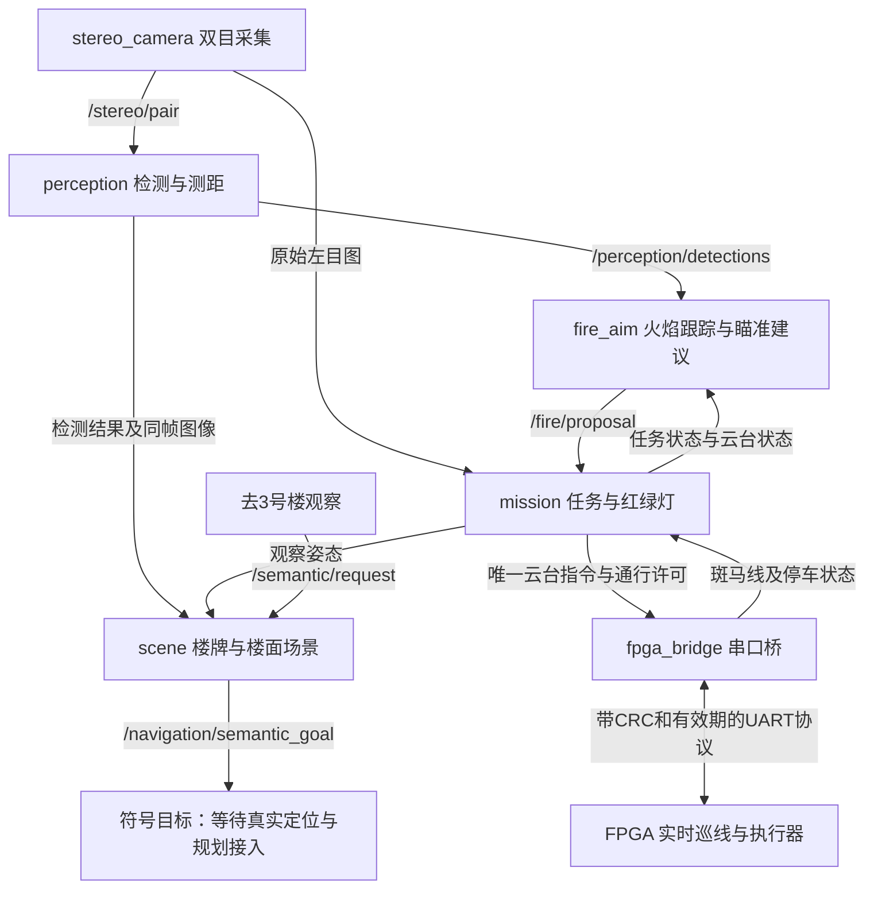

> 历史六节点版本，保留追溯用途。当前程序请读[十节点主入口](../README_开始使用.md)，不要按本历史文档部署。

# RDK X5 消防小车 ROS 2 工作区：从这里开始

这里已经写入可运行的 **ROS 2 六节点程序**，包含双目测距、红绿灯扫描与停车放行、楼牌 OCR、楼面场景报告，以及原有火焰跟踪和云台瞄准接口。各节点之间的通信、串口协议和状态流程已经联通测试，代码并非只有空节点名字。

**当前仍是待实车联调的版本。** 它还没有在你的 RDK X5、GS130W、FPGA 或云台上运行验证。导航目前只生成“去某栋楼观察”的语义目标；定位、实物地图配准和真实底盘行驶尚未接入。`fire` 模式提供火焰瞄准建议和受限云台控制，**没有执行水泵喷射**。

## 1. 这次增加了什么

| 功能 | 程序现在怎样做 | 真实小车还需要什么 |
|---|---|---|
| 双目测距 | 左右图整流，StereoSGBM 匹配，左右一致性/纹理检查，在 YOLO 目标框内提取可靠表面 XYZ | 拍摄真实棋盘格、测量方格尺寸、验证左右同步及测距误差 |
| 红绿灯 | FPGA 发斑马线事件后停车；云台有界左右扫描；红灯停，同一灯板绿灯连续稳定才给短期通行许可 | 实体上红下绿黑背板灯具、曝光调整、云台限位和速度实测、FPGA 协议固件 |
| 楼牌与场景 | 轻量中文 OCR 识别楼号/名称，多帧确认；与同帧 YOLO 结果、已验证楼面区域关联 | 实拍牌号测试、实际单楼面 ROI 和观察姿态配置 |
| 火焰瞄准衔接 | 沿用火焰跟踪、稳定锁定与云台修正；有效双目坐标可附加到目标 | 舵机接口、实际安装方向、喷嘴落点标定；当前不驱动水泵 |
| 语义导航入口 | “去3号楼观察”→ 春晖楼 C、观察点标识和规划需求 | 真实定位、场地配准、道路规划、避障和阿克曼控制执行 |

这里的双目深度坐标是相机坐标，X 向右、Y 向下、Z 向前，单位米。它不是地图坐标，也不是喷嘴坐标。针对居民楼火焰壁纸，测量对象是印着火焰图案的墙面；不能把这种结果当成真实跳动火焰的可靠测距。

## 2. 为什么有三个模型/算法分工

| 模块 | 使用的处理器 | 用途 |
|---|---|---|
| YOLO11n 检测 `.bin` | 计划调用 X5 BPU | 识别 `fire / firefighter / person` 三类 |
| PP-OCRv4 中文 OCR，三个 ONNX 文件合计约16.2 MB | X5 ARM64 CPU，通过 RapidOCR / ONNX Runtime | 读楼牌的文字和数字 |
| OpenCV 双目与红绿灯算法 | CPU | 求左右图视差/深度，判断实体 LED 红绿状态 |

识别楼牌采用的是轻量 OCR 模型，暂未部署 LLM/VLM。它适合明确的楼号、楼名识别；当前支持的语义请求也是明确楼号或完整楼名，不是任意自然语言推理。

现有 `.bin` 是前一步导出的联调候选模型：**量化后的质量门槛仍未完全通过，X5 BPU 运行和速度也尚未实测。** 不能把桌面 ONNX 演示结果或本次 ROS 联通测试理解成这份 `.bin` 已有同样精度。

## 3. 六个节点分别负责什么

ROS 2 的节点是分工明确的程序，话题是节点传递数据的通道。节点本身会订阅输入、计算结果、发布输出。



| 节点名 | 代码入口 | 主要职责 |
|---|---|---|
| `stereo_camera` | `camera_node.py` | 打开明确指定的左右拼接相机，分离两眼，保留帧号和时间戳；当前不是自动猜相机型号的驱动 |
| `perception` | `perception_node.py` | 图像整流、YOLO 推理、双目匹配、目标深度；无标定时可保留识别但拒绝米制深度 |
| `fire_aim` | `fire_aim_node.py` | 跟踪同一火焰、判断图像锁定、给出云台角度建议，不独自抢云台 |
| `mission` | `mission_node.py` | 管理任务模式、停车确认、红绿灯扫描、云台控制权；红绿灯优先于火焰瞄准 |
| `fpga_bridge` | `fpga_bridge_node.py` | 串口编解码、CRC、ACK 匹配、到期许可和链路状态；默认只演示发送记录 |
| `scene` | `scene_node.py` | 低频 OCR、楼牌确认、同帧楼面关联、当前人数/火焰报告、语义目标 |

只有 `mission` 向串口桥提交云台控制和运动许可，避免红绿灯扫描与火焰瞄准同时下命令。OCR 采用独立工作线程和低频节奏，减少其对控制消息的影响；具体频率和负载仍应在 X5 上测量。

### 主要话题

| 话题 | 消息类型 | 含义 |
|---|---|---|
| `/stereo/pair` | `rescue_interfaces/msg/StereoPair` | 原始左右图、帧号、同步确认状态 |
| `/vision/frame` | `rescue_interfaces/msg/StereoPair` | 与检测结果一致的原始/整流左右图 |
| `/perception/detections` | `rescue_interfaces/msg/DetectionArray` | 检测框、类别、深度是否有效及原因、可用 XYZ |
| `/fire/proposal` | `std_msgs/msg/String` 内含 JSON | 火焰锁定及云台建议，`pump_allowed=false` |
| `/mission/request` | `std_msgs/msg/String` 内含 JSON | 请求待命、巡逻、观察、火焰模式 |
| `/mission/state` | `std_msgs/msg/String` 内含 JSON | 当前任务、停车/云台状态、观察姿态 |
| `/traffic/state` | `std_msgs/msg/String` 内含 JSON | 扫描、红灯等待、绿灯确认、许可状态 |
| `/control/gimbal` | `rescue_interfaces/msg/GimbalCommand` | 目标角、速度、控制权和租约 |
| `/control/motion_permission` | `rescue_interfaces/msg/MotionPermission` | 有剩余有效期的通行许可，不包含导航路径 |
| `/fpga/events` | `rescue_interfaces/msg/FpgaEvent` | 斑马线、完成、STATUS、ACK |
| `/fpga/link`、`/fpga/tx` | `std_msgs/msg/String` 内含 JSON | 串口状态和发送记录 |
| `/scene/ocr`、`/scene/report` | `std_msgs/msg/String` 内含 JSON | 楼牌证据、同楼面当前场景报告 |
| `/semantic/request` | `std_msgs/msg/String` 内含 JSON | “去3号楼观察”等明确目标 |
| `/navigation/semantic_goal` | `std_msgs/msg/String` 内含 JSON | 语义目的地，目前 `can_execute=false` |

## 4. 你将看到什么场景报告

已有离线演示从当前地图的幸福楼渲染图实际运行 OCR 和 FP32 YOLO，组合得到类似信息：

```json
{
  "building_number": "08",
  "building_name": "幸福楼",
  "fire_status": "observed",
  "visible_person_count": 2,
  "visible_firefighter_count": 1,
  "casualty_count": null,
  "physical_fire_verified": false,
  "observation_scope": "current_view"
}
```

可以解释为：“当前观察的08号幸福楼楼面发现火焰图案，当前画面可见2个人物图案和1个消防员图案。”**不能解释为“已经确认整栋楼有2名受困人员”**：现有 `person` 类没有受困、伤亡或整栋楼清点的能力。`null` 表示未知。

这份演示使用既有合成图及亮度变化，不是 GS130W 实拍，不是 BPU 验证。打开 [场景演示](../reports/scene_demo.html) 和 [原始证据](../reports/scene_demo.json) 可以查看。

实际 ROS 报告必须把同帧 OCR 与 YOLO 对齐，还要确认单楼面 ROI、当前停车状态、云台角度、观察姿态 ID 与配置一致，才能把目标归到某一栋楼。未配置时仍可提供楼牌/当前画面信息，但不会把其他楼的人或火焰随意算到该楼。ROS 场景证据默认3秒到期，到期后状态回到 `unknown`。

## 5. 文件放在哪里

```text
rdkx5_ros2_ws/
├── README_开始使用.md
├── src/
│   ├── rescue_interfaces/msg/    ROS 自定义消息定义
│   └── rescue_vision/
│       ├── rescue_vision/       六节点及算法模块
│       └── launch/              一次启动六节点
├── config/                      标定模板、楼栋表、红绿灯参数
├── models/
│   ├── yolo/                    三类检测 BPU 候选模型
│   └── ocr/                     轻量中文OCR权重及校验清单
├── tools/                       板端检查/安装、标定、离线演示及集成测试
├── tests/                       纯算法测试
├── reports/                     测试结果和场景演示
├── docs/                        硬件联调、协议和算法说明
└── vendor/                      OCR来源、许可证等记录
```

## 6. 在 X5 上先检查系统，再构建

下面命令是在**X5 的 Linux 终端**运行，不是 Windows PowerShell。将整个工作区复制到板上，例如 `~/rdkx5_ros2_ws`。

本框架用 ROS 2 Humble，在隔离的 Linux 环境中验证过。你说的“RDK OS 3.5”还不能代替对板上实际 Ubuntu、Python、ROS 和 BPU 运行库的检查，先运行：

```bash
cd ~/rdkx5_ros2_ws
bash tools/check_board.sh
```

确认输出的架构、系统和运行库。当前构建脚本要求已经安装可用的 **ROS 2 Humble**；缺少时先按与你实际板系统匹配的官方方式安装，不在其他发行版上强行套用。确认后运行：

```bash
bash tools/setup_board.sh
```

脚本采用 `.venv` 虚拟环境并启用 `system-site-packages`，使 ROS 自带的 `rclpy/cv_bridge` 可用；通过虚拟环境的 `python -m colcon` 构建，避免节点解释器与依赖安装到不同环境。

每个新终端都要加载环境：

```bash
cd ~/rdkx5_ros2_ws
source /opt/ros/humble/setup.bash
source .venv/bin/activate
source install/setup.bash
```

如果检查脚本显示 ROS 路径不同，应使用实际路径；不能只改路径名就假设不同 ROS 发行版完全兼容。

## 7. 先启动无硬件版本

```bash
ros2 launch rescue_vision rescue.launch.py workspace_dir:="$PWD"
```

默认相机、YOLO、OCR 都关闭，UART 为 `dry_run`，标定模板也没有启用。六个节点会启动并提供状态接口，但不会凭空产生检测、测距，也不会打开你的串口控制车轮。

另开一个已加载环境的终端查看：

```bash
ros2 node list
ros2 topic echo /mission/state
```

也可以单独查看 `/traffic/state`、`/fpga/tx`、`/scene/report`。没有图像或关闭 OCR 时出现 `unknown/ocr_disabled` 是明确状态，不代表已检测到“无人、无火”。

## 8. 模式和语义请求怎样发

这些命令只在已运行的 ROS 图中发布请求。启用实际串口后会影响真实任务，先完成架空和低速联调。

```bash
# 显式软件暂停；不是硬件急停命令。
ros2 topic pub --once /mission/request std_msgs/msg/String \
  "{data: '{\"mode\":\"idle\"}'}"

# 请求巡逻通行权限，实际巡线仍由 FPGA 执行。
ros2 topic pub --once /mission/request std_msgs/msg/String \
  "{data: '{\"mode\":\"patrol\"}'}"

# 停车后观察已配置楼面；ID必须匹配 facade 配置。
ros2 topic pub --once /mission/request std_msgs/msg/String \
  "{data: '{\"mode\":\"inspect\",\"observation_pose_id\":\"observe_H\"}'}"

# 请求火焰跟踪/瞄准；不是喷水命令。
ros2 topic pub --once /mission/request std_msgs/msg/String \
  "{data: '{\"mode\":\"fire\"}'}"

# 明确请求3号楼；此命令目前只生成语义目的地。
ros2 topic pub --once /semantic/request std_msgs/msg/String \
  "{data: '{\"text\":\"去3号楼观察\"}'}"
```

`inspect` 的观察姿态声明只有在收到 FPGA 已停车状态时才记录；应先停车并确认状态，再发送带姿态 ID 的观察请求。`observe_H` 是示例，不能只写这个名字就证明车真的在幸福楼观察点。

显式发送 `idle` 会设置 `/mission/state` 中的 `operator_hold=true`，覆盖路口 GO 为 STOP 并暂停新增云台指令，同时保留当前斑马线事件。这是软件暂停，受串口传输和现有租约时延影响，不能代替物理急停。再发送 `patrol/inspect/fire` 会解除该暂停，并重新等待新鲜观测；不会直接复用旧绿灯放行。

程序刚启动时的初始 `idle` 只是普通待命，没有人为暂停标记，因此 FPGA 新发斑马线事件仍会自动进入用户要求的停车扫描流程。需要彻底退出异常路口任务时，先在 FPGA 侧停车并确认，再请求 `{"mode":"reset_traffic"}`；真实急停应由 FPGA 本地优先执行。

发出“去3号楼观察”后查看：

```bash
ros2 topic echo /navigation/semantic_goal
```

预期目的地为 `building_id=C`、`building_name=春晖楼`，并显示 `status=symbolic_goal_only`、`can_execute=false`。这说明“知道你要去哪栋楼”，还没有把车自动开过去。地图中的观察点目前是虚拟相机位置，不能直接当作实车车体导航终点。

## 9. 标定完成后怎样启用真实设备

先另存并填写自己的配置，保留模板。相机的真实内参、畸变、基线和左右外参不能根据“GS130W”型号凭空填写。

| 配置 | 何时可以启用 |
|---|---|
| `stereo.measured.json` | 使用真实同步棋盘格图完成标定并通过工具质量检查 |
| `mount.measured.json` | 测量云台中位、方向、限位、负载下速度和等待时间后，设置 `mounting_verified=true` |
| `servo.measured.json` | 火焰视觉修正方向、角度限位和参数完成实测后启用；未确认时保持禁用 |
| `facade.measured.json` | 当前单楼面ROI、分辨率、坐标系、云台姿态和观察姿态ID都验证过后启用 |
| `landing.measured.json` | 可选：以明确的相机距离定义实测喷嘴落点后，提供距离到瞄准像素补偿；不代表自动喷水 |

完成对应检查后，可参考下面的启动形式。**`/dev/video0`、`/dev/ttyUSB0` 只是格式示例，必须替换为实际设备。** 当前采集节点支持同一帧左右拼接的SBS输入，默认总分辨率1280×480、单眼640×480；可以用 `capture_width/capture_height` 设置驱动实际输出，但双目标定文件必须匹配单眼分辨率。若不是左右拼接模式，需要扩展采集节点。

```bash
ros2 launch rescue_vision rescue.launch.py \
  workspace_dir:="$PWD" \
  camera_enabled:=true camera_device:=/dev/video0 \
  capture_width:=1280 capture_height:=480 \
  synchronization_verified:=true \
  detector_enabled:=true ocr_enabled:=true \
  uart_dry_run:=false uart_port:=/dev/ttyUSB0 \
  stereo_calibration:="$PWD/config/stereo.measured.json" \
  mount_config:="$PWD/config/mount.measured.json" \
  servo_config:="$PWD/config/servo.measured.json" \
  facade_config:="$PWD/config/facade.measured.json"
```

已有实测喷嘴落点表时，可额外传入 `landing_calibration:="$PWD/config/landing.measured.json"`；未准备好时保留默认不加载。此参数只参与瞄准补偿，不会开启水泵。

`synchronization_verified=true` 是你对采集模式已经核实的声明，不会自动把不同步摄像头变成同步。驱动读完帧的时间也不是精确曝光时间，实际延迟需测量。左右同步尚未确认时保持 false，程序会拒绝有效深度。

如果某个实测配置尚未准备好，可以继续使用该项模板并只联调其他功能；不要直接把模板里的 `false` 改成 `true` 以绕过检查。

## 10. 推荐实机联调顺序

1. **先UART和停车。** 保持车轮架空，确认 STATUS、CRC、STOP、当前云台指令 ACK、许可过期和断线停车。此阶段可以暂不开 YOLO。
2. **再LED红绿灯。** 做竖直哑光黑色背板，上红下绿，调整相机曝光；验证绿色墙纸不放行、短暂绿闪不放行、连续绿灯放行、红灯撤销、重复斑马线事件不重启扫描。GO 只恢复现有巡迹。
3. **再双目标定。** 用实际打印棋盘格和最终分辨率采图，验证0.4、0.6、0.8、1.0米处误差、有效率和耗时。
4. **再OCR与楼面关联。** 读取实物楼牌，检查1号/11号区分、相邻楼牌冲突；固定观察姿态后配置单楼面ROI，验证人物不会串到别栋楼。
5. **最后火焰瞄准。** 检查检测模型、角度修正方向、限位、丢目标撤销锁定和喷嘴落点。图像锁定与实际喷水命中应分开验收；本工作区当前没有水泵执行控制。

云台的90°目标角不等于实际已经90°。没有实际回读时，程序采用命令 ACK 加实测运动/稳定时间估算就绪，实际角度仍显示未知。

详细说明：

- [UART协议、字节向量和FPGA伪代码](UART协议与红绿灯流程.md)
- [LED灯板与扫描联调](红绿灯联调.md)
- [双目标定、有效深度与实物验收](双目标定.md)
- [楼牌、场景报告与语义目标](楼牌与语义导航.md)

## 11. 已经验证到哪一步

| 验证 | 本次结果 | 能说明什么 |
|---|---|---|
| 纯算法测试 | 41项通过，见 `reports/core_tests.log` | 双目几何/拒绝逻辑、LED与状态机、协议、OCR与场景等基础行为 |
| ROS 2集成 | 17项通过，见 `reports/ros_integration.json` | 六节点实际启动，真实ROS消息与Linux PTY串口链路贯通；使用实际pyserial桥 |
| 路口流程 | 红停、绿闪拒绝、稳定绿放行、车辆移动后不死锁、云台续租、红灯撤销、重复事件、完成事件、MCU状态丢失停车 | 集成软件状态和实际串口字节行为符合测试要求 |
| OCR地图资产 | 13张楼牌原图均正确匹配；17张模拟视角15张匹配，2张多楼牌冲突被拒绝 | 已知地图图案能完成OCR功能检查，不是独立实拍精度 |
| X5与真实硬件 | 尚未验证 | 不能给出真实BPU帧率、测距精度、舵机角度误差或喷水命中率 |

集成报告明确标记 `real_hardware=false`、`bpu_executed=false`；测试用合成LED图像，YOLO在该集成测试中关闭。当前 `.bin` 的量化质量问题仍需单独改进和板端验证。完成以上软件工作后，下一阶段主要是把真实相机标定、串口固件和执行器参数接进来，再补真实定位与导航控制。
