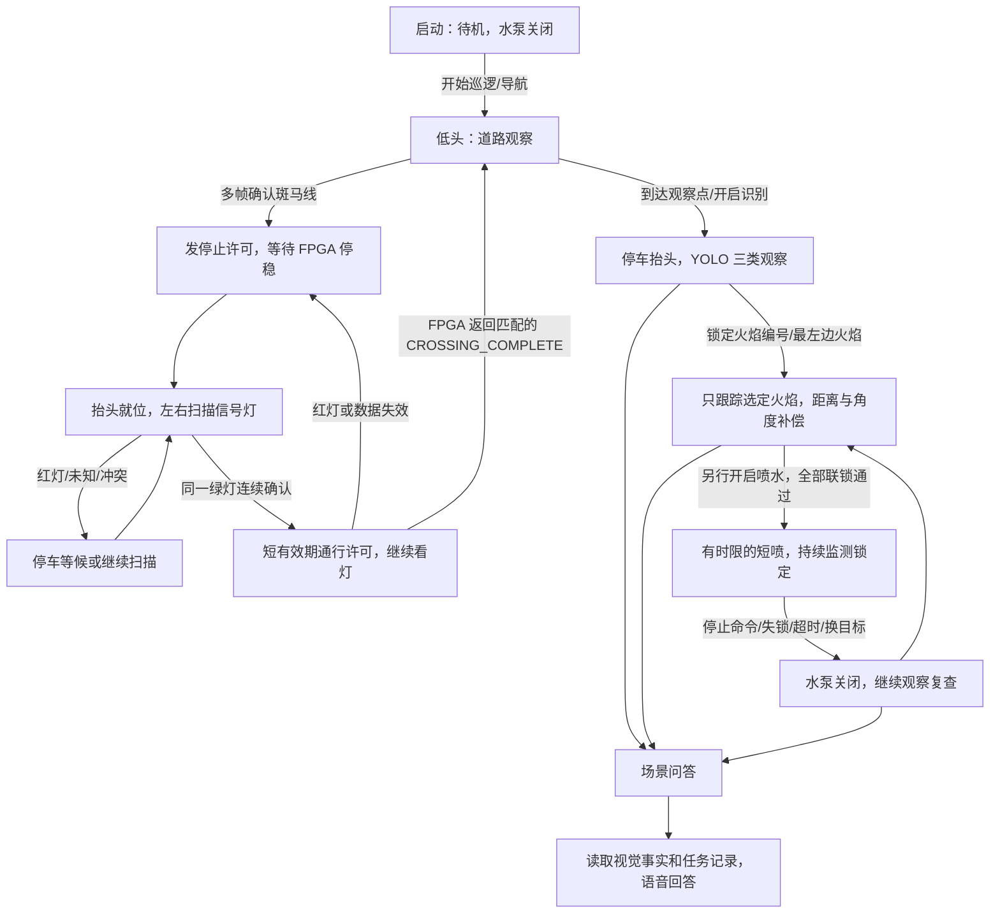

# 四种任务运行节点：从启动到语音控制

2026-10-11。电脑工程：`D:\工程仿真\FPGA赛道_小车仿真\RDKX5_消防小车系统\ros2_ws`。X5 工程：`/root/rescue/ros2_ws`。本次使用 `task_modes.launch.py` 统一启动，复用现有双目驱动和高速视觉进程。

## 先理解摄像头的四种任务

| 任务 | 摄像头/云台做什么 | 用什么算法 | 车辆、水泵做什么 |
|---|---|---|---|
| 行驶观察 | 云台保持实测低头姿态，看路面 | 灰度＋Otsu 二值化、连续白条几何特征、多帧确认 | 发现斑马线立即请求停车；收到 FPGA 停稳状态后才抬头 |
| 红绿灯处理 | 云台抬头，左右分步扫描；发现灯后保持观察 | 红/绿 HSV、亮度、圆度及黑色灯板位置约束 | 红灯、冲突、未知或过期均不给通行许可；同一绿灯连续确认后放行 |
| 到站观察与灭火 | 到达目的地或说“开启识别”后看楼面，启用三类 YOLO；选定火焰后闭环瞄准 | YOLO＋火焰 ID 跟踪＋双目距离＋喷嘴补偿 | 观察/瞄准保持停车；你单独说“开启喷水”后才申请限时喷射，停止命令立即关闭 |
| 场景理解与问答 | 复用当前观察结果，不重新跑另一个 YOLO | 新鲜检测结果、可选楼牌 OCR、任务状态、喷水记录；可选本机语言模型理解问句 | 回答“看到多少火焰/人物/消防员、喷水是否结束”等；回答不执行控制动作 |

**同一个云台不能同时低头看路、抬头看灯和对着楼面瞄准。** 所以这些任务由一个 `mission` 节点仲裁，其他节点只能提出观测或操作请求，不能各自抢舵机。

这里低头的双目负责斑马线任务。此前规划的前置单目＋FPGA 仍负责底盘循迹。当云台抬头看灯、尤其绿灯通过路口期间，前置循迹摄像头继续看道路。如果只装云台这一台摄像头，就不能同时完成这个分工，需要另做停车取图/盲区通行方案；当前没有偷偷使用定时盲走替代循迹。

## 状态转换



绿灯不是看到一次就走：当前至少 5 帧、持续至少 0.4 秒、同一个灯板、图像新鲜、云台已就位才能释放短期许可。许可需要刷新，红灯或识别丢失即撤回。通过完成必须带同一个路口事件编号；完成后低头，经过冷却及连续无斑马线画面才允许触发下一处，避免反复停车。

若在尚未完成的路口里说“开启识别/开启场景理解”，车辆先停车，原路口事件保留，楼面 YOLO 观察暂缓；绿灯不能覆盖观察停车请求。可以说“继续巡逻”恢复处理该路口，完成过街后再开启楼面识别。实际车辆已离开路口却因反馈异常未结束时，应确认停稳并由开发终端显式 `reset_traffic`，不能用重置替代正常过街反馈。

斑马线默认要求至少 6 条可见的平行白条，结合间距、暗背景和对比度；再连续至少 3 帧确认。它是初始可调规则，不是已对实际赛道验证的万能检测器。停止提前量仍需用实际车速、通信延迟和制动距离测量。路面分析用缩小灰度图，原来的 YOLO 画面和 JPEG 画质没有降低。

当前红绿灯约定是**黑色竖板、上红下绿的圆形发光灯珠**。建议实物按这个构型制作，减少把居民楼壁纸火焰当成红灯、其他绿色物体当成绿灯的风险。若采用横排或无灯板，修改 `config/traffic.json` 并补验证图。

## 节点与消息

| 节点 | 输入 | 主要输出 |
|---|---|---|
| 官方双目驱动 | GS130W 两路 MIPI | `/image_left_raw`、`/image_right_raw` |
| `fast_mipi_perception` | 物理左图、任务状态 | `/perception/detections`、原尺寸预览、CameraInfo；按模式启停推理 |
| `road_vision` | 物理左图、云台任务姿态 | `/road/observation`、`/traffic/observation` |
| `mission` | 路面/灯色、FPGA 状态、任务请求、瞄准提案 | 唯一 `/control/gimbal`、`/control/motion_permission`、`/mission/state` |
| `fire_targets` | YOLO 火焰框、选定请求 | `/fire/targets`、`/fire/selection`、选择确认 |
| `stereo_depth` | 同帧双目、YOLO 框、实测标定 | `/perception/depth_detections` |
| `fire_aim` | 所选火焰的同帧距离、相机/喷嘴标定 | `/fire/proposal`，包含误差、提议角度、锁定及目标身份 |
| `local_actuator` | 云台命令、锁定、显式短喷请求 | X5 PWM/GPIO、`/actuators/state`；默认模拟输出 |
| `voice` | USB 麦克风或 `/voice/text` | 转写、结构化任务请求、USB 音箱播报 |
| `task_interaction` | 语音/文字命令 | 任务/导航/选定/短喷请求和 `/interaction/result` |
| `task_scene` | YOLO、可选 OCR、任务及水泵状态 | `/scene/report`、`/scene/answer`、语音回答 |
| `navigation`、`fpga_bridge` | 地图/定位/路径请求、控制许可 | 路口机动提案、UART 帧；未就绪不执行 |

现在已确认的物理左镜头是 `/image_right_raw`，不是按英文话题名猜左右。各节点都复用官方相机，不重复打开 MIPI。

## 启动

本次板端交付会以 `rescue-task-modes` 临时后台服务运行。可用 `systemctl status rescue-task-modes` 查看状态；已运行时直接在另一个终端发下面的文字命令，不要重复启动。若要在终端前台调试，先 `systemctl stop rescue-task-modes`，再运行下方脚本。本次没有设置开机自启动。

先保持相机、现有高速 YOLO 和网页预览在运行。VS Code 的 X5 终端：

```bash
cd /root/rescue/ros2_ws
bash tools/run_task_modes.sh
```

脚本启用视觉的 `mission_gating` 参数：行驶/看灯阶段跳过 YOLO 推理，观察/瞄准阶段启用三类检测，预览仍可传图。启动任务栈时默认待机，不自动行驶或喷水。退出任务栈会恢复原来的持续 YOLO 预览模式。

不要同时启动旧的 `run_local_fire_control.sh` 或整套旧 `rescue.launch.py`；它们会重复创建任务/执行器拥有者。脚本会检查重复进程。

第二个远程终端准备命令环境：

```bash
cd /root/rescue/ros2_ws
export ROS_DOMAIN_ID=0 ROS_LOCALHOST_ONLY=0
source env.sh
```

然后**每次发一条**指令：

```bash
python tools/task_command.py "开始巡逻"
python tools/task_command.py "开启识别"
python tools/task_command.py --targets
python tools/task_command.py "锁定最左边的火焰"
python tools/task_command.py "锁定火焰2"
python tools/task_command.py "开启喷水"
python tools/task_command.py "停止喷水"
python tools/task_command.py "报告当前场景"
python tools/task_command.py "现在有几个人"
python tools/task_command.py "有没有消防员"
python tools/task_command.py "灭火完成了吗"
python tools/task_command.py "停车"
```

上面是可选命令示例，不能整块粘贴作为演示脚本，尤其喷水必须等选定火焰已锁定、落点标定和硬件都完成后单独发送。命令返回 `accepted` 表示请求已提交，不能替代执行器状态确认。

火焰编号来自 `/fire/targets`，不是 YOLO 类别号。当前网页仍显示原来的检测框；用 `--targets` 查看有效火焰编号和对应位置，也可以说“最左边/最右边/最大的火焰”，不必先记编号。编号在当前识别会话中不重用；失踪或关联不明确会作废，不能把原来的许可自动转给另一团火焰。“这个火焰”只在唯一火焰时接受。当前跟踪较保守，选中的火焰丢检后需要重新指定。

选择成功看 `/fire/selection_ack`，瞄准看 `/fire/proposal`；真正泵输出看 `/actuators/state`。新的短喷请求绑定火焰 ID、选择代数和识别会话，换目标、丢失目标或数据过期会撤销许可。默认短喷/冷却/次数限制沿用原执行器配置，不是“开启后一直无限喷水”。

## 语音怎么启用

板上已有离线中文 Vosk 模型和 espeak-ng 程序。当前没有自动打开未确认的音频设备。先修改独立的 `voice.measured.json`，确认 USB 麦克风和音箱的设备编号后设置 `microphone_enabled=true`、`tts_enabled=true`，再启动：

```bash
bash tools/run_task_modes.sh voice_config:=/root/rescue/ros2_ws/config/voice.measured.json
```

当前是按住说话/手动开始收音接口，不是全天监听唤醒词：

```bash
ros2 topic pub --once /audio/listen std_msgs/msg/Bool '{data: true}'
```

说完可以发送 `{data: false}` 结束收音，最长约 8 秒。转写会通过同一任务解析器执行。播报时会避免回声进入新一次识别。未接好音频时，可用上述 `task_command.py`，或向 `/voice/text` 发布文字，验证相同的命令链。

## 第四种“场景理解”现在能做到什么

可以把最新检测转成可解释的事实，例如：“当前画面看到 2 处火焰图案、1 名普通人物、1 名消防员；楼号尚未确认；上一次喷射指令已经结束，等待复查。”这些是当前视野内的检测数量，不是整个楼里的人数，也不能只凭人物框断言有人受困。

当前单靠 YOLO 不能确认楼号。本节点预留 `/scene/ocr`，必须是同一帧并且 OCR 楼栋确认通过才关联楼号；导航目标是 3 号楼也不能冒充“视觉已经确认 3 号楼”。当前任务启动器没有启动旧 OCR 节点，因为旧节点依赖另一套 `/vision/frame` 图像接口，不能假装已经无缝接通。

现已扩展为实时事实、模型生成、本地技术参考三类回答：精确数量、楼号和喷水问题即时读取实时事实；“分析当前场景、解释、建议、聊天”等问句可调用本地语言模型。选用官方 Qwen2.5-0.5B-Instruct Q4_K_M，权重已下载校验并上板，CPU 运行器已在 X5 原生编译并启动。`config/edge_dialogue.local.json` 启用本机 `127.0.0.1:8088/v1/chat/completions`，默认模板仍可用于关闭模型。模型返回后重新读取最新视觉和任务证据，场景数字不用模型自由编造；一般知识回答会注明其不是当前检测或执行结果。双目公式等确定的技术知识直接查询审定参考，标注 `domain_reference`；这与 `edge_llm_generate` 模型生成区分。模型输出不会变成舵机/水泵命令。

文字提问应加 `--wait-answer` 才能在请求回执后看到真正答案，例如 `python tools/task_command.py "请分析当前场景" --wait-answer --answer-timeout 90`。完整启动、停止、ROS 链路和实际验收状态见 [本地边缘 AI 部署与使用](本地边缘AI部署与使用.md)。USB 音频仍未开启。本轮实测中，两次真实模型回答约 27～31 秒；YOLO 空闲平均约 16 FPS，模型生成期间约 11～12 FPS。事实查询和停止请求使用独立处理路径，不等待模型生成；这些是本轮软件测量，不是实车动作耗时保证。

“喷水结束”和“火灾扑灭”是两个不同事实：前者可以从泵指令与任务记录知道，后者还需要可靠复查。我们的火焰是打印壁纸，喷水后图案不会自动消失，因此不能用“YOLO 必须检测不到火焰”作为壁纸赛道唯一完成判据。可以将演示终点定义为“选定目标、完成标定瞄准、完成规定短喷、关闭水泵、报告演示动作完成”，实际灭火验证另行说明。

## 真正上车前要填写的内容

- `mount.template.json` 新增 `road_pose_verified、road_pan_deg、road_tilt_deg`。这是实际舵机指令角，不是“镜头俯角直接等于舵机角”。先测低头姿态和可见距离；未标定时车辆等待，不凭猜测姿态行驶。
- UART 需要 FPGA 回传新鲜 `STATUS`（包括停稳状态），接收带租约的行驶许可；通过路口后回传相同事件号的 `CROSSING_COMPLETE`。地面检测触发事件号使用高位区间，FPGA 按收到的许可事件号回传即可。
- 导航需要现有编码器/航向/路口定位与 FPGA 机动接口，`navigation_execute_enabled` 默认 false；没有真实定位和路段完成反馈，软件不会宣称已经导航到达。
- 双目标定、喷嘴偏移、实测落点、PWM、MOS 引脚/极性仍按此前说明完成。全部 IO 默认模拟模式；新任务节点不会替你猜针脚并打开水泵。

相关说明：[双目测距与喷嘴角度补偿](双目测距与喷嘴角度补偿_使用说明.md)、[本地云台与水泵](X5本地云台与水泵_接线与联调.md)。软件检查脚本是 `tools/verify_task_modes.sh`；本次 **166 项检查及真实相机模式切换已通过**，详见 [部署与验证记录](../logs/task_modes_20261011/results.md)。
# 最新版本提示

当前板端架构已改为 FPGA 自主地图导航，X5 停车等待 2 秒后找灯，并已接入楼牌 OCR 与自动/手动火场策略。请先读 [FPGA 惯导版流程](FPGA惯导版_语音任务与状态流程.md)。本页原有节点细节保留作背景，涉及 X5 路径规划和等待停车回执的旧流程不再适用于新 task_modes 启动配置。

