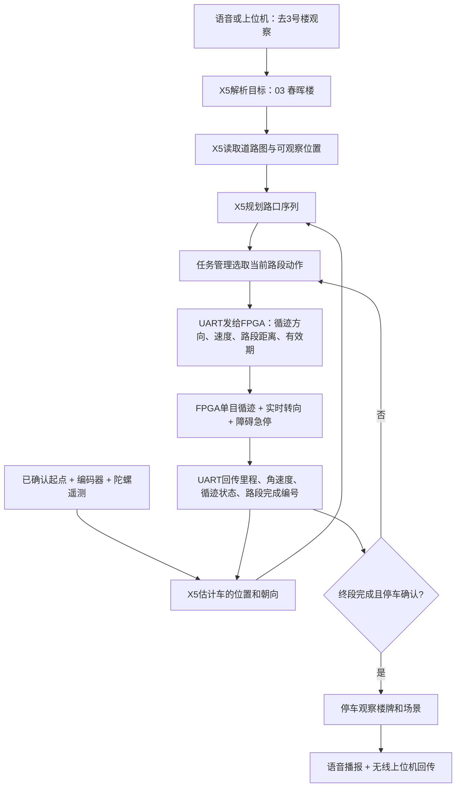

# 从“去 3 号楼”到小车停在楼前

这份文档对应当前 `ros2_ws` 的导航代码。先打开 `reports/navigation_preview.html`，可以选择 01～13 号楼，看真实地图上的路线。地图为已有 Blender v6 的 8.8 × 8.0 m 工程布局，并非赛方规定尺寸。

## 1. 地图放在哪里：放在 RDK X5

不需要先给 FPGA 做完整建图。X5 保存“道路怎样连接、各楼栋在哪里、从哪侧能观察楼牌”，计算到目标的路线。FPGA 接收近期一段动作，持续用摄像头循迹和底盘反馈执行，再回报进度。

| 层 | 负责什么 | 不应混淆的概念 |
|---|---|---|
| RDK X5 地图 | 13 栋楼、道路连接、观察位置、封闭道路 | 地图是先验知识，不能直接证明车在哪里 |
| RDK X5 定位 | 由已测起点、编码器和陀螺估算车的当前位置 | 只有陀螺不能获得可靠的行驶距离 |
| RDK X5 规划 | 选择道路、路口方向、观察目的地 | 最短拓扑路线还不是已验证的阿克曼转向轨迹 |
| FPGA 车道执行 | 看边线、求中线、补线、转弯、执行速度、避障急停 | 自主导航仍然需要循迹来贴合实际道路 |
| RDK X5 识别 | 楼牌、人物、消防员、火焰、红绿灯 | 看见楼牌不等于小车正好位于楼栋坐标 |



## 2. 程序现在怎样表示地图

`config/navigation_map.json` 从已有 `map_assets/rescue_maze_v6/config.json` 自动提取：

- 49 个节点：原地图路口、道路端点和楼牌已有道路观察位。
- 55 条无向道路边：保留原道路的真实折线，包括四角圆弧和 S 弯。
- 13 个楼栋目标：每栋可有多个观察侧，规划选择可通达的近侧。
- 默认封闭施工围挡占用的 3 条边；地图来源 SHA-256 记录在文件内。

图上的线只沿已有道路走，没有用“起点直接连楼栋中心”的穿墙捷径。算法为 Dijkstra 最短路径，代价为道路长度，禁止刚起步就要求阿克曼底盘原地掉头。真正的岔路口保留动作分段；同一道路上的中间观察点如果没有岔路，会合并执行，避免每几十厘米发一次无意义停车。

封边事件必须指定图中的原始 `edge_id`。执行动作可能合并多条边，动作 `edge_id` 用 `+` 连接，原始列表在 `constituent_edge_ids` 中。UART 把动作 ID 当作不透明标识；无需让 FPGA 解析道路名称。

> 地图观察位来自仿真相机位置。相机在车身上有安装偏移，真实车身停在哪里、转弯是否能完成、楼牌是否被遮挡，仍需测量验证。`observation_pose_verified` 默认是 false。

## 3. 固定起点怎么做

这是当前小地图最容易落地的方式：在地面做一个车辆对位框，固定车头朝向。测量车辆参考点到地图原点的坐标，配置 `initial_pose_xy_yaw`。坐标单位米；yaw 单位弧度，沿 +X 为 0，逆时针为正。示例 `(2.60, 0.64, π/2)` 表示车头朝 +Y，仅用于预览。

如果每次开机放的位置和朝向不同，需要增加初始定位手段，例如已标定的 AprilTag/PnP、多个视觉地标、激光定位或视觉定位。仅输入“现在在 3 号楼”还不足以确定小车到道路中心的偏移和车头朝向。

`map_registration_verified` 表示实际铺设地图与程序米制坐标已经对齐；`initial_pose_verified` 表示本次启动确实按已测对位框放置；二者含义不同。不能为了让车动起来而直接把所有 false 改为 true。

## 4. 为什么不能只靠“陀螺仪惯导”

当前代码采用编码器行驶增量与陀螺转动增量：

```text
本周期转角 = (陀螺角速度 - 已测零偏) × 时间
本周期位置变化 = 编码器行驶距离 × 本周期平均车头方向
新位置 = 旧位置 + 本周期位置变化
```

编码器正增量表示前进，负增量表示倒车。陀螺提供转动而不是位置；把加速度两次积分做小车定位很容易漂移。当前软件保留一个会随里程和时间增长的误差预算，超过阈值停止执行。它是工程守门量，不是经过实车统计验证的滤波协方差。

只有 `absolute_heading_in_map_frame_verified=true` 且 FPGA 声明 `yaw_valid=true` 时，绝对航向才参与校正。普通 IMU 的开机零点、磁航向、欧拉角不一定与地图 +X 同一基准，不能直接混用。

循迹能约束“车位于道路中线附近”，但不告诉你现在位于哪一个形状相同的路口；路口检测是几何观察，不自动具有地图身份。后续应加入经过验证的路口关联/定位地标。当前接口只允许在已注册的固定定位工装中，用 `fixed_pose_fixture` 明确重置位置和朝向，**不会因为 OCR 看见楼牌就伪造全局定位**。

## 5. “去 3 号楼”的实际预览

当前固定示例起点 `(2.60, 0.64)`，朝 +Y，3 号楼为“春晖楼”。路线沿西侧纵路，到 `(2.60, 5.00)` 左转，在 `(2.12, 5.00)` 的道路观察位结束；中心线总长 4.84 m。对应 `BUILDING_SIGN_C_0` 观察侧，仿真相机到楼牌水平距离约 0.715 m。

这里 4.84 m 是拓扑道路中心线累计长度。阿克曼车实际转弯需要圆弧轨迹，轮式里程、车身参考点和路口转弯完成定义必须与 FPGA 控制程序一起标定。X5 的初版导航不会自行把正阿克曼底盘当成能够原地转向的差速车。

## 6. FPGA 到 X5 的遥测

ROS `/fpga/telemetry` 是 UART 桥解析后的 JSON 话题。字节级串口新增布局见[FPGA与X5数据清单](../../docs/03_FPGA与X5数据清单.md)。

| 字段 | 单位/含义 | 当前用途 |
|---|---|---|
| `stamp` | X5 ROS 接收时钟，秒 | 检查数据是否过期 |
| `mcu_time_ms` | FPGA 32 位毫秒时钟 | 算积分时间，处理回绕，拒绝重复/乱序 |
| `delta_s_m` | 两个有效遥测间的有符号行驶增量 | 更新位置；来自累计编码器计数换算 |
| `odometry_valid` | 里程是否有效 | 无效时停止导航许可 |
| `gyro_valid`, `yaw_rate_rad_s` | 陀螺有效性和角速度 | 更新朝向；未声明有效就拒绝积分 |
| `yaw_valid`, `yaw_rad` | 可选绝对航向 | 只有已配准到 map 坐标系才使用 |
| `line_valid`, `line_error_m` | 单目道路中线是否可靠、偏差 | 导航许可；实时转向仍由 FPGA 负责 |
| `junction_type`, `junction_id` | 路口观测 | 为后续路口匹配保留；当前不自动吸附全局坐标 |
| `obstacle_distance_m` | 前方障碍距离 | 近障停止；不凭一次测距就随便封闭邻近道路 |
| `vehicle_stopped`, `estop` | 已停稳、急停状态 | 到达判定与许可 |
| `maneuver_done` 和映射后的任务/边/版本 | 路段实际完成 | 校验是当前任务当前版本当前段，才推进路线 |

通信帧的 ACK 只说明“指令被接收”，不能当成“这一段走完了”。FPGA 必须提供单独的实际完成流水号。迟到的旧任务、旧规划版本或旧路段完成报告不会推进新路线。

## 7. X5 发给 FPGA 的是什么

导航节点仅发布 `/navigation/proposal`。任务管理结合红绿灯、急停、通信状态和用户暂停，决定能否把动作交给 UART 桥：

```text
command_id、route_revision、edge_id → 当前动作唯一身份
turn → 本路段入口选左、选右或直行
speed_limit_m_s → 本段最高速度
distance_m → 该动作总行驶距离（不能每次续租重置起始里程）
requires_stop → 最后一段到达后停车；正常中间段连续衔接
ready_to_move / valid → 本次是否满足定位与状态要求
```

FPGA 需要把同一动作 ID 的重复命令当作“续租”，而不是每收到一次都重新从 0 m 开始。新动作 ID 才建立新的距离基准。最后一段收到完成报告后，还要确认 `vehicle_stopped=true`、里程大致足够、估计终点位置合理，才能报告到达。

## 8. 默认为什么只预览

默认没有真实编码器、陀螺和已验证坐标，因此 `navigation.json` 的以下内容保持关闭：

- `map_registration_verified` 与 `map_registration_id`：实际地图配准。
- `initial_pose_verified`：本次车辆起点确认。
- `execution_adapter_verified`：FPGA 已正确实现动作续租、转弯与完成回报。
- `absolute_heading_in_map_frame_verified`：可选绝对航向配准。

正式执行请求还要求 `mode="execute"`、`confirmed=true`、有效时间戳。请求发来时就必须已有新鲜有效定位，不能先按默认起点规划，等任意位置的定位恢复后突然开始走。

暂停保留当前任务与距离；恢复沿原动作 ID 续租。取消清空任务。失去有效遥测/循迹、检测到急停/近障、误差预算超限、执行完成与里程矛盾时，都不再给出行驶许可。已到达属于历史事件；如果遥测后来过期，当前 `arrived` 许可也失效，历史仅记录为 `arrival_achieved_previously`。

## 9. 如何学习与运行

1. 在 Windows 打开 `reports/navigation_preview.html`。切换楼号，先理解地图、路线与观察位。
2. 看 `reports/navigation_routes.json` 中 `03` 的 `segments`，与地图逐段对应。
3. 在工作区运行 `python3 tests/test_navigation.py`。这些是软件逻辑测试，不需要 ROS 或连接小车。
4. 在 X5 按主 README 安装 ROS 2 并完成 `colcon build` 和 `source install/setup.bash`。
5. 用整体 launch 启动；需要单独检查节点时可运行下面命令。路径要替换为 X5 上实际工作区。

```bash
cd ~/rdkx5_rescue/ros2_ws
source /opt/ros/humble/setup.bash
source .venv/bin/activate
source install/setup.bash
ros2 run rescue_vision navigation --ros-args \
  -p navigation_map:="$PWD/config/navigation_map.json" \
  -p navigation_config:="$PWD/config/navigation.json"
```

另开终端，同样加载ROS、虚拟环境和工作区三个source，然后任选一个话题监听。按Ctrl+C退出echo再换另一个，或另开终端同时监听：

```bash
ros2 topic echo /navigation/state
ros2 topic echo /navigation/proposal
```

请求带“当前 ROS 时钟”，不建议手抄固定日期。可以用上位机的楼栋选择发送预览请求，或在已 source 的终端用 Python：

```bash
python3 - <<'PY'
import json,time,uuid
import rclpy
from std_msgs.msg import String
rclpy.init()
n=rclpy.create_node('navigation_preview_client')
p=n.create_publisher(String,'/navigation/request',10)
deadline=time.monotonic()+3
while p.get_subscription_count()==0 and time.monotonic()<deadline:
    rclpy.spin_once(n,timeout_sec=.1)
if p.get_subscription_count()==0:
    raise SystemExit('navigation node not discovered; start it first')
msg=String()
msg.data=json.dumps({'command_id':str(uuid.uuid4()),'building_id':'03',
                     'mode':'preview','issued_at':n.get_clock().now().nanoseconds/1e9,'ttl_s':5})
p.publish(msg)
rclpy.spin_once(n,timeout_sec=.2)
n.destroy_node();rclpy.shutdown()
PY
```

`/navigation/state` 会给出路线；`/navigation/proposal` 的 `reason` 为 `preview_only`，不会驱动车辆。这让你先理解“收到目标 → 算出路径 → 发布结果”的 ROS 数据流。

## 10. 已验证与下一步

当前通过 16 项导航软件测试：13 楼可达、曲线几何与端点连续、施工避让、动态封边只重算一次、断路拒绝、倒车、陀螺角积分、时间回绕、重复/过期/无效遥测、误差超限、旧完成回报拒绝、暂停/恢复/取消、最终停车完成判定。测试不代表已完成实车导航。

下一步按顺序做：轮径/编码器比例 → 陀螺零偏和方向 → 固定起点配准 → 单条直路定程完成 → 一个路口转向 → 目标楼前停车 → OCR 确認楼牌 → 场景报告与播报 → 施工封边绕路。每一步有独立可观察输出，问题更容易定位。
