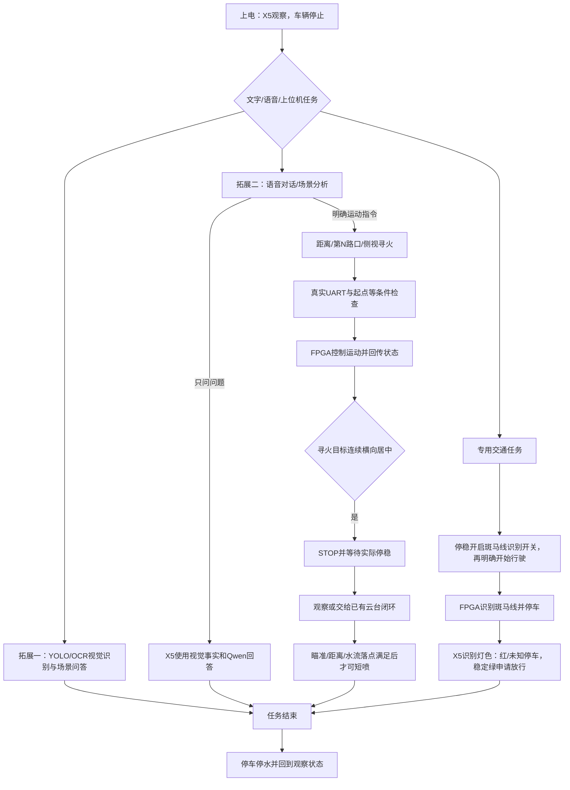
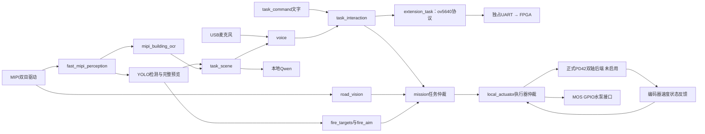
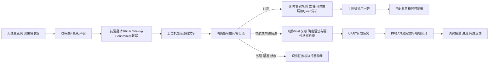

# RDK X5 消防小车：完整学习与验收手册

**学习入口 · 2026-11-02 更新**

最新本地版本先读[《本地全功能验收与标定说明》](本地全功能验收与标定说明.md)：包含本轮导航、语音、固定相机当前视场搜索、双轴与独立落点补偿的验收范围、复测命令及实际标定步骤。水流表格式见[《固定相机实测落点接口》](固定相机实测落点接口.md)。本轮只在电脑模拟并打包，没有连接或更新实车；下文历史“本轮”记录以各自日期为准。

当前新增的区域任务请先阅读同目录[《语义区域搜索与地图导航》](语义区域搜索与地图导航.md)：口令为“在A区域搜寻火源并执行灭火”；A～D每区四个搜索点；起点包含车头方向，同点再次点击逆时针转90°；FPGA自主导航页显示惯导箭头与剩余路线。该指南包含全程检测、三维靠近、停稳瞄准短喷及继续搜索的执行条件。本次本地更新仍需配套烧录、部署和实测标定，不能把软件回归等同于自动喷水验收。

本轮最新改动：水枪控制转移至 **FPGA B13，高电平开启**。X5通过既有唯一UART桥提交有限时脉冲，不再使用X5物理16脚；上位机只依据FPGA输出寄存器显示开启、关闭或未知。原有目标、瞄准、停稳与落点联锁继续使用。旧活动配置须按《拓展任务与水枪接线_20261031.md》迁移，不能仅更新源码后继续用GPIO配置。纯惯导改为保留定点余数和使用中点航向积分，减少数值累计误差，未引入视觉纠偏，也未恢复途中“偏离路线”停车。实车精度仍需轮径、编码器与起始朝向标定；本轮未部署或实测。

连续录音的最新本地修复：SenseVoice与独立Vosk核验放在可回收的识别进程中。正常多次录音复用模型；某次原生计算超时后回收该进程，下次点击开始会重新加载，旧轮次结果不能提交新指令。每轮仍保留语音有效期与动作核验；不保证每次转写都在相同时长内完成。此修复尚未部署，后续应连续进行至少三次“开始收音→说完提交”，再验证一次失败后重试。不要把当前板端旧程序的表现当作此本地版本已经验收。

> 最新操作口径见同目录《当前任务流程与固定双目瞄准.md》。文字与语音编号导航统一按规则解析，Qwen保留场景分析与问答；弯速140/120 mm/s，取消运行时几何偏离停车。本轮未部署或烧录；此前实机记录仍按各自日期保留。双目固定车身、云台只带喷嘴；双目/外参及落点标定待完成，B13实际输出也尚未验收。

当前编号导航链路是：无线麦克风 → SenseVoice及独立转写核对 → 与文字输入共用的规则解析器 → 明确提取起点/终点/地图朝向并校验状态 → UART → FPGA按朝向规划、IMU＋编码器行驶 → 到达停稳后YOLO观察。导航不调用Qwen；不符合支持语法或缺参数时说明原因，不让模型猜动作。第一次从8号点、朝左前往4号点，可以说或输入“你现在在8号点位，车头朝地图左侧，请导航前往至4号点位”；没有朝向且没有可靠参考时会澄清。上位机地图辅助区也可输入实际角度。听写、规则解析、路线规划、底盘控制是四个不同层次。

最新控制上限：转角绝对值不超过12°为200 mm/s，超过12°为140 mm/s，超过24°为120 mm/s；较低的用户设置及起终点加减速仍有效。Mode 9不因普通障碍、斑马线或几何偏离判定中断，跨过中间采样点后继续下一段。人工停止、链路或传感器故障、路线失效及终点停车保留。“到达”是惯导估计路线完成，`physical_position_verified=false`，不能当作外部实测定位准确。细节见相邻FPGA工程《惯导弯速与偏离判定调整_20261101.md》。

本版把上位机整理为**任务驾驶台、视觉与瞄准、设备调试**三个主入口。驾驶台同屏显示语音对话、摄像头和 FPGA 地图，导航以语音为主，点地图只辅助填写目标。新增真实地图遥测协议、PD42 俯仰轴＋ZDT 水平轴正式混合后端、编码器反馈视觉瞄准及有限角度往返自检。**先读第24章和《上位机任务驾驶台使用.md》；第24章说明本次最终界面与验收范围，优先于带日期的历史记录。**

历史记录：2026-10-31的FPGA版本完成Gowin编译及Flash烧录，证据为 `diagnostics/gowin_verified_20261031/build_audit.json`、`diagnostics/programming_20261031_185855/result.json`；当天上位机本地验收见系统目录 `reports/local_acceptance_20261031/本地验收与离线热点使用.md`。2026-11-01 03:42:51又完成朝向修复版FPGA烧录，见相邻FPGA工程《语义导航新版烧录_20261101.md》。这些记录不代表本轮规则入口与140/120弯速已经部署。桌面“消防救援控制台（最新版）”读取X5页面；更新电脑文件不会自动更新板端。文中带日期的性能／接线记录也不能替代当前硬件状态。

此前已取得双目真实图像、YOLO和本地模型运行证据；麦克风的 USB 接收器插在 X5。实际两台云台测试电机是 PD42（PIN8/10，ttyS1）和 ZDT_XS（PIN3/5，ttyS3），不能把这两个串口再分配给 FPGA。正式混合云台、双目距离、喷嘴落点及水泵仍需单独验收。电机2编码角能读取不代表驱动输出或实际转动已通过验收。本次不改水泵引脚、不自动校准电机。

文中旧 CRC 可变帧协议只供历史接口参考；**本次拓展任务使用 `ov5640_protocol.py` 的固定10字节XOR协议**，由 `extension_task` 独占 FPGA 串口。原兼容桥在此启动配置中保持 dry-run，不得让两套协议同时写同一个设备。

## 目录

1. [先弄清楚整个系统](#c1)
2. [文件位置、电脑终端与板端终端](#c2)
3. [第一次使用：连接、启动、自检、看图](#c3)
4. [ROS 2 从零理解：节点、话题、消息与启动文件](#c4)
5. [文字与语音指令速查](#c5)
6. [检验火焰、人物、消防员识别](#c6)
7. [检验楼牌 OCR 与场景理解](#c7)
8. [检验语义导航与 FPGA 通信](#c8)
9. [检验红绿灯、停车与通行](#c9)
10. [火焰编号、瞄准、喷水与自动模式](#c10)
11. [双目距离、角度补偿与实测落点](#c11)
12. [USB 语音输入与播报](#c12)
13. [本地 Qwen 与无线回传](#c13)
14. [自动测试与验收记录](#c14)
15. [修改代码、编译、部署与打包](#c15)
16. [逐文件学习路线](#c16)
17. [常见故障速查](#c17)
18. [给老师演示的顺序](#c18)
19. [FPGA 接口协议与硬件清单](#c19)
20. [最终目录、清理范围与术语](#c20)
21. [桌面实车上位机：无线看图、真实任务与语音控制](#c21)
22. [硬件接入验收与独立音频诊断](#c22)
23. [拓展任务、手机热点与本轮使用方法](#c23)
24. [最终任务驾驶台、真实地图与两轴自动瞄准](#c24)

<a id="c1"></a>
## 1. 先弄清楚整个系统

### 1.1 两块板分别做什么

| 部分 | 负责什么 | 不要混淆 |
|---|---|---|
| FPGA | ov5640 工程保存地图、规划路径，使用编码器/IMU控制底盘；识别斑马线、停车和上报 | 具体尺寸及固件以同级 ov5640 工程为准；不靠 X5 计算轮子 PWM |
| RDK X5 | YOLO、OCR、任务解析、独立灯色识别、语音/Qwen、寻火及云台/水泵接口 | 拓展二发送距离或地图途经点要求；不把语言模型自由回答直接作为电机指令 |
| 电脑 | VS Code 远程开发、浏览器显示、模型训练、Blender 地图与独立小车仿真 | 电脑里的仿真成功不等于实车导航已验收 |

你说“前进20厘米”，X5把语音解析成有边界的距离命令，FPGA利用编码器完成；你说“第3个路口左转”，X5用初始化的起点和地图拓扑解释路口，发送途经点约束，FPGA自己规划并执行。旧“去3号楼”必须先把楼号观察点配准到本次实物地图；不能直接使用虚拟街区的坐标冒充实车位置。

**陀螺仪给出转动信息，不能单独给出可靠的平移距离。** FPGA 至少需要合理使用轮编码器和 IMU，并标定轮径、轴距、转向和地图尺度。固定起点有利于初始化，但不能消除累计误差。

### 1.2 一次完整任务



上面的每条箭头都有条件。图中描述的是设计和代码流程；没有接 FPGA、没有完成云台标定时，程序会报告等待或拒绝，不会假装已行驶、已对准或已出水。

### 1.3 当前能验什么，什么还要接硬件

| 功能 | 软件与既有证据 | 你接下来应验收的内容 |
|---|---|---|
| 双 MIPI 相机、单眼完整预览 | 已有实机取图记录，1280×1088 | 今天是否两路持续出图，眼序和遮挡是否对应 |
| 三类 YOLO | 已有 X5 BPU 运行记录 | 当前打印壁纸的误检、漏检、距离与光照效果 |
| 楼牌 OCR | 已接入校正画面，按采集时间关联；有离线识别记录 | 打印门牌在真实镜头中的稳定识别 |
| 文字命令、场景事实、Qwen | 已有节点和实机问答记录 | 今天的命令回执和模型响应 |
| 语音 | SenseVoice Small INT8＋Silero VAD；动作同音频Vosk复核；48 kHz采集转16 kHz，本地按键收音 | 点击开始收音后检验真人转写；当前没有音箱，TTS关闭 |
| FPGA 语义导航 | X5 编解码与任务端齐备 | FPGA 固件、真实 UART、地图、定位、STOP/GO、到达回报 |
| 红绿灯 | 真实相机可作固定镜头观察；明确任务启动交通流程 | 先验证灯板识别；接车后另验云台搜索、停车距离和STOP/GO |
| 双目测距 | 标定工具、匹配和结果关联代码齐备 | 同步、左右内外参、米制距离验收；模板关闭距离输出 |
| 双电机空载测试 | 独立PD42/ZDT_XS串口线程，双卡片真实读回、±5°点动、5 RPM持续正反转及5秒续租停止 | 先验每台方向、速度与停止，再验两台同时运行及断连停止；本轮不预先宣称实测通过 |
| 瞄准/水泵 | 目标选择、几何与落点补偿、PD42＋ZDT混合后端、编码器反馈、FPGA B13定时脉冲 | 本地验证通过；安装参考、方向、齿比、机械载荷、喷嘴和MOS实际输出待实测；模板默认不输出 |

**三个最重要的状态含义：** `accepted=true` 是软件接收请求；`dry_run=true` 是不写真实硬件；`depth_valid=false` 是这一目标没有可用距离。它们都不能代替实物结果。

<a id="c2"></a>
## 2. 文件位置、电脑终端与板端终端

### 2.1 当前唯一主工程

| 用途 | 路径 |
|---|---|
| 电脑系统目录 | `D:\工程仿真\FPGA赛道_小车仿真\RDKX5_消防小车系统` |
| 电脑 ROS 工作区 | 上述目录下 `ros2_ws` |
| X5 ROS 工作区 | `/root/rescue/ros2_ws` |
| 本手册 | `ros2_ws/docs/完整学习与验收手册.md` |
| 浏览版 | 系统目录下 `打开学习手册.html`，与本手册同一版内容 |
| 地图/壁纸 | 同级 `map_assets`，当前楼牌配置来源为 `rescue_maze_v6` |
| 训练工程 | 同级 `YOLO11n_model`，保留数据、训练代码、导出工具和模型来源 |
| 电脑 C++ 仿真 | `D:\Github_OpenCode_TreeBird\AckermannRescueSim`，独立于 X5 实车运行 |

板端 `/root/rescue/ros2_ws` 可能是指向 `system_20261010/ros2_ws` 的符号链接。这是已部署的活动工作区路径关系，**不能因为名字有旧日期就删除它的目标目录**。

### 2.2 分清命令在哪执行

- 提示符 `PS D:\...>`：Windows PowerShell。适合 `ssh`、`scp`、打开浏览器和本地文档。
- 提示符 `root@ubuntu:...#`：X5 Linux。适合 `source env.sh`、`ros2`、`systemctl`、`bash`。
- VS Code 左下角显示 `SSH: rdkx5` 时，通常新终端在 X5 上；可执行 `hostname; pwd` 核实。
- 通过 VS Code SSH 打开的文件直接改在板上，不会自动同步到 D 盘。修改完必须有意识地同步一份权威源代码。

### 2.3 每一个 X5 新终端都先执行

```bash
cd /root/rescue/ros2_ws
export ROS_DOMAIN_ID=0 ROS_LOCALHOST_ONLY=0
source env.sh
```

`source` 只设置这个终端的环境，不是启动相机。终端关闭后新开一个，需要重新执行。这里必须先写域 0：`env.sh` 的通用默认是域 71，而真实相机/任务栈在域 0；用错域就像进入了另一间聊天群，会看不到节点。

测试脚本使用域 83，与实机域 0 隔离。不要将合成图片或假的 FPGA 状态发进实机域。

<a id="c3"></a>
## 3. 第一次使用：连接、启动、自检、看图

### 3.1 电脑连接 X5

在 Windows PowerShell 输入：

```powershell
ssh rdkx5
```

已有别名指向 `root@192.168.127.10`，使用本机 SSH 密钥。VS Code 按 `F1`，选择 `Remote-SSH: Connect to Host...` → `rdkx5`，再打开 `/root/rescue/ros2_ws`。

若报连接重置/超时，用已经连接的串口登录 X5，检查：

```bash
ip -br -4 addr
systemctl status ssh --no-pager
```

用户2026-10-14通过串口提供网线地址 `192.168.127.10/24`、无线地址 `10.137.129.227`；以后每次使用以板上最新输出为准。若 SSH 服务停止，可在串口执行 `systemctl start ssh`。若处于 active 仍被重置或超时，检查 `journalctl -u ssh -n 50 --no-pager`，不要反复删除密钥或跳过主机身份校验。

#### 首次使用这份最终版：同步新增工具和手册

这是 **Windows PowerShell** 命令，先确认上面的 `ssh rdkx5` 已能登录。若当前在板端终端，另开一个电脑端 PowerShell；不要把 `D:` 路径粘贴到 Linux 中。

```powershell
Set-Location -LiteralPath 'D:\工程仿真\FPGA赛道_小车仿真\RDKX5_消防小车系统\ros2_ws'
ssh rdkx5 'mkdir -p /root/rescue/ros2_ws/tools /root/rescue/ros2_ws/docs'
scp .\tools\self_check.py rdkx5:/root/rescue/ros2_ws/tools/self_check.py
scp .\docs\完整学习与验收手册.md rdkx5:/root/rescue/ros2_ws/docs/
```

每条命令成功后再执行下一条；连接失败时先处理 SSH。这里只更新新增的只读自检工具和手册，不需要重启相机，也不需要编译。电脑上的旧资料已移出活动工程，板上的历史文档尚未清理；远程开发时也以这份最终手册为学习入口。

### 3.2 先检查服务，不要重复启动

当前推荐先运行`bash tools/start_interaction_services.sh`，再做下面的只读检查。该入口会按配置补齐所需服务，避免只看得见画面却没有任务路由；不要再另外启动同一套相机、任务或语音进程。

完成第 2.3 节环境设置后执行：

```bash
systemctl is-active rescue-mipi-camera rescue-mipi-vision rescue-yolo-preview rescue-edge-llm rescue-task-interaction
```

五行分别对应以下顺序：

| 服务 | 作用 |
|---|---|
| `rescue-mipi-camera` | 唯一的官方双 MIPI 相机驱动 |
| `rescue-mipi-vision` | 物理左眼去畸变、YOLO、检测结果与完整 JPEG |
| `rescue-yolo-preview` | 8086 端口画面网页 |
| `rescue-edge-llm` | 本机 8088 端口 Qwen 推理 API |
| `rescue-task-interaction` | 任务状态机、道路观察、OCR、目标、瞄准、语音、FPGA 接口等 |

`active` 只证明服务进程运行，仍需下一节检查消息和画面。若服务存在但 inactive，依次启动相机、视觉、网页、Qwen、任务；不要并行抢跑任务入口：

```bash
systemctl start rescue-mipi-camera
systemctl start rescue-mipi-vision
systemctl start rescue-yolo-preview
systemctl start rescue-edge-llm
systemctl start rescue-task-interaction
```

启动后等节点初始化再自检。第一次加载模型、OCR 和 ROS 发现需要时间，刚重启立刻发命令可能得到 `Task router unavailable`。

### 3.3 服务显示 not-found 怎么办

部分服务此前是`systemd-run`创建的临时服务，重启板子后可能消失；这不表示源代码丢了。使用当前统一入口恢复，在X5执行：

```bash
cd /root/rescue/ros2_ws
bash tools/start_interaction_services.sh
```

它负责使用当前`voice.local.json`按键收音配置与固定镜头观察配置；不要复制旧的连续监听模板到任务服务启动参数。`ocr_fixed_camera_preview:=true`只允许固定相机OCR联调，不代表真实云台姿态已验收。装好并验收云台后再使用自己的硬件配置，逐项验证真实UART、PD42和水泵；当前入口不启用这些物理输出。

脚本提示 `already running` 时先查现有服务/终端，不再开第二份。尤其不要在当前相机运行时另开官方 `run_cam.sh`。

### 3.4 一键只读自检

```bash
python tools/self_check.py --seconds 5 --output reports/self_check/latest.json
```

它检查环境、服务、ROS 状态和网页元数据；不启动服务、不发任务、不旋转云台、不喷水、不打开传图租约。读懂结果：正常项为 `PASS`；缺硬件、待标定、待机或本次未观察到证据为 `WAIT`；服务缺失、环境/数据异常为 `WARN`。本工具没有 `FAIL` 状态，有 `WARN` 时退出码为 1。不要为了把提示变绿，直接把标定开关改成 true。

结果同时写到 `reports/self_check/latest.json`。如果 X5 离线，你只能做第 14 章的本地软件检查，不能得到真实相机/硬件验收。

### 3.5 打开实时画面

电脑浏览器打开 <http://192.168.127.10:8086/>。它只负责 YOLO 画面显示和传输开关，不是全功能任务按钮面板。

在 X5 终端请求观察：

```bash
python tools/task_command.py "寻找火焰"
```

拿当前壁纸图案给镜头看，应该有火焰、消防员、人物框。关闭网页“画面传输”，会省 JPEG/网络相关工作；观察任务仍可继续检测。没有当前目标时不出现框是合理结果。

关闭浏览器不等于结束任务。结束观察请执行：

```bash
python tools/task_command.py "任务结束"
```

### 3.6 日志与停止

查看最近错误，不需要停止程序：

```bash
journalctl -u rescue-task-interaction -n 60 --no-pager
```

把服务名替换为 `rescue-mipi-vision` 或 `rescue-yolo-preview` 即可查看对应日志。持续跟踪用 `journalctl -u rescue-task-interaction -f`，按 Ctrl+C 只退出日志查看。

需要停止全部软件时，先发“任务结束”，确认泵和运动许可关闭，然后依次停止：

```bash
systemctl stop rescue-task-interaction rescue-yolo-preview
systemctl stop rescue-mipi-vision rescue-mipi-camera rescue-edge-llm
```

真实实物的失电/紧急情况用实体急停；软件退出、SSH 断开或关闭窗口不能替代硬件停泵与制动。

### 3.7 不连Wi-Fi与电脑，如何上电自动运行

**视觉、语音和Qwen推理不需要互联网，也不需要Wi-Fi连接。** 摄像头、USB麦克风接收器、模型、ROS节点都在X5本机；FPGA和步进驱动使用各自UART，具体协议按设备选择。电脑EXE只是显示与操作端，SSH只是开发连接。使用不提供互联网的手机热点或路由器，也能在同一局域网查看上位机；完全不连网络时，电脑自然看不到车端画面，但本地算法仍可运行。

先区分三个层次：断网继续运行已启动的节点；上电自动启动节点；无需电脑而能收到你的任务。第一项现有程序已支持，第二项使用以下开机服务，第三项需要车载常听语音或实体按键输入。当前`push_to_talk`只在收到开始收音请求时采集，断开上位机后不会自动变成常听。已有`continuous`模式，要求命令以“小车”等前缀开始（停止类指令除外）；这是转写后的前缀校验，尚不是单独的唤醒词模型。该模式未由本次安装默认启用，也未做真人免按键验收。

2026-10-26晚已把持久开机服务安装到这台X5并启用，当次也已启动。以后正常开机由systemd启动，无需每次SSH输入命令。下面命令用于重新安装或迁移到另一台已准备好环境的X5，在**X5终端**执行：

```bash
cd /root/rescue/ros2_ws
sudo bash tools/install_offline_autostart.sh
```

安装入口仅安装并设为以后开机启动，不立即启动／重启现有服务。它配置`rescue-standalone.target`和相机、YOLO、预览、任务四个持久服务，复用既有本地模型、ROS环境及按键语音设置；若板上已经安装Qwen与上位机服务，会一并加入启动集合。缺少对应服务时会明确提示，需要先完成原有本地模型安装，不会临时上网下载模型。程序故障由systemd按服务重启，启动流程不等待Wi-Fi或互联网就绪。

准备好后立即启动（或下次正常开机自动启动），然后检查：

```bash
sudo systemctl start rescue-standalone.target
systemctl is-enabled rescue-standalone.target
systemctl is-active rescue-mipi-camera rescue-mipi-vision rescue-yolo-preview rescue-task-interaction
```

若旧的同名临时服务正在运行，安装不会替换其中的活进程；新持久配置在重新启动对应服务或下次开机后生效。`active`只代表服务进程运行，仍应按第3.4节自检，并分别验收真实图像、语音和硬件反馈。取消以后开机自动启动可执行`sudo systemctl disable rescue-standalone.target`，这条命令不会停止当下任务。

当前开机配置为固定镜头观察联调：真实相机、YOLO、灯色、OCR和任务节点自动运行，UART、电机、水泵输出仍保持dry-run。它没有代替FPGA导航、两轴机械参考、串口读回和喷水标定验收。完成这些验收后再配置正式无人值守任务，尤其不能把每次上电后的云台参考直接当成已确认。

<a id="c4"></a>
## 4. ROS 2 从零理解

### 4.1 五个词先学会

| 名称 | 在本工程里的含义 |
|---|---|
| 工作区 workspace | `/root/rescue/ros2_ws`，装源码、配置、模型和构建结果的目录 |
| 包 package | `rescue_interfaces` 定义消息；`rescue_vision` 放节点与算法 |
| 节点 node | 一个负责某项工作的程序，例如 `mission`、`fire_targets` |
| 话题 topic | 节点间消息通道，例如 `/mission/state` |
| 消息 message | 一次发送的结构化数据；有些是自定义类型，有些是 String 中的 JSON |
| launch | 按参数组合启动多个节点的 Python 文件；当前任务入口是 `task_modes.launch.py` |

一个 systemd 服务可以启动多个节点。`rescue-task-modes` 当前组合启动 13 个节点；不要把“5 个服务”误认为“5 个 ROS 节点”。

### 4.2 当前任务节点怎样配合



相机实际两只眼都可出图，但 YOLO 使用一只眼做 2D 检测；另一只眼用于双目几何。把两幅图拼成一张、去畸变、双目立体校正、计算深度，是四件不同的事。

### 4.3 三个最常用的观察命令

```bash
ros2 node list
ros2 topic list
ros2 topic echo /mission/state --once
```

`--once` 收到一次消息后退出。`ros2 topic echo /mission/state` 不带它会持续显示，按 Ctrl+C 退出观察，不会停掉发布节点。一个终端不要一次粘贴几条持续 echo。

### 4.4 你应该看哪些话题

| 话题 | 看什么 |
|---|---|
| `/mission/state` | mode、arrival_policy、camera_pose、motion_allowed、vehicle_stopped、reason |
| `/diagnostics/perception` | detector_active、enabled_classes、capture_fps、processing_fps、stage_errors |
| `/perception/detections` | 本帧类别、置信度、框、采集时间、检测是否可用 |
| `/diagnostics/building_ocr`、`/scene/ocr` | OCR 启停、处理、读到的楼牌与是否确认 |
| `/navigation/state`、`/fpga/tx`、`/fpga/link` | 目的地、任务身份、待发报文、真实链路或演练 |
| `/traffic/preview`、`/traffic/state` | 独立灯色证据与正式交通流程 |
| `/fire/targets`、`/fire/proposal` | 可选火焰、目标 ID、纠偏建议与拒绝原因 |
| `/fire/auto/state` | 自动任务当前步骤和终止原因 |
| `/stereo/depth_status`、`/perception/depth_detections` | 双目是否工作、目标距离及有效性 |
| `/actuators/state` | dry_run、hardware_written、pump_on、guard、实际角度是否可读回 |
| `/voice/status`、`/voice/transcript` | 收音状态与识别出的文字 |
| `/scene/report`、`/scene/answer` | 当前事实、问答结果、来源和限制 |
| `/interaction/result` | 请求是否被路由接受，不能代替执行完成 |

`std_msgs/String` 类型的 echo 会显示 `data: '{...}'`，里面的 JSON 才是业务字段。查看消息结构用 `ros2 interface show rescue_interfaces/msg/DetectionArray`。

<a id="c5"></a>
## 5. 文字与语音指令速查

先用文字验证业务，再换真实麦克风；两者最终走同一个任务解析入口。在第 2.3 节环境下，命令形式为 `python tools/task_command.py "中文指令"`。

| 输入文字 | 作用与检验点 |
|---|---|
| 寻找火焰 / 开启识别 | 进入观察，开启三类检测和 OCR；看 mission=inspect、detector_active=true |
| 去三号楼观察 | X5 提交楼号 3；看 navigation 和 UART 报文，不能仅看 accepted |
| 去三号楼等待语音指令 | 目的地 3，到达后 manual |
| 去三号楼自动灭火 | 目的地 3，到达后 auto |
| 到达后自动找火灭火 | 设置后续到达策略，不立即开泵 |
| 到达后等待语音指令 | 设置后续到达策略为 manual |
| 开始自动找火灭火 | 在当前位置明确启动一轮自动任务；依然要满足停稳和标定条件 |
| 瞄准第二个火焰 | 从当前可选火焰按左右顺序选择第 2 个 |
| 瞄准二号火焰 | 选择稳定跟踪 ID=2，与“第二个”不同 |
| 瞄准最左边的火焰 | 选择当前最左侧目标，只瞄准 |
| 开启喷水 | 请求限时、带条件的喷水授权，不是永久保持电平 |
| 停止喷水 | 撤销喷水和相关自动授权；随后旧请求不能重新开泵 |
| 现在有几个人 / 有没有消防员 / 现在是几号楼 | 查询有效视觉事实 |
| 对当前火场进行分析 | 结构化事实与本地 Qwen 结合回答，不直接操作底盘或水泵 |
| 任务结束 | 取消任务和导航、关泵、回 standby |
| 紧急停车 | 进入停止保持的 idle，不是继续巡逻 |

命令逐条选用，**不要把这张表批量执行**。尤其“开启喷水”“自动灭火”属于执行请求，在真实硬件启用后具有实际效果。

查看目标，不发选择命令：

```bash
python tools/task_command.py --targets
```

等待一个问答结果：

```bash
python tools/task_command.py "现在有几个人" --wait-answer
```

Qwen 较慢时：

```bash
python tools/task_command.py "对当前火场进行分析" --wait-answer --answer-timeout 90
```

`--wait-answer` 只用于问题/报告，不用于喷水或导航命令。状态“已入队”“已接受”也可能随后因条件不满足被拒绝；看对应功能状态的话题。

<a id="c6"></a>
## 6. 检验火焰、人物、消防员识别

### 6.1 实际操作

1. 运行只读自检，确认相机/视觉进程与近期消息可用。
2. 打开 8086 网页，执行“寻找火焰”。
3. 给物理左眼看当前地图的打印壁纸；先正面、距离约 0.4～1.0 m，再做斜视角与光照变化。
4. 观察网页类别和框；同时执行 `ros2 topic echo /diagnostics/perception --once`。
5. 结束后执行“任务结束”，再看 `detector_active` 是否回到 false。

正常时 `enabled_classes` 为 `fire/firefighter/person`，观察模式 `detector_active=true`，`stage_errors` 无活动错误。YOLO 不认识画面中所有真实场景，它训练的是当前壁纸图案；真实火、真实人员的泛化能力没有因模型成功运行而得到证明。

### 6.2 怎样量化，而不是“看起来还行”

做一张自测表，每行记录：楼面/目标、距离、角度、照度或光源位置、目标像素尺寸、人工应有类别与个数、程序检出个数、误检/漏检、截图文件名。建议覆盖：

- 近景 0.4、0.7、1.0 m；更远距离单列，不与主要观察区混在一起。
- 正面、左右约 30°、更斜角各一组。
- 正常、偏暗、侧光、反光，以及目标部分遮挡。
- 消防员与普通人物相邻、纯建筑背景无目标等易混淆画面。

同一张训练原图在显示器上反复展示不能作为独立实拍验证。实拍验证图片不要回灌到训练集后仍称为独立验证。

### 6.3 看懂帧率

2026-10-14在完整交互服务、三类YOLO、OCR和道路观察并行条件下，优化后持续传图约14.1 FPS（优化前12.4），无人请求传图约17.3 FPS（优化前15.1）。相机送达仍约30 FPS。测试是板端HTTP原图链路，不能当作电脑屏幕或Wi-Fi环境的保证值；大模型与麦克风当时待命。

该次历史优化减少OCR忙碌期间无用取图，并让道路观察按原频率接收完整原始帧，图像1280×1088、模型640×640、JPEG90、三类识别和去畸变保持。当时固定相机观察为3Hz；2026-10-27已替换为仅红绿灯检测，当前设置与实测见9.1。无人传图时停止JPEG编码，视觉识别继续。

待机可能仍显示20～30 FPS预览/状态，而`detector_active=false`，这不是YOLO推理速度。详见工程根目录`reports/performance_20261014/性能优化验收.md`，其中保留测量条件和原始JSON。

被动记录性能：

```bash
.venv/bin/python tools/benchmark_interaction_http.py --stream --seconds 30 --output reports/self_check/observation_performance.json
```

它不切换任务、不录音，`--stream`会维持图像请求。比较前后必须保持相同模式、光照、画面和传图开关；不要边跑性能测试边跑完整自动测试。主视觉输出最新有效帧，过期数据会丢弃，FPS 不能脱离图像年龄一起判断。

### 6.4 清晰度与问答期间的算力分配

这只GS130W当前单眼原始采集为**1280×1088**。官方SDK传感器配置是1088×1280，旋转90°后正好是现在的尺寸；当前已使用这一路支持的原始像素。畸变校正、传图JPEG和上位机canvas也保留1280×1088，YOLO模型输入另为640×640。把显示输出改成1920只会插值放大，不能得到新的镜头细节。镜头前实际目标大小、对焦、光照、曝光和标定仍决定可见细节。

上位机“车载视觉”下面新增查看方式：默认**完整画面**；选**原始像素1:1**按电脑屏幕物理像素查看，考虑Windows缩放；选**细节放大2×**查看局部，按住鼠标左键拖动画面。**全屏查看**扩大显示区域，再点“退出全屏”返回；不支持原生全屏的桌面环境会改用窗口内放大，也可按Esc返回。这些只是电脑上的查看操作，不改变车上识别输入、检测框坐标、JPEG90质量或取帧频率；2×不是超分辨率。

你问复杂问题时，Qwen可以使用提问时整理好的YOLO/OCR快照，无需跟着每一帧重新读图。为把CPU留给文本推理，程序采用以下调度：

| 实际状态 | 视觉处理 |
| --- | --- |
| `inspect`观察模式、无运动许可、无交通任务、无自动灭火、未武装水泵，并收到新鲜的Qwen忙碌状态 | YOLO处理上限暂设6 FPS；图像像素、640模型输入、质量和三类检测保持；OCR及固定相机道路预览暂时让出算力 |
| 问答完成、问答心跳过期或条件不再成立 | 自动恢复正常处理上限与按需观察；不等待人工重启 |
| 道路巡逻、导航、红绿灯、火焰跟踪、自动灭火或喷水相关模式 | 不使用上述问答降频路径，保持各自正常处理策略与时效检查 |

“上限6 FPS”不是保证每秒正好6帧；正常上限也不是实测必达30帧。上位机只有在新鲜诊断明确报告让出算力时，才显示“问答时上限6帧，完成自动恢复”。OCR/道路预览显示“正在让出算力给对话，识别稍后恢复”。新鲜问答心跳消失后最多约2秒退出让步条件；任务状态缺失时也恢复正常处理策略，但原有任务权限与安全条件仍独立生效，不因此启动车辆或喷水。

调度只改变必要的处理频率，不改SenseVoice中文听写模型。历史快照只供问答，绝不能充当瞄准、通行或喷水的实时证据。完整功能并行的FPS与问答耗时仍需按本节相同条件实测；第6.3节为先前固定配置的历史对比。

<a id="c7"></a>
## 7. 检验楼牌 OCR 与场景理解

### 7.1 OCR 怎么运行

YOLO 前的颜色转换与去畸变产生完整 BGR 画面。主视觉最多以 2 Hz 给 OCR 发布完整的 1280×1088 图，OCR 用同一采集时间配对检测。2 Hz 是 OCR 取图上限，不限制 YOLO 或网页只有 2 FPS。OCR推理与等待期间暂停图像订阅，下一次需要识别时恢复；恢复后只接受当前任务的新鲜同帧图像，避免处理旧画面。

楼牌字符检测内部使用较小分析图，文字识别裁剪取原始像素。模型识别文字后，匹配 `config/buildings.json`，再进行多帧确认。它不是 YOLO 的一个“楼号类别”。

| 编号 | 楼名 | 内部 ID | 编号 | 楼名 | 内部 ID |
|---|---|---|---|---|---|
| 01 | 安居楼 | A | 08 | 幸福楼 | H |
| 02 | 向阳楼 | B | 09 | 同心楼 | I |
| 03 | 春晖楼 | C | 10 | 晨光楼 | J |
| 04 | 和悦楼 | D | 11 | 绿荫楼 | K |
| 05 | 平安楼 | E | 12 | 瑞景楼 | L |
| 06 | 清风楼 | F | 13 | 康乐楼 | M |
| 07 | 暖心楼 | G | | | |

### 7.2 自检步骤

1. 执行“寻找火焰”，在镜头中稳定展示打印的“03 春晖楼”。不要拿很小或反光严重的字开始测试。
2. 查看 `ros2 topic echo /diagnostics/building_ocr --once`，确认当前任务允许 OCR，画面在进入处理。
3. 查看 `ros2 topic echo /scene/ocr --once`，等多次采集完成，观察识别文字与确认状态。
4. 执行 `python tools/task_command.py "现在是几号楼" --wait-answer`。
5. 移开楼牌，等待超过有效期，再问；不能无限沿用过期楼号。
6. 换成另一栋、遮一半、放错误号码，记录拒绝/误识别，而不是只挑成功的一张。

`building_sign_confirmed` 与 `building_association_verified` 不是一回事。当前场景代码尚未验证整栋楼面与全部检测目标的归属，`building_association_verified` 固定为 false，报告总体 `valid` 因此也为 false。应结合 `detector_available`、`stale` 和 `visible_*` 字段判断当前视觉事实，不能仅凭总体 valid 判断 YOLO 崩溃。

### 7.3 一个严谨的场景报告应该怎么说

可以说：“近期读到 3 号楼牌；当前画面看到 1 处火焰图案、2 个普通人物图案、1 个消防员图案；它们是否都属于该楼尚未确认。”

不能仅凭这些框说：“3 号楼里一共两名受困者，已灭火成功。”图案人物不等于受困人数；没有再检出火焰也可能是离开视野或漏检；壁纸上的火焰不会因喷水自动消失。

<a id="c8"></a>
## 8. 检验语义导航与 FPGA 通信

### 8.1 以本次实际协议为准

`extension_task`节点使用`ov5640_protocol.py`，订阅`/extension/request`，通过唯一真实UART下发固定10字节协议，发布`/extension/state`、`/navigation/state`和`/navigation/proposal`。拓展一和拓展二的普通识别/问答均不需要FPGA；编号导航需要真实串口、新固件、新鲜反馈及实际起点确认。上位机提交成功、FPGA回复ACK、真实运行、完成事件和停稳回读是不同阶段。

```bash
source /root/rescue/ros2_ws/env.sh
ros2 topic echo /extension/state --once
```

### 8.2 语义运动怎样做

| 指令 | X5 做什么 | FPGA 做什么 |
|---|---|---|
| 你现在在8号点，车头朝地图左侧，请前往4号点 | 规则提取8→4、180°，核对实际声明、语音复核与实时状态，不调用Qwen | 先按车头方向筛选起步道路，再规划并用IMU＋编码器执行 |
| 前进20厘米／后退20厘米 | 校验方向、距离、任务条件并编码 | 编码器闭环累计距离，结束制动并等待静止 |
| 第3个路口左转 | 由已确认车头起点/朝向和实际地图解释第几个路口，发送顺序途经点 | 复用实际有向道路规划器生成曲线路径，IMU/编码器跟踪执行 |
| 前进直到火焰居中 | 连续观察同一火焰，给短租约低速运动，居中后请求STOP | 执行速度；租约或链路过期自行停车；返回真实停稳 |
| 停车／任务结束 | 优先撤销待发运动，发送STOP，终止旧任务 | 停车；重新连通不会自动继续旧运动 |

起点是**车头中点**，世界坐标左下原点，+X向右、+Y向上，朝向0°为+X、90°为+Y。每次真正运动后，起点确认失效。重新执行路口指令前必须把车摆到所填起点并重新确认，不能复用上一次的假位置。初始化入口在上位机“拓展任务→设置起点”。

`semantic_routes.py` 只把中文要求变为拓扑约束，`extension_map.json` 从 FPGA 的 `road_centerlines.json` 导出。**真正路径仍由 FPGA 规划**。没有目标方向的T路口、直路先结束、起点不在道路或转弯前空间不足时拒绝，不改成别的路线。弯道不是路口；这条“直走到第N个路口”指令不会为了凑N绕大圈。道路几何和实际车轮转角尚需实车标定。

### 8.3 接线与验收

FPGA的独立任务串口为E14 TX、E13 RX、115200 8N1、3.3V TTL。现有分配为X5 UART2：物理15 TX接FPGA E13 RX，物理22 RX接FPGA E14 TX，物理14 GND共地，设备为`/dev/ttyS2`。X5的ttyS1和ttyS3已给两个电机，不能共用；串口复用及实际回包按板端状态核对。

在 `config/extension_uart.json` 填真实设备路径并设 `enabled=true`，然后使用本轮拓展启动入口；新版 FPGA 已完成烧录，仍需先部署 X5 更新、核对串口复用及真实握手。FPGA屏幕切换通信模式，先验证状态和停车，再依次验证轮子架空、短距离落地、固定起点路口、视觉寻火。完整部署顺序见第23章。不要给旧 `fpga_bridge` 同时设置真实UART。

`config/buildings.json` 仍来自此前虚拟地图；楼栋号到这张实物地图的观察坐标尚未配准，本次不把旧楼号请求假装成已走通的新任务。

<a id="c9"></a>
## 9. 检验红绿灯、停车与通行

### 9.1 当前运行逻辑

2026-10-27 起已删除斑马线识别运行链路和上位机条纹结果。`road_vision` 保留节点名和传输接口兼容，但专门处理物理左眼的红绿灯画面；不会再因看到地面白条纹触发停车。导航仍由 FPGA 负责。

本次红绿灯只在“开启交通任务／识别红绿灯”后运行；结束交通任务返回YOLO观察。斑马线事件由FPGA发出，FPGA先停车，X5再使用灯色证据；红灯、全灭、未知、冲突和旧帧都不作为通行依据。固定镜头预览与正式放行分开：前者展示颜色，后者还需真实停车、该任务、相机安装/姿态等条件。等待2秒不会把车辆停稳或云台到位伪造成true。

FPGA 斑马线识别开关默认关闭，可在 FPGA 驾驶页或上位机拓展任务页修改，要求车辆实际停稳。关闭会清除检测结果；重新开启从新图像开始检测。**自主导航已完全取消斑马线半速逻辑，开关开启也不会给普通导航限速。** 只有独立交通任务且开关开启，斑马线才触发停车；开关关闭时拒绝交通发车。等待红绿灯时关开关不会解除停车，也不会因旧绿灯自动继续。无串口或反馈过期时，上位机显示“未知”，不能当成关闭。

当前实物是黑色背板上的“上红、中黄、下绿”三灯板，`config/traffic.fpga_navigation.json` 的 `detector.fixture_layout` 为 `three_lamp`。算法结合灯位排列、暗背板、灯面颜色、亮芯与边缘亮度判别。红灯中心过曝发白时，依靠外围红色和上方灯位判断；支持一定倾斜。未亮灯罩、黄灯或不明确的亮度返回未知；红绿同时亮不能放行。三灯规则不会回退到旧双灯颜色阈值。

检测工作图保持 640 像素宽，当前相机对应 640×544，显示 JPEG 质量90。程序目标为最高10 Hz识别、最高8 Hz页面刷新；实际上达到多少看板端诊断和画面下方“识别 / 展示 FPS”：识别读取新鲜的 `processing_fps`，展示统计浏览器实际收到的不同帧，两者分别计量。诊断过期时识别FPS显示“—”，不能把配置上限当作实测帧率。YOLO输入与原相机分辨率不因此降低。

2026-10-27板端18秒测量：红绿灯实际处理9.07 FPS，传图6.84 FPS；此前同机基线约3 FPS。每帧识别处理平均由114.6 ms降至78.9 ms，页面另一次实际验收显示识别10.1 / 展示7.2 FPS。提速来自删除斑马线计算、一次解码缩放后复用图像、提高有界取帧频率。并行YOLO该轮平均13.81 FPS，基线15.90 FPS；更高红绿灯频率也占用CPU，不能声称所有节点同时提速。上述数值受场景和板端负载影响。

检测区域现覆盖完整画幅，避免旧中间区域裁剪漏掉靠边的完整灯板。新提供的红灯截图及去掉其文字/框线的灯板裁剪均判红；仅保留标注、擦掉实物灯板则未知。48个边缘位置/缩放检查是相关派生图，不代表真实现场准确率。部署验收时现场镜头内没有完整灯板，仍需用户切换真实红灯、绿灯和断灯进行现场确认。

### 9.2 固定镜头识别与正式任务的区别

尚未完成安装与验收时，在独立交通任务中可观察 `/traffic/preview`。把完整灯板放到镜头中即可观察真实识别框及灯色；仅预览不会直接驱动车辆。其他任务不继续后台使用灯色放行。

正式流程仍核对任务、相机姿态、图像时效和通行条件。使用云台时需要真实云台反馈；固定镜头使用`fixed_traffic_camera_verified=true`显式验收安装后才可尝试联动。未验证时只可展示预览；“开启交通任务”不动车，“开始交通行驶”才是独立发车请求。不要为了显示结果将机械标定字段任意改成 true。若未接好 FPGA 或云台，启动任务可能停在等待/拒绝，这与图像算法是否识别出红灯是不同事项。

```bash
ros2 topic echo /diagnostics/road --once
ros2 topic echo /traffic/preview --once
```

上位机显示“灯板 · 亮灯待确认”的琥珀色框，表示找到了灯板，但当前发光证据不足。灯板被裁切、距离过远、严重欠曝、反光或多个灯板进入画面时，允许输出未知；不能凭旧画面放行。

### 9.3 实物自测表

| 测试 | 应观察到的结果 |
|---|---|
| 手动让完整三灯板进入镜头 | 有效时出现灯板框，右侧显示当前灯色或未知原因 |
| 红灯点亮、中心偏白 | 应识别红灯；不能因中心白色直接判无灯或绿灯 |
| 绿灯点亮 | 预览显示绿灯；仅预览时不会驱动车辆 |
| 全灭、黄灯、两个灯冲突 | 不授予通行；未知或冲突仍保持停车 |
| 正式任务发起后不足2 s | 仍等待，不提前搜索 |
| 绿灯稳定且任务/链路条件齐备 | 有限期GO；丢条件会撤销 |
| 未收到过街完成 | 不能随意当成下一个新路口 |
| 相机断帧或姿态错误 | 旧灯色不能继续授权 |

既有两张无标注实拍及新增带红框/“红灯”字样的截图可用于回归定位。带标注截图不能作为独立原始图像准确率证据，也不能让算法依赖文字或画框；其裁剪/去框图和旋转缩放均为相关衍生测试。实际全灭、黄灯、不同距离、不同曝光和现场连续切灯仍需独立采样验收。新的帧率目标也需 X5 在线复核。

<a id="c10"></a>
## 10. 火焰编号、瞄准、喷水与自动模式

### 10.1 三步指令不是同一件事

“寻找火焰”开启观察；“瞄准第二个火焰”选择并尝试跟踪；“开启喷水”请求带条件的短时喷射。识别到火焰不会在手动模式自动喷水。

先查看 `python tools/task_command.py --targets`，以当前可选项为准。跟踪 ID 在目标持续可见时较稳定，但不能当作永久楼栋身份；移动相机、遮挡、重启或目标丢失后应重新确认。

### 10.2 瞄准怎样算

目标像素在校正后的物理左眼坐标系中，使用对应 CameraInfo 的内参 K 计算方向误差。当前控制器使用拍摄时刻的实测角度估计目标方向，再相对最新编码器角度计算限幅修正，避免尚未执行的指令角逐帧累加。mission 仲裁优先级，local_actuator 按选定后端执行。**正式 `mixed_actuator_io` 已实现 PD42 俯仰轴＋ZDT_XS 水平轴，两条 UART 使用各自的协议和位置单位；模板仍保持 dry-run。** 不能把 ZDT 端口填入只支持 PD42 的旧模板。需实测确认安装参考、齿比、方向、限位和 ZDT 配置，才能将编码器数值解释为云台角度；驱动 ACK 仍不等于实际到位。

工程保留普通PWM舵机作为兼容备选。只有选择PWM后端时才输出脉宽，且无法读回实际角度，其稳定时间只是行程估计。两台串口步进驱动不使用这套PWM接线；正式云台尚未完成安装标定，任务执行器真实输出保持关闭。

查看 `/fire/proposal` 时关注：是否有选中目标、数据是否新鲜、相机几何是否一致、`compensation_kind`、`servo_plan` 和拒绝原因。`servo_plan`是沿用的视觉角度规划字段名，不表示硬件必须是PWM舵机。选择动作还要求新鲜真实停稳状态；FPGA无有效反馈时，能看到目标列表也可能不能锁定。模板未标定时，可以检查目标证据及拒绝原因，不能要求云台实际动。

### 10.3 喷水为什么会被拒绝

至少要同时满足：明确选择、任务允许、真实停稳、云台条件、最新锁定、有效距离/落点条件、泵配置、执行器启用、人工或本轮自动授权。任意一项未满足，拒绝是正确行为。

模板中的一次短喷为约 0.4 s、冷却至少 1 s、稳定锁定约 0.35 s、授权次数有上限；精确值以当前配置/状态为准。界面“开启喷水”不是无限出水命令。“停止喷水”“任务结束”和失锁等会撤销许可，恢复画面不会自行恢复旧许可。

**当前没有完成喷嘴落点和真实泵验收，不能仅修改 enabled=true 来测试。** 按第 11 章顺序完成标定；先用 LED/逻辑分析仪替代 MOS 使能验证，再接泵。

### 10.4 两种到达模式

- manual：FPGA 报告到达且停稳后进入观察，等你选择目标和喷水。
- auto：当前实现每轮选一处最大的稳定可见火焰，尝试瞄准、一次短喷、复查，然后结束或按失败原因退出。它不是一次授权把所有楼的所有火焰无限巡回喷射。

在壁纸项目中，复查只能报告检出变化与实际喷射记录；不能通过“已经发过喷射命令”宣布灭火成功。

### 10.5 接线和启用顺序

1. 查看第19、22章，确认PD42的TTL版本、3.3 V兼容性、两条独立UART、电机独立电源以及MOS模块。
2. 先运行只读诊断，核对两轴真实位置、状态和故障；用外部回零或机械量零建立本次参考，填写方向、齿比、限位。程序不会自动回零。
3. 机械支撑就绪后，单轴、双轴逐步验证小角度移动和真实反馈，再安装相机/喷嘴检查负载与失能后的姿态。只有改选兼容PWM方案时，才进行断开舵机测脉宽的流程。
4. 不接水泵，测试选择、跟踪、目标丢失、交通抢占和取消。
5. 用 LED 代替泵使能，验限时、冷却、次数、停止命令和异常退出；真实泵必须有独立硬件限时截止。
6. 固定容器内实测落点，再允许带条件的真实喷射。当前B13后端由FPGA独立完成最多1秒脉冲截止，X5进程停止后不会续延；需实测确认电平与MOS效果。旧GPIO后端没有这项FPGA截止，已经被电机驱动接收的命令也不保证因X5进程退出而撤销。

<a id="c11"></a>
## 11. 双目距离、角度补偿与实测落点

### 11.1 当前眼序

按此前“站在摄像头后方看向拍摄方向，遮住左手边镜头，合成画面下半幅变暗”的实测：物理左眼为 `/image_right_raw`，物理右眼为 `/image_left_raw`。名字与物理位置相反并不自动代表硬件坏了。

换线、换通道或修改旋转后重新遮眼验证。画面眼序确认与 EEPROM 内参究竟属于哪只镜头，是两个验证项目。当前单目去畸变使用候选内参，不能直接宣称整个双目距离已校准。

### 11.2 为什么两只眼能测距

同一目标在左右校正图中的水平位置差为视差 d，理想模型近似 `Z = f × B / d`。f 是像素焦距，B 是实测基线，Z 是沿光轴的深度；瞄准还可能需要到左镜头的欧氏距离，不应混用。

时间接近不等于曝光同步；两眼画面不在同一时刻、标定/旋转错误、反光或缺纹理都会破坏距离。程序要求与 YOLO 采集时间准确关联，不随便取“最新的另一眼”。

### 11.3 标定采集与命令

准备实际测量格长的棋盘格，在原始完整分辨率下保存左右同步图。同一对用相同文件名，分别存 `calibration/left/0001.png` 和 `calibration/right/0001.png`。工具不负责从文件名证明同步，也不自动帮你采集。

至少 20 对能检测到角点的图，建议 30～50 对，覆盖中心/四周、不同倾角与工作距离。以下例子的 **9×6 是内部角点数、0.02 是实测格长的米值**，必须替换为你的板：

```bash
python tools/calibrate_stereo.py --left calibration/left --right calibration/right --cols 9 --rows 6 --square-m 0.02 --output config/stereo.measured.json --synchronized-capture-confirmed
```

只在已确认同步采集后使用最后的确认参数。工具会留出验证帧，检查重投影、极线误差、覆盖范围；报告失败要重采/修正，不要只更改 calibrated 标志。

### 11.4 五类配置之间的关系

| 配置 | 内容与验收 |
|---|---|
| `stereo.measured.json` | 两眼 K/D、R/T、米制尺度与验证记录 |
| `stereo_runtime.measured.json` | 物理眼序、同步、距离验收、verification_id、启用状态 |
| 实测镜头内参文件 | 主视觉去畸变与双目侧必须一致；改变几何后旧落点需复核 |
| `nozzle.measured.json` | 喷嘴相对左眼的平移/旋转、安装 ID、适用距离 |
| `landing.measured.json` | 当前完整校正画面上的实际水流落点、泵档位和距离表 |

从对应 `.template.json` 复制成 `.measured.json`，逐项填真实数据。模板是必要运行配置，不是应清除的旧版本。

当前任务入口可接收：`stereo_calibration:=...`、`stereo_runtime:=...`、`lens_intrinsics:=...`、`nozzle_calibration:=...`、`landing_calibration:=...`。主视觉也要使用同一镜头内参。变更配置后重新启动相应服务，不要只改文件却认为所有运行中的节点已自动加载。

### 11.5 自己验距离与命中

固定已知距离，至少在主要区间 0.4、0.7、1.0 m 分别测一批，记均值、最大误差、有效比例，再测斜面/边缘/暗光。状态 `computed` 不代表每个目标有效，要看 `depth_valid` 和原因。

`compensation_kind` 含义：

| 值 | 可得出的结论 |
|---|---|
| `image_alignment_only` | 只做图像方向对准 |
| `rigid_nozzle_geometry` | 已用距离与喷嘴安装几何，但没有完整水流修正 |
| `measured_water_landing` | 使用适用距离范围内的实测落点表 |
| `target_association_unverified` | 目标和距离未唯一匹配，不能继续使用本帧修正 |

落点记录必须用完整 1280×1088 校正图像像素，不用浏览器缩放后的屏幕坐标。至少两组递增实测距离，范围内插值，范围外拒绝外推；喷嘴、泵档位、安装或镜头几何变化后复测。固定观察位的显式实测距离可用于有限演示，但输出仍应标明它是固定距离假设，不是双目实测。

<a id="c12"></a>
## 12. USB 语音输入与播报

### 12.1 先理解两条方向

输入：USB麦克风按硬件支持的采样率采集 → 必要时抗混叠重采样为16 kHz → Silero检测人声 → SenseVoice中文识别 → 命令解析（涉及动作时独立Vosk复核）→ 任务节点。当前USB设备原生只支持48 kHz，程序用带连续滤波状态的FIR转换成16 kHz，不把48 kHz数据直接冒充16 kHz送入模型。

输出：任务/场景文字 → `/speech/say` → espeak-ng → USB 音箱。Qwen 负责部分文字回答，不负责直接控制 GPIO。

### 12.2 接设备后先查再配

在 X5 执行：

```bash
arecord -l
aplay -l
python -m sounddevice
```

前两个看 ALSA 设备，后者看 Python 输入设备。两套编号未必相同；不要把电脑上的麦克风编号直接填进板子。

已确认你的硬件是**无线麦克风＋插在X5上的USB接收器**。声音先由麦克风无线传到接收器，再作为USB音频进入X5，软件不需要把电脑麦克风通过网络传过去。2026-10-14实查接收器为`USB2.0 Device: Audio (hw:0,0)`，单声道16位PCM、原生48 kHz；ALSA采集开关为on，Python输入格式检查通过。配置用唯一设备名称匹配，不依赖固定声卡数字。USB接收器枚举成功不能单独证明麦克风端已开机、完成无线配对或解除静音，这些仍需查看麦克风状态和实际说话确认。

已有`config/voice.local.json`时先检查，不要覆盖当次实测设置。当前本地配置使用唯一名称`audio_input_device="USB2.0 Device: Audio"`、`capture_sample_rate_hz=48000`、`sample_rate_hz=16000`、`listening_mode="push_to_talk"`、`microphone_enabled=true`。这表示允许用户按键收音，启动节点不会自动录音；点击“开始收音”才采集，点击“结束并提交”或达到时限后结束。已出现过真人转写但存在错词；新模型尚待无线麦克风真人复测，不能把离线样本识别成功当成真人准确率。当前没有音箱，`tts_enabled`保持false。其他设备按其实际格式设置，不要照搬数字编号。

当前日常使用先执行`bash tools/start_interaction_services.sh`，它明确使用本地语音配置。需要主动开启连续监听时才参考`voice.continuous.template.json`，不要用它覆盖当前按键模式。

停止当前任务服务后，用前台启动联调新配置：

```bash
bash tools/run_task_modes.sh ocr_fixed_camera_preview:=true voice_config:=/root/rescue/ros2_ws/config/voice.local.json
```

这一终端需保持运行；另一终端做观察。退出后，旧 systemd 服务再次启动仍使用它原来的 ExecStart 参数，**不会自动改用 voice.local.json**。固定配置验收后再更新服务定义或重建临时任务服务。

### 12.3 一项项自检

先在桌面上位机中打开“语音与场景” → 车载语音面板右上角“收声测试”。直接点击“开始测试”，等窗口显示“正在收声 · 请说话”，再对无线麦克风说“今天进行语音测试”。10秒后自动结束，也可以点击“结束并识别”。结果留在测试窗口中，可随时再测，无需和开发者约定录音时间。

测试使用插在X5上的无线USB接收器，不使用电脑麦克风。音量条来自实际PCM采样；未采样、停止采样或状态过期时不显示假音量。dBFS越接近0声音越强，接近0并出现过载提示时应减小输入音量。音量有变化只证明采到声音，须核对转写文字才能判断是否听懂。无声音时先查发射端是否开机、配对、取消静音；有声音但没有文字时检查说话距离、噪声和发音。

测试链路为：`POST /api/audio-test` → `/audio/test/request` → `voice`独立测试模式 → `/audio/test/status` → 上位机音量和测试文字。使用原来的48kHz采集、抗混叠转16kHz和本地SenseVoice＋Silero模型，录音只在内存中处理，默认不保存WAV、不上传。测试文字不发布到普通`/voice/transcript`或`/interaction/command`，即使说“开始喷水”也不会执行。测试与正式收音互斥；关闭窗口会请求结束，断网时板端仍会在10秒达到采集上限后关闭麦克风。转写可能另外需要数秒。连续监听模式完成测试后保持暂停，必须显式点击普通“开始收音”才能恢复。

正式任务请关闭测试窗口，使用“开始收音”。这一路会解析并下发真实命令，测试窗口的文字不会自动带入。

先看 `/voice/status`：是否 disabled、正在收音、播报或错误。再看 `/voice/transcript`：你说的话是否真的识别正确。

上位机语音入口的实际连接：`POST /api/listen` → ROS `/audio/listen` → `voice_node.py`打开X5接收器 → `audio_pcm.py`将48 kHz抗混叠转换为16 kHz → Silero检测人声＋本地SenseVoice中文转写 → 动作需要时核对 → `/voice/transcript` → `/interaction/command` → 任务路由回执`/interaction/result`。Qwen不负责直接读取USB音频。

正式按键收音默认15秒，从设备实际打开开始计时（模型准备时间不占这15秒）。普通句子的短暂停顿不会提前结束，可以连续把问题说完；点击“结束并提交”可提前停止，或者等待自动结束。上位机显示已收时长和真实音量。当前SenseVoice在录完后整句识别，停车、停泵语音也需等转写；需要立即停止时使用上位机独立停止按钮。旧Vosk模式才有独立停止短句的提前识别。一次只说一个明确控制任务，复合或含否定、疑问的运动句子不会被拆开执行。只插上接收器不会进入常开监听。

采集计时与语音识别工作分离，识别较慢不会让设备超时继续录音；录完后可能还需等待“正在转写”。指令的`issued_at`在转写完成后生成，`capture_stamp`保留录音实际结束时间；同时对转写等待和录音年龄限时，避免旧录音过很久才驱动小车。上位机“转写出现”只说明听懂了文字，后续还要看任务回执或问答结果。

连续收音默认使用“小车”或“消防小车”前缀，例如“小车，去三号楼”。明确的停止命令无需前缀。程序播报时暂停收音，减少自己的声音被重新识别成命令。

只测试扬声器，不发运动指令：

```bash
ros2 topic pub --once /speech/say std_msgs/msg/String '{data: "语音播报测试，当前不执行运动任务"}'
```

输入静默/噪声/近远距离各测试一轮，再测试“寻找火焰”“现在有几个人”“停止喷水”，最后才测试带导航/喷水含义的语音。文字成功、语音失败时，先查 transcript，区分识别错字与后端业务拒绝。

暂停连续收音：

```bash
ros2 topic pub --once /audio/listen std_msgs/msg/Bool '{data: false}'
```

恢复收音用同一命令将 false 改成 true。该接口仍受 microphone_enabled 条件约束。

### 12.4 为什么“自动场景播报”可能不说话

当前自动整份报告播报要求场景 report.valid=true，而当前整栋目标归属尚未验证，代码给出 valid=false，所以这一路自动播报不会触发。可执行 `python tools/task_command.py "报告当前场景" --wait-answer`，通过明确的报告请求产生 `/speech/say` 文字，在 TTS 开启后听到回答。

### 12.5 当前语音模型、首次等待和指令核对

`config/voice.local.json`选择`asr_backend="sensevoice"`、`asr_threads=2`，`asr_fallback_backend=null`。主模型是SenseVoice Small INT8（sherpa-onnx 1.13.8），先用Silero VAD查找人声；没有人声就不转写成任务。普通场景提问只走新模型。Qwen依然只接收转写后的文字与现场事实，这次更换的是听写模型。

首次点击录音会先加载模型，旧版板端曾实测约15秒；新版隔离进程的准备耗时仍待上板测量，必须等显示“正在车载收音”才说话。准备时间不计入正式15秒或测试10秒。模型缓存于语音节点管理的独立识别进程，正常后续录音无需重复加载；重启服务或回收超时进程后会重新加载。准备期间也可以点结束取消。待机不打开麦克风，语音在X5本地处理，不保存或上传原始录音。

SenseVoice不提供词级置信度，所以页面明确显示“不提供置信度”，不会把固定数字冒充准确率。旧Vosk的解码评分也不等于实际识别正确率。前进后退、导航、巡逻、自动灭火、开始喷水、锁定火焰及切换自动模式，需要同一段完整16 kHz PCM再交给独立Vosk识别：两次解析得到的动作和全部参数必须一致，且Vosk评分达到0.65才可提交。不同、超时或复核失败则显示原因，不执行猜测动作；可以核对后用文字发出明确命令。停车、停泵、结束任务等停止语句和普通问题无需这次复核，但仍受精确语法与任务状态检查。

录音结束后，转写和动作复核共用30秒等待预算；超时不会补发旧命令。超时或取消时回收仍在计算的独立识别进程并释放本轮状态，下次开始可重建模型；旧会话的取消和结果不能影响新会话。正常停止录音只结束采集并开始识别，独立停车/停泵按钮才是即时控制入口。

2026-10-14同板、同音频对比（不是无线麦克风真人准确率）：

| 样本 | SenseVoice | 旧Vosk |
| --- | --- | --- |
| 合成“分析一下场景里有几团火焰”（3.57秒音频） | 文字正确；处理1.88秒 | “有集团火焰”；处理10.58秒 |
| 公开中文语音“开放时间早上九点至下午五点”（5.59秒） | 语义正确；处理3.81秒 | 语义正确；处理14.33秒 |
| 3秒数字静音 | 无人声、无文字 | 无文字 |

上述处理时间不包含模型首次加载、实际录音等待或后续Qwen回答。数字读作“20”或“二十”在解析时统一。真实麦克风应复测安静环境、噪声、正常音量和不同距离；先用收声测试确认“分析一下场景里有几团火焰”是否完整转写，再使用正式问答。

### 12.6 模型文件和复现方法

模型在`models/voice/sherpa-onnx-sense-voice-zh-en-ja-ko-yue-2024-07-17/`，VAD在`models/voice/silero_vad.onnx`，Vosk保留用于动作复核。核心代码：`asr_backend.py`负责缓存模型与VAD，`voice_node.py`负责设备、时限和发布，`voice_verification.py`核对两次识别的动作参数；它们都在`src/rescue_vision/rescue_vision/`。

在需要重新准备资源的X5环境中执行（已部署的板子不必重复）：

```bash
cd /root/rescue/ros2_ws
source ./env.sh
python -m pip install --no-deps sherpa-onnx==1.13.8 sherpa-onnx-core==1.13.8
python tools/prepare_sensevoice.py
```

准备脚本按固定版本和SHA256核对模型文件，损坏文件默认报错，核实后才用`--repair`重新下载；不自动打开麦克风，也不改其他依赖。模型权重遵循FunASR Model Open Source License Agreement，不可把sherpa的Apache许可等同于模型许可；来源与许可快照保存在`vendor/voice_source/sensevoice_manifest.json`和`sensevoice_MODEL_LICENSE.txt`。

下面只读公开WAV比较两种模型，不打开麦克风、不发送ROS指令：

```bash
python tools/benchmark_asr.py --backend both --threads 2 \
  --wav models/voice/sherpa-onnx-sense-voice-zh-en-ja-ko-yue-2024-07-17/test_wavs/zh.wav \
  --sample-kind public --output reports/asr_upgrade_20261014/public_comparison.json
```

脚本要求真实16 kHz、单声道、16位PCM，不能只改文件头冒充采样率。合成声音用于检查链路，真人效果需要单独标明`real_recording`并核对实际原话。本次详细证据位于`reports/asr_upgrade_20261014/`。

<a id="c13"></a>
## 13. 本地 Qwen 与无线回传

### 13.1 Qwen 现在是什么

当前选择 **Qwen3-1.7B Q4_0**：基础模型来自Qwen官方，GGUF量化文件来自固定版本的Unsloth仓库，已核对SHA256；不是把第三方量化文件称作官方原版。通过板端原生编译的llama-server在CPU运行，使用4个推理线程、单请求槽和2048上下文，并关闭长思考模式。接口仍为`http://127.0.0.1:8088/v1/chat/completions`。模型文件为`models/llm/Qwen3-1.7B-Q4_0.gguf`，来源记录为`models/llm/active_model.json`；配置在`config/edge_dialogue.local.json`，启动参数在`tools/run_edge_llm.sh`。板上实际载入型号以`/scene/dialogue_status`和服务参数为准。YOLO使用BPU；这个Qwen是**文字模型**，接收程序整理的视觉事实，不直接看摄像头图像。

“现在有几团火焰”“看到几个人”“报告当前场景”“现在是几号楼”等具体事实优先由程序根据新鲜识别结果回答，不需要等待大模型。“分析一下场景里有几团火焰”仍是数量问题，礼貌地加“分析一下”不会使它变成长推理。硬件状态也读取实际ROS反馈；ROS2、YOLO等已核对的技术参考仍明确标注来源。

“分析当前火场，应该优先核实什么”这类问题才进入Qwen分析。程序在提问时复制一份新鲜YOLO/OCR事实，保留采集时间、序号和坐标系；大模型只写观察建议，不编数量或楼栋归属。结果开头明确说明“依据提问时快照，采集距今多少秒，不代表此刻画面”。画面在回答期间变化不会把两个时间的数字混在一起；超过120秒或时间异常的快照拒绝使用。即时数量问题仍按回答时的有效证据返回。问答结果的`analysis_snapshot`与`answer_facts_source`可在系统证据中核对。

历史快照与AI建议没有控制权限。模型只发布回答和可选播报文字，不会把自由生成的“前进、喷水”等句子送去UART或GPIO；实际动作仍走原有精确命令解析、语音动作复核和任务条件。复杂问答一次处理一条，下一条需等待当前回答结束，避免后台积压；简单事实查询可独立回复。2026-10-14板端真实上位机文字链路中，Qwen3-1.7B Q4_0的三个知识/计算问题分别约30.9、25.4、37.7秒；火焰数量规则回答约0.42秒。数字不含录音、听写、首次模型加载和音箱播放，也不是所有问题的固定耗时。测试题、原始结果和局限见`reports/system_upgrade_20261014/系统优化验收.md`。

自检：

```bash
systemctl status rescue-edge-llm --no-pager
curl --max-time 5 http://127.0.0.1:8088/health
python tools/task_command.py "对当前火场进行分析" --wait-answer
```

看 `/scene/answer` 的 backend、model_error 和事实。服务健康但问答走规则/回退，并不代表本次成功用上大模型。模型不可用时不能伪造“AI 已分析”。

### 13.2 正式语音问答与控制怎么用

打开上位机“语音与场景”，直接点击普通“开始收音”，等待“正在车载收音”再说话。默认15秒；说完可以点“结束并提交”。识别出的文字会出现在左侧，问答结果或任务回执在右侧。“收声测试”是单独诊断入口，它的文字不会提交给问答或运动系统。



Qwen接收文字与程序整理的证据，不能把麦克风PCM直接交给这个文本模型。图像中的火焰、人物、消防员先由YOLO检测；楼牌先由OCR识别。现场人数和楼号必须以这些新鲜证据回答，模型不能编造。系统状态类问题由实际节点反馈回答；知识解释和日常聊天可以调用本地Qwen，不要求镜头前先有火焰。

上位机“提问与指令”按钮提供可点击示例，点击只填入文字框，不自动执行。也可以直接说：

| 类别 | 具体示例 | 结果依据 |
|---|---|---|
| 现场视觉 | 当前画面有几个火焰？看到几个人，有没有消防员？ | 当前YOLO检测，不能推断整栋总人数或受困事实 |
| 楼牌 | 现在看到几号楼？ | 新鲜OCR及地图楼名匹配，目标归属另行核验 |
| 火场分析 | 分析当前火场，应该优先核实什么？ | 提问时历史快照＋Qwen观察建议；显示快照年龄，不执行控制 |
| 灭火结果 | 刚才的火扑灭了吗？ | 新鲜节点证据及喷射记录，关泵不等于火已扑灭 |
| 硬件与任务 | 当前硬件连接状态。麦克风和音箱能用吗？现在导航到哪里了？ | ROS节点和FPGA真实反馈；缺失时显示未知 |
| 通用知识 | 解释一下ROS2节点是什么。为什么火焰检测会漏检？ | 本地Qwen或已核对的项目技术参考 |
| 日常聊天与表达 | 你好，介绍一下自己。帮我写一段消防小车的演示开场白。 | 小型Qwen文本生成，不是实时现场结论 |
| 导航 | 去三号楼观察。去三号楼等待语音指令。 | 地图楼栋精确匹配，然后向FPGA提交目标 |
| 短程运动 | 前进20厘米。后退20厘米。停车。 | 有界运动指令及FPGA闭环，不由Qwen直接控制电机 |
| 火场操作 | 寻找火焰。瞄准第一个火焰。开始喷水。停止喷水。 | 各任务原有停稳、云台、标定、喷水检查 |
| 模式切换 | 到达后自动找火灭火。到达后等待语音指令。任务结束。 | 任务状态机及实际设备条件 |

“前进”“后退/回退”默认短步20厘米，指定距离只接受5～50厘米，固定低速0.10m/s并限制任务时间。“前进吗”“不要后退”“先前进然后喷水”等句子不会拆成动作。运动不通过Qwen的自由生成回答执行，问答里出现动作描述也不会产生UART运动命令。

当前FPGA尚未接入，二维云台和水泵也未连接，所以可以识别语音、回答问题、展示视觉，但不能据此宣称底盘已移动。新的短程运动协议需FPGA实现并验收后再启用，详见本手册22.11；默认输出保持禁用。导航/运动被拒绝时请读回执，而不是重复喊同一指令。

**选型过程与边界：**旧0.5B模型存在泛泛复述和漏答；试用Qwen2.5-1.5B时出现“陀螺仪测加速度”的事实错误，因此没有保留为默认。Qwen3-0.6B更快，但因果关系例子错误，场景建议也不理想。最终1.7B Q4_0在本组计算、解释和格式化任务中较完整；与同1.7B Q4_K_M对照，文字生成吞吐有所提高。测试数量很少，且采样和现场快照不同，不能据此给出普遍准确率或保证所有问答都更快、更准确。

当前配置给普通知识回答最多160字、简单问候最多48字、场景分析建议最多120字，按问题分配输出长度；使用Qwen3官方建议的非思考采样参数和单请求执行。它能尝试解释、方案比较与中文表达，仍是离线小模型，没有联网检索、实时新闻或天气，也不承诺云端大模型的复杂推理准确率或长期对话记忆。陀螺仪解释仍可能遗漏漂移或给出不适合室内的建议，不能仅凭回答流畅就用作工程依据。上位机显示实际思考状态、回复来源与回退原因。拒绝的原始回复以限长JSON写入板上服务日志，方便排查，不当作正式答案展示。当前没有车载音箱，答案先以文字显示；接好音箱并配置TTS后才有实际播报。

可依次用“当前画面有几团火焰”“分析当前场景，应该先复核什么”“解释双目测距为什么会因光照不稳”“帮我写一段消防小车演示开场白”检验即时事实、快照分析、技术解释与自由表达。不要把一个问题答得流畅当作所有问题都可靠。SenseVoice仍负责听写，升级Qwen不会更换无线USB麦克风采集或中文转写模型。

### 13.3 当前两个网页用途

| 地址/程序 | 状态与用途 |
|---|---|
| `http://192.168.127.10:8086/` | 当前真实 YOLO 画面与传图开关 |
| telemetry 状态面板 | 代码保留，可单独启动；当前 13 节点任务 launch 没有自动启动它 |
| 电脑 C++ 仿真/地图网页 | 地图与算法演示，不是车上实时状态 |

**不要把 8088 用于状态面板：它当前已给 Qwen。** 历史文档中的网页 8088 用法已过时。

若要单独验证无线状态回传，复制 `config/telemetry.json` 为 `config/telemetry.local.json`，将 port 改成 8089，按实际网卡地址设置 bind 和 allowed_hosts，然后运行：

```bash
ros2 run rescue_vision telemetry --ros-args -p telemetry_config:=/root/rescue/ros2_ws/config/telemetry.local.json -p buildings_config:=/root/rescue/ros2_ws/config/buildings.json
```

默认 bind=127.0.0.1 只能本机访问。需局域网访问时，可设 bind=0.0.0.0，allowed_hosts 加入实际 X5 的 Wi-Fi/网线 IP，然后电脑/手机打开该地址的 8089。令牌按 telemetry.local.json 指定文件在本机查看，填入页面；不应公开令牌。

这个兼容面板订阅的老 `/vision/frame` 与当前快速 JPEG 路径不同，**不能承诺它会自动显示最新高清图像**；高清图用 8086。其按钮是有限任务接口，不是所有火焰选择和喷水指令都已有按钮。先用文字入口完成本手册验收。

8086 当前绑定网线地址，不会因为 X5 连上 Wi-Fi 就自动能通过 Wi-Fi IP 访问。确需改绑时停止单个预览服务，用实际地址重新创建/启动；不要启动第二份占同一端口的预览。

<a id="c14"></a>
## 14. 自动测试与验收记录

### 14.1 三种验证各证明什么

| 类型 | 能证明 | 不能证明 |
|---|---|---|
| 纯软件单元测试 | 解析、状态机、协议、错误分支、几何算法的给定用例 | 当前硬件已接通、物理距离准确、水流命中 |
| 隔离 ROS 集成测试 | 节点消息、时效、仲裁、停止条件 | 真正的FPGA固件、PD42串口和云台机械响应 |
| 实物测量 | 当前接线、观察距离、路线、命中率 | 所有未测试环境都会稳定成功 |

### 14.2 先跑只读检查

```bash
python tools/self_check.py --seconds 5 --output reports/self_check/latest.json
```

这是日常第一步。不要为了查状态先跑会发送模拟任务的集成测试。软件测试用下面独立脚本：

```bash
bash tools/verify_fpga_tasks.sh
```

该脚本显式选择域 83、localhost、启用隔离测试，覆盖当前任务、FPGA 目标协议、选择/停止和问答相关逻辑。双目/补偿用 `bash tools/verify_stereo_compensation.sh`；道路/任务相关用 `bash tools/verify_task_modes.sh`。一次运行一个，观察结束的 OK/FAILED，不把某个历史“通过多少项”当作本次结果。

图像管线时序测试在高实机负载下可能受资源竞争影响。若失败，保存完整输出，检查失败断言与测试环境，再单独复现；不能删掉失败用例或随意放宽阈值让它变绿。隔离 ROS 域只隔离消息，CPU/BPU 仍是同一块板。

### 14.3 验收表：每项都留下证据

| 项目 | 操作 | 要保存的证据 |
|---|---|---|
| 相机 | 遮左/遮右、持续观察 | 眼序记录、帧率、断帧情况 |
| YOLO | 独立打印目标，距离/角度/光照矩阵 | 人工标注与检测对比、误检漏检 |
| OCR | 换楼牌、移走楼牌、模糊/遮挡 | 读到的字、确认/过期时间 |
| 语义目标 | 发楼名/楼号、错误楼号、取消 | command_id、会话/目标、真实 ACK/status |
| 红绿灯 | 红灯、绿灯、全灭、黄灯、反光、丢帧 | 明确寻灯任务和STOP/2秒/GO/过街完成的时间序列 |
| 双目 | 多个尺量距离 | 有效率、误差、标定 ID |
| 瞄准 | 多个位置和目标切换 | 选中 ID、误差变化、角度方向、失锁停止 |
| 水泵 | LED→短喷→实测落点 | 电平、时限、取消行为、命中误差 |
| 语音 | 噪声、前缀、误识别、播报回声 | 原话、transcript、路由结果 |
| Qwen | 有目标/无目标/未知楼号/旧事实 | 原始事实、回答、耗时、是否夸大 |

建议为每次实测建 `reports/acceptance/YYYYMMDD_项目/`，记录配置副本与结果。测试数据放 reports/logs，实测配置放 config，不往模板里填未经测量的“合理猜测”。

<a id="c15"></a>
## 15. 修改代码、编译、部署与打包

### 15.1 推荐工作方式

初学阶段在 VS Code SSH 中打开 `/root/rescue/ros2_ws`，读代码、改少量逻辑、运行针对性测试；改完同步回 D 盘。或者以 D 盘为主修改后用 scp 传上板，但同一批文件不要两边独立改而不合并。

查看 Python 解释器是否正确：

```bash
which python
python -c 'import sys; print(sys.executable)'
```

应指向工程 `.venv/bin/python`。VS Code 的 Python 扩展选择同一解释器。波浪线可能是编辑器解析路径没配好，也可能是真缺依赖，先以这个解释器实际 import 结果为准。

### 15.2 修改后怎样生效

只改普通配置：相关节点通常启动时读取，需重启那个服务。只改 Python 源文件：为了避免安装副本和缓存不一致，仍按当前构建方式做一次包构建。

```bash
cd /root/rescue/ros2_ws
export ROS_DOMAIN_ID=0 ROS_LOCALHOST_ONLY=0
source env.sh
python -m colcon build --packages-select rescue_vision --symlink-install
```

本工程安装配置会强制更新部分复制产物，不要假定所有文件都是实时符号链接。编译完成后 `source env.sh`，再重启对应服务：任务代码对应 `rescue-task-modes`，视觉对应 `rescue-mipi-vision`，预览 Python 对应 `rescue-yolo-preview`。

涉及 C++ 原生库或全新工作区时用 `bash tools/build_board.sh`。它在 X5 编译本机库和 ROS 包；不能将 Windows DLL 当作 aarch64 `.so`。改变自定义消息时需构建相关包，不能只编译 Python 包。

### 15.3 拷贝少量文件的例子

Windows PowerShell，从当前 D 盘工作区进入后：

```powershell
scp .\src\rescue_vision\rescue_vision\task_interaction.py rdkx5:/root/rescue/ros2_ws/src/rescue_vision/rescue_vision/task_interaction.py
```

这只是示例，只有你实际修改了该文件才传。不要用旧整包覆盖当前 config、models 或板端的实测参数。部署前保存目标文件/配置，部署后重新执行只读自检和相关用例。

### 15.4 当前打包工具

`tools/package_workspace.py` 已改为打包当前选定文件并生成哈希清单，不再重写“10节点/X5规划/尚未上板”等旧状态。先看帮助：

```bash
python tools/package_workspace.py --help
```

默认包不带大模型、运行日志、构建环境和私有令牌。需要离线模型时显式使用 `--include-models`；目的路径用 `--output` 指定。打包成功只说明文件已打包，不代表通过全部硬件验收。

### 15.5 不要再使用旧入口

本手册当前主入口是 `run_mipi_camera.sh`、`run_mipi_vision.sh`、`run_detection_preview.sh`、`run_edge_llm.sh`、`run_task_modes.sh`。源码中保留部分兼容启动/算法，是为了依赖和回归测试；它们不是另一份推荐实车版本。

不要同时启动旧 `rescue.launch.py`、旧 `navigation` 或软件 preview，再启动当前任务栈。旧 preview_service.sh 管理的是历史软件演示，不能拿它检查当前五个服务。

<a id="c16"></a>
## 16. 逐文件学习路线

不用一开始读完整个项目。每次按“发一条命令→看一个话题→读产生它的函数”学习。

| 顺序 | 源文件（除注明外在 `src/rescue_vision/rescue_vision/`） | 读完应回答的问题 |
|---|---|---|
| 1 | `node_common.py`、`tools/task_command.py` | 为什么先 source？文字如何发布、怎样匹配回执？ |
| 2 | `task_interaction.py`、`task_interaction_node.py` | 一句话如何识别动作/楼号/火焰编号？为什么不能只靠包含某个词就执行？ |
| 3 | `mission_node.py`、`task_drive.py` | 谁最终允许车走、转云台？2秒计时、路口完成如何处理？ |
| 4 | `extension_control.py`、`extension_task_node.py`、`ov5640_protocol.py`、`semantic_routes.py` | 实际任务协议、路口约束、ACK/完成分离、STOP与租约如何协同？ |
| 5 | `fast_mipi_perception_node.py`、`legacy_detector.py`、`vision_task_gate.py` | 真正什么时候推理？为何不积压旧帧？BPU 输出怎么变成框？ |
| 6 | `mipi_building_ocr.py`、`mipi_building_ocr_node.py` | 完整校正图与采集时间为何要对应？怎样确认楼牌？ |
| 7 | `fire_targets.py`、`fire_target_node.py`、`fire_aim_node.py` | 当前第几个和稳定ID有什么不同？图像误差如何转角度建议？ |
| 8 | `depth_frame_join.py`、`stereo.py`、`stereo_depth_node.py`、`nozzle_geometry.py` | 左右帧、深度、喷嘴偏移怎样关联？ |
| 9 | `local_actuator_guard.py`、`local_actuator_node.py`、`local_actuator_io.py` | 什么条件允许开泵，失锁和超时怎样关泵？ |
| 10 | `auto_fire.py`、`auto_fire_node.py`、`auto_fire_gate.py` | 自动一轮何时结束，停止后旧请求为何不能重新启动？ |
| 11 | `voice.py`、`voice_node.py`、`task_scene.py`、`task_scene_node.py` | 音频、规则事实、Qwen、播报如何分工？ |
| 12 | `tools/detection_preview.py`、`web/detection-preview.html`、`telemetry.py` | 图像与框如何保持同帧？开关控制什么？ |

上述代码有些功能拆成多个小模块；根据 import 跟进去。参数和阈值以 config 和构造函数为准，不根据注释中的历史 FPS 猜当前状态。

<a id="c17"></a>
## 17. 常见故障速查

| 现象 | 先查什么 | 正确处理 |
|---|---|---|
| SSH connection reset | 串口 IP、ssh 服务、日志 | 修连接；不要假定后台服务已停或已正常 |
| ros2 找不到 / 找不到包 | 是否 X5 终端、source env.sh、构建输出 | 用项目环境；域0须在source前明确设置 |
| node list 空 / task router unavailable | 域、任务服务初始化、进程日志 | 等节点就绪；排除重复控制器，不能只重复发命令 |
| 8086 打不开 | 绑定IP是否存在、服务、端口 | 用实际网线IP；电脑127.0.0.1不是X5 |
| 只有画面没框 | 是否 standby、detector_active、壁纸是否在视野 | 进入观察，确认真实目标；空背景没框合理 |
| 画面暂停但识别还在跑 | 网页只关传图 | 若要结束识别任务，发“任务结束” |
| OCR 楼号未知 | 任务门限、文字像素、反光、确认次数、过期 | 近些正面稳定观察，不拿导航目标代替视觉楼号 |
| scene/report.valid=false | building_association_verified | 可能是整栋归属未验，不是检测失效 |
| 红绿灯无输出 | /diagnostics/road、完整灯板、图像时效 | 先看预览和真实亮灯；正式任务另查姿态与云台反馈 |
| 红绿灯不放行 | 灯板结构、稳定帧、链路、GO条件 | 当前为上红中黄下绿三灯板与暗背板，三个灯位应完整可见；单绿纸片不能替代验收 |
| depth=uncalibrated | stereo_runtime 和实测标定 | 2D仍可工作，完成双目独立验收再启用距离 |
| 已接受瞄准但云台没动 | dry_run、enabled、本次PD42参考确认、串口反馈/姿态/目标 | 查拒绝原因与驱动状态，不直接绕过门限；PWM控制器仅用于兼容后端 |
| accepted但泵没开 | pump guard、停稳、标定、IO配置 | 软件回执不等于命中；按分步联调 |
| 实际角度 null | PD42是否获得新鲜有效反馈、是否仍dry-run | 本次参考与齿比也必须正确；兼容PWM始终没有实测角度 |
| 语音没反应 | microphone_enabled、设备、transcript、前缀 | 先测试录音与转文字，再测任务 |
| Qwen慢/回退 | 8088服务、model_error、CPU负载 | 区分事实规则和大模型；保留停止命令通道 |
| 8088端口占用 | Qwen与旧telemetry冲突 | Qwen保留8088，另设telemetry8089 |
| 相机 already running | 相机服务/官方run_cam终端 | 保留一份驱动，不能重复打开硬件 |
| 构建后还是旧行为 | install副本、解释器、进程未重启 | 重新构建并重启相关服务；source不重启进程 |

<a id="c18"></a>
## 18. 给老师演示的顺序

先展示当前可验收的内容，把待硬件完成的部分单独说明，不用隐藏 dry-run 字段。

1. **看全系统**：展示第1章流程图与第3章自检，说明FPGA和X5分工。
2. **看视觉**：打印楼牌与三类壁纸在镜头内，展示真实同帧框、距离/角度变化、传图开关。
3. **看场景理解**：问“现在是几号楼”“有几个人”“分析火场”，展示事实来源与Qwen输出；楼栋归属/受困人数不确定就明确说不确定。
4. **看语义目标**：文字或真实语音“去三号楼”，FPGA界面显示接收目标；真实导航完成后才能展示移动与到达。
5. **看交通逻辑**：实测姿态与灯板下展示明确寻灯任务、STOP、2秒、红停绿行、过街完成；未接好时用隔离软件测试说明状态机，不能标为实车运行。
6. **看目标控制**：查看火焰列表，选择一个、切换另一个；先展示云台跟踪与失锁停止。
7. **看喷射闭环**：有实际标定后短喷、停喷；记录水流命中和任务结束，壁纸不变时不假称已扑灭。
8. **看结束恢复**：任务结束回standby；演示取消后旧命令不能继续运动或喷水。

目前最适合你马上动手的是：连接X5 → 自检 → 三类壁纸识别 → 楼牌 → 事实问答/Qwen → 文字目标报文。然后按硬件成熟度推进语音、云台、真实UART、双目和水泵。

<a id="c19"></a>
## 19. FPGA 接口协议与硬件清单

### 19.1 当前 ov5640 拓展协议

```text
A5 5A 01 SEQ CMD D0 D1 D2 D3 CHECK
CHECK = 01 XOR SEQ XOR CMD XOR D0 XOR D1 XOR D2 XOR D3
```

固定10字节，SEQ为8位，多字节数据小端，115200 8N1。正常回复CMD=请求CMD|0x80，并回显SEQ；事件由FPGA异步上报。串口逐条等待回复，STOP优先。完整定义以本次 `ov5640_protocol.py` 和FPGA `docs/extension_tasks_20261029.md` 为准。

| CMD（十六进制） | 用途 |
|---|---|
| 01 / 02 / 03 / 05 / 06 / 07 | 心跳、设置速度、启动、停车、查询、继续等原有指令 |
| 10 | 定距前进/倒车，距离单位毫米 |
| 11 | 短租约速度，用于侧视找火；持续刷新才允许运动 |
| 12 | 独立任务模式 |
| 13 | 当前交通任务的灯色/放行信息 |
| 14 / 15 | 扩展状态、能力查询 |
| 17 | 斑马线检测开关：D0=0关闭/1开启，D1～D3=0；需实际停稳 |
| 20 / 21 / 22 / 23 | 起点、顺序途经点、终点、提交规划；规划完成再启动 |

路线坐标是2cm栅格，原点在图像左上：x=0..175、y=0..159。实际车头世界坐标 `x_cm=2*x+1`、`y_cm=319-2*y`。最多8个途经点。X5内部会转换坐标，不要把厘米数直接填入协议字节。

15回复的能力bit4表示支持斑马线开关；14回复的flags bit4是FPGA实际开关状态。17回复接受后，还需由之后发起的14查询确认状态，不能把按钮点击或ACK直接显示为已生效。开关可在本地屏幕改变，上位机持续以最新回读为准。

旧 `protocol.py` 的可变帧CRC16并不是ov5640已实现协议。它被保留供兼容代码使用，在本次profile中不写真实串口。之前的 `NAV_GOAL 0x85` 楼号协议不能直接发给当前固件。

### 19.2 硬件/参数清单

| 部分 | 当前配置入口 | 需要你提供或测量 |
|---|---|---|
| FPGA UART | `config/extension_uart.json`；固定10字节XOR、115200 | 实际串口、3.3V电平兼容、共地、TX/RX交叉、固件协议；不能与云台共用 |
| 串口步进云台（实际PD42＋ZDT_XS） | 空载测试与正式后端均按设备绑定协议；正式混合模板为 `actuator_io.mixed.template.json`，保持 dry-run | 已完成本地代码；仍需两独立TTL串口、电平、本次安装参考、方向、齿比、限位、ZDT配置验证与俯仰失能支撑 |
| 普通PWM云台（兼容备选） | `actuator_io.template.json` | 仅改选PWM时验证脉宽/方向/限位、独立供电和共地 |
| 云台任务姿态 | `mount.template.json` | road/home角度、机械限位、速度与稳定时间 |
| 视觉纠偏 | `servo.template.json` | 图像左右/上下对应的旋转方向、步长和增益 |
| 水泵 MOS | io的pump字段及`local_fire_control.template.json` | `fpga_uart/B13/active_high`、新固件能力/输出回读、FPGA限时、泵电源与保护 |
| 喷嘴/镜头 | `nozzle.template.json`、落点模板 | 固定安装几何、工况ID和实测落点 |
| 双目 | stereo及stereo_runtime模板 | 眼序、曝光同步、内外参、尺量距离 |
| 音频 | `voice.continuous.template.json` | 麦克风唯一设备名与真实收音；当前无音箱，播报保持关闭 |

当前PD42方案的详细接线、参考与参数见第22章。以下仅是**兼容PWM备选的历史检查**：物理针脚32/33对应普通PWM控制器 `34170000.pwm` 通道0/1，曾映射为pwmchip0；重启后编号可能变化，必须核对控制器，不能只认pwmchip数字。不要占用相机同步的 `34110000.lpwm`。这些PWM针脚不自动等于PD42的UART针脚。MOS脚位/有效电平尚未确定，手册不猜GPIO直接通电。

X5发送串口或PWM控制信号，不等于由X5给电机大电流供电。供电方案、线序、保护按实际PD42/电机和泵规格确定。正常任务中只保留一个云台/水泵命令执行者。

<a id="c20"></a>
## 20. 最终目录、清理范围与术语

### 20.1 最终目录的用途

```text
RDKX5_消防小车系统/
  打开学习手册.html                 同一最终手册的离线浏览版
  整理清单.json                     本次清理/备份记录
  board_setup/                     SSH/板卡环境工具、官方来源与依赖
  ros2_ws/
    docs/完整学习与验收手册.md       唯一权威学习正文
    src/rescue_interfaces/          消息定义
    src/rescue_vision/              当前算法、节点、启动组合
    config/                        当前配置、待实测模板与标定结果
    models/                        YOLO、OCR、SenseVoice、Silero、Vosk复核、Qwen资源
    tools/                         当前运行、编译、自检、标定、测试和打包工具
    tests/                         可复现的软件用例
    web/                           预览与兼容状态面板
    reports/                       原始验证结果、实测记录
    logs/                          运行与历史测试证据
    vendor/                        来源与许可证等依赖记录
```

旧学习文档、过期部署整包、明确的旧 ROS 工程副本和备份代码移出活动工程；原始实验数据、地图、训练资产、官方资料、模型许可证及被代码引用的资源保留。兼容源码/测试和未验收模板不是独立旧版本，不能为目录“看着干净”删坏依赖。

工程外的恢复备份及每个移动路径写入系统目录的 `整理清单.json`。以后学习从本手册进入，原始logs/reports只是证据，不是另一套教程。清理是电脑工作区操作；板端在SSH不可达时不会宣称已经同步整理。

### 20.2 术语最后核对

| 术语 | 本工程中准确含义 |
|---|---|
| 待机 standby | 等待明确任务；不自行产生导航目标或地面条纹触发事件 |
| idle | 明确停止保持；紧急停止命令会停泵并请求暂停导航，取消导航用“任务结束” |
| inspect | 请求停车抬头观察，运行目标识别与OCR |
| dry-run | 计算与记录，但不写真实UART/PWM/GPIO |
| accepted | 某一步软件接受请求，不等于全链路完成 |
| settled | 当前实现主要为命令和实测行程时间估计，不等于编码器测得角度 |
| 标定 calibration | 用实测确定几何、单位、映射和误差，不是把布尔值改成true |
| 同帧 | 像素、框、几何与采集时间相互对应，不是简单“时间看着差不多” |
| 场景理解 | 可靠视觉事实加受限解释，未知项保持未知 |
| 最终版文档 | 当前代码的唯一学习入口；不表示所有未接硬件都已完成验收 |

按第3章开始，再逐项填写第14章验收表。每通过一项，就有一条可以向老师解释、可以复测、可以定位问题的完整证据链。

<a id="c21"></a>
## 21. 桌面实车上位机：无线看图、真实任务与语音控制

### 21.1 上位机怎样参与系统

X5 负责识别和任务处理，FPGA 负责导航与底盘。Windows 桌面上位机只连接真实 X5，显示小车当前画面与状态，按钮和文字框向车上任务节点下发真实指令。已移除合成样例、模拟指令和离线演示模式。没有连接或没有新鲜反馈时显示未连接、等待或拒绝，不自动生成检测结果、到达、锁定、语音或喷水成功。

电脑无需安装 ROS，也不负责运行 YOLO。局域网不需要连接互联网。桌面窗口使用系统 WebView2 显示界面，外部是独立 EXE 应用，没有浏览器地址栏；板端通过轻量 HTTP 服务提供数据。

新上位机使用 **8090** 端口；原有 YOLO 画面使用 **8086**；Qwen 使用 **8088**。上位机只转发 8086 已经配对的 JPEG 和检测框，不启动第二份相机或推理，不重编码、缩小模型输入或更改检测阈值。状态面板低频刷新；停止传图后仍可查看状态、接收语音文字和操作任务。

上位机按电脑窗口尺寸铺满，整页不滚动，包含三个主页面。长对话、事件列表和原始消息仅在各自面板内滚动：

界面采用工业监控布局：左侧固定功能导航，顶部集中连接状态与停车/停水操作，中间显示当前任务。石墨灰用于背景和面板，蓝色用于主操作或选中项，绿色表示已满足的状态，琥珀色表示待确认，红色表示停止或异常；状态同时提供文字，不能仅凭颜色判断。按钮、输入框和模块标题采用统一尺寸，画面保持原始长宽比，右侧控制栏不随大屏无限变宽。

设计参考：[Siemens Industrial Experience 颜色规范](https://ix.siemens.io/docs/styles/colors)及[设计指南](https://ix.siemens.io/docs/guidelines/overview)。本项目借鉴其层次、状态语义和可读性原则，界面由本项目独立实现。

| 页面 | 老师看什么 | 你怎样解释 |
|---|---|---|
| 任务驾驶台 | 语音聊天、任务模式、摄像头、FPGA地图、导航状态 | 在同一页说任务、看转写与回答、看真实执行反馈 |
| 视觉与瞄准 | 火焰编号、两轴瞄准/自检、距离、泵状态；页内切换交通与楼牌 | 区分看见目标、图像对准、实际角度和水流命中 |
| 设备调试 | 双电机测试、收声测试、高级运动、系统证据 | 保留原功能，调试时再展开；检查真实状态与拒绝原因 |

### 21.2 打开 EXE，连接真实小车

首选直接双击：

```text
D:\工程仿真\FPGA赛道_小车仿真\RDKX5_消防小车系统\desktop\dist\消防救援演示台.exe
```

窗口默认最大化。输入 X5 当前的局域网 IP 与 8090 端口并连接；网线直连默认使用 `192.168.127.10:8090`，Wi-Fi 使用板端实际无线 IP。初次打开和失联时只显示连接状态，不出现虚构现场。更换电脑请复制整个 `desktop/dist` 文件夹，保留窗口依赖的 DLL；目标 Windows 需要微软 WebView2 运行时。电脑无需安装 Python 或 ROS。

关闭桌面应用不会停止板上的任务。结束机器人任务时，先在应用内发送“任务结束”，检查停泵、取消导航与回待机的反馈，再关闭窗口。

保留旧文件名的启动脚本现在也只打开这个实车 EXE。电脑 PowerShell 可执行：

```powershell
Set-Location -LiteralPath 'D:\工程仿真\FPGA赛道_小车仿真\RDKX5_消防小车系统'
powershell -NoProfile -ExecutionPolicy Bypass -File .\board_setup\启动电脑演示.ps1
```

需要浏览器备用入口时直接打开 `http://192.168.127.10:8090/`。不再启动电脑上的 8091 合成数据服务。连接后按第21.4节直接提交真实任务。

### 21.3 将上位机部署到 X5

2026-10-14更换网线后SSH恢复，实车上位机已同步至X5。相机、网页和任务节点是分开的进程：只有8090页面与8086画面运行时，页面仍能看图，但语音和任务入口会显示未就绪。现在使用下面的交互入口恢复依赖，在**X5远程终端**执行：

```bash
cd /root/rescue/ros2_ws
bash tools/start_interaction_services.sh
```

交互入口复用已有相机和YOLO，加载任务路由、固定镜头观察、OCR、火焰编号、语音与场景问答等服务。当前硬件配置下默认`inspect`，不会靠伪造FPGA停车状态或云台到位来启用动作。启动成功后，核对上位机“系统证据”的任务路由、语音订阅与新鲜任务状态；仅命令退出成功不能代替节点验收。

以后更新界面时，在 **Windows PowerShell** 执行：

```powershell
Set-Location -LiteralPath 'D:\工程仿真\FPGA赛道_小车仿真\RDKX5_消防小车系统'
powershell -NoProfile -ExecutionPolicy Bypass -File .\board_setup\部署答辩上位机.ps1
```

本版 `部署答辩上位机.ps1` 转入完整任务驾驶台更新流程，不能再只复制网页和一个任务路由文件。更新包包含关联 Python 模块、ROS 包/接口、地图目录、Web 资源与必要工具，先验证清单并备份，再重新构建；保留板端模型、标定、串口和活动执行器参数。需要先结束任务并停止相关服务，脚本不会替你突然重启机器人任务。详细步骤以 `board_setup` 内本轮更新说明为准。**本轮只准备本地更新包，未执行这个部署命令。**

**新路由需要任务节点重新启动才能载入。** 确认车辆停稳、喷水关闭、旧任务结束后，在 X5 执行 `systemctl restart rescue-task-modes`，随后执行下列检查。部署脚本不会替你突然中断正在进行的实车任务。

之后在桌面应用中输入 `192.168.127.10:8090` 并点“连接X5”。备用方式是浏览器打开 `http://192.168.127.10:8090/`。板端检查：

```bash
systemctl status rescue-presentation --no-pager
journalctl -u rescue-presentation -n 60 --no-pager
systemctl is-active rescue-mipi-camera rescue-mipi-vision rescue-yolo-preview rescue-task-modes rescue-edge-llm rescue-presentation
```

只在板端直接启动的替代方式：

```bash
cd /root/rescue/ros2_ws
bash tools/run_presentation.sh --bind 0.0.0.0 --port 8090
```

服务方式和终端方式选一种，避免同端口重复启动。2026-10-26已在板端安装并enable第3.7节的`rescue-standalone.target`；启用状态及当次启动均已验证，尚未验证完全断网冷启动。其他未安装该target的板子，重启后仍需手动运行交互入口。只需要相机时可选第22.10节的纯感知入口，但它不会恢复任务按钮和语音节点。

### 21.4 连接后直接控制

2026-10-26按用户要求移除“解锁控制”、令牌输入及后端Bearer令牌校验。连接真实X5且任务节点就绪后，可直接点击任务按钮、开始语音或控制画面传输，无需每次粘贴口令。旧control.token文件不再被服务读取。

任务接受仍需新鲜ROS状态和对应硬件条件。接口保留Host、同源请求、JSON字段与请求大小检查；导航、瞄准、喷水的硬件门控和急停不变。按钮灰色时查看任务与硬件状态，不再是令牌未输入造成。关闭上位机不会结束已下发的任务。

按钮和文字框都使用现有任务解析器，经 `/interaction/command` 进入同一个任务路由。上位机不会直接写PD42串口、PWM或GPIO，也不会修改标定开关。操作顺序为：提交 → 等待任务回执 → 看任务状态 → 看实物结果。排队成功、路由接受、实际运动是不同的证据。

你可以下发一次完整任务，然后等车上状态机处理，例如选择“3 号楼”和“到达后等待语音”，点击前往；FPGA 的真实反馈确认到达后，X5 才切换观察。选择自动灭火则按条件完成“选一处目标 → 瞄准 → 短喷 → 复查”。没有到达反馈、没有可用目标或未完成执行器条件时停留在等待/拒绝状态；界面不会按计时器推进成任务完成。

在上位机文字框只输入“去 3 号楼”或“去 3 号楼观察”，默认是**到达后等待手动/语音指令**，不会继承上一次自动灭火策略。需要自动处理时，明确输入“去 3 号楼自动灭火”，或在导航控件中选择自动策略；上位机会要求再次确认后才提交。此处默认规则针对上位机文字/按钮入口，车载语音仍按第 5、12 章的任务语法与当前策略执行。

**真实请求与真实硬件可用是两件事。** 现有模板的 UART 和执行器仍默认 `dry_run=true`，水泵/控制器默认关闭；这一轮没有猜测针脚、放开水泵或伪造标定。真实导航需要 UART 已启用且反馈新鲜；真实喷水/自动灭火需要执行器已启用、非 dry-run 且水泵已允许。界面明确显示缺少的条件并拒绝相关动作。视觉和场景问答则使用已运行的真实相机/算法，是否识别出目标由现场决定。硬件启用按第 8、10、11、19 章逐项接线与测量完成。

| 你要演示什么 | 对应操作/文字 | 应看到的证据 |
|---|---|---|
| 当前固定镜头灯色 | 使用交互入口，手动让镜头完整看到三灯板 | 独立灯色观察；预览本身没有通行许可 |
| 正式红绿灯任务 | `识别红绿灯`，或点击“启动红绿灯任务” | 停车等待、搜索、灯状态和有条件通行；需要真实硬件与姿态验收 |
| 三类目标与楼牌 | `寻找火焰` | 观察模式、当帧检测框、OCR文字与有效性 |
| 编号点语义导航 | 输入/说实际起点、车头朝向与目标点，例如“现在在8号点，车头朝地图左侧，请前往4号点” | 规则解析结果、FPGA真实路线、执行阶段与到达停稳反馈；楼号须另行配准 |
| 指定火焰 | 点当前有效目标，或 `瞄准1号火焰` | 选择确认、图像锁定与补偿资格分别显示 |
| 手动喷水 | 满足硬件条件后明确点击并确认 | 请求/拒绝原因、限时泵状态、实物水流 |
| 停水 | `停止喷水` | 泵控制状态回到关闭，现场观察停水 |
| 自动处理 | `自动找火灭火` | 选目标、瞄准、短喷、复查；单轮至多一处 |
| 事实播报 | `报告当前场景` | 观察事实、播报请求、TTS结果 |
| AI分析 | `分析当前火场` 或输入问题 | 等待后收到同一command_id的回答，标明回答来源 |
| 收尾 | `任务结束` | 停泵、取消导航、回待机 |

楼牌随观察模式运行；正式红绿灯任务使用明确指令“识别红绿灯”。固定镜头预览用于验证灯色，不推进正式过街状态机。“识别楼牌”是否作为动作应以命令解析器注册结果为准，查看楼牌结果也可直接进入观察模式。

当前云台、FPGA、水泵未接时，先展示三类检测、稳定火焰编号、楼牌文字、问答和按键收音。编号只是当次真实画面中的目标身份，不能证明云台已瞄准。点击“瞄准”或“喷水”仍可能因缺少停稳/云台/水泵反馈被拒绝，这与“所有任务入口均未启动”是不同问题。

左侧切换“视觉与瞄准”等页面只改变你看的面板，不给机器人换模式。要开始识别先点“观察火场/寻找火焰”，确认有新鲜画面和目标，再选当前火焰编号。关闭窗口不等于“任务结束”。

### 21.5 语音现场演示的正确方法

打开上位机“任务驾驶台”，聊天区中你的文字问题或车载语音转写靠右，对应回答紧接在下方靠左。每轮按实际任务编号配对，即使后问的数量问题先得到回答，也不会串到上一轮。思考、拒绝和任务回执都显示在对应问题下面；接受任务不等于动作完成。摄像头和 FPGA 地图在同页查看，语音不用切到另一页。

当前窗口保留最近25轮问答；刷新时恢复车载服务仍保存的近期记录，服务重启后不能保证找回旧会话。未保留原问题的历史回答会单独注明。聊天记录用于展示，不代表大模型已具备跨轮上下文记忆。升级界面后，在桌面程序顶部点击“重连”，进入“任务驾驶台”即可。

“开始收音/结束收音”操作的是 **X5 上的 USB 麦克风**，不借用电脑浏览器的麦克风。当前交互入口使用`voice.local.json`，已允许48 kHz按键采集、重采样至16 kHz给Silero＋SenseVoice，动作需同音频Vosk复核，TTS关闭。程序启动不主动录音，也不继续上一轮诊断录音；只有你点击“开始收音”才开始本次采集。先看见“正在车载收音”再说话，不要在ASR模型尚在加载时提前说完。

目前没有音箱。首次自己操作先点“收声测试”，用“今天进行语音测试”核对实际音量、识别文字和置信度；测试不会下发任务。通过后关闭测试窗口，再点普通“开始收音”说“寻找火焰”或“现在有几个人”，对照正式转写和任务回执。不要把已出现收音按钮或有音量条当成识别质量通过。无语音结果时文字框仍可独立使用。

演示时你在车旁说“去3号楼观察”，老师在电脑上看：

1. 收音状态变化。
2. `/voice/transcript` 出现识别文字、置信度和采集时间。
3. 语音节点提交命令，任务路由给出接受或拒绝的回执。
4. FPGA 导航状态根据实物变化；没有真实反馈就显示等待。
5. `/speech/say` 是播报请求；`/voice/status` 的 `spoken` 表示 TTS 进程成功完成，现场还需听见音箱声音。

`speech_preview` 和 `playback=false` 是文字预览，说明音频未实际播放。上位机不会自动把这些文字用电脑音箱读出来冒充车载播报。文字输入作为调试/演示备用入口，页面中不应标为麦克风识别。

### 21.6 不拖网线怎样连接

将 X5 和电脑接到同一个路由器的 Wi-Fi 或有线局域网，关闭该网络的客户端隔离。X5 执行 `ip -br -4 addr` 查当前无线IP，在桌面应用顶部输入 `这个IP:8090` 并连接。换用 Wi-Fi 后，固定的192.168.127.10地址未必适用，应该用实际无线IP。路由器不需要外网。

启动脚本会允许本机当前IPv4地址访问。若运行期间DHCP更换IP，执行 `systemctl restart rescue-presentation` 重新读取；其他自定义主机名需要用 `--allow-host 主机名:8090` 显式配置。不要把出现的 `host_not_allowed` 当成算法故障。

没有画面需求时关闭传图，可继续显示轻量状态。断开上位机网络不会主动取消已有机器人任务；页面失联时不能依赖网页停止按钮送达，应使用车上的独立停止手段。重新连接后页面读取真实当前状态，不自动重放之前的控制请求。

### 21.7 一次五分钟答辩安排

1. **半分钟解释分工**：X5感知/交互，FPGA导航/底盘，上位机展示证据。
2. **一分钟展示感知**：观察打印壁纸，框出三类对象、读楼号；换角度检查新鲜画面。
3. **一分钟展示路口视觉**：当前先手动让相机看完整真实灯板，展示独立灯色识别结果；装好云台与FPGA后再演示完整停车、等待2秒、抬头和放行。
4. **一分钟展示语音**：点击开始收音后说观察或场景查询命令，展示转写和回执；只有接好音箱后才展示车载播报。
5. **一分钟展示场景与瞄准**：问当前火场，选择明确火焰；硬件未验收则现场展示拒绝条件，不宣称已喷水命中。
6. **半分钟结束并导出证据**：任务结束，下载状态记录。导出JSON用于保存当次状态/事件，不是连续视频，也不是ROS bag。

可以投屏上位机、同时让老师观察车的实际动作。上述顺序是人工操作说明；每个任务按钮发出的都是实车请求，没有点击后自动填充样例结果的讲解模式。

### 21.8 画面与结果如何解释

YOLO框只叠加到相同采集标识的JPEG上。“道路与楼牌”默认显示独立的“红绿灯”画面，旁边可切换回YOLO。道路检测使用原始左眼图像，YOLO使用校正图像，两者坐标不同；道路检测框只画到对应的原始图像上，并核对采集时间与帧标识。红灯显示红框，绿灯显示绿框，亮灯不明确的完整灯板显示琥珀框；未检测到时显示实际原因，不补造检测框。

测试方法：打开EXE并连接X5的8090服务 → 点击左侧“道路与楼牌” → 保持“红绿灯”页签 → 手动让镜头完整看到黑色三灯板上的上红、中黄、下绿三个灯位 → 同时看左侧框与右侧结果。识别到灯板但无法确定亮灯时会显示未知及原因；看到灯板不等于确认绿灯。画面超过1.5秒未更新会隐藏，避免把上次的红绿灯结果当成当前结果。该页签切换只是查看，不下发巡逻、移动或云台动作。

道路识别图通过`/road/visualization`和`GET /api/road-frame`传输，显示宽度最多640像素、JPEG质量90；这不会改变原有算法输入、YOLO分辨率或模型。只在打开该画面时订阅并编码，离开后约3秒撤销订阅。道路页和YOLO页的“画面传输”共用同一个开关，连接后可直接修改开关；关闭传图不关闭识别，右侧可继续查看新鲜的文字观测。系统证据页的“信号灯·自动控制”没有消息，不等于“红绿灯·识别测试”没启动，需查看对应的测试话题。

EXE是连接X5界面的桌面外壳。修改界面后需要把`web/presentation.html`、`presentation.css`、`presentation.js`及对应Python服务更新到X5，随后点击EXE顶部“重连”；仅修改电脑上的文件，已连接的EXE不会自动切换为本地修改版。若上位机提示X5未连接，先恢复电源与网线／同局域网Wi-Fi。

当前`fixed_camera_observation`使用独立`/road/preview`、`/traffic/preview`供上位机读取；它们来自真实相机，不是合成样例。这些观察不会送入正式`/road/observation`、`/traffic/observation`任务输入，不会触发放行。界面需要同时说明“看到了什么”和“车辆是否具备执行条件”，识别绿灯并不等于底盘收到GO。

新版 FPGA 协议已增加地图签名、实测里程计位姿、规划路径和禁行线查询。上位机显示的路径来自 FPGA 返回的数据，超过128点会抽样显示并注明；未烧录新固件、签名不一致或数据过期时，不把本地地图上的起点标记当作车辆实时位置。车箭头锚点是 FPGA 的车头中点。门牌 OCR 结果与目标楼号分别展示；未验证楼栋归属时，不把当前视野人数说成整栋楼人数。`commanded_deg` 是指令角，只有新鲜有效的 `actual_angles_deg` 才是按已标定参考换算的编码器反馈；`image_locked` 不能代替水流命中。

### 21.9 自己验收上位机

| 检查 | 通过标准 |
|---|---|
| 不接板打开 EXE | 显示未连接；没有合成画面、样例目标或模拟语音 |
| 实机连接 | 看得到新鲜状态；无需控制令牌，任务按真实执行条件接受或拒绝 |
| UART 未启用或反馈过期 | 导航请求被明确拒绝；不显示虚构到达 |
| 执行器仍 dry-run 或水泵未启用 | 喷水/自动灭火被明确拒绝；不把软件计算当成已出水 |
| 关闭传图 | 画面停止传输，任务状态与语音事件继续更新 |
| 断开网络 | 显示断连/过期，旧数据不继续标成实时 |
| 指令回执 | 点击后显示对应command_id，拒绝原因可见；不把HTTP成功当成执行成功 |
| 真语音 | 在X5麦克风说话，能找到相应转写、回执和播报事件 |
| 按键语音空闲 | 仅启动服务不录音，点击开始后才显示收音；无音箱时只显示文字回复 |
| 固定镜头观察 | 实物进入画面后独立观察话题变化，正式过街状态与GO许可不被它推进 |
| 重连 | 不自动重放导航/喷水等旧命令 |
| 相机模式变化 | 待机/巡逻仍能显示画面，YOLO关闭时不会沿用旧检测框 |
| 画质 | 实机JPEG分辨率、字节流和原8086输出一致，不增加第二套推理 |

这套界面的源码在 `web/presentation.*` 与 `tools/presentation_server.py`，板端运行入口是 `tools/run_presentation.sh`，电脑部署入口是 `board_setup/部署答辩上位机.ps1`。Windows 窗口源码和构建脚本在系统目录 `desktop` 下，EXE 交付在 `desktop/dist`。修改前端后部署到 X5 的 8090 服务；修改 Windows 窗口时运行 `desktop/build-app.ps1`。EXE 连接板端页面，不再使用电脑本地的合成后端。最终学习说明统一保留在本章。

<a id="c22"></a>
## 22. 硬件接入验收与独立音频诊断

### 22.1 接上线、读得到、功能成功分别确认

本章保留此前硬件联调记录，不作为当前通电状态。用户后来已确认安装两轴：PD42为俯仰、ZDT为水平；麦克风接收器在X5，音箱未确认接入；FPGA和喷水仍待验收。本轮用户要求不连接硬件，因此没有重新确认物理状态。真实视觉、文字问答与按键收音可通过交互入口使用；模板执行器关闭，`tts_enabled`保持false。软件验收要继续确认下面三层，一层成功不代表后一层成功。

本轮状态：用户在串口以root登录后更换网线，有线协商由10 Mb/s恢复到1 Gb/s，SSH现已可达。板端有线IP `192.168.127.10`、无线IP `10.137.129.227`。电脑存在多网口时，本轮SSH使用`ssh -b 192.168.127.1 rdkx5`明确来源接口；以后以电脑真实网口地址为准。此前串口界面自动操作已停止，此后的部署通过恢复的SSH完成。

PD42源文件及真实上位机已同步；板上PD42相关58项测试使用模拟串口验证软件逻辑，没有给真实电机发动作。FPGA实际尚未连接，执行器配置保持未启用。此前独立采集诊断期间只运行了相机、YOLO、预览和上位机，这导致任务按钮与语音入口未就绪；现在新增交互启动入口，按第21.3节加载真实软件任务链，不把未接硬件标成就绪。

日志目录和时钟问题已修正。相机在用户调整后，两眼均恢复明亮室内图像，分辨率保持1280×1088，亮度Y均值约97.97/97.01；右眼边缘有手指遮挡，安装时还需固定镜头方向，本轮没有擅自改变旋转参数。左右话题18秒采样均约30 fps，调整后10秒推理采样中位26.31 fps、最小23.61 fps。该次同帧图像与检测包中目标列表为空，与未摆放比赛壁纸的场景相符，不能据此宣称已验收壁纸识别准确率。证据见`reports/hardware_20261014/camera_acceptance.md`及同目录原始图；这些是此前测试窗口的记录，不是完整交互服务的持续性能承诺。

USB声卡`USB2.0 Device: Audio (hw:0,0)`已被ALSA和Python识别：单声道输入，没有USB播放通道；设备硬件仅支持48 kHz。原先直接要求16 kHz会报`Invalid sample rate -9997`，现已在生产语音节点与独立工具共用`audio_pcm.py`，按48 kHz采集并滤波转换成16 kHz。滤波保留分块连续状态，离线测试及板端测试验证了语音频段保留、12 kHz混叠抑制和分块一致性。

重采样使用SciPy，本轮X5已验证版本为`scipy==1.10.1`（Python3.10、NumPy<2）；`tools/setup_board.sh`和电脑端`board_setup/wheel-constraints.txt`已补依赖。新装板子按部署脚本安装，不要只拷贝语音Python文件而漏掉依赖。当前板上已有所需SciPy，本轮未为此重装或升级板端NumPy/OpenCV。

首个6秒真实样本已取得，无溢出，转换后96000采样；RMS为−80.22 dBFS，峰值−68.03 dBFS，Vosk转写为空。随后工具增加了准备完成提示、明确等待时间与实际采集起止记录，第二次在北京时间2026-10-14 11:50:02.740～11:50:17.745采集15秒，转换后240000采样，无溢出，RMS为−61.99 dBFS，峰值−27.99 dBFS，转写仍为空、置信度为null。两次都只在内存中处理音频，不保存原始录音，不发送ROS任务。

用户随后明确：**前两次错过了采集窗口，没有说话**。因此这两段属于近静音采集记录，不能作为“人声识别失败”样本，更不能据此判断麦克风损坏。第三次以独立函数进行30秒采集，北京时间11:55:29.395～11:55:59.398，无溢出，RMS−39.08 dBFS、峰值约0 dBFS，出现非零音频但转写仍为空；用户是否在这一段实际说话未获确认。它也不能单独证明麦克风故障或语音功能通过。

用户随后要求“不测试了”，已停止进一步独立录音及语音诊断。三次采集均未保存原始音频，没有发送ROS任务。ALSA采集开关已开、增益100%，本次没有修改增益。设备枚举和采样链路已验证，真人ASR保留未验收状态。

用户之后要求恢复上位机交互，因此本地语音配置改为`microphone_enabled=true`、`listening_mode="push_to_talk"`，由交互服务加载；`tts_enabled=false`保留。这项配置允许用户自行按键开启麦克风，不表示恢复诊断测试或后台连续录音。服务启动和界面连接本身均不收音；用户点击后当次识别出的指令会进入真实任务路由，执行条件仍由硬件状态检查。

本轮原始JSON证据在系统目录`reports/hardware_20261014/`：`audio_inventory_x5_20261014.json`、`audio_capture_x5_20261014.json`、`audio_capture_x5_second_20261014.json`、`audio_capture_x5_third_20261014.json`及汇总`audio_acceptance.json`。这些记录是设备与诊断证据，不是另一套学习文档。

| 层次 | 举例 | 判定依据 |
|---|---|---|
| 设备枚举 | USB声卡、摄像头、UART设备存在 | X5当前系统列表 |
| 数据收发 | 左右相机都有新帧；音频有电平；收到FPGA报文 | 帧计数、采集结果、真实串口反馈 |
| 功能完成 | 语音正确转写；FPGA真实到达；实际扬声器出声 | 当次实测与对应状态记录 |

X5本身无法从USB列表证明FPGA侧每个IMU、编码器或测距模块正常；需要FPGA上报对应传感器和底盘状态。云台、水泵未接入时保留未启用状态，不因为已有控制代码就标成硬件通过。

### 22.2 只检查音频设备，不开始收音

新增 `tools/check_audio.py` 是独立工具，不启动ROS、不发 `/interaction/command`，不改语音配置。默认操作仅枚举设备和检查模型。必须在**X5终端**执行，电脑端设备列表不能代表小车。

```bash
cd /root/rescue/ros2_ws
source ./env.sh
python tools/check_audio.py --report reports/audio_inventory_x5.json
```

重点查看：

- `inventory.alsa.arecord`：是否有真实采集声卡。
- `inventory.alsa.aplay`：是否有预期音箱输出设备。
- `inventory.sounddevice`：Python实际看到的设备名、输入通道和输出通道。
- `model.acoustic_model_present`、`model.vosk_installed`：声学模型与运行库是否存在。
- `configured`：这次读取的配置是否启用收音、播报。工具默认读 `config/voice.json`；测试本地配置时加 `--config config/voice.local.json`。

优先用唯一的USB麦克风名称片段选择输入，例如实际列表中的 `USB Audio Device`。名称必须以本机输出为准，不要原样照搬示例。不要长期保存数字设备号，重插USB或重启后编号可能变化。同型号设备有多个时，工具会拒绝含糊选择；先区分端口/设备，再配置固定ALSA别名。`arecord/aplay`的声卡号与`sounddevice`索引不是同一套编号。

### 22.3 明确录制短样本，先验收转文字

先暂停已有语音节点的连续收音，避免两个程序抢占同一麦克风或将诊断时的话当作任务。然后在场的人准备好说测试句，再显式启动以下命令：

```bash
python tools/check_audio.py --config config/voice.local.json \
  --record-seconds 6 --start-delay 3 --asr --report reports/audio_capture_x5.json
```

当前已准备的`voice.local.json`明确选中USB设备并按48 kHz采集。工具先完成枚举、滤波初始化，再打印`READY`；上面命令等待3秒后打印`RECORDING NOW`才实际收音。看到开始提示后说“今天进行麦克风测试”，按需要在窗口内重复一次。报告中的`capture.started_utc`、`ended_utc`是实际采集时刻，顶层`created_utc`只是诊断开始时间，不能混用。需要更充足的准备/说话时间可以显式使用`--record-seconds 15 --start-delay 3`，不启动持续监听。

此命令行工具保留旧Vosk模型作对照；上位机收声测试已经使用SenseVoice。它只输出识别文字，不将任何文字交给任务解析器，因此不会触发导航、云台或喷水。可分别录一段安静环境和一段说话样本来比较。其他麦克风可用`--input-device`覆盖真实名称、`--capture-rate 16000/32000/48000`指定硬件采样率；Vosk输入始终是经过正确转换的16 kHz。

默认音频只留在本次进程内存。需要保存原始实测证据时，显式增加 `--save-wav reports/microphone_test.wav`；文件为16 kHz、单声道、16位PCM，已有文件不会被覆盖。JSON报告会含识别到的原文，分享之前检查内容。

| 结果字段 | 怎样理解 |
|---|---|
| `capture.signal_present` | 有非零采样，不等于已经听懂人声 |
| `capture.rms_dbfs` / `peak_dbfs` | 负值越接近0电平越强；完全静音为null，避免把静音写成正常数值 |
| `capture.clipped_fraction` | 接近满量程的样本占比；持续削顶应调低硬件增益或说话音量 |
| `capture.overflow_count` | 大于0说明采集丢块，本次不进入ASR验收 |
| `asr.text` | 实际离线转写内容，需要人工核对是否说对 |
| `asr.confidence_gate_passed` | 通过当前0.65平均词置信度门槛，不代表导航任务已经执行 |
| `command_published=false` | 工具从未下发机器人任务 |

诊断工具退出码0表示请求的诊断流程完成；仍要检查是否有声音、文字是否正确和置信度是否通过。不能把退出码0单独当作语音硬件合格。录音限制1～15秒，不自动长期监听。硬件采样率和`capture_sample_rate_hz`必须匹配；32/48 kHz输入经实际抗混叠滤波转换后再按16 kHz送给识别器，不能只修改声明的采样率。

### 22.4 独立验证扬声器

本轮没有连接音箱，先跳过本节，保留 `tts_enabled=false`。上位机可以显示回答文字，不能将文字事件标为“已经出声”。将来接好音箱、在现场能听声音时再显式运行：

```bash
python tools/check_audio.py --play-text '语音播报测试，当前不执行运动任务' \
  --report reports/audio_playback_x5.json
```

工具使用与 `voice_node.py` 相同的 `espeak-ng` 后端。自定义输出设备用 `--tts-device`，其含义与 `tts_audio_device` 一致，不要填入另一套API的数字索引。先检查 `playback.process_succeeded`，再由现场确认音箱是否真的出声；报告保留 `audible_confirmed=false`，不会把进程成功当成人耳听到了。录音和播音必须分开运行，避免把测试扬声器回声当作真人语音。

### 22.5 按键任务语音与真人验收

独立工具不会帮你把`microphone_enabled`或`tts_enabled`自动改为true。当前为恢复用户操作入口，`voice.local.json`已配置麦克风true、按键收音、音箱false，交互服务明确加载它。设备名与采样兼容已核对，真人转写尚需你点击收音后自己验证。输入可以使用诊断报告中的`recommended_input_name`；字段为null表示还没有找到唯一稳定名称，不能直接照填。

首次自己操作时，用“现在有几个人”等查询验收`/voice/transcript` → 任务文字回复；补齐音箱后才验收车载播报，最后再验收导航指令。云台、水泵尚未接入和验收时，不开启真实执行器。上位机“开始收音”控制的是车上麦克风；电脑上敲文字只能验证任务入口，不能替代麦克风验收。

当前没有音箱，先验收到“任务文字回复”；补齐音箱后再验收最后的车载播报。

### 22.6 两台不同协议步进电机的接线方式

本轮已根据新厂家资料纠正型号：**电机1为PD42S1，电机2为ZDT_XS，均为空载串口测试**。两者协议和计数单位不同，不能互换命令；ZDT还有Emm和X两种固件模式，需先读取实际模式。最终哪台安装为水平轴、哪台为俯仰轴仍未确认。下表描述正式安装所需的独立通道；当前不据此绑定轴角色。它们不使用普通舵机的50 Hz PWM，空载测试按各自原生协议、115200、地址1准备，并以实际菜单和只读配置核对。

接线按每个独立通道进行：

| 连接 | 水平轴 | 俯仰轴 |
|---|---|---|
| X5发送 → 驱动接收 | 独立UART A的TX → 水平驱动RX | 独立UART B的TX → 俯仰驱动RX |
| 驱动发送 → X5接收 | 水平驱动TX → UART A的RX | 俯仰驱动TX → UART B的RX |
| 信号参考 | X5与水平驱动按手册共地 | X5与俯仰驱动按手册共地 |
| 独立电机电源 | 驱动V+、GND按电机规格供电 | 驱动V+、GND按电机规格供电 |

2026-10-21已核对官方引脚表与板端设备树；2026-10-26把原先预留给FPGA的8、10脚改分配给电机1；2026-10-27按用户实际接线，把3、5脚分配给电机2，不再沿用电机2接11、13脚的旧候选方案。以下是40针排针的 **BOARD物理针号，不是BCM/GPIO编号**：

| 用途 | X5发送TX → 对方RX | X5接收RX ← 对方TX | 设备 | 本次检查状态 |
|---|---|---|---|---|
| PD42电机1（用户已接线） | 8号 | 10号 | `/dev/ttyS1` | 已有真实只读回包；正反转与轴角色仍需分别验收 |
| ZDT_XS电机2（用户已接线） | 3号 | 5号 | `/dev/ttyS3` | UART3已启用、I²C5已停用；正确协议、16位选项适配及真实HMI连接/读取/断开通过；未下发使能/运动 |
| FPGA新候选分配 | 15号 | 22号 | `/dev/ttyS2` | 历史检查disabled，需要先启用及确认实际接线 |

电机1具体接法：X5的8号TX接PD42驱动RX，10号RX接PD42驱动TX。电机2具体接法：X5的3号TX接ZDT驱动RX，5号RX接ZDT驱动TX。两台驱动各与X5 GND共地。**8、10脚是一条串口；3、5脚是另一条串口，两组均已分配给电机，不能同时连接FPGA。** 软件当前FPGA端口为空且保持dry-run；正式PD42后端不能直接控制ZDT，混合云台需后续单独接入，不能仅凭“电机1／电机2”猜测水平、俯仰或旋转方向。

6、9、14等针脚是GND，三路各与对方共地。X5串口为3.3V TTL逻辑；先确认FPGA对应IO Bank及两款驱动的实际TTL收发电平兼容，必要时加电平转换。每台电机独立供电，分别按其型号手册选择供电范围，不能把PD42的12～32V范围直接套用于ZDT，也不能用X5的3.3V/5V排针给电机供电。PD42的COM是脉冲控制公共端，不应当作UART GND。

3、5脚默认为I²C用途时不能直接按UART收发，**同一对针脚不能同时启用I²C5和UART3**。2026-10-27已按官方`srpi-config`采用的`fdtput`方式修改实际启动设备树`/boot/hobot/x5-rdk-v1p0.dtb`并重启；原DTB备份位于`/root/.local/state/rescue_robot/uart3-20261027-173122/`。本次实际修改的是启动DTB，不是`/etc/hobot.conf/x5rdk.conf`。重启后核验当前设备树`serial3=okay`、`i2c5=disabled`，pinmux为`uart3grp`，`/proc/tty/driver/serial`中UART3驱动为`16550A`，说明串口配置已生效。

历史探测曾把第二台误认作PD42，发送PD42的`READ_VERSION (0x20)`后超时，UART3计数为`tx:5 rx:0`。**型号现已纠正为ZDT_XS，这条旧协议探测不能作为接线损坏的证据；本轮正确ZDT协议已经取得实际回包。** ZDT的版本读取为`1F`，其`20`含义是相电阻/相电感，帧结构也与PD42不同。目前上位机连接、读取、断开及16位选项兼容均已通过，真实转动仍待单独验收，详见22.12。FPGA候选UART2仍需独立启用与确认；`ttyS0`是系统调试控制台，`ttyS5`由蓝牙占用，不分配给本项目设备。

官方依据：[UART使用说明](https://github.com/D-Robotics/rdk_doc/blob/main/docs/03_Basic_Application/01_40pin_user_sample/uart.md)、[X5物理引脚复用表](https://rdk-doc.oss-cn-beijing.aliyuncs.com/doc/img/03_Basic_Application/01_40pin_user_sample/image/40pin_user_sample/image-20241217-202319.png)。

**两台TTL驱动不能把TX直接并接到一个X5 RX来读反馈。** 厂商PDF第15页已提示TTL多机并接会导致接收异常，本程序要求两独立串口；因此独立链路上的两台设备可以各用地址1。如果以后改用RS485版本，必须使用匹配的RS485收发器、A/B总线和不同设备地址，不能将RS485的A/B当作TTL的TX/RX直接用同一套杜邦电气接法。

PD42驱动V+使用其手册规定的12～32 V电机电源；ZDT供电按实际板卡版本手册核对。**电机电源不能接到X5 GPIO或3.3 V针脚，也不能靠X5 GPIO给电机供电**。按对应厂商要求断电改线，不带电拔插信号线、Type-C和电源线。

资料依据：`【正点原子】PD42S1步进电机闭环驱动器/PD42S1步进电机闭环驱动器用户手册_V1.2.pdf`。以下均为PDF阅读器的物理页码：第7页是供电与改线注意事项，第12～15页是端口、TTL/RS485接线；与文内印刷页码相差6页。核对记录保存在系统目录的 `reports/hardware_20261014/pd42_protocol_sources.md`，作为工程证据，不另建第二份学习手册。

ZDT资料是工程仿真目录下`ZDT_XS系列第二代闭环步进电机资料/3. 说明书/ZDT_X42S第二代闭环步进电机用户手册V1.0.5_260527.pdf`。关键物理页码：第46页区分Emm/X，第50页使能，第57页Emm位置，第60页停止，第67页版本，第72～74页位置/状态，第77页固件与缩放状态，第99和103页配置回包。摘录保存为`ros2_ws/reports/zdt_motor2_20261027/zdt_manual.txt`。第22.7～22.9中的PD42正式配置说明仍仅适用于PD42，不是ZDT的配置指南。

### 22.7 每次启动都必须重新确认机械参考

PD42S1手册PDF第20页明确其编码器是**单圈编码器，断电会丢失多圈累计位置**。读到一个位置数值，不等于知道摄像头朝哪边，也不代表上次保存的安装零点这次仍然成立。

每次程序启动前，以及驱动掉电/重启之后，都应通过已经验证的外部回零流程、限位/机械基准，或明确的机械量零流程重新建立参考，再记录当时的编码器计数。不能在任意角度把第一次读数直接当作“正前方”。当前适配器不自行找限位、不自动回零、不清零计数、不清故障、不恢复上次动作。

每个轴配置以下实测值：

| 字段 | 含义 |
|---|---|
| `port` | 水平/俯仰各自真实独立串口，不能填FPGA占用口 |
| `address` | 与对应驱动设置一致的单播地址 |
| `reference_angle_deg` | 在机械基准处约定的云台角度，如正前方90度 |
| `reference_counts` | 本次基准处读得的PD42编码器计数 |
| `direction` | 实测正方向，+1或−1 |
| `gear_ratio` | 每转1圈云台需要电机转多少圈 |
| `min_angle_deg`、`max_angle_deg` | 包括线缆余量的实测机械范围 |

PD42转换关系为 `计数 = 基准计数 + (目标角度−基准角度) × 方向 × 齿比 × 51200 / 360`。51200是PD42原生位置协议的每转计数，不能拿外部脉冲模式的细分设置替代，**更不能用于ZDT**；ZDT单位见22.12。模板角度范围和加速度仅是待标定参数，不能直接视为已测机械极限。

启动参数 `pd42_reference_confirmed` **默认false**，并覆盖配置文件中保存的同名确认含义。完成本次参考校验后才显式传 `pd42_reference_confirmed:=true`；这样不会靠上次JSON里的true绕过本次确认。驱动在运行中复位时，应停止该次控制并重新验证，不继续沿用旧参考。当前没有硬件重启计数/绝对云台编码器，软件不能可靠识别所有“复位后计数碰巧仍在范围内”的情况。

### 22.8 先只读诊断，再接入现有任务节点

板端先枚举设备和服务，不打开串口、不录音：

```bash
cd /root/rescue/ros2_ws
source ./env.sh
python tools/hardware_inventory.py --output reports/hardware_inventory_x5.json
python tools/check_pd42.py
```

`check_pd42.py`不带参数时只检查模板结构，**没有打开任何电机串口**。现在两台电机正在做空载接入，正式云台安装尚未验收。完成对应UART引脚复用配置、确认端口属于PD42后，先在上位机断开电机测试连接，确保没有其他控制进程占用，再使用只读模式。以下示例读取电机1：

```bash
python tools/check_pd42.py --read-only --port /dev/ttyS1 \
  --address 1 --baudrate 115200 --report reports/pd42_motor1_readback.json
```

**不要把`check_pd42.py`的端口改成`/dev/ttyS3`探测第二台。** 第二台是ZDT_XS，应使用22.12的ZDT协议入口读取`1F/1A/42`；本轮已取得这些实际回包，16位选项适配复测通过，`motion_configuration_valid=true`。`check_pd42.py`只适用于电机1；它读取版本、电压、位置/误差、速度、运行状态、堵转、使能和到位，不发使能、运动、刹车、回零或清状态命令。PD42手册与表格对使能反馈0/1存在文字矛盾；报告保留 `READ_ENABLED.raw_data_hex`，首次实物要对照屏幕的已知状态核对，不能仅凭解析出的布尔值判断。

ZDT只读工具已部署。需要自己复查时，在板端执行以下命令；执行前先断开上位机的测试连接，避免两个进程同时占用串口。它读取诊断数据，不发使能或运动指令：

```bash
cd /root/rescue/ros2_ws
source ./env.sh
python tools/check_zdt_xs.py --read-only --port /dev/ttyS3 \
  --report reports/zdt_motor2_readback.json
```

以下 ROS 链路由正式执行器共用。只支持 PD42 的旧后端不能用于混合设备；当前已新增 `mixed_serial` 后端，PD42 俯仰轴与 ZDT 水平轴沿用同一任务仲裁入口。模板保持 dry-run，实机标定要求见第24章：

```text
mission的视线需求 / fire_aim的瞄准结果
        ↓  /control/gimbal
local_actuator：任务归属、指令时效、角度/速度边界、喷水条件
        ↓
pd42_actuator_io：编码器角度换算、串口工作线程、真实反馈判定
        ↓
pd42_transport：整帧读写、校验、超时、对应回包检查
        ↓
两条独立UART → 水平ZDT_XS / 俯仰PD42
        ↑
编码器、速度、状态 → /actuators/state → mission / 上位机
```

对应源文件在 `src/rescue_vision/rescue_vision/` 下：`pd42_protocol.py` 编解码，`pd42_transport.py` 单串口事务，`pd42_actuator_io.py` 两轴适配，`local_actuator_node.py` 保留统一控制入口；配置模板为 `config/actuator_io.pd42.template.json`。

准备阶段可检查启动参数和离线测试：

```bash
ros2 launch rescue_vision local_fire_control.launch.py --show-args
python -m unittest discover -s tests -p 'test_pd42_*.py' -v
python -m unittest discover -s tests -p 'test_check_pd42.py' -v
```

运行任务服务时通过 `io_config:=/root/rescue/ros2_ws/config/actuator_io.pd42.local.json` 选择填好的本地配置。保留 `actuator_dry_run:=true pd42_reference_confirmed:=false` 可以在不输出的情况下检查加载；真实启用需要同时满足配置 `dry_run=false`、启动 `actuator_dry_run:=false`、本次 `pd42_reference_confirmed:=true`、机械范围/载荷确认、控制器enabled等条件。默认模板不会开启电机或水泵。不要同时启动第二个任务/执行器进程；已有服务的参数要在其配置入口修改。

### 22.9 什么才算步进轴真正到位

手册PDF第58页的F2命令回包只代表驱动接受位置请求，**不代表已到角度**。本程序等待后续新鲜编码器读数，并同时核对两轴已使能、速度为0、运行状态是停止/完成、位置误差在标定容差内，才设置 `settled_measured`。只有真实有效反馈才能显示 `actual_angles_deg`，dry-run不生成假实测角度。反馈超时、堵转/过载/欠压、越界和响应错误都不能当作完成。

传输不会自动重发位置指令，尤其F3相对位移丢回包后重发可能多转一次。串口工作线程负责阻塞读写，ROS回调不等待电机通信；过期动作不会无限堆积。实际吞吐和反馈时效仍需要两台真实驱动接入后测量。

当前停机策略是 `FA失能`，会移除电机保持力矩。**俯仰相机/喷嘴需要机械支撑、自锁或平衡，必须实测确认失能后不会下坠**，然后才允许 `load_supported_verified=true`。手册PDF第64页警告FC长期刹车会严重发热，因此程序不靠FC长期抱死，也不在故障后自动FB清状态再继续运行。电机失能不能代替水泵的独立断电措施。

水枪仍未连接，`pump.enabled` 与 `pump_enabled`保持false；轴已到位也不自动证明水流命中。双目距离、喷嘴偏置和实测落点继续按第11章单独验收。

### 22.10 重启后恢复交互，或仅启动纯感知

日常要使用上位机按钮、文字问答、固定镜头灯色识别和按键语音，在X5执行：

```bash
cd /root/rescue/ros2_ws
bash tools/start_interaction_services.sh
```

当前配置默认`inspect`，让YOLO三类检测、火焰编号、固定镜头OCR与场景问答有真实输入。`fixed_camera_observation`在专用交通任务中通过`/road/preview`、`/traffic/preview`展示灯色；纯预览不会触发放行。启动不录音；真实FPGA串口只由`extension_uart.json`明确启用，电机和水泵仍遵循各自配置。任务结束后以本轮任务状态和第23章为准。

如果只要相机、YOLO和8086画面，可以选择下方纯感知入口。它会保留已有对应服务，但不会补齐任务路由与语音节点，因此不能用它代替上述交互启动命令：

```bash
cd /root/rescue/ros2_ws
bash tools/start_perception_services.sh
```

再查看左右画面、YOLO与上位机状态。看到帧率但画面全黑时，先处理光路、镜头遮挡、曝光或驱动图像问题，不把有效检测缺失解释成模型一定错误。只有获得清楚的真实画面，再按章节顺序继续语音和任务验收。

### 22.11 定距运动使用实际 ov5640 拓展协议

本次入口已改为 `extension_task`，不是此前预留的CRC `MANUAL_MOVE 0x87`。前进/后退距离范围5～1000cm，以FPGA编码器反馈完成；启动和停止都需要实际状态。旧的5～50cm CRC接口保留于兼容测试，不用于本次UART配置。

具体启动、语音示例、独立串口和实测方法见第8、19、23章。后方是否有障碍取决于实际安装的后向传感器；目前已有前/侧方测距不能冒充后向测距，后退验证必须在已清空的试验空间进行，不能宣称已经具备全向避障。

### 22.12 上位机双电机并行点动与持续旋转测试

**当前电机2说明（2026-11-01）：** 实机 ZDT 的选项回读为 `04 26`，其中新增 bit10 未被现有手册定义，不能沿用下方历史 `00 06` 的“通用参数验证通过”结论。现在针对这台固件 2.0.6、硬件 `0x2314` 和完全一致的配置，提供已实测的小角度位置测试：每次正/反向 8 脉冲，约 0.9°，本次目标范围 ±0.9°。不需要手动修改 EmmTurbo 菜单。上位机显示“已适配 0.9° 位置测试”，按 **连接并读取 → 使能 → 正向 0.9° → 等待到位 → 回到起点 → 停止并失能** 操作。每段最长 6 秒，使用实际位置、保留目标、实时目标和误差连续确认；当前位置与旧目标不一致时拒绝使能，不自动追赶旧目标。速度原始指令为 1，尚未把它解释为确定的 RPM。这个分支不开放连续旋转、大角度运动或正式自动瞄准；`motion_configuration_valid` 仍为 false，受限点动权限由独立的 `position_test_ready` 和 `can_enable/can_move` 表示。其他配置继续执行通用校验，不能套用这个精确配置的实测结论。下文的 5°/±15°/连续旋转步骤只适用于通用参数校验已通过的电机。

**当前部署验收：** 双线程版已上板，21个文件与服务端界面校验一致，`rescue_vision`编译成功，任务与上位机服务active。X5运行130项PD42/core/node、52项ZDT、9项HTTP续租、69项HTTP服务测试共260项通过；本地58项JavaScript界面测试通过。真实两台同时连接时，M1电压约11.668 V、M2约11.343 V，各自0 RPM、配置有效、`can_enable=true`、`can_run=false`；连接、刷新、断开全部完成。本轮未发送使能或速度命令，因此没有将持续转动或失联实物停止写成已验收。用户按Esc终止了原生窗口操作，随后未继续操作窗口；界面采用代码测试和服务文件校验。证据保存在`reports/dual_continuous_20261027/live_readback.json`和`acceptance.json`。

2026-10-27用户确认**两台电机都为空载测试**，并要求支持两台持续旋转、同时测试。当前软件采用两条独立串口、两个工作线程；连接、使能、目标、速度、运行身份、停止和回执均按电机分别管理。先前通信验收的二次部署18个文件，`colcon`重建`rescue_vision`成功、相关服务active；X5上48项ZDT测试和101项PD42/核心测试共149项通过。真实上位机`POST /api/motor-test`的`motor2 connect → read → disconnect`三步骤均completed，并收到对应ROS状态与实物读数，验证了上位机请求→ROS测试节点→ZDT串口→反馈显示链路。历史上第二台误用PD42探测帧无回包的判断已纠正。

| 前一轮实际读取 | 结果 | 证据边界 |
|---|---|---|
| PD42电机1，PIN 8/10 | 固件1.8、电压11.689V、速度0、无堵转 | 串口重新读取成功；不是正反转验收 |
| ZDT电机2，PIN 3/5 | 固件2.0.6、硬件原始值`0x2314`、Emm模式、1.8°步距、16细分 | 正确协议已收到真实版本及配置；硬件值保留原始编码，不猜测产品子型号 |
| ZDT通信配置 | 115200、地址1、Receive应答、固定`6B`校验 | 与测试入口要求一致 |
| ZDT最终独立读回 | 电压11.387V、0°、0 RPM、未使能、无堵转；`motion_configuration_valid=true` | 正确识别实际16位选项并通过独立配置交叉验证；未下发使能或运动 |
| ZDT最终HMI读回 | 电压11.395V；连接时`motion_configuration_valid=true`、`can_enable=true`、`can_move=false`、`enabled=false` | 连接、读取、断开均completed；允许用户点击使能，不表示电机已经使能或运动 |
| ZDT选项返回 | `1A`响应携带16位大端`0006`，整帧5字节 | 首轮曾保护；现仅对经验证的FW2.0.6、硬件原始值0x2314、Emm且独立配置一致的组合放行，未知版本继续保护 |

原始读回及本轮检查证据位于`ros2_ws/reports/zdt_motor2_20261027/`：`live_verified_readback.json`记录最终独立读回，`live_hmi_verified.json`记录真实上位机三步验收，`motor1_regression_readback.json`记录PD42回归读回。16位选项适配已结合厂家Modbus资料第39页和独立配置确认，仅接受**FW2.0.6、硬件原始值0x2314、Emm、16位大端且独立配置交叉一致**的已验证组合；其他未知布局或版本继续保护。二次部署、软件测试、通信和HMI验收已完成；**使能、实际点动、转动方向及云台安装仍未验收**。

独立`check_zdt_xs.py --read-only`诊断工具严格只读。HMI的`connect`操作本身只读取，但连接保持后的空闲策略属于执行器控制：首轮曾读到电压11.378V、状态`03`（已使能/已到位、无堵转），随后连接120秒无操作，按策略失能并断开，原因是`motor_test_idle_disconnected`。因此准确说法是“未下发使能或运动，发生过空闲自动失能”，不能称整个检查没有任何控制命令。最终独立读回和HMI连接时的状态均为未使能，以上表最终数据为准。

入口已迁移到 `desktop/dist/消防救援演示台.exe` 的 **设备调试 → 步进电机**。两个并列面板分别固定为 **PD42电机1：PIN 8/10、`/dev/ttyS1`** 与 **ZDT_XS电机2：PIN 3/5、`/dev/ttyS3`**，无需切换设备或先断开另一台。界面没有控制令牌；每台必须单独连接并读取、使能，随后才能点动或持续旋转。打开页面、连接串口或恢复网络不会自行发送转动指令；启动服务也不打开电机串口。

| 按钮与操作 | 程序发送及检查的内容 | 你应观察什么 |
| --- | --- | --- |
| 连接并读取 | 只读所对应驱动的版本、配置、位置、速度与状态；电机停稳时记录本次起点 | 两台可以同时连接；各自读数、协议和端口清楚分开，未验证配置不能动作 |
| 使能电机 | PD42用FA、ZDT用`F3 AB`，随后读取真实使能状态；开启本次30秒操作期 | 驱动本来已使能也仍须点此按钮建立本次操作期；使能不是转动 |
| +5° / −5° | 按该驱动的计数或脉冲/角度换算目标，以5 RPM执行小步运动 | 等待新鲜编码器、停止状态和零转速确认完成；不要连续快速点动 |
| 回到本次起点 | 在允许范围内返回连接时记录的位置 | 不是机械寻零，不写入驱动零点；显示量化后的实测角度 |
| 持续正转 / 持续反转 | 发对应协议的恒速指令，目标速度固定5 RPM；绑定本次启动请求的`run_id` | 先显示驱动接受，再用实际非零且同向的转速确认“连续运行”；5 RPM约每12秒一圈 |
| 停止并失能 | 只停止本面板电机、撤销本次续租；PD42按FA失能，ZDT发`F3 AB 00 00`失能并读回 | 该台保持力矩释放；另一台可继续测试，空载转子可能短暂惯性滑动 |
| 两台全停 | 分别给M1和M2下发停止，并立即撤销两条续租 | 两块面板分别确认实际失能；一台通信异常不能伪造其停止成功，也不阻挡另一台停止 |
| 断开串口 | 必要时失能后释放该台串口，清除本次起点 | 另一台连接不受影响；下次重新连接记录新的参考位置 |

第一次按 **M1连接并读取 → 使能 → +5° → 等到位 → −5° → 等到位 → 停止** 测点动，再在M2面板重复。随后可在每台先使能，再点“持续正转”，观察实际转速，点停止；反转也必须先停止，再使能后重新启动。方向按各驱动正负定义，尚不等同于镜头左/右、上/下。配置不明确或无回包时只显示真实错误，不改固件、细分、地址、回零参数或恢复出厂设置。

同时测试时，保持06页可见，分别连接、使能两台，再分别启动持续旋转。两台各有自己的`run_id`、速度与续租截止时刻，不因另一台启动、停止或串口超时而串线。可以先停M1观察M2继续，再点击“两台全停”。这段是待实物验收的操作步骤，不表示代码检查已经替你转过两台电机。

**持续旋转只用于已确认空载的两台电机。** 每台板端运行许可为5秒，上位机大约每秒为本页启动且已确认运行的同一个`run_id`续租；续租本身不发送新的速度运动包。错电机、错运行身份、过期、已停止或重新连接后的旧续租均不能使电机恢复。页面切换、窗口隐藏、关闭或网络失联会停止续租并尽力发送停止；网络完全断开时靠板端租期到期失能，执行器/串口异常仍要看实际反馈。返回页面或网络恢复后必须重新使能并启动，不自动延续旧运行。Stop优先清掉该台排队动作和续租；两台串口工作线程独立。

点动目标受本次起点±15°范围约束，ZDT量化后的目标也需通过检查。“回到本次起点”可能超过单步5°，但不会绕过此范围。持续旋转允许离开这段点动范围；**一旦转出本次±15°范围，停止后点动和回起点都拒绝，需先断开、停稳后重连记录新的参考位置，再使能**，不能一键高速返回很久以前的角度。点动3秒未确认到位会停止；非持续运行时30秒无新使能/运动会失能，120秒无操作断开。持续运行依靠更短的5秒续租。反馈异常、堵转/过速/方向不符、急停、正式任务接管或失去互锁证据时停止测试。运动写失败不自动重发；角度仍是电机轴相对本次起点的角度，不是已标定云台角度。

电机1接线是 **X5物理8号TX→驱动RX，10号RX←驱动TX**；电机2是 **3号TX→驱动RX，5号RX←驱动TX**。每台另接X5 GND与驱动UART GND，例如使用6、9号GND；电机电源由驱动独立供给，不接X5排针供电。一组TX/RX只能连接对应的一台TTL驱动，不能把两台驱动TX并在一起。当前测试仅适用于两台已确认的空载电机，失能会释放保持力矩；带俯仰负载后不能沿用空载停止方式，应按22.9完成机械支撑和正式云台配置。

程序链路：上位机按钮 → `POST /api/motor-test` → ROS `/motor_test/request` → 按`motor_id`分发到独立M1/M2串口工作线程 → 对应PD42/ZDT适配 → `/motor_test/state`中的`motors.motor1`、`motors.motor2` → 两块实测面板。持续旋转另经`POST /api/motor-heartbeat`发送绑定电机与`run_id`的续租；它不挤满普通操作回执，也不会自动重发启动命令。节点入口仍叫`pd42_test`，不代表第二台使用PD42协议。UI检查`can_enable`、`can_move`、`can_run`和各台实际反馈新鲜度；HTTP排队成功、运动ACK、速度运行确认与位置到位是不同状态。入口由`task_modes.launch.py`接入，不启用FPGA或水泵。本轮新增双线程和持续运行代码的部署、运行与实物运动应各自记录，不能沿用前一轮只读通信结果代替。

ZDT的首次连接必须弄清下面这些参数，不能直接套用PD42换算：

| 读取项目 | 正确协议与解释 | 程序为何要先读 |
|---|---|---|
| 版本 | `地址 1F 6B`；`20`在ZDT中是相电阻/相电感 | 防止沿用PD42版本命令；版本号不是Emm/X模式 |
| 固件、步距与缩放 | `地址 1A 6B`；bit1：0=X、1=Emm；bit0：0=1.8°、1=0.9°；bit2=闭环；bit7=输入缩放 | 决定命令布局、位置与速度单位，不能只相信出厂默认Emm |
| 完整配置 | `地址 42 6C 6B`；Emm回包33字节，长度/参数数字段为`21/15`；X回包37字节，为`25/18` | 与`1A`交叉核对，读细分、端口、使能有效电平、Response、到位窗口；模式冲突时拒绝点动 |
| Emm位置运动 | `FD`位置字段是脉冲，脉冲/圈=`360÷步距角×细分`；1.8°且16细分时3200脉冲/圈 | 与读取位置的65536计数/圈不同；5°会按脉冲量化，不能直接发送编码器读数 |
| X位置运动 | 默认输入整数÷10为角度；Scale开启后输入整数÷100为角度 | 输入缩放不能误用于读取结果 |
| 实时位置`36` | Emm：符号＋幅值×360/65536°；X：符号＋幅值/10° | 不使用PD42的51200计数/圈；常规回包不是补码 |
| 实时速度`35` | Emm读取单位为RPM；X读取单位为0.1 RPM | Emm的输入Scale只改变命令速度输入，不改变读取单位 |
| 位置误差`37` | Emm：幅值×360/65536°；X：幅值/100° | X误差单位与X实时位置单位也不同 |
| 状态`3A` | bit0使能、bit1到位、bit2堵转、bit3堵转保护 | 配合新鲜位置和速度确认到位，不复用旧动作状态 |

ZDT细分字节为0时表示256细分，不是0细分。厂商手册第78页与104/106页对`19/32`电机类型含义存在矛盾，因此程序应以`1A`步距标志及实际菜单交叉核验，不能只凭配置中的电机类型字节决定脉冲换算。ZDT常规运动模式`00/01/02`分别是相对上一输入目标、绝对坐标、相对当前实际位置；需要避免丢回包后重发导致重复位移。

ZDT`Response`默认Receive，只回`02`表示命令已接收；Both会另发`9F`动作完成，Reached可能只发完成包，Other对位置返回完成而对其他动作返回ACK。异步完成包可能穿插在只读响应中，必须按功能码分流，旧到位包不能完成本次新运动。默认到位窗口0.8°也不等于精密瞄准容差。停止`FE 98`不等于失能`F3 AB 00`；是否锁轴最终看真实使能状态。En默认Hold、`F7`存储上电自动运行、回零参数中的`O_POT_En`是三个不同设置，空载测试适配不得在连接时自动改写它们。

正式云台完成混合协议接入与安装标定后，闭环找火的目标流程如下。当前已实现视觉与任务逻辑，正式执行器仍是PD42后端且dry-run，**仅完成两台空载测试不会自动启用这条实物流程**：

```text
自动找火灭火指令 / 自动到达策略
        ↓
车停稳 → 云台在有限范围扫描 → 到位后获取新画面
        ↓
YOLO发现并选定一个火焰 → 计算像素/角度瞄准误差
        ↓
给水平和俯仰轴小步角度目标 → 各驱动实际反馈确认到位
        ↓
用新画面再次计算误差 ── 还未锁定则继续小步校正
        ↓
稳定锁定 → 距离、落点、停车等条件通过 → 本轮短喷与复查 → 待机
```

这里有两层闭环：**视觉外环**由`fire_aim_node.py`根据同一个已选目标的新鲜图像反复修正瞄准；`legacy_visual_servo.py`限制比例增益、速度、每步角度和总角度范围。**电机位置内环**由各驱动执行位置控制，适配层读取实际位置、速度和状态后确认到位。现有`pd42_actuator_io.py`已经具备PD42双轴这部分逻辑，ZDT在本次仅有空载测试适配，混合双轴的正式适配还未完成。视觉锁定需要连续帧稳定，不是收到一次YOLO框就算对准；驱动接受命令也不算实际到位。

“寻找火焰”指令进入观察识别模式并请求观察原点；**“自动找火灭火”才启动主动扫描**。当前`auto_fire.py`的搜索是观察原点左右的有限水平扫描，顺序为相对偏移`0°、−20°、＋20°、−40°、＋40°、0°`，俯仰保持观察角；这些是现有软件参数，不是360°旋转或二维逐行扫描，实际安装仍须先验证其机械范围。每个位置等待到位和新画面后再决定继续或选目标；本轮最多处理一个火焰，目标丢失就结束本轮，不偷偷切换到另一团火，不会因为壁纸图案一直存在就反复自动喷水。

**前一轮已完成149项软件测试、两台通信、配置兼容及HMI连接/读取/断开验收；本轮新增双线程持续运行功能，未在本节预先声称已完成点动或持续旋转实测。生产执行器后端未修改，正式混合云台没有接入。** 真正带相机运行前，还需完成混合协议正式后端、确认哪台是水平轴/俯仰轴，实测旋转方向、减速比、机械限位、本次启动零点和载荷支撑，再填写正式配置。FPGA实际停车反馈、相机几何、双目距离以及喷嘴到相机的偏置也要验证；喷水还需要实测落点。当前正式模板保留`dry_run=true`、未确认机械参考和`pump.enabled=false`。图像锁定不是水流命中的证明，短喷动作完成也不是火焰已熄灭的证明。


<a id="c23"></a>
## 23. 拓展任务、手机热点与本轮使用方法

### 23.1 先理解三个任务

| 任务 | 电脑 | X5 | FPGA | 是否需要X5↔FPGA UART |
|---|---|---|---|---|
| 拓展一：视觉识别与场景问答 | 选择任务，持续看火焰/人物/消防员框与统计；可直接提问当前场景 | GS130W→YOLO，楼牌由OCR处理；问题读取新鲜视觉事实并可交给Qwen解释 | 不参与识别或普通问答；屏幕提供车辆状态 | 普通观察/问答不需要；编号导航需要真实串口 |
| 拓展二：对话与语义控制 | 文字/麦克风提问或下达明确指令，看回答与执行阶段 | SenseVoice→命令解析/事实回答/Qwen；非交通任务持续使用YOLO | 仅在要求运动时执行定距、地图规划、转向和停车 | 纯对话不需；底盘导航需要真实串口和新固件 |
| 独立交通任务 | 显式开启灯色识别，设置斑马线开关，再单独开始行驶 | 只在该任务识别红绿灯 | 开关开启才识别斑马线并停车；普通导航无限速联动 | 只看灯色不需；开关回读与车灯联动需要 |

无线网卡不运行YOLO，电脑也不必替小车计算。YOLO、语音、Qwen已经在X5本地有实现，本次主要补实际FPGA适配与任务分工。Qwen负责解释和分析，真正的运动走确定的命令解析器及状态机，避免一段聊天回答意外驱动车轮。

**FPGA 屏幕入口与上位机不是同一个东西。** FPGA 上的“拓展1视觉识别”“拓展2对话控制”目前都进入同一个本地通信控制页，显示“上位机选择任务”；不会远程启动X5模型，不会因为点击就让车动。实际选择识别/对话、收音、提问、发送运动命令，请用电脑上位机。FPGA通信页仍有真实作用：选择串口控制、显示车辆状态及切换斑马线检测；接到有效UART命令后执行运动。仅看FPGA页面名称不能断言X5任务已启动。拓展一也允许观察问答；点击上位机“开始收音”或直接输入文字即可。独立交通任务仍不进入普通问答。

### 23.2 手机热点怎么连

连接关系为：**手机热点 ← 电脑Wi-Fi；手机热点 ← X5板载Wi-Fi；无线麦克风USB接收器 → X5 USB；X5 UART → FPGA。** 麦克风自身的无线链路与Wi-Fi是两回事。接收器如果改插电脑，当前X5收音程序就收不到这个设备；本次没有实现电脑录音转发替代X5麦克风。

官方文档支持X5作为Station连接热点，且用户此前的板子已有wlan0。优先用板载Wi-Fi，不用先买USB网卡。手机热点初次设成2.4GHz/WPA2兼容配置，避免热点隐藏；电脑和X5接同一个SSID。外接USB无线网卡须另外验证芯片驱动，不能仅凭“USB网卡”承诺兼容。

第一次带回X5时，可保留网线或串口进入板子：

```bash
cd /root/rescue/ros2_ws
bash tools/connect_phone_hotspot.sh --status
sudo bash tools/connect_phone_hotspot.sh --connect wlan0
```

脚本显示热点列表，询问SSID，再由NetworkManager询问密码；连接后显示wlan0的IPv4，启用这个连接的自动重连，保留eth0原设置。不要把手机密码写进聊天或代码。也可以用系统自带 `sudo nmtui` → Activate a connection 连接热点。

在电脑上把Wi-Fi连到相同热点，运行桌面EXE，将顶部地址改为 **X5刚取得的IP:8090** 再点连接。`192.168.127.10`是网线直连地址，不一定是手机热点IP。可在电脑PowerShell检查：

```powershell
# 将下面的地址换成X5刚取得的wlan0地址
.\desktop\Test-X5Connection.ps1 -Address 192.168.43.123
```

22是SSH，8090是上位机服务，8086是YOLO预览。检测只是检查这三个TCP端口，不会控制小车。手机可能隔离热点客户端，或关闭屏幕后自动关热点；若两台设备都已连接却不能互访，先检查这些设置，仍不通就使用普通小路由器/旅行路由器。电脑移动热点也可用，但要确认电脑网卡支持，X5连接该热点；不必同时叠加两级热点。

**本地模型不需要移动数据或互联网。** 热点只是局域网通道。电脑断开后板端程序可继续运行；X5自己断电或程序未启动则不会运行。开机服务已提供 `install_offline_autostart.sh`，本次无硬件未重新安装/验收；不要把网络连接成功等同于所有ROS节点已启动。

官方依据：[RDK网络与蓝牙配置](https://developer.d-robotics.cc/rdk_doc/System_configuration/network_blueteeth)。本次读取的官方Markdown副本存于 `reports/extension_20261029/official_network.md`。

### 23.3 本地文件与部署

| 文件 | 学什么/做什么 |
|---|---|
| `ov5640/src/vehicle/`及同级FPGA文档 | 实际运动、串口、斑马线交通状态机 |
| `rescue_vision/ov5640_protocol.py` | 真正与FPGA一致的字节格式 |
| `rescue_vision/extension_control.py` | 请求、ACK、执行、停车和故障等任务状态 |
| `rescue_vision/extension_task_node.py` | ROS话题和唯一真实FPGA串口拥有者 |
| `rescue_vision/numbered_navigation.py`、`config/numbered_points.json` | 9个编号点；实际起点确认、分阶段规划、同任务到达核验 |
| `rescue_vision/mission_node.py`、`auto_fire.py` | 拓展1到达观察；拓展2只扫描、等待选火与独立喷水指令 |
| `rescue_vision/semantic_routes.py` | 第N个路口转换成地图上的途经点要求 |
| `config/extension_map.json` | FPGA地图的拓扑副本和来源哈希 |
| `config/extension_uart.json` | 串口、侧视相机等本机实际条件 |
| `task_interaction.py`、`voice_verification.py` | 中文任务解析与动作参数复核 |
| `edge_dialogue.py`、`task_scene_node.py` | 当前视觉事实和本地问答，读取拓展任务真实状态 |
| `web/presentation.*` | EXE内显示的工业上位机界面 |
| `tools/connect_phone_hotspot.sh` | X5连接手机热点 |

当前修改只在电脑，本轮用户选择暂不连接。以下保留ROS构建命令用于理解流程；正式更新按第24章的完整更新包说明执行，不再使用早期只复制少数文件的方法。恢复连接后，先结束旧任务并确认车辆停稳，保留板上实际相机、麦克风、UART、电机、水泵配置：

```bash
cd /root/rescue/ros2_ws
source ./env.sh
python -m colcon build --base-paths src --packages-select rescue_vision --executor sequential
```

新任务仍使用 `tools/run_task_modes.sh` / `tools/run_standalone_tasks.sh` 入口，默认进入观察；`extension_config`指向 `config/extension_uart.json`。有服务时只重启对应任务服务，不另起第二份相机或串口节点。上位机EXE是桌面容器，界面由X5的8090服务提供；只复制EXE而没更新X5的web文件，不会出现本轮新页。

默认`extension_uart.json`保持`enabled=false`、`port`为空。FPGA独立UART2：X5物理15 TX→FPGA E13 RX，物理22 RX←FPGA E14 TX，14 GND共地；设备`/dev/ttyS2`，须核对复用。PIN8/10和3/5仍属于两台电机。新位流、串口复用和握手通过后再启用。水枪最新控制脚为FPGA B13，X5通过这个唯一串口桥发脉冲和读取输出状态；旧物理16脚停用，详见《拓展任务与水枪接线_20261031.md》。

### 23.4 按这个顺序自测和演示

1. **拓展一**：选择“拓展一·视觉识别”，摆放训练壁纸，看火焰/人物/消防员的实时框；YOLO在非交通任务中持续运行，不因到达事件重启。输入“分析一下场景里有几团火焰、几个人、有没有消防员”或点击收音提问，答案基于当前新鲜检测。拔掉FPGA串口仍可做识别和问答。未检出不能证明没有火灾。
2. **拓展二对话与控制**：选择“拓展二·对话与控制”，进入“语音与场景”开始收音，等显示正在收音后说话，默认15秒可手动结束。先说“分析一下场景里有几团火焰”，检查原始转写与回答；也可输入文字。纯对话无FPGA也能演示。拓展1同样可以提问；切到独立交通任务会停止普通收音/问答。麦克风枚举成功不等于实际转写准确；当前没有音箱，TTS关闭，回答先显示为文字。**不在收音时，说“停车”不会被听到；此时用上位机停车/停止喷水按钮。** 已接收到的停止指令优先处理。
3. **定距运动**：接通新协议，FPGA切通信模式，确认上位机实际链路；先短距离前进/倒退，再量尺比较。提交、FPGA接收、运动、停稳分阶段展示。停止键应优先，断开X5↔FPGA通信后车辆不能继续跑。
4. **编号点导航**：先按实物摆车。可在辅助面板确认实际起点与车头方向，也可明确说或输入“你现在在8号点位，车头朝地图左侧，请前往4号点位”。操作员声明不是系统自动测得位置。文字与语音共用规则解析，节点依次完成20写起点、24写地图朝向、08选点、09等规划就绪、03启动；收到ACK不等于到达。FPGA同任务完成及停稳回读后切到固定相机YOLO观察，等待场景提问或选择火焰，不转动喷嘴来搜索画面。

5. **路口导航**：先在“设置起点”填车头位置和朝向并实际摆车。按当前地图示例 `(104.22,40)cm，90°`，第1个路口可左转、第2个可右转、第3个可左转。这个例子只对应导入的实物地图，不能挪到别的赛道。发“一直前进在第2个路口左转”应拒绝，因为该分支不存在。观察FPGA规划完成再执行；本次结束后重新摆车确认起点。
6. **侧视寻火**：确认相机侧向安装、画面横向与车前进的关系及有效视野后再启用配置；`side_camera_verified=true`且`screen_x_per_forward_sign`按实测填+1（前进时目标向右）或-1（向左）。该符号不能猜。输入“前进直到火焰居中”。连续同一目标的横向位置进入中心范围才请求停车；遮住相机、目标丢失、过期、超时应结束/停车，不允许盲走追旧框。
7. **喷水**：先只验“横向居中后停车观察”。安装正式云台/水泵、完成双目和落点标定后，再选“停车后请求自动瞄准灭火”；它保留刚才那团火焰的目标编号和相机会话，丢失时结束，不换成另一团；同时走原有停稳、瞄准、距离、落点等条件，不绕过真实硬件验收。任务结束应停水停车。
8. **交通任务与开关**：先“开启交通任务”摆红/绿/全灭/同时亮灯，这一步只选识别任务，不动车。真实UART、模式和停稳反馈齐全后，开启“FPGA斑马线识别”，等状态回读为开启，再明确点击“开始交通行驶”，以100mm/s开始本轮专用直行（最长120秒）。FPGA检测斑马线后停车，检查有效绿才放行、同一斑马线不重复触发；“结束交通任务”会优先停车。开关关着时不允许交通起步；等待灯时关闭开关不会让车走。普通自主导航中看到斑马线不再限速；非交通任务不读旧灯色放行。实际相机视野、云台/固定姿态及停车条件不齐时只展示识别，不凭颜色直接动车。

### 23.5 固定侧视和云台灭火分别适合什么

固定在车侧的镜头适合沿楼面找观察位置。车辆前后移动主要改变火焰在图像中的**水平位置**，不保证上下居中，也不保证水流命中；高度不对仍需俯仰或机械调整。软件会分别报告横向居中和正式瞄准状态。

已有双目云台方案适合停车后精调。双目在有效标定和匹配质量下提供距离；火焰目标像素→视线方向→二维云台修正，再结合喷嘴偏置和实测水流落点。目标框中心、相机视线、喷嘴轴线、水流落点是不同物理量。水流工况变化、远近变化和云台实际角度误差都需要实测，不能仅拿YOLO框中心开泵。

当前两台串口电机的空载测试页继续保留，但正式PD42＋ZDT双轴混合后端尚未验收。侧视停车功能不会把电机测试工具冒充自动闭环云台。

### 23.6 新编号导航的完整链路

电脑点击开始收音 → Wi-Fi送收音请求到X5 → X5读取无线麦克风USB接收器 → SenseVoice转写 → 动作由独立ASR复核参数 → 与文字输入共用的规则解析器生成`navigate_point` → 唯一`extension_task`串口桥 → FPGA规划与底盘执行。直接键入文字不需要先转成语音，导航全程不请求Qwen。场景分析与问答仍可使用Qwen，两者分开处理。

首次实际摆车后，在上位机选择起点（1～9）、填写地图朝向并勾选实际确认，再点击确认起点；这只建立参考，不启动底盘。也可一次说完整声明和目标：“你现在在8号点位，车头朝地图左侧，请前往4号点位”。仅在已有可靠起点与朝向时，才可简说“前往4号点”。“去3号楼”与“去3号点”属于不同标识，不能混用；本轮联动按编号点演示。

程序依次执行：写入已确认起点 → 写入实际地图朝向 → 选择终点 → 等FPGA规划与速度轮廓准备完成 → 启动 → 持续回读 → 收到同任务完成事件 → 再查询同点终态与实测停稳 → 发布`arrived=true`。Mission只消费一次新鲜到达，不需再点击“到达”。收到ACK、旧任务DONE、停稳但任务未完成或断连，都不会自动切到已到达。`arrived=true`是本次惯导任务完成，不等于外部设备核验了物理到点精度。

| 导航前选择的拓展任务 | 到达后行为 | 接下来你怎么操作 |
|---|---|---|
| 拓展1 | `inspect`，保持YOLO与OCR，等待主动提问 | 说“分析当前火场”，查看当前场景回答 |
| 拓展2 | 固定相机YOLO观察，更新可见火焰并等待选择 | 说“瞄准2号火源”；标定与锁定条件齐备后单独说“开始喷水”；随时“停止喷水” |

到达策略在本次导航开始时固定。双目固定车身后，找火是读取当前视野YOLO结果，不转动喷嘴来扩大相机视野；不会自动选目标、武装水泵或喷水。之前选择过自动灭火也不会把这次编号导航升级为自动喷水。YOLO一直提供检测结果，到达切换的是任务状态。显示的火焰编号是本次视觉跟踪目标号，不是导航点号。

本轮完整自动到达链路以X5编号任务启动为入口。若只在FPGA触屏直接开启导航且协议没有对应`nav_session/task_id`，X5无法可靠归属完成事件，会显示未关联，不冒充到达。已关联、真实到达的点可以作为下次起点；抬车、移动、取消或失联后需要重新确认实际位置。

本地自动测试使用替身UART、虚拟ROS消息验证协议和任务行为，不连接实物。上位机验收也只检验界面尺寸与按钮逻辑；部署后仍需用真实FPGA、真实起终点、实际停稳与云台限位完成实车验收。此次新代码不改现有相机分辨率、模型、编码质量或推理参数。

<a id="c24"></a>
## 24. 最终任务驾驶台、真实地图与两轴自动瞄准

### 24.1 三个页面怎样配合

本章对应2026-10-31本地修改。上位机功能没有按“演示”与“实际”分成两套，生产入口只发送真实请求。自动化测试用的本地夹具与截图独立保存在 reports，未加入实际产品运行模式。

| 页面 | 主要操作 | 原入口迁移 |
|---|---|---|
| 任务驾驶台 | 选待机/拓展1/拓展2；点击开始收音；查看一问一答、YOLO、编号地图与导航反馈 | 总览＋语音场景＋编号点导航合并 |
| 视觉与瞄准 | 火焰选择与自动瞄准、实测两轴角度、自检、喷水/停水；页内切换交通与楼牌 | 火焰控制＋道路楼牌合并 |
| 设备调试 | 两台步进电机独立调试、收声测试、距离/第N路口/侧视寻火、原始状态与导出 | 电机、音频、扩展高级参数、系统证据集中 |

整页适配1280×720、1366×768与1920×1080，不需要上下滚动才能找到主操作；聊天和长记录只在所属面板内滚动。重复的场景入口已合并；各页保留停止入口。详细迁移表和按钮顺序见同目录《上位机任务驾驶台使用.md》。

### 24.2 编号导航优先用语音

1. 首次把车放到真实起点，展开“实际起点确认”，核对点号、填写地图朝向后确认；也可使用包含实际位置和车头方向的完整语音/文字声明。操作者声明不等于程序已自动测得车辆位置。
2. 选择拓展任务。拓展1到达后观察并等待场景问答；拓展2到达后找火并等你选择火焰。两者都不因“到达”自动喷水。
3. 点击**开始收音**，看到正在收音后说“你现在在8号点，车头朝地图左侧，请前往4号点”；已有可靠位置和朝向时可简说“请前往4号点”。默认15秒，可点击结束收音提前提交，不需要一直按住。同样文字也可直接键入。
4. X5读取车上USB无线麦克风，SenseVoice转写，动作参数由独立ASR复核；与文字共用的规则解析器生成确定导航命令，不调用Qwen。FPGA负责方向约束下的规划和底盘执行，Wi-Fi只运送请求和结果。
5. 观察同一问题下面的回执、地图上的真实规划路线与车辆状态。实际到达仍要同一任务的完成反馈、同目的地点位终态以及实测停稳共同成立。

点地图的编号只往文字框填入“去N号点”，不会立即发车；你可以编辑或发送，不强迫先选目的地下拉框。起点确认标记与实时车辆箭头分开；确认起点不是持续定位。

常用句：“分析当前火场”“现在有几团火焰”“自动瞄准2号火源”“停止瞄准”“开始喷水”“停止喷水”“任务结束”。“自动瞄准”只请求瞄准；“自动瞄准2号火源然后喷水”这种复合句不会被偷偷拆成自动喷水，建议逐步下达并检查回执。火源编号、地图点号和楼栋号是三个不同标识。

### 24.3 FPGA地图是怎样来的

静态道路与九个点来自本地 `ov5640` 的真实ROM/目的地表。导出器逐位核对地图数据后生成 `config/fpga_map_catalog.json`、`web/assets/fpga_map.svg` 和 FPGA地图签名头；本版CRC32为 `0x44BE0006`。

新固件经固定10字节UART协议只读返回地图签名、里程计位姿、实际规划路径RAM和四条触屏禁行线。X5在控制指令与心跳都处理完之后才安排这些查询，最多一个待返回地图请求，120毫秒超时；地图查询不替代运动心跳，也不刷新运动看门狗。路径读取前后核对同一代次，避免重规划期间拼错路径。

| 地图元素 | 真实含义 |
|---|---|
| 道路底图、1～9号点 | 本地导出的FPGA设计地图；离线可见 |
| 当前车辆箭头 | 编码器＋IMU里程计的**车头中点**，有惯导累计误差，不是外部绝对定位 |
| 路径 | FPGA实际执行路径；最多128个真实索引点，超过时注明采样 |
| 禁行线 | FPGA触屏设置的禁行线；不代表已检测所有实物障碍 |
| 已确认起点 | 用户确认过的参考，不是实时车辆位置 |

车辆位姿只在有效地图导航状态下显示；距离点动等模式的相对坐标不会冒充地图坐标。没有新版固件、签名不一致、状态过期或位姿无效时，显示未知/未验证，不用动画推算小车位置。修改FPGA地图后必须重新导出并一同更新两端；协议详见 `ov5640/docs/host_map_telemetry_20261031.md`。

### 24.4 两轴自动瞄准与自检

按用户最新更正，两台电机交换功能：**M1 / PD42 / PIN8、10 为俯仰（tilt）；M2 / ZDT / PIN3、5 为水平（pan）**。电机编号、串口与协议保持对应原设备；视觉角度数组仍按 `[水平, 俯仰]` 排列。历史验收截图按当时配置记录，本次更正以本节和新版模板为准。

正式后端选择 `mixed_serial`：PD42俯仰轴使用PIN8 TX/PIN10 RX、`/dev/ttyS1`；ZDT水平轴使用PIN3 TX/PIN5 RX、`/dev/ttyS3`。模板为 `config/actuator_io.mixed.template.json`，未填猜测的编码器零点，水泵关闭。

闭环路径为：当前火焰目标与图像时刻 → 相机内参得到角度误差 → 对应拍摄时刻的实测编码器角度 → 计算目标方向 → 与最新实测角度比较 → 限幅/限速 → 各自串口协议 → 读回位置、速度和状态。电机若没有跟上，不会把未执行的目标逐帧越加越远。反馈不足或过期时，不回退到仅相信指令角的控制。

“视觉与瞄准”中的自检以**当前实测位置**为中心，所选轴依次 +1°、−1°、回原位置；单步限5秒，总计限15秒。每一步都要新鲜编码器角、驱动停稳和误差达标才能继续。它不是寻零、碰限位、自动校准或喷水测试。

自检要求本次安装参考、方向/传动比/限位、ZDT配置和负载支撑已核实，正式执行器真实启用，并有新鲜实测停车状态。FPGA未接且没有停车反馈时会显示拒绝原因，不能把“电脑里没发前进指令”当作已停稳。电机台架调试与正式控制互斥，切换前先停止并断开台架串口。自检停止/故障会失能两轴并释放保持力矩，俯仰负载应有支撑。

ZDT此前读到的额外选项bit10尚缺对应资料确认，正式动作继续拒绝未知配置，不因一次空载转动成功就绕过检查。模板不可直接启用；板子接回后依次验收只读反馈、方向与限位、单轴1°、两轴1°、无水视觉对准，再独立验收测距和水流落点。

### 24.5 本次本地验收与更新交付

软件回归覆盖语音解析、编号导航/实际到达、地图代次与超时、控制优先级、HTTP任务队列、音频、两种电机协议和反馈闭环。根回归586项与独立复审新增覆盖19项合计605项通过；复审另重复了1项优先级测试，没有重复计入合计。浏览器与界面报告另存于系统目录 `reports/hmi_task_console_20261031/`。

离线闭环工具使用1280×1088栅格图像、100毫秒图像延迟及真实协议编解码搭建电机模型，验证正反方向与不跟随反馈等条件。报告中的角误差是指定模型结果，**不是实物精度，也不是YOLO准确率验证**。没有降低相机输入、模型尺寸、JPEG质量或检测阈值。

FPGA 当前源码已通过 6 项 RTL 回归，并使用官方 Gowin IP 完成真实综合、布局布线和位流生成。已核对源文件哈希、ROM、路径 RAM 独立读地址、资源与约束引脚；现有 SDC 下 Setup/Hold 违规为 0/0。此前结构展开中使用加密IP占位模块的检查仍只算连接检查，不替代这次正式编译。编号点仿真中的完成事件通过注入结束状态验证，不能证明实车沿路径行驶到达；未设置板级输入／输出延迟的外部接口仍需硬件验收。完整编译证据在相邻 FPGA 工程 `diagnostics/gowin_verified_20261031/`；随后已完成烧录、校验和重新加载，证据为 `diagnostics/programming_20261031_185855/result.json`。最新纯本地复测 6/6 组通过，112 个构建输入与该位流审计一致，未再次访问下载器。

本地完整更新包为系统目录 `board_setup/task_console_update_20261031.tar.gz`，附SHA256清单、构建器和部署说明。EXE 已重新构建并在本地测试服务上实际打开检查，桌面快捷方式为“消防救援控制台（最新版）”。它是加载 X5 页面的桌面外壳，**要把完整包更新到 X5 并重建对应 ROS 包，再重启相关服务，EXE 重连后才会看到新版。** 不接板时显示未连接，不假装硬件已在线。电脑与 X5 同连允许终端互访的手机热点后，填 X5 当前无线 IP:8090；正常运行不需要手机移动数据。完整步骤和最新模型抽测边界见系统目录 `reports/local_acceptance_20261031/本地验收与离线热点使用.md`。

| 从哪里学习 | 内容 |
|---|---|
| `docs/上位机任务驾驶台使用.md` | 看懂新版布局、具体按钮和演示顺序 |
| `tools/presentation_server.py`、`web/presentation.*` | 上位机HTTP/ROS转发和界面 |
| `task_interaction.py`、`extension_task_node.py` | 语音/文字任务、FPGA控制与地图查询调度 |
| `fpga_map_transport.py`、`fpga_map.py` | 遥测一致性、坐标与新鲜度 |
| `fire_aim_node.py`、`aim_geometry.py` | 火焰角误差、图像时间与编码器反馈闭环 |
| `mixed_actuator_io.py`、`gimbal_self_test.py`、`local_actuator_node.py` | 正式两轴协议、自检状态机、ROS所有权和执行互锁 |
| `reports/hmi_task_console_20261031/` | 软件验收、闭环模型轨迹与硬件边界 |

上述未写前缀的 Python 模块均在 `src/rescue_vision/rescue_vision/` 下。先从“说一句话→回执→实际状态”学习，再读地图传输与执行器，不必一次理解所有底层文件。
