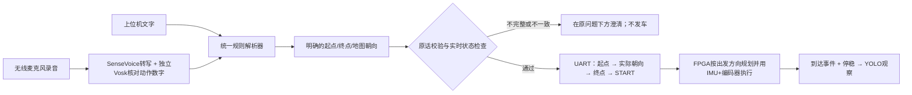
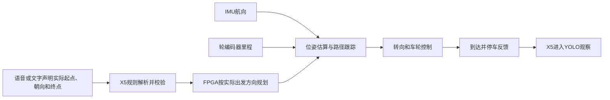
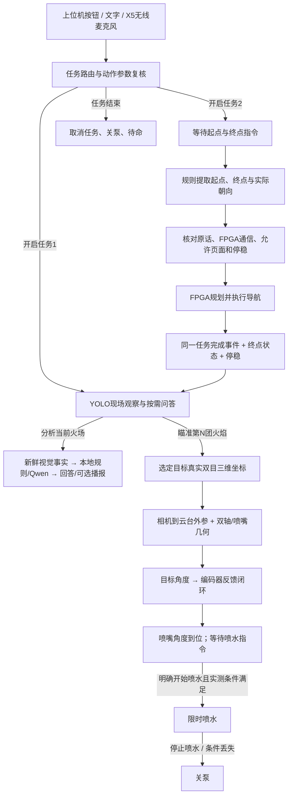

# 当前任务流程与固定双目瞄准

本文件更新至2026-11-01最新本地方案：编号导航的文字与语音统一使用确定规则解析，Qwen保留场景分析与问答；导航按实际车头方向规划，弯速为140/120 mm/s。本轮改动先留在电脑，未再次部署或烧录，不能与此前已部署、已烧录的版本混为一谈。固定双目、手动选火、单独喷水指令的设计继续有效。下文硬件状态是此前验收记录，不代表此刻在线。

## 你实际怎样演示

任务按钮选择工作模式，不代表已经导航、已经分析、已经瞄准或已经喷水。无需编写复杂提示词，说清下面这些短指令即可。麦克风USB接收器插X5；上位机通过Wi-Fi请求X5录音，识别与模型推理都在X5本地运行。

| 你点击或说什么 | 程序应当做什么 | 不应据此推断什么 |
|---|---|---|
| 开启任务1 / 拓展一 | 开启现场YOLO观察及问答，告诉你下一步可提问 | 不是自动生成一份当前火场报告 |
| 搜索火焰 / 寻找火焰 | 进入YOLO观察，更新火焰、居民、消防员目标 | 固定相机不靠转动喷嘴扩大视野 |
| 分析当前火场 | 用新鲜检测、楼牌等实际可用数据回答 | 未检测到不等于不存在；当前可见人数不是整栋总人数 |
| 开启任务2 / 拓展二 | 进入语义导航与火场操作模式，等待你的导航指令 | 不自行选择起终点、不开车 |
| 你现在在8号点位，车头朝地图左侧，请导航前往至4号点位 | 规则提取起点8、终点4、朝向180°；校验通过后FPGA设起点及朝向、规划、行驶、到达并停车 | 这是操作员位置与朝向声明，不是系统自动定位 |
| 到达后 | 根据同一任务完成事件及真实停稳反馈，自动进入YOLO观察 | 不需要再点“到达”，不自动选火或喷水 |
| 瞄准第2个火焰 | 选择当前画面有效目标编号；完成标定后请求双轴自动瞄准 | 编号不是导航点号，也不能用过期画面选目标 |
| 开始喷水 | 请求对当前选定并锁定的目标限时喷水，仍检查真实输出条件 | 目前水泵没接，不能显示为实物已喷水 |
| 停止喷水 | 立即取消喷水请求并关闭已受控输出 | 不依赖Qwen先生成回答 |
| 任务结束 | 取消任务、停水、回待命 | 不保留自动喷水权限 |

文字输入与语音转写后的文字使用同一规则解析器，明确提取起点、终点、车头朝向，并核对位置声明、独立语音复核及硬件状态，随后交给FPGA。**编号导航不调用Qwen，也不等待Qwen生成动作。** 指令不完整、相互矛盾或不符合支持语法时，直接说明缺什么，本次不发车；不会退回聊天模型猜起点、终点或方向。停止、停水和结束任务直接处理。

地图辅助按钮属于手动结构化操作；聊天框与麦克风转写走相同的规则入口，最终都进入同一导航状态机。车载对话在原指令下方显示提取出的点位/方向或拒绝原因；“已提交”不等于已经到达。规则解析消除了导航等待语言模型的时间，但不保证听写永远正确，也不缩短FPGA实际规划和行驶所需时间。真人麦克风、UART与实车到达仍需配套更新后验收。

首次摆车时，起点必须是实物实际所在点，车头方向也要符合FPGA地图约定。只说编号不能修正摆错的位置和朝向。语音动作参数会经过独立复核，识别不一致时拒绝执行，文字输入可用于排除麦克风识别因素。

### 第一条导航怎样说

本次你的实际摆车是8号点、车头朝地图左侧，完整说：**“你现在在8号点位，车头朝地图左侧，请导航前往至4号点位。”** 也可以在地图辅助面板填起点8、朝向180°并确认，再说原句“你现在在8号点位，请导航前往至4号点位”。缺朝向时程序会澄清，不从目的地猜车头。

地图朝向约定：右0°、上90°、左180°或−180°、下−90°，允许输入−180°至180°的具体角度。角度相对于显示地图，不是IMU开机时的任意零点。FPGA把操作员声明与当时IMU读数关联，后续用IMU转角更新航向。正常到达且停车后可用新鲜的到达位姿继续下一程；抬起、搬动车辆、重新上电或丢失参考后，应重新声明实际位置与方向。



场景问答正在使用Qwen时，编号导航规则解析不需要争用模型槽。导航仍必须满足当前任务、实际起点和方向、FPGA通信及停稳要求；已有任务冲突时按状态机处理。取消任务或更改参考后，旧导航请求不能继续执行。Qwen的问答耗时与编号导航规则耗时分开显示。

可以先做**只读规则解析验收**，不经过运动节点：

```bash
cd /root/rescue/ros2_ws
python3 tools/check_semantic_navigation.py
```

默认输入是8号点朝左前往4号点。检查 `backend=explicit_navigation_rules`、`model_called=false`、`status=ready`，以及结构化结果中的起点8、终点4、朝向180°。`hardware_commands_sent=false`表示解析成功也不发车。可用 `--text '你的完整导航原句'` 验证不同说法；没有朝向且没有已确认上下文时应澄清。正式验收再分别测试上位机文字、真人语音、FPGA规划及实际行驶，不把解析成功当作车辆已完成导航。

## 如何结束语音录入

1. 点击“开始收音”，等出现“正在车载收音”后，对插在X5上的无线麦克风说话。默认收音15秒，也可以提前结束。
2. 说完点击“说完提交”。界面先显示“结束请求待车载确认”，这时表示请求已经发出，不表示设备已经停止。
3. X5收到结束请求后关闭麦克风采集，保留已录声音并转写。界面随后显示“收音已结束，正在识别文字”。这时不需要继续说话。
4. 转写文字出现在右侧。导航命令显示规则解析与执行回执；场景问答需要模型时才显示“本地Qwen正在思考”，回答接在左侧。结束收音不会取消已录声音的识别或后续处理。

结束请求优先于普通排队指令；快速连点开始、结束会撤销尚未开始的收音。准备模型期间也可取消，取消后不会再打开本次麦克风。重复点击结束会再次确认当前状态。断网或节点没有反馈时显示“等待确认”，不会把提交成功当作停止成功。

“收声测试”是独立测试窗口，只检查音频和转写，不执行文字里的车辆动作；应使用该窗口里的“结束并识别”。正式对话里的结束按钮不会将测试录音当作任务提交。

## 导航是否使用摄像头纠偏

编号点导航使用IMU航向、轮编码器里程和FPGA预存地图，不输入摄像头道路中线或视觉位置。严格说这是“IMU＋编码器航位推算”，不是仅靠加速度两次积分的位置估计。编码器继续保留；它提供行驶距离，IMU提供车头方向。

当前 `ov5640` 以你指定的 `ov5640666` 导航为基础，保留道路、里程计和跟踪方式，并增加X5串口、编号点任务、到达反馈。此次进一步修复方向规划：FPGA先筛选与真实车头夹角不超过35°的出发方向，再寻找可行路径；开始执行时不再用规划路线反写实际车头。8→4朝左的RTL测试选择389cm向左路线，朝右选择380cm向右路线，道路几何未变。实际车头与首段不匹配会拒绝启动，不强行掉头。



代码中的“道路中线”指地图里预存的几何路径，不是图像二值化提取的中线。编号点及上传路线导航期间，测距不触发减速、绕行或近障停车，测距掉线也不影响导航；独立制动、避障任务仍使用测距。新版取消运行中的几何“偏离路线”故障，跨过中间采样点时按路线段平面继续推进。人工停止/暂停、主机失联、IMU或编码器故障、堵转、路线失效和正常到达仍可使车停下；起步车头与首段不符仍拒绝启动，屏幕显示“朝向不符”。这些最新行为须使用本轮FPGA位流与X5程序，当前只在本地准备，未再次烧录。

弯速采用单一上限：转角绝对值超过12°为140 mm/s，超过24°为120 mm/s，直线仍为200 mm/s；用户更低的速度设置、原加速度和终点减速仍有效。此处是最新版参数，旧版160/140 mm/s及其速度仿真数据不代表当前版本。

初始摆放误差、车轮打滑和IMU漂移仍需要实车测量，取消偏离故障不会消除这些误差。终点状态表示IMU＋编码器估计已越过末段到达平面或进入到点范围，`physical_position_verified=false`仍表示没有独立实物定位核验。由于地图导航不再自动避停，演示应清空预存路线上的障碍。

另外保留的“前进直到火焰居中”是独立的视觉停车任务；“红绿灯”是独立的交通任务。这两者使用图像作任务判断，不应与编号点地图导航混为一谈。到达后的识别、固定双目测距和喷嘴瞄准同样不改变编号导航的位姿。

## 完整链路



## 固定双目与喷嘴云台的区别

最终安装是：双目固定车身，水平与俯仰电机只转喷嘴。转动电机时，火焰在相机画面中通常不会移动。因此不能反复调电机直到火焰居中，否则会越调越偏。

程序应先取选定火焰的立体深度点 `p_camera`，按标定得到的刚体变换计算 `p_gimbal = R × p_camera + t`，再用双轴位置、喷口偏移和喷口方向求解水平/俯仰目标角。编码器反馈用于限制每步角度、确认到位和检测跟随异常。

新配置入口为 `config/fixed_camera_aim.template.json`，启动参数为 `fixed_camera_aim_config`。未标定模板不会回退到旧像素居中控制，也不会使用猜测距离。`geometry_locked`表示喷嘴几何角度到位；`image_locked`表示旧随动相机的像素对准，两者含义不同。几何指向仍不等于水流命中，水压、重力下坠和落点需要实测。

## 当前实机状态与接线

| 项目 | 当前情况 |
|---|---|
| FPGA UART | 已启用UART2、重启生效，并取得固定10字节XOR协议真实回包 |
| FPGA接线 | X5物理15 TX→FPGA E13 RX；22 RX←E14 TX；14 GND共地 |
| 水平轴 | 电机2 ZDT，PIN3 TX / PIN5 RX，`/dev/ttyS3` |
| 俯仰轴 | 电机1 PD42，PIN8 TX / PIN10 RX，`/dev/ttyS1` |
| 单电机测试 | 两台已有受限空载运动证据，不等于安装后双轴瞄准验收 |
| 双目与云台标定 | 用户确认尚未完成；相机最终需固定车身 |
| 水泵 | 最新改为FPGA B13高电平控制MOS；X5经唯一UART发有限时脉冲，输出/落点实测仍待验收，模板保持禁用 |

FPGA串口连接与“允许导航”是两个状态。固件还检查通信控制页面、当前是否停稳、规划结果等。上位机显示阻挡原因；不得为了让按钮变绿伪造停稳、定位或到达。

当前新版FPGA首页底部显示“拓展1视觉识别 / 拓展2对话控制”。从设置页返回首页，点“拓展2对话控制”进入REMOTE控制页；不需要点启动行驶。设置→控制模式中的“通信模式”只选择控制来源，停在设置页时仍是`selected=true, scope=false`，不能导航。上位机发出有效编号导航后才切地图与执行页。

## 完成标定后才启用真实双轴

1. 将双目牢固安装在车身，固定云台、喷嘴和相机之间的相对位置；相机移动之后原外参失效。
2. 校准双目内参、左右相对姿态、基线与同步；使用已知距离物体验证深度，不能从镜头型号猜基线。
3. 定义云台基座坐标：X向前、Y向左、Z向上。测量或标定相机到基座的旋转和平移，坐标单位为米。
4. 测量水平轴中心到俯仰轴中心的偏移、喷口相对俯仰轴的偏移与方向，不默认两轴相交。
5. 确认各轴参考角、实际编码器计数、正方向、传动比、机械限位；每次重启/拆装重新核对参考，不能把旧坐标复制成已验证状态。
6. 先对无水目标验证多个方位和距离的角度误差，再配置喷嘴落点补偿与水泵输出。当前模板中的未测参数应保持空值。

控制程序另外检查“失能时的实际角度与旧目标是否一致”。手动转轴之后直接使能，驱动器可能追赶旧目标；程序不会自动清零或强制归位掩盖差异。

## 文件与启动

- 电脑系统目录：`D:\工程仿真\FPGA赛道_小车仿真\RDKX5_消防小车系统`。
- X5工作区：`/root/rescue/ros2_ws`。
- 桌面入口：`消防救援控制台（最新版）`，仍使用同一个EXE外壳；界面从X5加载。
- 当前热点地址：`http://10.16.82.126:8090`，IP变化后修改连接地址。电脑与X5同一局域网即可，不需要互联网。
- 开机任务入口：`tools/run_standalone_tasks.sh`；唯一FPGA串口拥有者为`extension_task`。旧CRC兼容桥仍dry-run，不能同时接管UART2。
- 学代码：`task_interaction.py`中文入口 → `numbered_navigation.py`导航阶段 → `mission_node.py`任务切换 → `fire_aim_node.py`瞄准提案 → `mixed_actuator_io.py`两轴执行。
- 当前软件只通过新鲜目标与真实反馈推进阶段；界面“请求已提交”不能当作动作完成。
