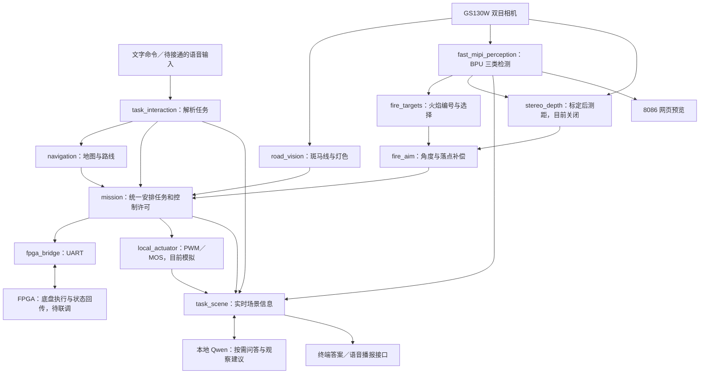

# 消防小车：当前全部功能与实现总览

> 版本说明：本页记录本次改分工之前的核对快照。当前已改为 FPGA 存图/惯导/规划，新增楼牌接入、自动/手动火场和语音任务；以 [FPGA 惯导版流程](FPGA惯导版_语音任务与状态流程.md) 为准。

核对日期：2026-10-11。依据当前源代码、任务启动配置、既有验收记录和 X5 实时状态整理。

**已经完成真实相机、三类 YOLO、ROS 任务框架和本地 AI 问答的软件运行闭环；实车自主行驶、测距瞄准和喷水仍需接线、标定及联合验收。** “代码已实现”与“实物已经完成动作”在下表中分别说明。

## 1. 先理解整体分工

- **RDK X5**：相机取图、目标检测、斑马线与灯色分析、地图规划、场景报告、语言问答、语音接口、云台和水泵控制程序。
- **FPGA**：计划负责前置单目道路循迹、底盘速度/转向、编码器和 IMU 等实时反馈，以及底盘急停。X5 端通信协议与桥接代码已有；不能把它当成 FPGA 固件已经全部实现并验证。
- **电脑**：Blender 地图、C++ 阿克曼仿真、训练数据与 GPU 训练、VS Code SSH 开发、网页预览。

ROS 2 是程序协作框架。节点是各自运行的小程序，话题是交换消息的通道，launch 是一起启动若干节点的配置。它本身不负责识别火焰；识别由节点调用 YOLO 完成。X5 节点主要是 Python，桌面模拟器是 C++，llama.cpp 模型运行器是原生 C/C++。

## 2. 已经实现哪些功能

| 功能 | 实现方法 | 当前完成程度 |
|---|---|---|
| 街区地图与壁纸 | Blender 场景、薄墙居民楼、道路边线、斑马线、信号灯、施工与侧障碍、大字楼牌；保留 GLB 等资产 | 电脑资产已制作；不是赛方统一标准场地 |
| 阿克曼桌面仿真 | C++ 模拟 27×19 cm 底盘、18 cm 暂定轴距，可手动驾驶、鼠标选任务/路线、观察摄像头画面 | 电脑仿真已实现；18 cm 仍需实测 |
| 仿真视觉循迹与规划融合 | 融合大津法、逆透视、边线/中线、缺线补偿；Hybrid A* 路线与可靠视觉中线形成同一跟踪参考，避免两个控制器争抢 | 仿真功能；不等于已经移植到 FPGA |
| 仿真障碍绕行 | 模拟测距、障碍占用、路径检查、绕障路径保持、接近降速与离开恢复 | 仿真功能；真实超声波/激光仍待接入 |
| 数据集、训练和导出 | 从地图生成双目视角、光照/距离/角度样本及标签；YOLO11n Detect 三类训练与 BPU 导出 | 已训练并上板运行；主要是壁纸合成数据，实拍精度仍需验证 |
| 双目相机取图 | 官方 MIPI 驱动发布左右话题，其他节点复用；物理左眼实际对应 `/image_right_raw` | 真实取图已跑通；双目匹配测距另列 |
| 去畸变与高速检测预览 | 镜头参数映射纠正畸变；BPU 检测、CPU 前后处理与按需 JPEG 传输 | 实机运行；当前镜头几何仍不等于通过双目米制标定验收 |
| 火焰/消防员/人物检测 | 三类 YOLO11n Detect 输出类别、置信度和框坐标；按任务模式启停推理 | 三类已开启；不是人体姿态估计，不保证识别任意真实火灾 |
| 行驶中斑马线检测 | 灰度、Otsu 二值化、平行白条数量与间距、背景对比、多帧确认 | 软件与测试已有；实物路面与停车距离未验收 |
| 搜索及识别红绿灯 | 云台抬头分步扫描，HSV 红绿颜色、亮度、圆度、黑色竖灯板约束；稳定绿灯才许可通行 | 软件已有；真实灯珠、云台和 FPGA 闭环待验收 |
| 统一任务状态机 | `mission` 仲裁待机、巡逻、交通等候、观察、消防；云台只有一个控制出口 | 节点在 X5 运行；真实运动许可被未就绪条件阻止 |
| 火焰编号与选择 | 跨帧关联生成目标 ID；支持编号、最左、最右、最大；丢失或歧义撤销选择 | 软件已接入真实 YOLO；目标选择可查看，实物锁定另需云台 |
| 双目距离与三维点 | 时间戳配对、标定校正、SGBM 视差、左右一致性/纹理/有效比例检查、Q 矩阵恢复 XYZ | 已写代码与测试；当前 `gate=disabled`，未提供已验收的实测距离 |
| 云台闭环瞄准 | 火焰框中心与参考点的视线角差，比例修正、限幅限速；运动后重新取图修正 | 软件已有；舵机型号、方向、行程和到位时间未验收 |
| 喷嘴偏移与水流补偿 | 喷嘴位置/方向的几何参考，或按距离内插的实测水流落点表；两者不重复叠加 | 代码已有；实际喷嘴和水流落点未标定 |
| X5 PWM 与水泵 MOS | 两路硬件 PWM 控制舵机信号，GPIO 控制 MOS；显式选目标并另行请求限时短喷 | 当前 `enabled=false`、`dry_run=true`、泵关闭，没有真实 IO 写入 |
| 导航与施工改道 | X5 保存 49 节点、55 条无向边和 13 楼观察目标的道路图，Dijkstra 选路；禁行边重规划、动作版本与完成回执检查；编码器增量与陀螺角速度推算位姿 | 可规划/预览；定位、循迹反馈、FPGA 执行适配未验收，实车执行关闭；不是 SLAM 或完整局部绕障器 |
| UART 通信 | ROS 与串口协议转换、CRC 分帧、状态接收、动作身份、有效期、ACK/完成回执区分 | X5 桥接与接口已有；当前 dry-run，缺真实 FPGA 状态，未完成底盘闭环 |
| 楼号与楼名识别 | 已有 PP-OCRv4／RapidOCR 模型与楼栋名单匹配代码；多帧确认，关联场景时要求同帧证据 | 当前四模式栈没有启动 OCR 节点，尚未接通 MIPI 图像输入，不能声称已持续读号 |
| 场景理解 | 组合最新火焰/人物/消防员计数、楼号确认情况、任务和喷射指令记录 | 真实检测到场景报告已跑通；不推断未验证受困人数或扑灭成功 |
| 本地语言模型 | 官方 Qwen2.5-0.5B-Instruct Q4_K_M，由 CPU llama.cpp 服务运行；ROS 异步调用 | 已部署、真实问答已验收；模型接收文字事实，不直接看图 |
| 离线语音与播报 | Vosk 中文识别、同一任务解析器、espeak-ng 播报；按需收音接口 | 模型/代码已有；USB 麦克风和音箱尚未启用验收 |
| 上位机与无线接口 | 当前 8086 显示检测图并可开关传图；另有遥测/任务网页代码与电脑演示 | 真实 YOLO 预览已通；完整无线任务面板没有接入当前全部节点 |

旧完整遥测板的当前板端预览配置为 `127.0.0.1:18088`，通过 SSH 转发访问；它与 8086 检测预览是两个服务。旧教程中的 8088 不应原样用于该面板，因为 8088 已分配给本机 LLM 服务。桌面仿真的交通与壁纸识别使用图像规则，定位、测距使用模拟信息，不等于桌面已经运行了真实双目深度和板端 YOLO。

## 3. 小车实际怎样完成一轮任务

以下是已编写的执行逻辑。各实物动作仍要先完成上一表所列联调。

1. **下达目标**：文字或将来的语音说“去 3 号楼观察”。程序匹配楼栋观察位，X5 根据道路图规划路线。
2. **沿路执行**：X5 指定经过哪些路口和方向；前置单目＋FPGA 根据真实道路边线算中线并转向。编码器与 IMU 提供里程和航向。导航负责选择道路，循迹负责走稳道路。
3. **遇斑马线**：云台双目低头观察，多帧确认后请求停车，等 FPGA 回报停稳，再抬头扫描灯珠。
4. **处理灯色**：红灯、未识别或冲突都等待；同一绿灯稳定确认后释放需要持续刷新的通行许可。FPGA 返回匹配事件号的过街完成消息后，恢复低头道路观察。
5. **到楼前观察**：停稳后启用三类 YOLO，生成可见目标和场景报告。楼牌未确认就报告未确认，不把导航目的地当成 OCR 结果。
6. **指定火焰**：你说“锁定最左边的火焰”或指定当前编号。程序只跟踪这一目标，计算视线角与补偿参考；丢失目标时停止沿用旧锁定。
7. **另行请求喷水**：在锁定、停车、距离、落点、硬件等条件都有效时，单独的喷水命令才能进入短喷过程。停止、失锁、换目标或数据过期会撤销喷射许可。
8. **报告结果**：记录“已发出喷射指令/短喷已结束/等待复查”。壁纸图案不会自动消失，不能据此声称现实火灾已经扑灭。

云台双目承担轮流切换的任务，前置单目承担持续道路循迹；云台抬头看灯时不应把车辆变成没有道路视觉的盲走状态。

## 4. AI 到底参与了什么

| 答案来源 | 示例 | 工作方式 |
|---|---|---|
| `structured_rules` | 现在有几个人、有没有消防员 | 读取最新有效检测和任务状态，直接回答 |
| `edge_llm_generate` | 什么是机器视觉、请分析当前场景 | 真实调用本地 Qwen；通用问题生成短答，场景问题选择受限观察建议，数字用返回时的新事实填写 |
| `domain_reference` | 解释双目测距原理 | 查询已经审定的技术参考，明确标注来源，关闭模型也能回答 |

模型没有直接图像输入，没有可靠的跨多轮长期记忆，也不输出底盘、舵机或水泵动作。语音命令“停止喷水”经过明确的任务解析器直接处理，不等待 LLM 思考。

本轮 X5 实测：真实模型问题约 27～31 秒，本地技术参考约 0.22 秒，模型忙时人数查询约 26 ms、停止喷水请求回执约 21 ms。后两者是软件消息耗时，不是机械制动或水流停止时间。空闲 YOLO 平均约 16 FPS，模型回答期间约 11～12 FPS。此次状态核对读到 16.72 FPS，不代表长期最坏帧率。

## 5. 当前运行状态与下一步

此次核对时，相机、YOLO、8086 预览、任务栈和 Qwen 服务均 active。任务为 `inspect`，硬件输出关闭，泵关闭，`hardware_written=false`，没有真实舵机角度反馈；缺少 FPGA 状态，运动许可为 false。双目测距为 disabled。

建议按下面的依赖顺序联调：

1. USB 麦克风/音箱，先完成“说话→任务文本→检测报告→播报”。
2. FPGA UART 状态和编码器/IMU/循迹回传，验证停车与路段完成的真实含义。
3. 云台两轴方向、角度、限位与稳定时间；先验证低头和抬头。
4. 实物斑马线与灯珠，验证“看见→停车→抬头→绿灯许可→过街完成”。
5. 接通当前 MIPI 画面到 OCR，补实拍识别验证，完成楼牌同帧关联。
6. 双目标定与真实距离验收，之后标定喷嘴偏移和水流落点，再联调限时喷水。
7. 配准地图、固定起点、验证单路段循迹导航，最后串成完整任务。

## 6. 文件与学习入口

- 电脑主工程：`D:\工程仿真\FPGA赛道_小车仿真\RDKX5_消防小车系统\ros2_ws`
- 板端主工程：`/root/rescue/ros2_ws`
- 地图：`D:\工程仿真\FPGA赛道_小车仿真\map_assets`
- 训练：`D:\工程仿真\FPGA赛道_小车仿真\YOLO11n_model`
- C++ 仿真：`D:\Github_OpenCode_TreeBird\AckermannRescueSim`

从 [四种任务教程](四种任务运行节点_从启动到语音控制.md) 理解状态机，再读 [地图定位与导航](地图定位与导航.md)、[双目测距与喷嘴补偿](双目测距与喷嘴角度补偿_使用说明.md)、[本地边缘 AI](本地边缘AI部署与使用.md)。节点代码位于 `src/rescue_vision/rescue_vision/`，不是修改模型权重来改变全部系统行为。

已有验证包括四模式阶段的 166 项检查及真实模式切换、本地 AI 最终 39 项针对性检查和真实问答联合测试。不同阶段测试有重叠，不把它们简单相加成独立测试总数；这些测试也不替代实物传感器、底盘和水流验收。
