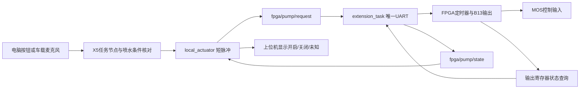

# 拓展任务与 FPGA B13 水枪接线

更新日期：2026-11-01。文件名保留供原入口使用，以下为当前方案。本轮仅修改、验证和编译本地程序，没有部署、烧录或进行喷水试验。

## 任务怎么用

拓展一用于YOLO观察与场景问答。电脑和X5连接同一热点，上位机点击“开始收音”，X5采集无线麦克风USB接收器。问“分析当前火场”时，Qwen使用当前视觉事实生成回答；音箱和TTS启用后可播报。观察问答不依赖FPGA。

拓展二增加编号点导航。可说“你现在在8号点位，车头朝左，请导航前往至4号点位”。麦克风转写与文字共用规则解析，导航不调用Qwen。FPGA负责地图规划、IMU和编码器定位及底盘控制。首次起点和朝向必须符合实际摆车，不能由终点猜起点。

FPGA报告本次导航完成并回读确认停稳后，X5进入YOLO观察。双目固定车身，云台只带喷嘴，不通过转动喷嘴使火焰在相机画面里居中。说“瞄准第2个火焰”后，程序按双目三维位置、安装外参和云台编码器计算喷嘴方向；真实输出仍需完成安装与落点标定。

喷水始终是单独命令：“开始喷水”或上位机按钮；“停止喷水”或“任务结束”会请求关泵。识别到火焰、导航到达、Qwen回答均不会自行打开水枪。

## 最新接线

| 功能 | 控制端 | 对端 |
|---|---|---|
| 水枪开关 | **FPGA B13，3.3V逻辑输出** | MOS模块IN/SIG |
| 水枪参考地 | FPGA GND | MOS模块GND，共地 |
| FPGA通信 | X5物理15 TX / 22 RX | FPGA E13 RX / E14 TX |
| FPGA通信参考地 | X5物理14 GND | FPGA GND |
| 水平电机2 | X5物理3 TX / 5 RX | ZDT RX / TX |
| 俯仰电机1 | X5物理8 TX / 10 RX | PD42 RX / TX |

B13是FPGA封装/开发板信号标号，不是X5的BOARD编号。高电平开启，低电平关闭。B13只连接MOS的控制输入，水泵由独立电源经过MOS供电；需确认MOS输入支持3.3V高电平。旧X5物理16脚水枪方案已停用，不要把两个输出同时接到MOS输入。

## 控制链路与真实反馈



原有喷水条件仍在X5核验：车辆停稳、选定火焰新鲜、喷嘴反馈到位、落点标定有效和明确喷水授权。原有短脉冲默认0.4秒，单次上限1秒。FPGA收到有效0x18后自行倒计时；重复ON不延长脉冲，0x19为独立OFF，0x1A查询状态。到时、断链、运动、模式退出或停止均关泵；再次开启前需OFF清除锁止。

X5只有`extension_task`打开FPGA串口，不新增竞争串口进程。排队过期ON丢弃，ON不重发；OFF优先。接收ACK不表示已输出，也不表示出水。上位机的B13状态来自FPGA输出寄存器回读；失去反馈显示未知，不伪造关闭。正常ON/OFF后的读回过渡最多0.3秒，只维持已授权会话，不允许新授权或导航。

正常模式切换或FPGA复位后，桥接器根据真实回报重新执行OFF初始化，再读回确认；这一过程只关泵，不重新播放ON。脉冲到时、运动、断链或STOP造成的其它锁止继续由明确OFF恢复。

## 旧活动配置迁移

更新器会保护板上`*.local.json`，所以仅更新源码不会自动改变旧GPIO配置。部署时先停止任务服务，找到启动参数`io_config`所指向的实际I/O配置，在X5工作区运行：

```bash
python3 tools/migrate_pump_to_fpga.py --config /实际路径/actuator_io.mixed.local.json
python3 tools/migrate_pump_to_fpga.py --config /实际路径/actuator_io.mixed.local.json --apply
```

第一条只预览，第二条备份并只改`pump`字段，保留电机端口、方向、齿比和标定。新配置为`backend=fpga_uart, pin=B13, active_high=true`，初次迁移保持`enabled=false`。配置模板在`config/actuator_io.mixed.template.json`。

烧录配套新FPGA、重新构建X5并核对只读状态后，再完成实际输出验收及启用。新的FPGA后端由能力位和状态回报核验硬件定时器，不再申请X5的libgpiod引脚。此脚本不连接UART、不启用水泵，也不修改已有云台标定。
