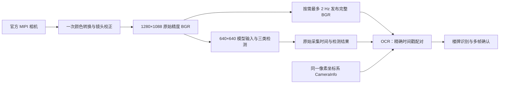

# 无损性能优化与复测

本文对应 2026-10-11 的 X5 性能优化。当前分工仍是：FPGA 保存地图并负责路径规划、惯性导航和底盘运动；X5 负责相机观察、斑马线与红绿灯判断、三类 YOLO 检测、楼牌 OCR、火焰瞄准任务、语音和本地 Qwen 问答。

电脑工程：`D:\工程仿真\FPGA赛道_小车仿真\RDKX5_消防小车系统\ros2_ws`。板端工程：`/root/rescue/ros2_ws`。

这里的“无损”指保留原有像素、模型及判断条件，减少重复计算和无消费者时的计算。它不是已经完成比赛地图实拍准确率验收，也不表示所有负载下都达到硬件绝对极限。

## 1. 优化了哪些地方

### 1.1 YOLO 后处理：提前排除必定不合格的背景位置

模型仍输出火焰、消防员、普通人物三类。原先对大量背景位置也计算三类概率；现在先做一个宽松、数学上确定不会丢掉有效候选的预筛选。

在置信度阈值不小于 `0.25` 时，若一个位置的三类原始得分都低于 `-2`，其最大 sigmoid 概率仍低于约 `0.12`，不可能通过阈值，因此可跳过。保留下来的位置仍执行原有的三类 sigmoid、类别选择、框解码和 NMS。阈值低于 `0.25` 时不使用这个预筛选。

这没有把三类模型变成只识别火焰，也没有提高置信度阈值。概率饱和时的并列类别选择、框坐标与排序逻辑仍按原规则处理。

代码：`src/rescue_vision/rescue_vision/legacy_detector.py`。

### 1.2 OCR：复用 YOLO 已经校正的完整画面

原先 OCR 独立接收高频原始图像，再做一次颜色转换和镜头畸变校正。现在主视觉节点按需发布自己已经处理好的画面，OCR 直接复用：



`/vision/observation/image` 是 `1280×1088 bgr8` 图像，不是 JPEG 预览，也不是 `640×640` 模型输入。它的字节与对应检测帧的校正图像一致。原有 OCR 内部的文字区域检测尺寸、原始分辨率文字裁剪识别、模型、置信度与多帧确认条件继续保留。

这里的 `2 Hz` 是供 OCR 取样的完整画面传输上限，不是限制 YOLO 或网页只能两帧每秒。OCR 仍按原有间隔和单工作线程运行。没有 OCR 图像订阅者、任务不允许检测、图像已过期时，主视觉节点不复制和发布这份额外图像。

配对使用原始采集时间的整数纳秒值。程序不会把“最近的一幅图”随意配给另一次检测，也不会将 OCR 完成时间当成采集时间。CameraInfo 必须匹配校正后的坐标系和完整图像尺寸；任务、云台姿态或几何信息变化后，旧缓存与未完成结果会被作废。OCR 只确认看到了某栋楼的楼牌，仍不能把整幅图里的所有人物和火焰自动归属给它。

主要代码：

- `fast_mipi_perception_node.py`：发布按需的完整校正图像。
- `mipi_building_ocr_node.py`：根据任务订阅图像、运行 OCR。
- `mipi_building_ocr.py`：像素格式验证、精确采集配对、结果有效期与多帧确认。
- `task_modes.launch.py`：默认启用 `ocr_corrected_input:=true`。

上述前三个 Python 文件在 `src/rescue_vision/rescue_vision/`，启动文件在 `src/rescue_vision/launch/`。

### 1.3 待机：没人需要画面时，省掉无用的像素处理

当任务不允许 YOLO 检测，同时也没有预览图像订阅者时，主视觉节点不再对每一帧重复做颜色转换和去畸变。它仍接收、验证真实相机消息，维护采集健康状态，并发布带真实采集时间的“检测已禁用”状态。

第一幅真实画面仍会建立和检查图像几何。若此前发生几何处理错误，必须再次处理真实画面才能恢复正常状态。

重新开启识别或预览时，下一幅真实画面恢复处理。若需求恰好在一幅待机状态消息准备完成后才出现，程序会跳过这幅没有像素的数据，等待下一幅真实图，不会将空图、旧缓存或生成图送去识别。

这个优化只减少主视觉节点在无像素需求时的工作。官方相机仍运行，斑马线相关任务按其原有模式和姿态条件工作。画面传输开关关闭也不等于关闭处于观察模式的 YOLO 检测。

### 1.4 图像传输：扩大 Fast DDS 共享内存缓冲区

板上原有共享内存段约 0.5 MiB，单张 NV12 图像约 2 MiB。相机和主视觉两个大图发布进程现在使用 64 MiB 缓冲区，保留 UDP 兼容通道，其余节点维持原配置。隔离测试中，同样发布 450 帧，接收数量从 348 帧提高到 450 帧；完整像素 CRC 错误均为零。新发布者与旧配置接收者也通过 360/360 帧测试。

这不是零拷贝，也不能声称完全没有分片。正式配置、官方依据和兼容性见 [Fast DDS 图像传输配置验证](FastDDS图像传输配置验证.md)。`tools/image_transport_env.sh` 只在图像发布进程启动前设置环境，尊重已有的自定义 DDS 配置；`RESCUE_LARGE_IMAGE_SHM=0` 可在下次启动时关闭此设置。

### 1.5 联合负载下选择线程数

主视觉默认使用 4 个去畸变线程、2 个 OpenCV 线程和原有 2 个融合预处理线程。新传输配置下，4/2 与 8/8 的吞吐接近，而前者本轮处理延迟较低；所有像素算法与图像尺寸一致。线程数量可通过启动参数覆盖。

NEON 去畸变候选通过了逐像素测试，但相同图像交替测速没有稳定收益，因此正式库保留原实现，候选仅存放在 `reports/native_remap_neon_candidate.cpp`。Qwen 调度优先级试验也未提供稳定收益，最终恢复原来的 `Nice=5`、`CPUWeight=30`、2 个线程和 210% CPU 配额。

## 2. 哪些质量与控制条件保留

| 项目 | 本轮保持的条件 |
|---|---|
| 实际采集与完整预览画面 | 1280×1088 |
| YOLO 输入 | 640×640，原有预处理与几何关系 |
| 网页 JPEG | 质量 90 |
| 检测类别 | 火焰、消防员、普通人物三类 |
| 检测权重与规则 | 同一模型、置信度、NMS 和类别选择规则 |
| OCR | 同一识别模型、原始分辨率文字裁剪、确认次数与有效期 |
| Qwen | 同一权重与量化版本、上下文长度、生成上限和采样配置 |
| 采集证据 | 原始时间戳、过期拒绝、精确配对、几何检查 |
| 控制逻辑 | 任务仲裁、目标选择、瞄准与喷水条件、停止命令通路 |

本轮没有通过替换更小的语言模型、缩短上下文、减少输出长度来提速。Qwen 仍在 CPU 上运行，与视觉和 OCR 共享 CPU、内存资源；它的计算耗时需要在同时运行这些模块时测量。

## 3. 如何自己复测

以下命令在 **VS Code SSH 连接 X5 后的终端**执行。相机、视觉、任务栈和 `8086` 预览服务应已运行；测试工具不会替你启动或切换这些服务。

```bash
cd /root/rescue/ros2_ws
export ROS_DOMAIN_ID=0 ROS_LOCALHOST_ONLY=0
source env.sh
python tools/benchmark_full_stack.py --seconds 30 \
  --output logs/performance_20261011/my_observation_measurement.json
```

这是被动测量程序。它读取 ROS 诊断、任务与执行器状态、相关进程 CPU／内存、温度，以及 `http://192.168.127.10:8086/api/state?images=0`，不发送运动、云台、喷水或任务切换命令。查询 `images=0` 不下载图像。它会在你指定的路径保存测量 JSON。

建议在下面几种状态分别保存记录，比较时让场景、光照、程序配置和网页传图状态一致：

1. 待机，网页传图关闭。
2. 观察模式，YOLO 与 OCR 工作，网页传图关闭。
3. 观察模式，YOLO 与 OCR 工作，网页传图开启。
4. 同样的观察状态下，发起一次 Qwen 场景分析，测量整个回答期间。

状态通过平时的任务命令或界面设置，测量脚本本身不切换状态。每轮尽量取稳定运行的一段时间，不同时启动第二个相机驱动、任务控制器或额外性能测试。工具使用单调时钟计算经过时间，不依赖板上的日期是否已经校准。

### 看哪些数据

| 字段 | 正确理解 |
|---|---|
| `capture_fps` | 主视觉节点收到相机帧的速率 |
| `processing_fps` | 输出处理结果的速率；必须结合当前检测是否启用判断 |
| `detector_active` | 本帧是否实际运行了检测并保持任务许可 |
| `pixel_processing` | 本帧是否实际进行了像素处理 |
| `geometry_fps` | 准备阶段的结果速率，待机也可能包含轻量状态消息 |
| `image_age_s` | 测量时结果距离原始采集时刻的时间 |
| `processing_latency_ms` | 该处理流程的耗时，不等于整条链路的采集年龄 |
| `stage_ms` | 解码、镜头校正、预处理、推理、后处理和发布等耗时 |
| `aggregate_cpu_pct` | 被选中相关进程的 CPU 使用率之和；100% 约等于占满一个 CPU 核，不是整块八核板的 100% |
| `/diagnostics/building_ocr` | OCR 实际处理耗时、完成数量、过期数量、当前输入来源 |

**待机显示约 30 FPS，不表示 YOLO 在做 30 FPS 推理。** 如果同时有 `detector_active=false`、`pixel_processing=false`，这是轻量状态更新速率。真正比较检测速度时，应比较观察模式下 `detector_active=true` 的稳定窗口，并同时看 CPU 与采集年龄。

Qwen 还存在冷／暖提示缓存差别。同一句话第二次回答更快，可能只是缓存命中。应同时记录问题、输出 token 数、缓存 token 数和推理阶段耗时，不能仅以一次总等待时间认定性能提高。

以当前 X5、同一真实相机视野，三类 YOLO＋楼牌 OCR＋网页传图同时开启的短时采样中位数对比：

| 指标 | 优化前 | 最终配置 | 说明 |
|---|---:|---:|---|
| 视觉节点收到的相机帧 | 10.93 FPS | 30.14 FPS | 相机本身仍配置为 30 FPS；这里测接收端实际送达 |
| 三类 YOLO 处理 | 10.88 FPS | 16.70 FPS | 本轮约提高 54% |
| YOLO 后处理阶段 | 3.78 ms | 1.27 ms | 相同算法输出的背景预筛选 |
| OCR 单次处理 | 1370 ms | 1385 ms | 最终全栈吞吐提高后此项基本持平；仍无过期/无效结果 |
| 检测结果的采集帧龄 | 146 ms | 173 ms | 吞吐提高伴随约 27 ms 增加；不是所有延迟都降低 |
| 被测进程 CPU 合计 | 521% | 623% | 100% 表示一个 CPU 核；更高吞吐使用了更多算力 |

证据：[优化前完整负载](../logs/performance_20261011/baseline_full.json)、[最终 4/2 线程配置完整负载](../logs/performance_20261011/optimized_shm_t4_cv2_full.json)。每轮约 30～40 秒；采用相同测量工具，排除开头 3 个采样点。数字不是长期保证值，场景中没有实际打印目标；不是在三类目标密集时取得的准确率或最坏负载数据。

包含一次 Qwen 请求的联合观测窗口，YOLO 中位数约 14.24 FPS。独立的真实异步检查中，Qwen 回答耗时约 17～20 秒；在它尚未回答时，事实查询约 12～37 ms、停止喷水指令的软件回执约 12～19 ms。回执延迟不等于真实水泵停机时间，当前硬件输出仍禁用。Qwen 的模型、上下文和输出长度没有缩减，不能将这轮优化解读为语言模型已经实现实时对话。

[联合负载窗口](../logs/performance_20261011/optimized_llm_full.json)；[最新问答与停止回执检查](../logs/performance_20261011/dialogue_control.json)。不同窗口的采样时间和生成 token 数不同，因此不以问答总时长直接宣称 Qwen 提速。

待机且网页传图关闭时，被测进程 CPU 合计从 **412% 降到 293%**，约减少 **29%**。此时 YOLO 未启用，约 30 Hz 的处理统计是禁用状态更新，不能称为 YOLO 30 FPS。证据：[最终待机测量](../logs/performance_20261011/final_standby_no_stream.json)。

共享内存使用额外的缓冲容量换取稳定图像送达：仅两个大图发布进程各配置 64 MiB，不给每个控制节点都分配大池。全部帧仍采用原有过期拒绝和最新帧处理方式，没有积累无限待处理队列。

## 4. 如何回退 OCR 图像复用

若要对比原来的 OCR 原始图像路径，启动任务栈时传入：

```text
ocr_corrected_input:=false
```

例如先结束当前任务栈，保留相机和主视觉服务，然后前台运行原始输入路径：

```bash
cd /root/rescue/ros2_ws
systemctl stop rescue-task-modes
bash tools/run_task_modes.sh \
  ocr_corrected_input:=false \
  ocr_fixed_camera_preview:=true \
  voice_config:=/root/rescue/ros2_ws/config/voice.continuous.template.json
```

这条命令对应目前使用的固定相机联调配置。`ocr_fixed_camera_preview:=true` 表示云台姿态尚未实物验证，不能将它当成实车姿态验收。已完成真实云台配置时应沿用自己的原有参数。

前台命令持续运行，按 `Ctrl+C` 结束。恢复复用路径时，将 `ocr_corrected_input` 改为 `true` 后重新启动同一任务栈；它也是当前默认值。不要在原任务栈仍运行时再开启第二份。这个选项只回退 OCR 输入路径，不撤销 YOLO 背景预筛选和待机省算。

## 5. 验证结果与适用范围

本轮已完成 **52 项针对性测试**和 **230 项功能回归测试**；最终线程参数另外复核了 **15 项相关测试**，全部通过。这些集合有重叠，不能相加当作独立测试数量。

针对性检查包括：三类候选预筛选的结果一致性、完整图像字节一致、原始时间戳保留、订阅者恢复、待机需求切换、过期帧拒绝、错误几何拒绝，以及 CameraInfo／姿态改变后的异步结果失效。测试中的合成图像放在隔离 ROS 通信域中，不进入实际运行的控制话题。

功能回归可在板端运行项目已有脚本：

```bash
cd /root/rescue/ros2_ws
bash tools/verify_fpga_tasks.sh
```

脚本使用隔离通信域 `83`。它验证任务和消息逻辑，不代表进行了实车底盘行走或出水测试。

当前真实相机测试场景没有可用的目标物，能验证程序、帧率、时效、资源占用和空场景输出，但不能据此宣布火焰、消防员、居民或楼牌的实拍准确率合格。之后仍需用打印壁纸，在主要观察距离、不同角度与光照下验证检出率和楼牌多帧确认，再验证双目标定、云台和水流落点。

## 6. 推荐学习顺序

先读 [FPGA 惯导版任务与状态流程](FPGA惯导版_语音任务与状态流程.md)，理解任务状态；再读 [MIPI 楼牌 OCR 接入说明](MIPI楼牌OCR接入说明.md)，理解同一次采集如何关联图像与检测。随后运行一次被动测量，对照本页的指标解释阅读 JSON，最后再看 `fast_mipi_perception_node.py` 的 `prepare()`、`infer()`、`publish_observation()`。

Qwen 的角色与当前限制见 [本地边缘 AI 部署与使用](本地边缘AI部署与使用.md)。优化的目标是提高有用计算的比例，同时保持你已经建立的识别与任务条件。


最终线程复核时，有一轮测试与真实全负载推理同时运行，未触发测试中预期的“准备帧被覆盖”计数；像素与时间关联检查没有失败。停止真实推理后，在隔离域按组件测试方式重跑，15 项通过。保留日志 `threads_tests_with_live_load.log` 与 `threads_final_tests.log`，不把这项依赖时序的计数当作任意系统负载下的保证。

当前已恢复待机并开启网页画面传输。需要观察识别时，在已 `source env.sh` 的 X5 终端执行：

```bash
python tools/task_command.py "寻找火焰"
```

结束观察并回到待机：

```bash
python tools/task_command.py "任务结束"
```

正式代码与配置的增量包是 `logs/performance_20261011/update.zip`，逐文件校验是同目录 `manifest.json`。包不包含模型、虚拟环境或板端已编译库，适用于当前已部署的工作区。板端修改前备份为 `/root/rescue/ros2_ws/logs/performance_20261011/before_optimization.tar.gz`。
