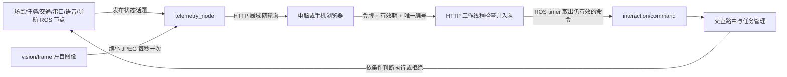

# 无线网页上位机：先本机，再局域网

它是运行在 X5 上的网页服务。电脑和手机只需浏览器，与小车连同一个 Wi-Fi；无需安装另一套 ROS，也不把图片上传到云端。默认仅允许 X5 本机访问，修改配置后才开放局域网。车端导航、识别和串口控制独立运行，网页只看状态、提交任务请求。

## 1. 页面显示什么

- 场景：楼栋号与名称、是否检出火焰、当前视野普通人物与消防员数量。无法确认楼面归属时明确显示“归属未确认”。人物不能直接当作受困者。
- 相机：左目低频 JPEG 预览，默认 1 Hz、宽度不超过 640 像素。超过 3 秒没有新画面就隐藏。
- 状态：任务、红绿灯、FPGA 链路、导航以及每项数据接收时间。服务器连接不等于 FPGA 在线；没有状态不会显示已连接。
- 交互：“去 3 号楼观察”“观察当前场景”“播报场景”“请求继续”“请求停车”。返回已入队不等于已经执行，必须看任务状态。
- 最近语音状态与告警。本页面不使用浏览器云端语音识别，实际语音输入由小车本地麦克风程序完成。

## 2. 本机先启动

完成主 README 的 ROS 构建后，在 X5 上进入工作区。以下用 `~/rdkx5_ros2_ws` 举例；若你复制在其他目录，先替换这条路径。单独启动网页节点时必须传入两份配置：

```bash
cd ~/rdkx5_ros2_ws
source /opt/ros/humble/setup.bash
source .venv/bin/activate
source install/setup.bash
ros2 run rescue_vision telemetry --ros-args \
  -p telemetry_config:="$PWD/config/telemetry.json" \
  -p buildings_config:="$PWD/config/buildings.json"
```

若整车 launch 已启动 `telemetry` 节点，不要重复启动，否则 8088 端口被占用。单独启动只有网页服务，尚未启动的视觉/任务话题会显示未知。

在 X5 自己的浏览器访问 `http://127.0.0.1:8088/`；电脑浏览器的 `127.0.0.1` 指电脑自身，不会自动访问 X5。第一次启动时服务自动生成令牌文件：

```bash
cat ~/.local/state/rescue_robot/dashboard.token
```

把本机终端里看到的令牌粘贴进页面输入框，再点“连接”。令牌不在 URL 中传递，不写入浏览器持久存储。不要把令牌截图放进报告或发送给其他人。Linux 文件权限是仅当前用户可读写。

## 3. 用电脑或手机无线查看

1. X5 和电脑连接同一 Wi-Fi，或电脑连接 X5 所在的路由器。
2. 在 X5 执行 `hostname -I`，找到局域网地址，例如 `192.168.1.42`（示例，必须替换为实际值）。
3. 编辑工作区 `config/telemetry.json`：

```json
{
  "bind": "0.0.0.0",
  "port": 8088,
  "allowed_hosts": ["127.0.0.1", "localhost", "192.168.1.42"],
  "token_file": "~/.local/state/rescue_robot/dashboard.token",
  "preview_hz": 1.0,
  "preview_max_width": 640
}
```

4. 明确把该配置路径交给节点：

```bash
ros2 run rescue_vision telemetry --ros-args \
  -p telemetry_config:="$PWD/config/telemetry.json" \
  -p buildings_config:="$PWD/config/buildings.json"
```

5. 电脑访问 `http://192.168.1.42:8088/`，输入令牌。若 X5 防火墙已启用，应只允许可信局域网访问该端口；不用在路由器做公网端口转发。这是可信局域网 HTTP 联调服务，没有 TLS 加密，不适合互联网或不可信公共 Wi-Fi。

IP 改变时同步修改 `allowed_hosts` 并重启。浏览器必须访问配置允许的地址，否则返回 403；这是避免网页从其他来源冒充本机请求。

## 4. 数据到底怎么流动



所有状态 API 和图片 API 都需要 `X-Rescue-Token` 请求头。静态网页可以打开，但没有令牌拿不到车端状态和画面。POST 还检查 Host、同源 Origin、2 KB 长度限制、动作白名单、最长 10 秒有效期、未知字段和重复命令编号。HTTP 工作线程不能直接发布 ROS、开串口或执行 shell，ROS timer 再次检查有效期后发布命令。

订阅：`/scene/report`、`/mission/state`、`/traffic/state`、`/fpga/link`、`/voice/status`、`/navigation/state`、`/interaction/result`（均为 `std_msgs/String` 内的 JSON），以及 `/vision/frame`（`rescue_interfaces/StereoPair`）。任务的接受、拒绝原因会从 `/interaction/result` 回到按钮下方与消息列表。

发布：`/interaction/command`，例如：

```json
{
  "command_id": "每次生成不同的 UUID",
  "source": "web",
  "action": "navigate",
  "text": "去3号楼观察",
  "issued_at": 1791500000.0,
  "ttl_s": 10
}
```

浏览器发送的 `issued_at` 只做数字格式检查。HTTP 服务接收并认证后，会用 **X5 本机接收时间**覆盖 `issued_at` 再加入队列；因此手机与 X5 时钟不同也能提交，客户端填一个遥远未来时间不能延长命令寿命。实际有效期从服务端接收时开始，`ttl_s` 必须在 0～10 秒之间，页面固定为 10 秒；ROS 定时器和任务入口都要检查有效期。这里是短时任务请求，不支持离线积压命令，浏览器超时后不会自动重新提交。支持的动作仅有 `navigate/inspect/report/stop/resume`。楼栋编号如 `C` 可用 `building_id` 明确传入；自然语言文本交给车端交互模块解析，页面本身不替代导航。

## 5. 没有 X5 时先学界面

在本工作区运行：

```bash
python tools/dashboard_demo.py
```

打开 `http://127.0.0.1:8089/`，读取提示路径中的 `dashboard_demo.token` 并连接。演示复用 `reports/scene_demo.json` 中已完成的合成地图 OCR 与目标检测结果，不重新编造检测框或宣称连接硬件。页面始终显示“演示 / 无硬件”，FPGA 显示未连接。按钮只记录请求，无语音、舵机、底盘或水泵操作。交付包已包含原始图像副本 `reports/recorded_scene_image.png`，无需Windows地图目录；安装OpenCV后可显示该图。

## 6. 代码学习顺序

1. `telemetry.py`：普通 Python 状态仓库、HTTP 服务、命令校验，完全不依赖 ROS。
2. `telemetry_node.py`：ROS 订阅回调把状态放入仓库，定时器把命令发给交互入口。
3. `web/app.js`：每秒请求状态，使用 `textContent` 呈现文本，按钮发 JSON。令牌只存在本页内存。
4. `tests/test_telemetry.py`：实际 HTTP 请求测试，包括未授权、过期、重复、恶意来源、错误字段、队列边界和数据过期。

网页“停车”属于无线任务请求，网络断开时无法送达，不能替代实体急停。Wi-Fi 断开不会自动取消已接受的车端自主任务；X5 控制进程或 UART 链路失联后的停车由 FPGA 本地许可超时与整车联锁实现。

## 7. 已经怎样验证

`reports/telemetry_validation.json` 记录 15 项普通 Python 与真实 HTTP 测试，包括认证、来源校验、命令去重、最长 10 秒有效期、客户端时钟漂移、队列满和图像过期。

`reports/telemetry_ros_integration.json` 记录 16 项真实 ROS 2 + HTTP 联通检查：实际启动 telemetry、interaction、navigation，通过 HTTP 提交“去 3 号楼观察”，经真实 ROS 话题取得春晖楼路线，再从 HTTP 状态快照读到 4 段 preview 路线；停车请求进入任务入口并暂停路线，无法解析的楼栋反馈到网页。检查运行在独立 Linux ROS 域 179，使用临时端口和临时令牌，没有相机、麦克风、串口、BPU 或底盘硬件。

测试代码是 `tools/telemetry_ros_integration_test.py`。它证明网页与 ROS 程序的数据通路，不能替代真实 X5 的 Wi-Fi 覆盖、延迟、重连、并发性能和车辆制动测试。
