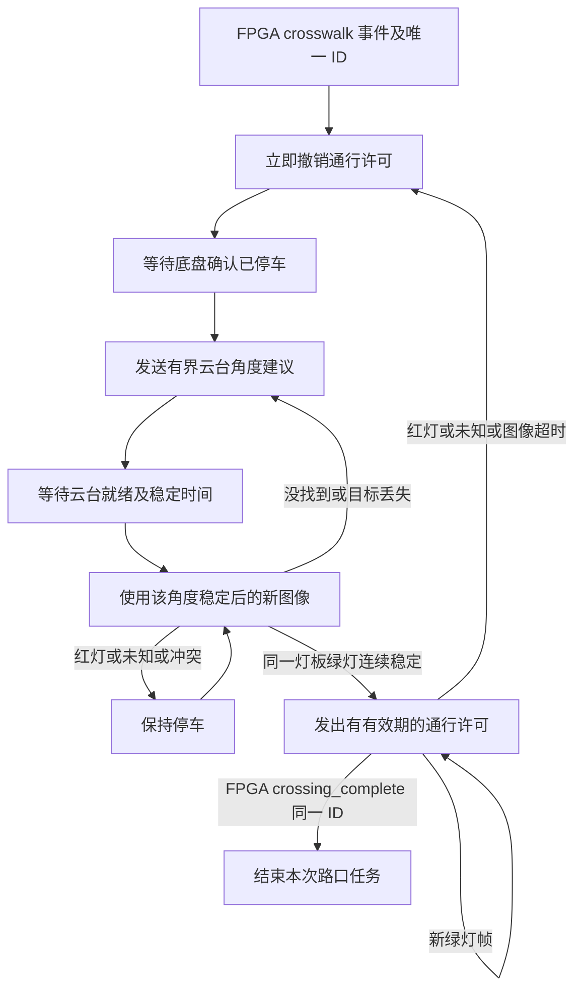

# 红绿灯识别、扫描与 FPGA 放行接口

本模块识别实体红、绿 LED 发光状态，不需要改动三类消防 YOLO 模型。它是可调的 OpenCV 识别基线，当前已做软件合成图及状态机测试，尚未用你的真实灯珠、GS130W 和舵机完成验证。

## 需要怎样制作红绿灯

默认采用**竖直哑光黑色长方形背板，上红、下绿**。红灯中心在板宽 50%、板高 27% 处；绿灯中心在板宽 50%、板高 73% 处。板宽高比默认允许 0.28～0.85。灯珠加扩散罩可减少正视过曝；不要把灯珠直接当作孤立的两个彩色像素。相机看到背景中的绿色居民楼或绿色衣服时，不能因此放行。

识别程序依次约束：配置的观察 ROI → 独立完整黑色矩形灯板 → 灯板黑色比例 → 高亮、高饱和度红/绿区域 → 紧凑形状 → 灯珠在灯板的相对位置。多灯具无法区分、同框红绿冲突、灯板严重泛白过曝时，都输出不允许通行。没有黑背板的裸灯珠不符合默认配置，会保持停车，需要按实拍调整设计和参数。

这些几何约束仍不能从理论上消除墙纸中相似灯板的误识别。应让交通灯与居民楼图案在外形和安装位置上区别明显，收窄 ROI，并用真实干扰物测试。识别置信度 0.9 是规则通过标记，不是经过统计校准的概率。

## 控制流程



默认左右扫描范围为 -60°～60°、步长 20°，先居中再向左扫，抵达边界后反向；每个角度先等待就绪，再稳定 0.3 秒、观察 0.45 秒。需要在实机测量行程后修改限位与等待时间；这些角度只是暂定命令值。

**云台就绪不等于软件刚发完角度指令。** 支持反馈的驱动应确认实际角度到达；没有反馈时，集成层可以用 FPGA 命令应答及实测的最大转动/稳定时间来生成就绪状态。程序始终把 `actual_pan_deg`、`actual_tilt_deg` 留空，不能冒充读回角度。没有就绪输入时不允许绿灯放行。

默认同一灯板至少 5 个不同新帧、跨越至少 0.4 秒，才允许通行；相邻确认帧间隔不得超过 0.22 秒。状态机用灯板框重合度和中心距离做关联，绿灯换到另一个位置会重新确认。红灯立即撤销许可，不做会延迟停车的多帧投票。

每次放行最长有效 0.45 秒，且绝不超过用于放行图像的 0.30 秒新鲜期限；每个稳定的新绿灯帧续期。FPGA 必须实现自己的通信超时停止，不能把一次 `GO` 锁存成永久通行。离开斑马线后 FPGA 应发同一事件 ID 的 `crossing_complete`，然后由整车任务管理恢复普通行驶权限；`IDLE` 的 `move_allowed=false` 表示本模块不再授予该路口通行权，不能单独解释为整车永久停车。

相同事件 ID 重复发送不会重新启动扫描或清空确认；活动期间其他 ID 被拒绝，避免连续电平误当新事件。FPGA 应在斑马线检测上升沿产生一次 ID，而不是每帧生成一个新 ID。45 秒未完成会保持超时停车，必须显式任务复位。复位后仍保留最近 256 个事件 ID 的去重记录；ID 应唯一递增。

## 与 ROS 节点的核心接口

源码：`src/rescue_vision/rescue_vision/traffic.py`，参数：`config/traffic.json`。

```python
detector = TrafficDetector(config)
controller = TrafficController(config)
controller.on_crosswalk(event_id, monotonic_time)
observation = detector.detect(
    bgr_frame, capture_time=frame_monotonic_time, frame_id=unique_frame_id)
result = controller.tick(
    monotonic_time, observation,
    vehicle_stopped=fpga_stopped_confirmed,
    gimbal_ready=driver_ready_for_current_command)
# result 包含 state、move_allowed、valid_until_s、crosswalk_id、
# desired_pan_deg、desired_tilt_deg、reason。核心不执行硬件 I/O。
controller.on_crossing_complete(event_id)
```

所有时间使用同一单调时钟域。相机采集层应保留真正的采集时间和唯一帧号；ROS 包装层只在收到新图像时生成新 observation。重复读缓存画面不能伪造新帧。延迟图像、乱序帧和扫描转动过程中旧图像不用于绿灯确认。

## 实机建议测试顺序

1. 固定云台，只记录图像，分别采集红灯、绿灯、关闭、两灯异常同亮、逆光和反光。调曝光、背板尺寸和 HSV 参数，保证 0.4～1.0 米观察区间内灯珠有足够像素。
2. 将绿色衣物、居民楼贴图、灭火图案放进背景，验证不会直接放行；在绿灯旁加入红灯验证立即停止。
3. 接 FPGA 状态回传，验证停车确认、云台就绪和旋转期间拒绝绿灯确认。
4. 验证持续重复斑马线信号、相机断流、通信中断、目标被遮挡、绿灯闪烁及任务超时都不会形成永久 GO。
5. 最后低速实车穿越，通过 crossing_complete 恢复普通行驶。巡线控制继续由 FPGA/统一底盘控制负责，红绿灯程序只提供有期限的路口通行许可。

灯珠 PWM 调光可能与相机曝光产生条纹或闪烁；应协调曝光时间与灯珠驱动，不能只放宽连续确认阈值掩盖问题。
