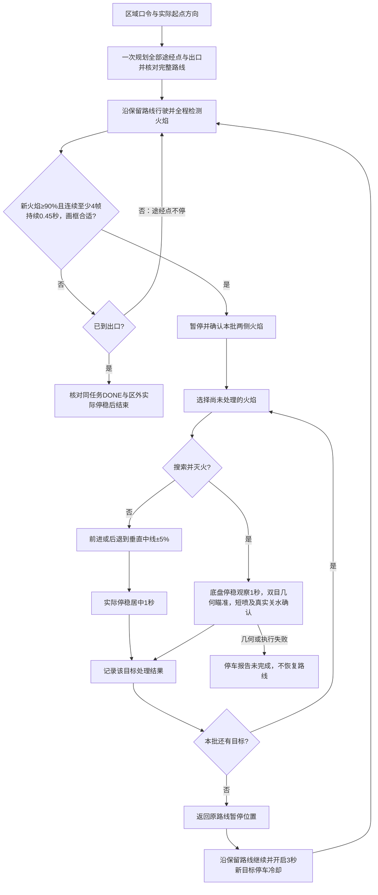

# 语义区域搜索与地图导航

区域任务分为“去 C 区域搜索火焰”和“在 C 区域搜索火焰并执行灭火”。X5 解释区域、处理视觉和灭火流程，FPGA 用已存地图、A*、编码器和 IMU 执行底盘导航。每次执行一个指定区域；起点与车头方向由操作员按实际摆放确认。两种模式均一次规划整条路线，全程开启火焰检测。检查点只作途经点，确认合适火焰后才停车。仅搜索模式前后微调，让本批火焰逐个居中停稳 1 秒，然后返回原暂停位置继续；搜索并灭火模式保持底盘停稳，云台逐个瞄准当前画面中的稳定火焰、短喷并确认关水，全部确认目标完成后才恢复原路线。

**本次功能在本地实现。** 编译、协议测试和界面测试不等于车辆已安装或现场验收；本指南不代表已把修改烧录到 FPGA、部署到 X5，或已进行自动行驶、喷水测试。部署状态以本次交付说明为准。

工程根目录：`D:\工程仿真\FPGA赛道_小车仿真\RDKX5_消防小车系统\ros2_ws`。

## 1. 四个区域

使用 FPGA 当前的 **352 × 320 cm** 地图，导航栅格 **2 cm**。`config/semantic_regions.json` 与 FPGA 地图身份校验绑定。当前每区 4 个途经点，程序限制最多 4 个。这些点约束搜索路线和覆盖范围，不是停车目标。小车沿 FPGA 的连续路线经过点位，按真实惯导位置更新途经进度；不会因为经过检查点而停车、等待航向回正或额外降速。道路弯速仍由 FPGA 原有底盘控制负责。

下表按地图图像坐标表示：原点在左上角，X 向右、Y 向下，单位 cm。

| 区域 | 图上位置与范围 | 候选搜索航点（不是固定顺序） |
|---|---|---|
| A | 左上，X 0～176、Y 0～160 | A1 (25,83)、A2 (159,27)、A3 (105,69)、A4 (69,121) |
| B | 右上，X 176～352、Y 0～160 | B1 (327,93)、B2 (193,27)、B3 (247,67)、B4 (327,141) |
| C | 左下，X 0～176、Y 160～320 | C1 (65,221)、C2 (159,295)、C3 (105,263)、C4 (25,177) |
| D | 右下，X 176～352、Y 160～320 | D1 (327,233)、D2 (193,295)、D3 (247,251)、D4 (291,193) |

边界按左闭右开处理。A1、B1 等是搜索航点，与原来的 1～9 号点、楼栋编号分别管理。你只需指定区域，程序负责展开内部航点。

X5 使用从 FPGA 同一份 ROM 导出的有向道路图，把当前位置、实际车头方向、全部航点和合法出口一起用于排序。航点编号只用于辨认，不代表访问顺序。开始任务时一次性下发所有途经点和出口，FPGA 只执行一次 PLAN；X5 读回并核对完整路线后才 START。途中因火焰暂停与恢复始终保留同一 task_id、路线版本和执行进度，不逐站重设起点、朝向或重新规划。

进入区域的第一段按合法道路抵达搜索点；区域内各搜索点之间，X5 和 FPGA 都对区域外道路增加32倍路长代价，因此优先在区域内绕行。该规则是偏好：当有向道路或障碍限制要求借道时允许短暂出界，上位机会显示原因。最后选择合法出口，将停车目标设在区域外至少14cm，留出6cm到达半径和地图量化余量；收到同一出口腿的 DONE、新鲜停稳反馈及区外位置后，才显示任务完成。实际可观察范围仍取决于固定摄像头朝向、遮挡和距离，走完航点不证明所有角落都没有火。

弯道规划保留实际车头方向限制。若原先最近道路点无法接入，FPGA 才在原起点附近6cm范围内查找朝前、切线匹配的其他合法有向接入点，不把车头方向改成目标方向，也不直接跳过道路连通性检查。

本版把 FPGA 的**正向有向道路搜索**更新为 A*，按“已走代价 g＋到目标的距离下界 h”选择待扩展节点；原先的多航点逆向后缀求解仍使用 Dijkstra。区域层只调度“接下来搜索哪里”，实际道路约束、起步方向和底盘控制继续由 FPGA 处理。早期位流的算法不能因此被称为已经更新，需使用本次配套编译产物。

## 2. 起点必须包含方向

起点选对而车头方向填反，惯导仍可能走反。方向不能根据目标位置猜测。

| 地图方向 | 角度 |
|---|---:|
| 右 → | 0° |
| 上 ↑ | 90° |
| 左 ← | 180° 或 −180° |
| 下 ↓ | −90° |

角度加 90°就是逆时针转 90°。调整箭头只改变参考，不会转动车辆。

每次摆车后手动给 IMU 做零点校准是可以的。推荐顺序：**静止清零 → 等校准完成 → 确认地图位置和车头方向 → 规划启动**。IMU 的 0° 是本次相对零位，不是地图向右；例如实际车头向左，地图仍填 180°。FPGA 将人工地图方向与 IMU 相对转角叠加，按零点不会要求车辆先转到地图 0°。原地清零与旧地图参考的衔接需使用包含 2026-11-02 手动清零修复的 FPGA 位流；行驶中不要重新清零，若清零则停止任务并重新确认参考。

### 上位机任意道路起点

1. 按真实位置摆好车，等待 FPGA 已停稳。
2. 点地图下方“设置起点与方向”，再点实际车头中点所在的道路位置。
3. 黄色虚线圈和箭头表示待确认起点。新位置按最近有效道路的切线给出初始箭头，弧线上可为非正交角度，必须按实际车头核对。
4. 再点该起点，箭头逆时针转 90°；继续点击可循环四个方向。点较远的新位置则移动起点，并重新使用该处道路切线。
5. 点“确认起点”，等显示“起点已获车载确认”，再下区域指令。

黄色箭头是人工参考；绿色箭头是 FPGA 回传的运动位置。编辑参考不会伪造遥测，也不会发车。区域任务不要求先选 1～9 号点。

起点方向目录由实际 FPGA 道路 ROM 导出。上位机以 2 cm 格中心与 ROM 精确坐标做曼哈顿距离匹配，距离相同取 ROM 中靠前的节点，与板端选取规则一致。缺少这份配套目录时禁止确认起点，不凭空填向上或向右；按提示更新地图目录与固件。道路箭头只是初始建议，不能代替确认车辆实际朝向。

高级入口“设备调试 → 运动与连接 → 设置人工起点”使用左下角为原点、Y 向上的世界坐标。图像坐标 (104,280) 对应 X=104 cm、Y=40 cm。普通地图点击会自动转换。

### FPGA 触屏起点

在导航设置中选 **“起点”**，再点道路位置。新起点默认使用该处有效道路切线；再次点已设起点中心附近（±8 像素），在当前方向上逆时针加 90°，四次回到原方向。按住不会连续转，改变方向会使旧路线失效，须按新方向重新规划。板载箭头按八个显示方向绘制，内部与协议保留实际角度，不把显示量化后的箭头角度用于规划。

车辆被搬动、重新上电或参考失效后，重新确认位置与方向。编码器和 IMU 不能感知车辆被抬起搬走的位移。参考位置使用车头中点，实际摆车也应使用同一基准。

## 3. 下达任务

在上位机开启“拓展2”，在 FPGA 选择通信导航页。等待地图、串口回包、起点、方向和实时 YOLO 就绪，并确认车辆停稳、水泵已关水且解除授权。

推荐口令：

> 去 C 区域搜索火焰。

将 C 换成 A、B 或 D。只搜索默认使用此口令：沿已规划路线连续行驶，经过区域途经点不停。火焰置信度至少 90%，同一目标在实际行驶后的至少 4 个连续新曝光中达标、持续不少于 0.45 秒，并满足完整画框、大小和位置要求，才请求停车；收到实际停稳反馈后确认本批火焰；车辆前进或后退，让画面两侧的火焰逐个进入垂直中线 ±5%，每团实际停稳居中 1 秒。本批处理完成后返回原路线暂停位置，再继续原路线。后续新火焰重复这一流程，直到到达选定出口并在区域外停稳结束。此模式不输出云台角度或开启水泵。二维观察不能证明火焰属于指定地图区域、距离足够近或水流能够命中。

已修复重复关水指令清空有效关水反馈、导致区域任务刚接受就取消的问题。只搜索使用 FPGA B13 的真实关水状态与解除喷水授权状态，不再被纯云台角度参考故障阻塞；自动搜索灭火仍检查云台与标定。发生取消或失败时，上位机显示原因及下一步。确认过的起点若因实际运动失效，需在地图重新确认当前位置与方向，旧指令不会自动重发。

明确输入“在 C 区域搜索火焰并执行灭火”后，车辆按同一规则巡检并停车。停稳后以至少 3 个新曝光和 1 秒观察确认每个目标；无需把火焰移到图像中线，也不另规划车轮靠近路线。固定双目提供目标三维点，喷嘴云台按相机到喷嘴的几何关系瞄准。每团都必须收到对应目标与本轮编号的 B13 高→低回读及解除喷水授权状态，才能标记本轮短喷完成。真实深度、安装参考、角度到位或关水失败时保持停车并报告未完成，不能跳过后自动走。

- **文字**：输入完整口令，点发送。
- **语音**：点“开始收音”，等提示正在收音后说话，再点“说完提交”。无线麦克风 USB 接收器插在 X5，电脑通过局域网请求收音。
- **按钮**：选 A/B/C/D 和任务方式（默认只搜索），再提交。单独选择区域或任务方式不立即执行。

这是轻量语义映射：区域名称 → 地图区域 → 搜索航点 → FPGA 路径。明确动作走规则，语音还要核对区域及灭火授权；Qwen 保留“分析当前火场”等问答，不负责猜测运动命令。

“在 A 区域搜索火源”会按只搜索任务执行。疑问、否定、引用或含糊的附加动作不会直接发车。“已提交”“已解析”只表示请求到达相应节点；实际执行看 FPGA 回执与绿色箭头。服务器明确拒绝时显示“未执行”；只有网络超时等无法确认提交结果时才显示“提交未确认”，两种情况都不会自动重发。

普通“去 4 号点”仍保留，到达后等待单独瞄准、喷水指令。旧的“沿途自动灭火”编号口令及其 3 秒屏蔽参数已停用。

## 4. 连续巡检、逐团处理与恢复路线

YOLO 在整个区域任务中持续检测火焰、人物和消防员，包含前往区域、区域内部和前往出口的路段。途经点只约束路线，不触发停车。新火焰达到置信度 **≥90%**，在实际行驶后连续 **至少 4 个不同的新曝光**中持续 **不少于 0.45 秒**，且中心进入画宽 **20%～80%**、画框距四边至少 **2%**、框宽和高分别至少占画幅 **1.5%和2.5%**，才请求暂停。规划和起步前的画面不累积这项停车证据。停稳后再确认同一批画面里的稳定火焰。画面左侧和右侧都参与，不把左侧火焰直接当成已经经过；停车触发区域不裁剪 YOLO 的完整画面。普通 YOLO 预览仍可显示低分或边缘候选，因此有普通框不等于已被区域任务确认。

**仅搜索的导航与视觉新鲜度分开处理。** 没有火焰不阻止出发；视觉暂时没有新数据也不再拒绝地图搜索任务。视觉中断超过 2 秒时继续原地图路线，暂停新增火焰停车触发，界面显示视觉暂缺。若已为火焰停车，则取消本批未完成对中；已有局部前后运动必须先核实停稳并返回原暂停位置，再恢复原路线。恢复新鲜数据后仍需高分、多帧确认新目标。出现视觉中断的任务会记录检测覆盖不完整，不能将“走完路线”解释为“整个区域没有火”。搜索并灭火模式仍要求有效视觉与灭火条件。

**仅搜索遇到短暂关水回读延迟时保留任务。** 开始导航前暂缓发出启动；已经行驶或进行前后对中时先请求停车，优先核对 FPGA B13 真实状态。新关水回读与相应停车证据齐全后，继续当前任务和原路线，不重新规划、不重复启动任务。界面显示“核对关水回读，任务与原路线保留”。这段恢复最多等待 3 秒；实际开水、人工停止、通信失效或持续无法核对仍会明确停止，不能将未知回读冒充关水。已经发出但未得到确认的导航启动也不能猜测成功后重发。

以下前后居中规则仅用于“只搜索”。固定侧向相机的**右半幅对应车头前方**。当前火焰在中线右侧时前进，在左侧时后退；进入垂直中线 **±5% 画宽**后请求停止。发出 STOP 或收到 ACK 都不等于车辆停稳，只有新鲜停车及惯导位姿反馈满足，且目标继续处于居中带内，才累计 **1 秒**停留。目标跑出居中带、丢失或反馈过期时不能沿用旧计时。

每团火焰依次完成后，处理下一团；若局部移动使队列中另一团暂时出画面，先返回原观察位置尝试重新捕获一次，回到原位后等新鲜多帧目标重现，不立即把它当作完成。本批完成后回到保留路线的暂停位置，再用 RESUME 继续同一条 FPGA 路线，不发新的全局 PLAN、START，不重置地图起点和方向。局部前后微调由 FPGA 的受控短距离运动执行，不改写整条区域路线。经过途经点时持续行驶，火焰停留不是区域任务结束。

停车确认会保留触发时的候选，但必须重新取得停车后的高置信度 3 帧证据；一次漏检不会清空整批。每个候选有稳定的批内编号，原地画框唯一匹配且连续得到新证据后可关联变化的跟踪编号。至少收到 3 个真正停车后的曝光，且曝光时间显示持续无火约 1.2 秒，才记录“停车后已无可见火焰”并续行；图像传输延迟不算作无火时间。仍有候选但无法稳定确认时，收集窗口为 3 秒，缺失新曝光则按视觉恢复流程处理。跳过不计为居中完成。

前后微动使用实际停止位置、实际航向、同源膨胀地图和原路线直线段核验。合理的小幅航向或横向误差不会直接把两个方向都判零；墙、已知路障、转弯、岔路和路线终点仍限制移动范围。界面会显示具体受限原因。日志分别记录指令产生、串口真正写出、FPGA 接受和实测停稳，便于区分“未下发”和“电机未带动车辆”。

停车对中的默认容差现为画宽 **±5%**，1280 像素画面对应中线左右各 **64 像素**。仍需 3 个新曝光确认和实际停稳居中 1 秒；这只调整车辆观察位置，喷嘴的三维瞄准精度和喷水条件独立核对。如果同一火焰连续三次微调都有实际正向进展，但仍提前停下未到请求位置，车端在确认停稳及关水后，将该目标记录为“未完成”，继续处理其他目标，最后确认回到原暂停位置再恢复原路线。迟到的旧结果通过批内目标键和微调编号隔离，不会跳过下一团火焰。回程本身多次不足、实际越界、反向或零进展、失联、路线变化仍会中止，不把未完成当作完成。

搜索并灭火模式保持车辆停稳，整批火焰通过云台依次瞄准，完全不依赖车轮居中。当前明确配置为 `straight_ray`：依据真实双目三维点、相机到喷嘴的安装几何和编码器反馈对准直线，不要求水流落点补偿表，也不会声称已实测命中。每团短喷完成必须匹配本轮编号与目标身份，并确认新的 FPGA B13 低电平及解除喷水授权。已确认火焰失踪、深度/几何不可用或执行失败时停车结束本任务，不把它算已喷后恢复路线；未达到稳定确认的候选单独计数。队列最多 32 个，容量超限会停车报告，避免遗漏后继续。

离开本批火焰恢复巡检后，默认 **3 秒新目标停车冷却**。冷却不关闭 YOLO，不影响人工停车；本批仍待处理的目标也不会被冷却跳过。同任务已处理编号继续去重，短时编号变化只有在唯一、连续的画框关联满足时才抑制。二维框不能证明长期遮挡后的两个编号必然对应同一物理火源。冷却结束后新的目标仍需 ≥90%、连续至少 4 个新曝光持续不少于 0.45 秒，并满足上述完整画框、大小和位置条件。

对于恢复巡检前后短暂丢失再换编号的旧火焰，另保留最长 4 秒的同视角关联；必须是同一路线、位置变化不超过 4 cm、航向变化不超过 5°、路线进度变化不超过 6 cm，并取得 3 帧唯一匹配证据。新火焰不会仅因落在旧框附近就被永久忽略。

道路导航继续使用 FPGA 地图、编码器和 IMU，不做视觉循迹或视觉航向纠偏。只搜索时视觉控制有限前后居中；搜索并灭火时视觉选择停稳后的目标，固定双目与相机到喷嘴的几何关系决定云台角度。云台只带喷嘴，相机固定车身。

途经进度以同任务的完整路线、路线版本、真实惯导位置和执行进度核对。前瞻索引指向某点，不代表车身已经经过该点；界面不能单靠这个索引把点标为完成。最终出口仍需同任务 **精确 DONE 回包**（载荷 `03 00 00`）、新鲜停稳、出口附近且位于区外的位置及关水反馈。没有火焰时全程连续驶向出口，途中没有检查点停留；存在设备反馈异常、人工停车或急停时仍按对应规则停止。

经过全部途经点不证明所有角落均已观察到，也不证明真实火焰已扑灭。实际视野仍受相机朝向、距离和遮挡影响。完成轮数表示喷水流程完成，不代表水流传感器或视觉已确认灭火结果。

结束整个区域任务可说 **“停止区域搜索”“取消区域任务”“停车”**，或点顶栏 **“停车 · 停水”**。仅关水用“停止喷水”；要结束自动搜索使用整任务停止指令。迟到的旧回包不会授权恢复新运动。

## 5. 屏幕怎么展示

**FPGA 自主导航运行页（NAV_RUN）**以地图、当前车头箭头和路线为主体，原摄像头大画面及传感器数值退出这张运行页。箭头跟随编码器＋IMU位置、朝向更新；屏幕只擦除实际车头后方经过的显示栅格，停车时不扩大擦除区域，终点清除余线。其他任务页面仍保留各自功能。

**电脑上位机**显示同源地图、区域边界、航点和区域任务进度。下一途经点高亮，已经过的途经点变淡；编号点功能放在“编号点辅助控制”。无新鲜 FPGA 回包时不画猜测的车辆位置。

“区域火源任务”面板显示途经点进度、全程火焰检测规则、当前火焰编号和本批处理结果。只搜索显示前后居中与 1 秒倒计时；搜索并灭火显示停稳确认、云台瞄准、短喷及关水状态，并区分已确认、未确认和已喷数量。任务开始时先核对完整路线再出发，浏览器不模拟车辆到位。反馈过期时隐藏实时结论；经过途经点不等于完成全部任务或扑灭火焰。

仅在**拓展2**且 FPGA 已选择允许的控制页面、通信与反馈新鲜时，实时 YOLO 画面叠加垂直中线及 ±5% 带、稳定火焰编号、当前目标高亮、已处理标记和动作/倒计时。拓展1与其他任务不显示此层，保留普通 YOLO 框。编号框必须绑定当前 JPEG 的精确时间戳、序列、坐标系和分辨率；没有匹配元数据时显示“等待同帧火焰编号”，绝不把上一帧的框贴到新图像上。若新画面里的当前目标已离开居中带，画面立即隐藏旧倒计时并提示等待任务更新。仅有高分候选但尚未加入车端队列的编号标为“待任务确认”，不能据此认为停车条件已经达成。

地图下方显示一次规划的访问顺序、原路续行和区域内优先说明，地图上的菱形标记是选定出口。出口标记是计划目标，车辆箭头仍只使用新鲜惯导回包。连续巡检需要 FPGA 地图能力 bit6、bit7；前后居中还需要扩展协议 D1 版本 2 的能力 bit6（保留路线局部移动），通过 0x3C 下发有限有符号位移、0x3D 核对对应请求的移动及停稳状态。使用 0x21 写入航点、0x26 设置区域偏好、0x37 读取同一位姿快照的路线版本与前瞻索引。旧固件会提示更新。只有任务开始时复位旧路线，后续暂停不会清空路线 RAM。

上位机显示 FPGA 回传的规划路线与新鲜惯导车头位置。0x37 返回的是前瞻目标索引，不等于车辆已走过该点；执行器把它与同快照的位置结合投影到完整路线，用于顺序途经进度判断。界面不把前瞻索引直接画成车辆当前位置。

演示顺序：设起点与方向 → 说区域口令 → 看完整路线回读与聊天回执 → 看小车连续经过途经点 → 放入稳定火焰目标 → 看两侧火焰排队。只搜索看前后居中倒计时；搜索并灭火看底盘保持停稳、两电机依次瞄准、每团短喷和关水回读。最后看全部确认目标处理后续行与出口停车。电脑和 X5 在同一手机热点或局域网即可，板端本地模型运算不要求互联网。

## 6. 实机标定与当前边界

当前连续路线的灭火模式采用“底盘停稳、云台逐目标瞄准”。导航仍核对真实地图、起点与方向，自动喷水仍核对真实双目深度、相机到喷嘴几何、当前开机轴参考、实际到位及水泵回读。旧的“转换火源到地图、规划车轮靠近位置”配置保留未验收，**不再作为当前停稳云台流程的前置条件**。下表涉及世界地图配准、车轮靠近净空和运动曝光对时的项目，仅在启用旧靠近流程时要求；不能将这些标志直接改为 `true` 冒充测量。

| 项目 | 实测内容 |
|---|---|
| 地图与起点 | 地图尺度、车头中点、实际位置及方向 |
| 双目 | 左右眼、内外参、图像方向、有效测距范围与标定 ID |
| 相机到车身 | 相机光学坐标到车头中点坐标系的旋转和平移 |
| 时间 | 曝光时间与惯导姿态在运动时能对应 |
| 云台喷嘴 | 两轴方向、角度回读、安装参考、限位与喷嘴原点 |
| 水流 | 有效短喷距离、目标高度范围及不同距离落点补偿 |
| 道路净空 | 包含安装突出物的车身余量和可达道路位置 |

旧轮式靠近的本机测量写入 `config/region_approach.local.json`；没有该文件时读取 `config/region_approach.json`。当前停稳喷嘴控制直接使用正式固定相机三维瞄准配置与当前编码器参考，不伪造 `fire_world_m` 或 `in_spray_range` 来绕过旧配置。自动轮次开始后，真实瞄准门仍必须通过才允许一轮有限短喷。

火焰确认与冷却参数沿用 `config/checkpoint_alignment.json`，本机 `config/checkpoint_alignment.local.json` 优先，其中 `min_confidence` 不低于 0.90，`fire_retrigger_cooldown_s` 默认为 3 秒。行驶中的停车触发使用下一段的独立规则，默认至少 4 帧且持续 0.45 秒；停稳后的目标确认与居中确认仍各需 3 个新曝光。连续区域巡检使用 `centering_tolerance_norm`（默认 0.05），每团停留固定为 1 秒；旧检查点 `ALIGN_*` 流程仅保留兼容。修改配置后重新启动相关任务服务，上位机只读显示车端实际配置。

行驶中的停车确认独立使用`stop_confirm_frames=4`、`stop_stable_duration_s=0.45`、`stop_center_band_norm=[0.2,0.8]`、`stop_box_margin_norm=0.02`和`stop_min_box_wh_norm=[0.015,0.025]`。旧配置未填写这些字段时也采用上述默认值。规划/起步前曝光不累积停车证据；画面两侧都可触发。停稳后观察全幅，只搜索逐个前后对中，搜索并灭火保持底盘停稳逐个转动喷嘴；停车区域并非检测裁剪范围。

### 拓展2的状态怎么看

上位机“车辆实测状态”只表示 FPGA 新鲜车轮反馈，不等于任务完成。只搜索流程是：巡检 → 停稳 → 本批火焰逐个前后居中观察 → 返回原暂停位置 → 继续。搜索并灭火流程是：巡检 → 停稳 → 确认本批火焰 → 云台逐个瞄准、短喷、确认关水 → 全部已确认目标完成 → 核对原路线身份后继续。普通视觉任务的 `inspect` 仅表示观察策略，不代替实测状态。

“开始搜索”只对中观察；需要喷水时选“搜索并灭火”，或说“在D区域搜寻火源并执行灭火”。不要在区域任务执行过程中重复点“寻找火焰”或手动选择目标，这些是接管操作，会按指令结束当前区域任务。停止、急停和真实硬件故障仍会终止运动。

失败时显示第一个具体原因及发生阶段，保留已处理数量和未完成目标；不会把未完成目标显示成仍在对中，也不会把停止运动当成任务完成。修复通信后需要重新确认实际摆放并发起新任务，旧失败任务不自动重发。

现有水枪控制为 **FPGA B13 高电平 → MOS 控制输入**，X5 通过 UART 请求有限时脉冲。B13 回读是输出寄存器状态，尚不是水流传感器。最终水平轴为电机2 ZDT（X5 PIN3/5），俯仰轴为电机1 PD42（PIN8/10）。

## 7. 文件与学习顺序

| 文件 | 用途 |
|---|---|
| `config/semantic_regions.json` | 四区、航点和地图身份 |
| `config/region_traversability.json` | 同源可通行栅格 |
| `config/region_approach.json` | 待实测的几何和时序参数 |
| `config/checkpoint_alignment.json` | 火焰确认、观察时间、重触发冷却及兼容对齐参数；本机 `.local.json` 优先 |
| `src/rescue_vision/rescue_vision/task_interaction.py` | 文字、语音变成 `search_region` |
| `src/rescue_vision/rescue_vision/region_search.py` | 连续巡检、真火焰停车观察、短喷与原路线恢复状态机 |
| `src/rescue_vision/rescue_vision/region_route.py` | 按实际道路、位置和朝向一次安排全任务航点与出口 |
| `src/rescue_vision/rescue_vision/region_control.py` | 区域流程与唯一 UART 所有者的连接 |
| `src/rescue_vision/rescue_vision/area_navigation.py` | 连续路线下发、途经进度、火焰暂停续行与出口确认 |
| `src/rescue_vision/rescue_vision/retained_route.py` | 完整路径途经匹配、真实进度投影与兼容前进走廊 |
| `src/rescue_vision/rescue_vision/fire_retrigger.py` | 已处理火焰去重与新目标触发冷却 |
| `src/rescue_vision/rescue_vision/region_approach.py` | 三维目标变换到地图并选取合法靠近点 |
| `src/rescue_vision/rescue_vision/extension_task_node.py` | ROS 消息、串口轮询与执行适配 |
| `web/presentation.html`、`.js`、`.css` | 上位机区域按钮、起点箭头与实时显示 |

先读配置与流程图，再看纯 Python 状态机，最后看 ROS 节点。ROS 2 把视觉、任务、导航、执行器按 topic 连接起来；FPGA 串口始终由一个 `extension_task` 节点持有。

已有 X5 工程部署好后，可在板端工程目录运行 `bash tools/start_interaction_services.sh` 启动现有感知与交互服务，再打开上位机。启动命令不代替更新 FPGA 位流、复制本次代码、安装 ROS 包和完成标定。普通识别问答与区域自动运动应分别验收。
