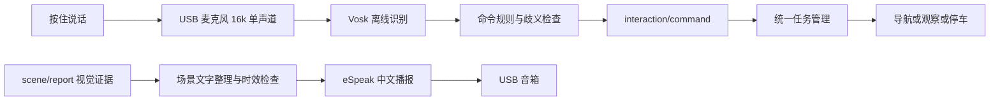

# 离线中文语音：怎么说、怎么听、怎样接入整车

你已经选定 USB 麦克风和 USB 音箱。它们接在 RDK X5 的 USB 接口上；这个版本的语音功能在 X5 CPU 上运行，不使用云端接口，也不会上传录音。

本程序不是通用聊天助手。它把少量明确的中文命令转成整车任务，再把视觉系统已有的证据组织成中文播报。导航能否执行，仍由任务管理检查地图、定位、底盘状态决定；语音识别成功不等于小车已经到达。

## 1. 三部分各做什么

| 部分 | 方案 | 工作 |
|---|---|---|
| 语音转文字 ASR | Vosk small-cn-0.22，离线中文，约 42 MB 下载 | 麦克风 PCM → 中文文本与识别置信度 |
| 命令理解 | 明确的有限指令规则 | 中文文本 → 去楼栋、观察、报告、停车、继续 |
| 文字转语音 TTS | eSpeak NG 中文 `cmn` | 场景报告 → USB 音箱播放；音色偏机械，适合先打通流程 |

Vosk 小模型在 Linux ARM64 有运行包，可以装在 X5；实际 X5 CPU 占用、麦克风噪声下准确率还需要上板测量。运行库固定为 `vosk==0.3.45`。模型官方列表声明 Apache 2.0，来源与 SHA-256 放在 `vendor/voice_source/model_manifest.json`。eSpeak NG 由系统包管理器安装，其 GPL 许可保留在来源目录；没有把它冒充自研模型。



## 2. 能说哪些命令

| 示例 | 输出动作 |
|---|---|
| 小车去三号楼观察 / 去3号楼 / 前往十三号楼巡检 | `navigate`，楼栋 ID 按 `config/buildings.json` 查找 |
| 观察当前场景 / 开始观察 | `inspect` |
| 报告当前场景 / 播报场景 | `report` |
| 停车 / 停止 / 紧急停车 | `stop`，整车路由优先处理 |
| 继续行驶 / 继续导航 | `resume`，仍须任务管理准许 |

一至十三以及“两”支持归一化。“不要去三号楼”“去三号楼还是四号楼”“能去三号楼吗”“先去3号楼再去4号楼”会被拒绝，避免把否定、提问、多目的地误当作一个行驶任务。当前不支持闲聊、任意复杂长句和自由多步任务。语音本身可能听错，所以初次调试必须抬起车轮或关闭真实 UART 输出，检查实际发布的楼栋再联调行驶。

## 3. ROS 2 接口

节点名称 `voice`；主程序 `rescue_vision.voice_node:main`。

| 方向 | 话题 | 类型 | 内容 |
|---|---|---|---|
| 订阅 | `/audio/listen` | `std_msgs/Bool` | `true` 开始录制；`false` 结束；最长默认 8 秒 |
| 订阅 | `/voice/text` | `std_msgs/String` | 纯文字调试，经过同一个命令解析器 |
| 发布 | `/voice/transcript` | `std_msgs/String` | 实际 ASR 文字、置信度、采集时刻 |
| 发布 | `/interaction/command` | `std_msgs/String` | 统一 JSON 命令，交任务管理处理 |
| 发布 | `/voice/status` | `std_msgs/String` | 加载模型、监听、拒绝命令、播报预览、设备错误 |
| 订阅 | `/scene/report` | `std_msgs/String` | 原视觉场景报告，用于自动播报和主动查询 |
| 订阅 | `/speech/say` | `std_msgs/String` | 文字或 JSON 播报请求 |

统一命令示例：

```json
{"command_id":"每次唯一UUID","source":"voice","action":"navigate","building_id":"C","text":"小车去三号楼观察","issued_at":1791500000.0,"capture_stamp":1791500000.0,"ttl_s":5.0,"purpose":"inspect"}
```

`issued_at` 使用 UNIX 时间，`ttl_s` 是接收方必须检查的有效期；录音结束后生成。`source` 为 `voice` 或文字调试的 `text`。语音节点不直接发送 UART，不直接控制水泵或舵机。网络端与 RDK 的系统时钟也需要同步。

`/speech/say` 可发送：

```json
{"action":"report_scene"}
```

此时读取最新场景并检查是否过期。也可发 `{"text":"已收到观察任务"}` 或直接发中文字符串。主动报告绕过去重；自动场景播报默认同内容 12 秒内去重，队列最多 3 条，过期排队内容不播放。

## 4. 第一步：先不开音频设备，验证节点

在 X5 终端进入 `ros2_ws`，完成主 README 的安装和 `colcon build` 后：

```bash
source /opt/ros/humble/setup.bash
source .venv/bin/activate
source install/setup.bash
ros2 run rescue_vision voice --ros-args -p workspace_dir:="$PWD" -p voice_config:="$PWD/config/voice.json"
```

另开终端，进入同一个 `ros2_ws`，同样加载 ROS 环境、激活 `.venv` 并加载 `install/setup.bash`，再执行：

```bash
ros2 topic echo /interaction/command
```

第三个终端测试：

```bash
ros2 topic pub --once /voice/text std_msgs/msg/String "{data: '小车去三号楼观察'}"
ros2 topic pub --once /voice/text std_msgs/msg/String "{data: '报告当前场景'}"
```

这一步仅证明命令和 ROS 通信，不能证明麦克风识别，也不能证明已经到楼栋。默认 `microphone_enabled=false`、`tts_enabled=false`，不会打开麦克风或音箱。播报内容会以 `speech_preview` 显示在 `/voice/status`。

## 5. 第二步：在 X5 安装离线音频依赖

```bash
sudo apt update
sudo apt install -y espeak-ng libportaudio2 alsa-utils python3-pip
source .venv/bin/activate
python -m pip install vosk==0.3.45 sounddevice==0.5.5
```

上面的 `.venv` 应先由主 README 的 `tools/setup_board.sh` 创建，并通过该环境的 `python -m colcon` 构建。不要把依赖装到另一个 Python 解释器。模型已放进交付目录，无需再次下载；只有丢失模型时在同一虚拟环境运行：

```bash
python tools/prepare_voice.py
```

查看 USB 设备：

```bash
arecord -l
aplay -l
python -c 'import sounddevice as sd; print(sd.query_devices())'
```

先单独录一段测试音频并播放，确认系统能用麦克风和音箱，设备名用你机器的真实枚举替换：

```bash
arecord -D plughw:CARD=你的USB麦克风名称,DEV=0 -f S16_LE -r 16000 -c 1 -d 5 /tmp/mic-test.wav
aplay -D plughw:CARD=你的USB音箱名称,DEV=0 /tmp/mic-test.wav
espeak-ng -v cmn -s 145 '当前看到两名人物，一名消防员。'
```

这些命令会实际使用音频设备，请在板端主动执行。我们没有通过电脑自带摄像头麦克风替代你的 GS130W 或 USB 设备完成实测。

## 6. 第三步：配置并启动语音

编辑 `config/voice.json`：

- `microphone_enabled` 改为 `true`。
- `tts_enabled` 改为 `true`。
- `audio_input_device` 填 `sounddevice.query_devices()` 中 USB 麦克风的编号或可唯一匹配的名称；`null` 表示默认设备。设备编号可能随插拔改变。
- `tts_audio_device` 可填 eSpeak 所使用的音频设备名；`null` 使用系统默认输出。优先先把 USB 音箱设为默认输出，再测试播报。
- `sample_rate_hz` 使用 `16000`。若麦克风不支持，需要 ALSA 的 `plug` 转换或外置重采样，程序会明确报错，不会伪造录音。

重启语音节点使配置生效。先监控 `/voice/status`。开始说话前：

```bash
ros2 topic pub --once /audio/listen std_msgs/msg/Bool '{data: true}'
```

看到 `listening` 后，说“小车去三号楼观察”。说完：

```bash
ros2 topic pub --once /audio/listen std_msgs/msg/Bool '{data: false}'
```

第一次需加载模型。模型未安装、设备打不开、录音溢出、低置信度会在状态话题说明；不会生成成功命令。ASR 在后台线程运行，不阻塞 ROS 接收。播报期间拒绝开启识别，并丢弃与播报重叠的录音，避免小车听到自己的声音而触发任务。

如果想报告当前场景：

```bash
ros2 topic pub --once /speech/say std_msgs/msg/String '{data: "{\"action\":\"report_scene\"}"}'
```

## 7. 播报遵守视觉证据

确认同一帧、同一楼面且未过期时，可以说：“当前观察3号楼春晖楼。画面中发现火焰图案。当前看到2名普通人物，1名消防员。受困人数无法仅凭图像确认。”

楼栋归属未确认时，只报告“当前楼栋归属尚未确认”和本帧看到的人物，不能把它们强行归属某栋楼。超过默认 3 秒的画面说“信息已过期”。没检出火焰只说“本次画面未检出火焰”，不宣称不存在火灾。由于目前检测对象是打印壁纸，所以使用“火焰图案”措辞；真实火灾分类与水泵授权是另一个经过验证后才能启用的环节。

## 8. 本次验证的范围

`tests/test_voice.py` 覆盖楼号转换、否定与多目标拒绝、停车优先、ASR 置信度、场景时效、人物归属和去重。真实音频链测试由 `reports/voice_audio_smoke.py` 将中文文本合成为实际 PCM 文件，再调用 Vosk 解码并进入同一个命令解析器；完整原音频、转录和成功/失败记录保存在 `reports/voice_audio_validation.json` 和 `reports/voice_audio/`。

本次结果：7 项逻辑测试通过，5 项实际 ROS 2 话题检查通过。使用 Windows 自带的离线“微软慧慧”合成 6 段中文音频后，Vosk 实际解码 6/6 正确进入期望结果（5 条正向任务，1 条否定拒绝），详细转录在 `reports/voice_audio_huihui_validation.json`。这段合成仅用于测试，X5 不依赖 Windows 语音库。

eSpeak 机械音的另一组相同内容测试只有 1/6 达到预期（否定命令被拒绝，其余 5 条因识别不符合命令规则而拒绝），失败原始转录保留在 `reports/voice_audio_validation.json`。这说明不能把合成音频测试直接等同于真实人声准确率，也说明当前 eSpeak 播报音色仍有明显局限。语音系统不会把这些失败强行模糊匹配成行驶命令；后续可替换更自然的离线 TTS。

合成语音测试不是你的声音和 USB 麦克风测试。最终应在电机运行、风扇噪声、不同人声和距离下测“命令识别正确率/误触发率/延迟”，再调整置信度和麦克风位置。声音不清晰时，可以用上位机按钮或文字请求完成同一流程。
