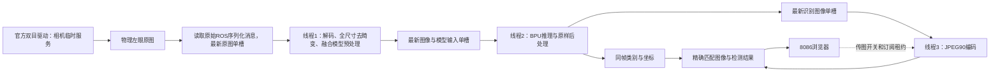

# 高清火焰预览与传图开关

2026-10-11追加：已按要求默认开启火焰、消防员、人物三类输出（`fire_only=false`）。下方两轮性能数字是在当时只输出火焰的配置下测量，不能作为新三类配置的持续帧率承诺。网页标题现在随实际启用类别变化，三类分别用橙、绿、蓝色框显示。

更新：2026-10-10，第二轮同画质优化。本文件是当前高清预览入口的使用说明。旧文档中的640×544画面、10fps上限、8000网页运行状态及早期速度记录属于历史配置。上一轮证据位于`logs/vision_pipeline_20261010/`，本轮证据位于`logs/vision_pipeline_v2_20261010/`；不同负载下的旧数字不能直接当作本轮对照结果。下方保留上一轮实测块，其数字不代表第二轮最终结果。

## 现在看哪里

电脑打开[YOLO单画面](http://192.168.127.10:8086/)。页面只保留识别画面、画面传输开关及简短速度状态。出现火焰框表示当前模型检出了火焰候选；没有框也可能是正常运行但本帧没有检出。已经运行时不要重复启动程序。

当前直接订阅**物理左眼对应的`/image_right_raw`**。这是按先前遮住物理左镜头、官方拼接图下半幅变暗确认的映射。以后更换排线、通道或安装方向，应重新确认，不能只看话题名字猜左右。



每个交接位置只保留最新一张图，算法忙时跳过尚未处理的旧帧，避免越看越滞后。三个线程可重叠工作，图像、时间戳、序号和镜头参数始终一起传递；网页只显示与检测结果匹配的那一帧。

这一入口只做视觉观察，不启动底盘、云台、水泵或UART动作控制，也不意味着双目深度或喷水瞄准已经验收。

## 这次提速保留了什么

| 环节 | 当前要求 |
|---|---|
| 相机参考图和网页图 | 1280×1088，保持全尺寸去畸变，不是把低分辨率图片放大 |
| JPEG编码 | 质量90 |
| YOLO输入 | 原有640×640，保持按比例缩放和补边方式 |
| 模型 | 同一个`wallpaper_yolo11n_3class_bayese_640_nv12.bin`，没有重新训练或更换权重 |
| 颜色和预处理 | 保持原BT.601 FULL计算和UV采样规则 |
| 筛选与后处理 | 保持置信度、NMS及三类判别规则；当前默认输出火焰、消防员、人物 |
| 检测坐标 | 还原到1280×1088矫正图的坐标系，与网页画面一致 |

模型仍计算火焰、消防员、人物三类分数。“只输出火焰”不是把最高分为人物的目标改叫火焰，也不代表BPU计算量自动降到三分之一。网页清晰度提高也不等于模型变成1280输入。

单眼去畸变使用`config/gs130w_intrinsics_20261010.json`中的镜头参数。当前仍是`rectified=false`、`depth_valid=false`：单眼画面矫正不等于左右极线校正、米制测距或喷嘴外参标定。

## 第二轮继续优化了哪些环节

这轮继续保持1280×1088参考图、JPEG90、原模型和原识别阈值，把耗时集中在有必要做的运算上。

| 环节 | 实现方式 | 保持一致的内容 |
|---|---|---|
| ROS图像接收 | 通过`raw=True`接收`Image`的CDR序列化字节，直接建立只读像素视图，省去通用消息转换中的额外复制 | 原像素、编码、尺寸、行跨度、时间戳和`frame_id` |
| 全尺寸去畸变 | 用原生C++执行固定映射表的双线性插值，并行处理图像行 | 同一相机标定、同一OpenCV固定映射表、插值取整及黑色边界规则 |
| 模型输入准备 | 把精确2倍缩小、上下各48行灰色补边和NV12转换合并，不再生成两张中间BGR图 | 640×640输入的每个字节、灰色114、原BT.601 FULL算式及左上角UV采样 |
| 候选框预筛选 | 先排除不能通过置信度要求的候选，再为留下的候选做完整解码 | 原有三类分数的获胜语义、类别筛选、NMS及坐标还原 |
| 空闲线程等待 | OpenMP线程无任务时等待，减少自旋占用CPU | 不改变模型输入或输出，只影响调度 |

原始ROS订阅仍通过DDS接收序列化消息，不是整条通信链路“零复制”。解析器检查长度、格式和几何约束，像素视图持有原字节的所有权，避免工作线程拿到已经失效的内存。未支持的消息格式明确报错，可用下文参数切回标准消息订阅。

融合预处理只在1280×1088 BGR输入、原生并行库可用时启用；其他尺寸保留通用缩放补边流程。它只替换模型输入的准备步骤，全尺寸网页图仍来自去畸变后的1280×1088图像。

当前默认配置如下。这里的线程数属于不同阶段，不是把它们相加就能得到设备核心数或帧率。

| 参数或环境变量 | 默认值 | 用途 |
|---|---|---|
| `raw_subscription` | `true` | 读取原始CDR图像消息 |
| `fused_preprocess` | `true` | 启用满足条件时的融合模型预处理 |
| `preprocess_threads` | `2` | 融合预处理的OpenMP线程数 |
| `remap_backend` | `native_or_opencv` | 优先原生去畸变；原生库文件缺失时使用OpenCV并记录原因 |
| `remap_threads` | `8` | 原生去畸变的OpenMP线程数 |
| `OMP_WAIT_POLICY` | `PASSIVE` | 让空闲OpenMP工作线程等待 |
| `GOMP_SPINCOUNT` | `0` | 减少GNU OpenMP空闲自旋 |

`tools/run_mipi_vision.sh`会设置后两项环境变量的默认值；若调用者已经设置它们，脚本保留调用者的值。原生去畸变库已存在但ABI、加载或计算发生错误时，会明确报错，不在运行中掩盖错误。

## 怎样判断没有牺牲识别效果

同画质的检查分为两层：先给新旧实现**同一张输入**，逐字节核对图像和模型输入；再观察整条实时管道的实际完成速率。输入不同的两次现场画面，不能直接拿来证明算法数值一致。

- 融合预处理在X5的OpenCV4.11环境下完成32组对照，每组614400字节全部一致。样本包含全尺寸场景图、随机图、颜色极值、渐变、棋盘格、全部1021种2×2像素求和以及非连续内存；也覆盖2线程和4线程版本。证据在`logs/fused_preprocess_20261010/`。
- 原生去畸变原型完成34次与OpenCV4.11的像素一致性对照，记录在`logs/vision_pipeline_v2_20261010/remap_prototype.json`。这验证的是指定输入、映射表和边界条件下的实现一致性。
- 上一轮同BIN的模型输出、同帧JPEG对照仍保留在下方实测块。本轮ROS图像接收、融合预处理、去畸变和候选筛选的进一步测试记录，以本轮日志目录为准。

单独测量去畸变或预处理，能够说明该阶段是否变快；它不是整机吞吐率。整机还受相机送帧、BPU、JPEG、网络、线程竞争和温度影响。只有同时运行相机、视觉与网页，持续采样`processing_fps`、编码速率和延迟，才能给出实际提升幅度。并行管道也不能把各阶段节省的毫秒简单相加后换算成帧率。

## 为什么要更换BPU调用方式

原有`pyeasy_dnn`在等待BPU任务时会占住Python解释器锁，使其他Python线程难以同时推进。上一轮已经增加`native_hbdnn`，本轮继续使用：通过C++调用同一套X5 `hbDNN`运行库，再由`ctypes.CDLL`调用C++接口。等待BPU时释放Python解释器锁，让去畸变、JPEG及ROS回调能够与BPU工作重叠。

这改变的是任务调度和调用方式，模型BIN及图像算法保持一致。验证包括相同输入下的模型输出/检测结果对照，以及流水线图像和JPEG逐字节对照。完整验收与性能数字应以本轮日志为准，不把“代码使用了多线程”当作一定达到30fps的证据。

默认启动选择`backend:=native_or_pyeasy`：原生运行库可用时使用`native_hbdnn`；只有共享库不可用时退回`pyeasy`并记录原因。模型、ABI、推理错误会明确报错，不在运行中偷偷切换。诊断中应检查实际运行的`inference_backend`；缺库回退时启动日志显示`Native runtime unavailable`。原生C++颜色预处理另有自己的后备路径，两者是不同优化。

## 传图开关控制什么

- **开启**：页面持续订阅时，编码并传输最新识别画面，显示同帧的YOLO框。
- **手动关闭**：停止这条网页管道的JPEG编码及图片传输，YOLO识别和相机采集继续运行。
- **重新开启**：显示新的处理结果，不补播关闭期间的旧帧。
- **关闭网页**：没有页面继续订阅时，约5秒后图片订阅租约到期，停止无用的编码与传输。

开关是所有8086页面共享的状态，一个页面关闭会影响其他页面。若只是关闭一个标签页，另一个页面仍在订阅，传图会继续。停传图后留在网页上的画面明确属于历史帧，不能用于判断当前场景。

**8000官方双目预览是另一条管道，本轮测量时没有运行。** 8086开关只管理自己的图片流；以后若手动打开8000原图预览，它会额外消耗编码、消息和网络资源，8086开关不会替它关闭。

## 帧率和延迟怎样看

| 诊断值 | 含义 |
|---|---|
| `capture_fps` | 本观察节点实际收到参考眼原图的速率 |
| `geometry_fps` | 解码、去畸变和模型输入准备的完成速率 |
| `processing_fps` | YOLO处理并发布检测结果的实际速率 |
| `preview_encode_fps` | 完成JPEG编码和发布的速率；停传图后应归零 |
| 网页画面更新率 | 浏览器真正更新新画面的速率，可能低于算法速率 |
| `stage_ms.total` | 解码、去畸变、推理等主动处理耗时之和，不包括中间排队，也不包括独立JPEG线程 |
| `queue_wait_ms` | 已准备图像等待推理的时间 |
| `processing_latency_ms` | 从开始解码到发布检测结果的经过时间，包含排队 |
| `image_age_s` | 拍摄到检测结果的年龄；需要正确系统时间 |
| `prepared_frames_skipped` | 推理跟不上时跳过的准备图像数；用于降低积压，不是图片质量降低 |
| `stage_errors` | 采集、几何、推理、预览各自的未恢复错误；一个阶段成功不会掩盖其他阶段的错误 |

并行执行时，不能用`1000 / stage_ms.total`推算整机帧率，也不能用单次BPU耗时倒数代替网页更新率。`process_fps`是速率上限，`opencv_threads`是线程数；两者需要整机对照选择，设置更大不保证更快。

<!-- FINAL_BENCHMARK_BEGIN -->
# 高清视觉性能优化实测（2026-10-10）

| 测量项 | 优化前 | 优化后 |
|---|---:|---:|
| 开传图：完整识别 | 12.01 fps | 19.19 fps |
| 开传图：同帧预览 | 12.02 fps | 19.46 fps |
| 预览图像年龄中位数 | 242 ms | 225 ms |
| 关传图：完整识别 | 本轮未测 | 22.00 fps |

默认参数：`process_fps=30`（上限）、`opencv_threads=8`、`pipeline_enabled=true`、`backend=native_or_pyeasy`，实测使用`native_hbdnn`。完整识别提升约60%，实际预览提升约62%。网页现场读数约19.8帧/秒。

相机及预览均1280×1088、JPEG90、同一640模型及原有去畸变/颜色/阈值/NMS。8组输入的48个模型输出头全部逐字节一致；隔离ROS测试验证图像和JPEG与串行参考逐字节一致。单次模型执行约29～30ms，性能收益来自并行调度，未宣称模型本身加速。

持续45秒开传图测量与20秒关传图测量已完成。关传图期间JPEG计数保持1496不变，检测序号由2022增长到2465，图片订阅数为0。已恢复开启传图。测量期间温度约59～63°C，未超频；当前场景和系统负载变化时帧率也会波动。

原始证据：`baseline_board.json`、`final_on.json`、`final_off.json`、`native_runtime_equivalence.json`、`pipeline_tests.txt`。时间长度用单调时钟记录，避免X5重启后日期回退影响测量。

<!-- FINAL_BENCHMARK_END -->

## 第二轮最终实测

本轮开始重新测量35秒；部署后完成75秒开传图与25秒关传图测试。下表为滚动帧率的采样中位数，详细原始记录见`logs/vision_pipeline_v2_20261010/results.md`和`summary.json`。

| 指标 | 本轮优化前 | 本轮优化后 |
|---|---:|---:|
| 开传图：检测速率 | 19.42 FPS | 23.11 FPS |
| 开传图：服务端同帧配对速率 | 19.56 FPS | 23.17 FPS |
| 预览图像年龄中位数 | 219 ms | 206 ms |
| 关传图：检测速率 | 本轮未测 | 27.55 FPS |

开传图检测提升约19%，最终采样范围21.68～25.42 FPS；关传图26.17～28.08 FPS。服务端配对速率与浏览器绘制速率不同，不能把瞬间峰值当持续帧率。关传图测试中JPEG计数一直为4080，检测序号4411→5095、图像订阅数0；结束后已恢复传图。

生产版去畸变、原有镜头处理、原生后端ROS管线的17项测试全部通过；此前融合预处理、raw CDR、候选筛选的18项测试也通过。相同输入的像素、模型输入与JPEG已做字节一致性对照，模型/阈值未改变。最终健康检查无阶段错误，温度约63°C、CPU频率1.5GHz，未超频。测试中曾出现参考眼停流，重启相机进程后恢复，故障区间已排除；原因尚未确定。

当前相机和处理上限为30 FPS，关传图已接近这一配置上限；这不是已经证明软件达到绝对极限。再提高仍需针对消息传递、内存访问和编码做实测，不能靠降低模型输入或画质冒充本要求下的优化。

## 当前怎样管理程序

以下命令都在**X5的SSH远程终端**执行。当前相机由临时服务`rescue-mipi-camera`管理，视觉算法由`rescue-mipi-vision`管理，8086网页由`rescue-yolo-preview`管理。三者均未设置开机自启。不要在旧终端重复启动，也不要把已经失活的旧`rescue-detection-preview`服务当成当前网页服务。

先看状态：

```bash
systemctl status rescue-mipi-camera rescue-mipi-vision rescue-yolo-preview --no-pager
journalctl -u rescue-mipi-camera -n 60 --no-pager
journalctl -u rescue-mipi-vision -n 60 --no-pager
pgrep -af '[d]etection_preview.py|[m]ipi_cam'
```

普通非root用户操作服务时在`systemctl`前加`sudo`。临时服务已设置ROS日志目录环境变量`ROS_LOG_DIR`，ROS日志与systemd日志是两种记录；排错可先看上面的`journalctl`。

需要换成手动前台算法时，先停掉服务：

```bash
cd /root/rescue/ros2_ws
systemctl stop rescue-mipi-vision
bash tools/run_mipi_vision.sh
```

默认复用现有相机、输出火焰/消防员/人物、启用去畸变和并行流水线。脚本有互斥锁；提示已有算法运行时，应先停止对应服务或终端，不绕过锁。

需要对照时，每次先按Ctrl+C结束上一套前台算法，再选择一条：

```bash
# 同模型，强制回到原pyeasy调用，便于做运行库对照
bash tools/run_mipi_vision.sh backend:=pyeasy

# 同像素处理，把几何和推理改回串行，便于做流水线对照
bash tools/run_mipi_vision.sh pipeline_enabled:=false

# 对照第二轮三个可配置优化：标准ROS订阅、OpenCV去畸变、分开的模型预处理
bash tools/run_mipi_vision.sh remap_backend:=opencv raw_subscription:=false fused_preprocess:=false

# 临时切回仅输出火焰；不加这个参数默认三类
bash tools/run_mipi_vision.sh fire_only:=true
```

上述三个参数只关闭对应的优化路径。候选预筛选、原生BPU调用和其他已存在的改进仍保留，**这不是恢复到旧版本程序**。需要彻底恢复旧代码时，应使用该轮保存的代码备份并重新构建。日常使用结束对照后，按Ctrl+C退出，再用不带覆盖参数的`bash tools/run_mipi_vision.sh`恢复默认配置。

通常只需网页开关停传图。若要改成前台运行网页，先 `systemctl stop rescue-yolo-preview`，确认退出后再启动：

```bash
cd /root/rescue/ros2_ws
bash tools/run_detection_preview.sh --bind 192.168.127.10
```

## X5重启后重新运行

临时服务不会自动恢复。下面给出重启后的手动前台启动方式，不要求自己创建systemd服务。先核对系统日期；X5未保持时间时，使用电脑上的`board_setup/sync_rdkx5_time.ps1`在**启动相机前**校时，避免运行中突然改时破坏图像时间戳。先确认没有同名服务或进程已经运行，再在三个X5远程终端依次运行：

```bash
# 终端1：相机采集，已经运行则跳过
cd /root/rescue/ros2_ws
bash tools/run_mipi_camera.sh
```

```bash
# 终端2：视觉算法
cd /root/rescue/ros2_ws
bash tools/run_mipi_vision.sh
```

```bash
# 终端3：8086网页
cd /root/rescue/ros2_ws
bash tools/run_detection_preview.sh --bind 192.168.127.10
```

三个入口会使用相机所在ROS域0；`source`只是设置当前终端环境，实际采集和算法进程需要持续运行。仅打开浏览器不会代替采集节点。此流程不需要8000官方原图网页。

## 兼容旧StereoPair路径

正常使用保持`fast_mode=true`。若必须排查旧桥接链路，先结束当前算法与网页，然后分别启动：

```bash
cd /root/rescue/ros2_ws
bash tools/run_mipi_vision.sh fast_mode:=false
```

```bash
cd /root/rescue/ros2_ws
bash tools/run_detection_preview.sh --bind 192.168.127.10 --image-format stereo
```

旧路径输出640×544参考图，不属于本轮“保持1280×1088画质”的性能结果。不要同时运行两套视觉算法，也不要让旧网页格式等待新流水线消息。恢复时停止旧程序，再运行不带这些覆盖参数的默认入口。

## 代码与学习顺序

电脑目录：`D:\工程仿真\FPGA赛道_小车仿真\RDKX5_消防小车系统\ros2_ws`。板端目录：`/root/rescue/ros2_ws`。

| 顺序与文件 | 作用 |
|---|---|
| 1. `tools/run_mipi_vision.sh`、`src/rescue_vision/launch/mipi_vision.launch.py` | 设置环境、参数并启动节点 |
| 2. `src/rescue_vision/rescue_vision/fast_mipi_perception_node.py` | 采集、准备、推理、编码三个线程，及诊断/退出管理 |
| 3. `src/rescue_vision/rescue_vision/latest_slot.py` | 单槽交接，只留最新帧 |
| 4. `src/rescue_vision/rescue_vision/raw_image_cdr.py` | 校验原始ROS图像消息，建立只读像素视图 |
| 5. `src/rescue_vision/rescue_vision/lens_correction.py`、`native_remap.cpp`、`native_remap.py` | 缓存相机映射，并用原生或OpenCV路径执行全尺寸去畸变 |
| 6. `src/rescue_vision/rescue_vision/legacy_detector.py` | 模型输入准备、模型运行及候选解码筛选 |
| 7. `src/rescue_vision/rescue_vision/native_preprocess.cpp`、`native_preprocess.py` | 与旧计算保持字节一致的融合预处理和通用颜色预处理 |
| 8. `src/rescue_vision/rescue_vision/native_runtime.cpp`、`native_runtime.py` | 同BIN的hbDNN调用、内存管理及Python锁释放 |
| 9. `tools/detection_preview.py`、`web/detection-preview.html` | 同帧配对、传图开关、订阅租约、网页绘制 |
| 10. `tests/test_fused_preprocess.py`、`tests/test_fast_mipi_board.py`、`tests/test_native_runtime.py`等 | 预处理字节、图像/JPEG/模型一致性及线程行为验证 |

原生组件在板端通过`tools/build_native_preprocess.sh`、`tools/build_native_remap.sh`和`tools/build_native_runtime.sh`编译，分别生成`_native_preprocess.so`、`_native_remap.so`和`_native_runtime.so`，作为Python包的数据文件一起安装。更新源码后按`tools/build_board.sh`构建；仅修改源码而没有更新安装包，正在运行的ROS节点不会自动使用新实现。更新完还需要退出旧视觉进程，再按上面的方式启动。

预处理和去畸变的并行版本使用OpenMP。预处理编译保留`-ffp-contract=off`，不要为了速度擅自启用`-ffast-math`破坏数值一致性。共享库必须在X5的ARM64环境编译，不能把Windows电脑生成的二进制当成板端`.so`使用。

图像链路和模型输出一致性测试不等于实拍准确率验收。最终仍应拿打印地图火焰壁纸，在0.4～1.0米以及不同角度、明暗条件下统计漏检和误检。
