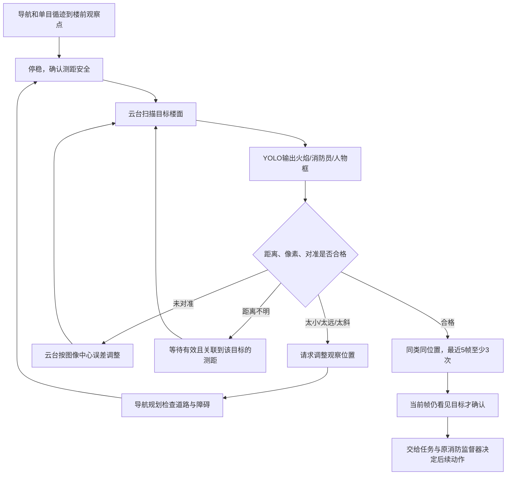

# 楼前主动观察与 YOLO 识别

用户最新指令为把新增96张消防员场景加入训练并开启新微调，见[本次V4训练说明](FIREFIGHTER_V4_TRAINING.md)与[当前训练状态](TRAINING_STATUS.md)。旧V8保存到第25轮。本文记录观察策略与冻结模型评估，历史评估页不代表新权重成绩；新增96张场景不再具有独立验证用途。

## 先看什么

1. [原验证集分距离/尺寸/角度/光照报告](reports/observation_v1/val/review.html)：实际预测结果和漏检示例。
2. [新独立楼前观察验收](reports/observation_v1/benchmark/review.html)：40张新图，明确展示类别覆盖缺口。
3. [融合数据浏览器](dataset_observation_v3/review.html)：选择V8来源，查看新增消防员、人物双目样本与标注。
4. [V7 训练样本诊断](reports/observation_v1/train_v7/review.html)：只用于发现训练覆盖不足，不能当泛化成绩。
5. 上位机 `D:/Github_OpenCode_TreeBird/AckermannRescueSim/run_console.cmd` 的消防实验：观察条件、云台和确认状态。
6. [观察参数](config/observation_policy.json)：Python 真实 YOLO 推理的可调整门槛。
7. [消防员新视角预测回放](reports/observation_v1/firefighter_playback/review.html)：12张新图的现有模型预测；来源属于训练空间，只供直观诊断。

## 实际执行顺序



观察模块不直接驱动车辆。太远、太小或太斜时，只产生 `request_reposition`；更换观察点必须由导航、安全测距和碰撞检查批准。云台旋转改变朝向，不改变镜头焦距。当前上位机给出实际像素消防闭环；普通人物按钮仍是外部测试事件，不能声称已运行 YOLO 人员识别。

## 默认规则与含义

| 项目 | 默认值 | 说明 |
|---|---|---|
| 主要观察距离 | 0.4–1.0 m | 摄像头到当前目标的空间距离，不是车中心到最近障碍 |
| 高度/短边 | ≥40 px / ≥12 px | 按实际输入细节计算；16 px可作为更严格试验 |
| 检测置信度 | 0.25 | 需要在验证集调节，不等于确定正确 |
| 多帧规则 | 5帧中至少3帧 | 同类、框IoU≥0.3、当前帧也必须合格 |
| 对准误差 | ≤4° | 使用镜头水平视场与图像中心误差计算 |
| 相机移动 | 累计变化>2°重置证据 | 不把不同观察方向的目标合并投票 |
| 帧间隔 | >0.5 s清空证据 | 重复帧/过期帧不能增加确认票数 |
| 车辆停稳 | 速度绝对值≤0.02 m/s | 还需到达观察点、测距安全状态有效 |
| 斜视角 | 已知时≤55° | 未知角度不凭检测框编造，由像素与测距等条件约束 |

当前目标漏检时立即撤销 `ready`，即使历史票数仍有3票。目标类别改变、框不再匹配或相机改变朝向时重新累计。`ready`只表示当前观察条件达标，不能直接等同于水泵开关。

## 使用真实训练模型

在本目录 PowerShell 使用现有 `.venv`。下列参考程序真实加载三类 YOLO11n `.pt` 权重，输出检测图、逐帧决策与记录，不训练、不驱动执行器。

```powershell
# 单张图片：可检查模型检测，不可能凭一张图片完成多帧确认。
& ./.venv/Scripts/python.exe runtime/run_observation.py --source "你的图片.png" --output runs/observation_image_01

# 相机设备编号按实际连接修改，显示检测结果；按 Q 或 Esc退出。
& ./.venv/Scripts/python.exe runtime/run_observation.py --source 0 --display --output runs/observation_camera_01

# 如果GS130W驱动输出左右拼接图，选择SBS，默认只对左目做检测。
& ./.venv/Scripts/python.exe runtime/run_observation.py --source 0 --layout sbs --target-class fire --display --output runs/observation_stereo_01
```

也可以双击 `07_observation_camera.cmd` 打开设备0。该编号不保证是GS130W，笔记本摄像头也可能占用0；未连接的相机需要先由系统驱动成功打开。`--target-class person`、`firefighter`、`fire`可以按任务切换当前确认类别，`all`按火焰、消防员、人物优先。

`--roi x,y,width,height`从单眼原始图裁取楼面，检测框映射回原图。质量门槛使用 `min(原像素, 缩放后像素)`，不把插值放大当作新增细节。只有原相机保留更多有效像素时，裁剪才有可能改善小目标。

### 车身与云台反馈

通过 `--telemetry telemetry.json` 读取外部控制程序提供的最新状态。该文件应使用临时文件+原子替换更新，时间戳为Unix秒，与本机时钟同步。超过0.25秒、来自未来或显式帧号不匹配的状态不会用于确认。

推理结束后再次检查原图和对应遥测：从本机读到图像到决策超过0.25秒，或该帧关联遥测过期，均清空观察证据并保持等待，不拿推理前的检查结果继续执行。这里的图像时间戳是主机读取时间；真实设备还应接入驱动的曝光时间与帧序号，处理驱动缓存，不能把重复缓存图误当新帧。

```json
{
  "timestamp_unix_s": 0,
  "pan_deg": 0,
  "tilt_deg": 12,
  "speed_mps": 0,
  "safety_clear": true,
  "at_observation_point": true,
  "ranges": [
    {
      "bbox_xyxy": [300, 210, 330, 270],
      "distance_m": 0.7,
      "source": "calibrated_sensor_projection",
      "obliquity_deg": 20
    }
  ]
}
```

以上只是字段示例，时间戳0会被判为过期；距离、框和安全状态必须来自实际测量/控制程序，不能照抄。一个测距读数只关联一个重叠目标框，禁止把车前最近障碍距离赋给画面中所有人。没有有效反馈时仍显示YOLO结果，但保持 `hold`。

### 可选的真实双目标定测距

`--stereo-calibration calibration.json`启用OpenCV矫正与SGBM，必须同时选择`--layout sbs --eye left`。文件包含：`calibrated: true`、`translation_unit: "m"`、`image_size: [单眼宽, 单眼高]`、`K_left`/`K_right`（3×3）、`D_left`/`D_right`、左右相机间`R`（3×3）与`T`（以米为单位3元素）。

这些参数必须由实际镜头和分辨率标定取得。仿真暂定的72°视场、80mm基线不能冒充实测标定文件。适配器检查左右顺序、基线单位和分辨率，只支持水平双目；使用目标内部ROI的有效视差中位数，像素不足、有效比例太低或深度离散太大时返回未知距离。没有标定时不自动估距。

### RDK X5 接入边界

`runtime/run_observation.py`是PyTorch/OpenCV参考推理程序，已在本机CPU运行真实权重验证；它不是已经量化的RDK X5 BPU `.bin`。板端推理后，将解码得到的类别、置信度、原图坐标框和有效关联深度转换成 `runtime.observation.Detection`，即可复用观察策略。摄像头驱动、BPU导出/量化、云台反馈和执行器通信仍需在实物上接线、标定和验证。

## 评估和新增数据怎样使用

整体检测保留所有目标标签。距离/角度分箱使用每个实例的墙面几何和真实单眼光心；无法解析的标为unknown，不用同图主目标距离代替。固定置信度0.25、IoU0.5的分箱召回，与Ultralytics自动F1工作点的P/R不同，不直接拼成同一张成绩表。

旧验证集的主要观察且像素足够子集只覆盖普通人物：88个目标检出88个，不代表88次独立实物试验。近距离漏检的4个消防员框处于约87°极斜视角、短边仅2像素，4个火焰框也约86°、短边2–3像素，不能把这些漏检解释成清楚近景也识别失败。

专门楼前观察验收集独立保存在`source_data/observation_benchmark_v1`，来自原验证空间分区，不加入训练。穷举现有安全车位后，原验证区域无法提供满足0.4–1m、高40px/短边12px、角度≤55°的消防员位置；因此明确报告消防员条件覆盖不足，需要后续独立实拍或另设计验收场地，不能用训练区图冒充独立验证。

这份验收实际包含10个新位姿、两种照明与左右眼，共40张图。预定火焰目标检出8/8、人物32/32；火焰只有2个位姿，人物8个位姿，不能把相关图像当作40次独立实物试验。全部合格近景目标（含附带人物）的检出为火焰8/8、人物74/74。详细结果见[评估说明](reports/observation_v1/README.md)。

另外用现有模型对12张V8消防员图进行了小批回放，先按元数据选6个位姿、两种照明，覆盖正面/斜视、有/无遮挡。预定消防员12/12检出，全画面消防员20/22；它来自训练空间，模型见过相关壁纸与场景，因此只作为观察效果示例，绝不加入独立验证分母。见[逐例回放说明](reports/observation_v1/firefighter_playback/回放说明.md)。

新增V8训练数据放在`source_data/v8_observation_focus`，融合入口为`dataset_observation_v3/data.yaml`。所有旧数据与验证/测试集保留；没有把很远目标框删除。新采集重点改善观察角度与目标尺寸，并加入暗光和有正确遮罩标注的遮挡；训练诊断中已清楚可见近景的失败数为0，所以不能把这批数据说成修复了已证实的清晰近景错误。

融合后共5,064张图、47,778个框，train/val/test分别为4,560/252/252张。V8新增96个位姿、192对双目（384张原图），加配对成像增强后为768张。消防员与人物各48个位姿，覆盖正面到55°斜视、正常/侧阴影/暖暗/冷暗照明；24个位姿额外加入真实渲染遮挡。所有可见标签保留，少数遮挡后低于40px的目标仍标注，运行时按门槛请求改善视角。[数据验收报告](dataset_observation_v3/OBSERVATION_DATA_REPORT.md)记录源图、mask、融合、冻结验证集及加载器检查。

上位机消防回归已经完成：在约0.5033m观察，目标高41px、短边35px，同目标5/5帧确认后执行模拟喷射，零碰撞；红绿灯流程回归也通过。它使用颜色规则与已知楼面几何，不能代替这里的真实YOLO精度评估。见`D:/Github_OpenCode_TreeBird/AckermannRescueSim/docs/楼前观察与多帧确认.md`。

由于训练集已变化，本次使用`dataset_observation_v3`从保存权重开始新微调任务，采用新优化器与新轮次；旧第34轮任务保持原样，未通过`resume`替换其数据。实际进度查看[当前训练状态](TRAINING_STATUS.md)。
