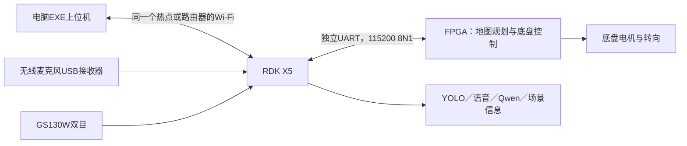

# 地图编号导航合并版与无线演示

当前统一工程：`D:\工程仿真\FPGA赛道_小车仿真\ov5640\ov5640.gprj`。

本轮把导入的 `ov5640_1` 编号点导航合入原有串口／拓展任务工程，并完成相邻 X5 工程的九点语音、ROS 2 与 EXE 上位机接入及离线联动检查。新增的点位表和九个编号保留，原来的定距运动、路口任务、侧视寻火、独立交通任务、地图路径上传及停车保护继续使用。自主导航仍采用 IMU＋编码器定位与地图路径跟踪，不恢复已删除的导航斑马线限速。X5 本轮修改尚未部署到实板，离线检查不代表真实小车已执行成功。

**2026-10-31 当前源码已完成 Gowin 综合、布局布线和位流生成，现有 SDC 约束下的 Setup/Hold 违规均为 0。** 本轮文件为 `impl/pnr/ov5640.fs`，核验记录见 [本轮构建审计](../diagnostics/gowin_verified_20261031/build_audit.json)。仍未烧录 FPGA、未部署本轮 X5 更新、未进行实车验收；历史具名位流不能替代本轮文件。

## 1. 地图编号是什么

| 编号 | 位置 | FPGA地图显示坐标（cm） |
|---|---|---|
| 1 | 外圈左上弯道中点 | 35,285 |
| 2 | 外圈左直道中点 | 25,159 |
| 3 | 外圈左下弯道中点 | 35,35 |
| 4 | 外圈下直道中点 | 177,25 |
| 5 | 外圈右下弯道中点 | 317,35 |
| 6 | 外圈右直道中点 | 327,159 |
| 7 | 外圈右上弯道中点 | 317,285 |
| 8 | 外圈上直道中点 | 177,293 |
| 9 | S弯中间曲率转换位置 | 177,173 |

这些是道路上的**导航点号**，不自动等于“1号楼～9号楼”。统一定义在 `src/navigation/nav_destinations.vh`。显示坐标采用地图下方为Y零点；规划器内部是2cm网格，具体网格坐标见 `docs/host_destinations_20261031.json`。不要把Blender旧场景的米制坐标直接发到这套地图。


## 2. 一次编号点导航怎样完成

1. 小车摆在地图已知编号点，并核对车头方向与现有 IMU 航向初始化。在 EXE 上位机选择真实起点，明确确认“实际位置和朝向”；语音不能代替这次实物确认。FPGA选择“通信模式”。
2. 通过上位机点选目标，或说“去3号点”“从1号点到3号点”。语音里声明的起点必须与已确认位置一致。唯一 `extension_task` 串口桥先用 `20 SET_START` 上传确认的起点，再发送 `08 SELECT_POINT`，传入点号和任务号。FPGA设置终点、清除旧途经点并规划；已画禁行区继续生效。**选点不动车。**
3. 发送 `09 POINT_STATUS` 轮询；只有状态2才表示路径和执行轮廓准备好。状态3是失败／取消，不能继续启动。
4. 发送 `03 START`，D0=1。FPGA从地图页切换到导航运行页，并开始执行规划路线。
5. 上位端每500ms发送心跳，读取状态和完成事件。约2秒失联会停车；恢复通信不会自行起步。
6. `05 STOP` 在规划中取消规划，在运行中暂停；`07 RESUME` 只恢复尚未结束的导航。X5核对本轮任务号、已运行状态、`F0`完成事件和随后新鲜的实测停车状态，才发布“已到达”；收到ACK不等于已到达。失败、取消、过期和重复到达不会触发新一轮观察或扫描。

到达后的任务分工：

| 当前任务 | 到达策略 | X5行为 |
|---|---|---|
| 拓展1 | `manual` | 进入 `inspect` 观察，保持YOLO识别人、消防员和火焰；等待用户语音询问，再进行场景分析／对话，不自动调用Qwen分析。 |
| 拓展2 | `scan` | 在停车、安装确认和云台实测反馈均就绪后扫描找火；发现可选火焰后停止扫描、等待用户选择火焰编号。选定并完成瞄准后，仍须单独下达喷水指令。 |

`scan`不是原来的`auto`自动喷水模式。缺少执行器或反馈时，上位机显示等待就绪，不能当作已经完成扫描；扫描途中失去停车或云台反馈会停止扫描。YOLO在非交通任务中持续开启，不因到达而重启。红绿灯识别仅在明确选择的交通任务中启用。

若只使用FPGA触摸屏或独立调试客户端，可以仍在“自主导航 → 路径设置”手动设置起点，再走`08/09/03`流程；这不替代EXE发起导航时要求的实际起点确认。

扩展任务正在行驶、制动或等待红绿灯时，`03/08`会返回忙，避免两个任务抢控制权。原`10～17`扩展任务与`20～23`地图上传指令保留。斑马线检测默认关闭，仅明确开启的交通任务使用；普通编号地图导航不因斑马线自动限速。

## 3. 无线连接可以怎样演示



电脑无需网线；FPGA和X5之间仍是车上的短UART线。Wi-Fi仅承担上位机交互、图像和数据回传，不替代底盘闭环。X5有板载Wi-Fi；麦克风的USB接收器继续插X5，麦克风无线链路与Wi-Fi不是同一条链路。

1. 手机开启热点，电脑和X5连接同一个热点；热点要允许设备之间互访。也可都连同一台路由器。已安装的本地模型不要求互联网或手机流量。
2. X5首次配置热点，在其交互终端执行：

   ```bash
   bash /root/rescue/ros2_ws/tools/connect_phone_hotspot.sh --connect
   ```

   按提示输入热点名称／密码。查询当前IP：

   ```bash
   bash /root/rescue/ros2_ws/tools/connect_phone_hotspot.sh --status
   ```

3. 电脑运行 `D:\工程仿真\FPGA赛道_小车仿真\RDKX5_消防小车系统\desktop\dist\消防救援演示台.exe`。
4. 在连接设置中填 `http://<X5当前无线IP>:8090`。EXE原来保存的是有线地址`192.168.127.10:8090`，切换无线时要更新。直接浏览器访问同一地址也可检查连通性；YOLO独立预览为8086端口。
5. 确认上位机显示实时状态，再拔掉电脑网线验证。若看不到，先检查两台设备是否同网段、热点是否隔离客户端、X5服务是否运行。

2026-10-30已做过同接`Xiaomi 14`热点且拔掉网线的测试，上位机状态接口5次成功。2026-10-31本轮电脑在另一个Wi-Fi上，旧热点X5地址未连通，因此本轮未重新完成无线实机验收；不要固定使用历史IP。

## 4. FPGA串口不能和两台云台电机共用

| X5接口 | 已有用途 |
|---|---|
| `/dev/ttyS1`，物理8 TX／10 RX | 电机1：水平轴 |
| `/dev/ttyS3`，物理3 TX／5 RX | 电机2：俯仰轴 |

官方X5引脚表确认另有 **UART2** 可复用，优先使用空闲的这组针脚，无需额外USB转TTL：

| X5物理针脚 | UART方向 | 接FPGA |
|---|---|---|
| **15** | UART2_TXD（发送） | **E13／host_rx** |
| **22** | UART2_RXD（接收） | **E14／host_tx** |
| **14** | GND | GND |

15和22是40针排针的**物理针号**，不是GPIO编号。两脚普通GPIO标号分别是GPIO22、GPIO25，启用UART2后不能同时给其它GPIO设备使用；现有8/10、3/5两台电机串口不受影响。UART采用3.3V TTL，不要连接RS-232或5V逻辑信号。

X5上执行 `sudo srpi-config`，进入 `3 Interface Options → I3 Peripheral bus config`，将 `uart2` 设置为 `okay`，保存并重启。重启会中断当前板端服务；本轮没有执行该设置或重启。官方设备树`serial2 = &uart2`确认设备名为`/dev/ttyS2`。重启后还需核查设备树serial2状态、pinmux及实际握手，再将该端口交给FPGA桥接节点独占；仅看到/dev/ttyS2文件不足以证明复用已生效。

官方参考：[RDK 40Pin定义](https://github.com/D-Robotics/rdk_doc/blob/main/docs/03_Basic_Application/01_40pin_user_sample/40pin_define.md)、[X5官方排针图](https://rdk-doc.oss-cn-beijing.aliyuncs.com/doc/img/03_Basic_Application/01_40pin_user_sample/image/40pin_user_sample/image-20241217-202319.png)。[官方设备树UART2别名](https://github.com/D-Robotics/x5-kernel/blob/main/arch/arm64/boot/dts/hobot/x5.dtsi)。断电后接线。如果15/22已被其它硬件占用，再选择独立3.3V USB转TTL，使用`/dev/serial/by-id/...`的稳定设备名。

当前X5 `extension_uart.json` 中FPGA端口为空且`enabled:false`。无线连上上位机，不代表FPGA串口已接好。要看到真实导航进度，需要独立串口配置、合并版FPGA位流和实际底盘反馈均就绪。

## 5. 本轮提供的程序入口与上位机边界

- `tools/host_serial_client.py`：保留原协议收发，增加 `select_point / point_status / wait_point_ready / start_navigation / navigate_to`。
- X5 `ros2_ws/src/rescue_vision/rescue_vision/extension_task_node.py`：现有唯一串口桥，统一处理编号点导航和其它拓展控制；`numbered_navigation.py`负责起点确认、`20/08/09/03`流程及到达证据校验。
- X5 `mission_node.py`：根据本轮到达消息进入观察或只找火扫描；`auto_fire.py`的`scan`分支不选择目标、不授权喷水。
- `tools/diguapi_navigation.py`：保留的独立Python协议调试适配器。正式EXE／语音流程复用`extension_task`，不能同时运行这个适配器占用同一串口。
- `src/vehicle/vehicle_host_link.v`：现有串口协议与新增编号点命令共存。
- `src/navigation/nav_control.v`：选点、规划、开始／取消和页面切换。
- `src/navigation/nav_destinations.vh`：九个目的地的唯一硬件定义。
- `docs/host_protocol_20261027.md`：基础串口；本页与 `extension_revision_20261029.md` 的新增规则优先于历史说明。

在烧录合并版、设置起点和通信模式后，可以用独立USB串口做下面的**真实运动命令**测试：

```powershell
# 仅选点、等待/查询，不启动
python tools/host_serial_client.py --port COM8 select-point 3 --task 1
python tools/host_serial_client.py --port COM8 point-status
# 状态为2后开始，并持续维持心跳
python tools/host_serial_client.py --port COM8 start-nav --task 1 --watch
# 或一条命令完成选点、等待规划、启动
python tools/host_serial_client.py --port COM8 navigate-to 3 --task 1 --watch
```

COM8仅示例，必须替换为实际端口。Linux可使用已启用并核验的UART2设备，或独立USB串口设备路径；**不要使用已分配给电机的ttyS1／ttyS3**。一个串口同一时间只能由一个客户端维护，不能同时运行此脚本和X5的FPGA ROS桥接节点。

本地EXE／上位机已接入九点选择、实际起点确认、语音目标、导航进度与到达后的任务状态，ROS代码与离线联动检查也已完成。正式运行只由`extension_task`独占FPGA串口，不另起第二个`fpga_navigation`串口进程。请明确说“3号点”；“3号楼”仍属于楼栋语义，未配置对应关系时不能自动当成3号导航点。本轮尚未向X5部署这些改动，也未用真实底盘和云台验收，因此上位机代码就绪不等于实机功能已完成验收。

## 6. 工程清理与验证记录

`ov5640_1.gprj`和有同名基线文件的导入`*_1`副本已移出工作工程，统一使用`ov5640.gprj`；必要的新文件保留。工程外备份位于 `D:\工程仿真\_项目清理备份\ov5640_merge_20261031`，含修改前源文件快照、移出文件和清单。它不参与构建。

编号点合并阶段记录在 `diagnostics/map_uart_merge_20261031/`。随后加入地图遥测的当前源码又通过 6 项 RTL 回归、Gowin 综合／布局布线、ROM 与独立路径读端口检查以及现有约束下的时序核验，记录在 `diagnostics/gowin_verified_20261031/`。编译通过不等于实车导航成功。

**合并阶段历史结果：20/20项RTL检查通过（9个编号点＋11项回归），2组Python客户端测试通过。** 当时109个文件哈希与仿真、独立审计记录一致；71项工程引用、字体ROM和重复文件清理检查通过。阶段汇总见[合并验证记录](../diagnostics/map_uart_merge_20261031/validation.json)，逐项结果见[RTL测试矩阵](../diagnostics/numbered_merge_20261031/validation.json)。当前含地图遥测的源码以[本轮构建输入与审计](../diagnostics/gowin_verified_20261031/build_audit.json)为准。

验证范围说明：

- 编号点测试真实运行UART收发、触摸起点设置、规划器、路径速度轮廓、显式启动与地图页切换，并检查驱动使能、暂停和恢复。测试中的编码器保持零；完成事件通过注入运动结束状态检验，**不是小车沿九条路线闭环行驶到达的验证**。
- 原功能回归覆盖拓展指令、地图上传、斑马线开关、正常导航不受斑马线限速、设置页和车辆I/O。
- 顶层结构检查使用4个加密IP的黑盒以及诊断副本中的IMU声明顺序兼容处理，仅验证连接与未加密RTL的展开，不验证DDR、时钟、FIFO行为或时序。
- 地图编号与中心线的量化偏差核验不代表实车定位精度。实际停车误差仍受起点摆放、编码器、IMU漂移、轮胎与转向参数影响。

X5本轮本地验证记录见相邻工程`RDKX5_消防小车系统/reports/numbered_tasks_20261031/`；其中扫描／到达检查使用假ROS传输和离线状态，不连接真实电机或泵。

后续硬件使用顺序：核对本轮 `impl/pnr/ov5640.fs` 与审计中的 SHA256 → 烧录该位流 → 断电连接UART2 → 启用复用并重启X5 → 部署更新后的X5节点与上位机 → 只启动唯一串口桥 → 先握手／查询状态 → 在HMI确认实际起点和方向 → 再进行留有空间的低速导航及到达任务验收。本次尚未执行以上硬件步骤；以后修改源码需重新运行 `./build.ps1` 并核验。
